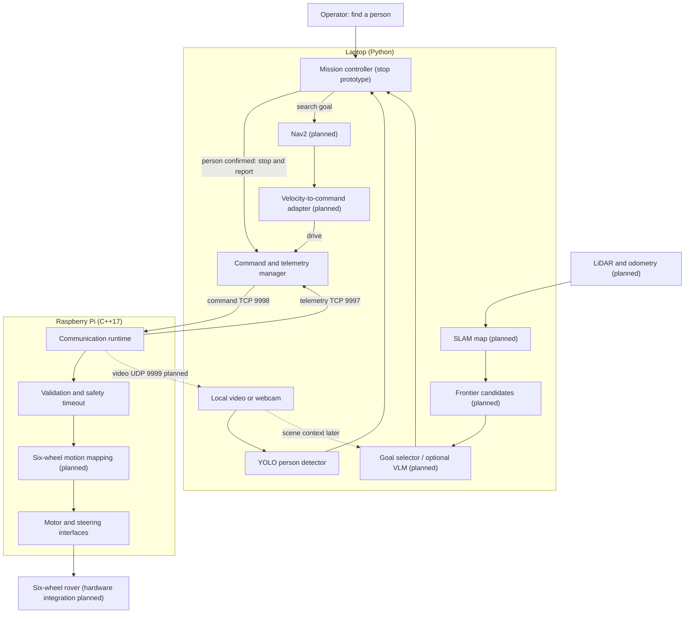

# Autonomous Rescue Rover

SKKU Software Capstone Design Project.

A 3D-printed, six-wheel rover project for indoor disaster-site exploration. The laptop handles perception and mission decisions; the Raspberry Pi handles robot communication and low-level control.

## System Architecture



The current person-search demo reads a local video or webcam, confirms a person candidate, and requests a stop. Navigation cancellation is simulated. The TCP command/telemetry runtime, Pi-side command timeout, and `MockMotor` are implemented. Camera transport, SLAM/frontier selection, Nav2, velocity conversion, six-wheel motion mapping, sensors, steering, and real motor control are planned. Sending a stop command does not itself verify physical stopping.

## Repository Structure

```text
autonomous-rescue-rover/
|-- laptop/                         # Laptop-side Python software
|   |-- communication/             # Protocol, TCP listeners, operator console
|   |-- perception/                # Person detector
|   |-- mission/                   # Person confirmation and stop decision
|   `-- demo/                      # Person-search video demo
|
|-- robot/                          # Raspberry Pi C++ runtime
|   |-- CMakeLists.txt
|   |-- include/
|   |   |-- communication/
|   |   |-- motor/
|   |   `-- state/
|   |-- src/
|   |   |-- communication/
|   |   |-- motor/
|   |   |-- state/
|   |   `-- main.cpp
|   `-- tests/                     # Pi-side runtime tests
|
|-- tests/                          # Laptop protocol and mission tests
|-- docs/                           # Build and demo instructions
|
`-- shared/
    `-- protocol/
        `-- PROTOCOL.md            # Laptop <-> Pi communication contract
```

## Communication

| Channel | Transport | Port | Direction |
| --- | --- | ---: | --- |
| Command | TCP | 9998 | Laptop server -> Raspberry Pi client |
| Telemetry | TCP | 9997 | Raspberry Pi client -> Laptop server |
| Video | UDP | 9999 | Raspberry Pi -> Laptop (planned) |

The command and telemetry protocol uses a 4-byte big-endian length prefix followed by a UTF-8 JSON payload. The full message contract is documented in [shared/protocol/PROTOCOL.md](shared/protocol/PROTOCOL.md).

Build, run, and handoff steps are in [docs/COMMUNICATION_DEMO.md](docs/COMMUNICATION_DEMO.md).

## Person Search Demo

Install `laptop/perception/requirements.txt`, then run `python -m laptop.demo.person_search --source VIDEO.mp4 --show` from the repository root. It writes an annotated video, discovery image, and JSON report under `output/`. The preview and saved video are capped at 720px high by default; use `--render-height 480` for a smaller window or `--render-height 0` for the original size. Detection still uses the full-resolution frame. The default stop is simulated. `--send-to-pi` sends a stop command through the existing TCP connection; Nav2 remains simulated.

## Raspberry Pi Access

Connect the Pi and your laptop to the same network, then run `ssh rover@rover-pi.local`. The Pi username is `rover`; the password is shared privately. If `.local` does not resolve, use `ssh rover@<PI_IP>` with the Pi's current IP address.

## Technology

- Raspberry Pi runtime: C++17 and CMake
- Laptop-side tooling: Python
- Protocol JSON support: nlohmann/json
