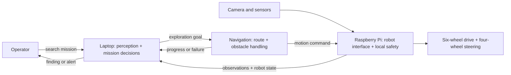

# Autonomous Rescue Rover

SKKU Software Capstone Design Project · Fall 2026

We are building a 3D-printed, six-wheel rover for indoor disaster exploration. The goal is to explore an unfamiliar area, identify a person or other relevant situation, move or stop safely, and report what it found to an operator.

## System Architecture



AI selects what to inspect next; the navigation layer computes how to get there. The robot applies commands and stops locally on communication failure. We plan to use ROS 2 for mapping and navigation, but the exact packages and execution device are still being decided. The diagram describes the target system, not a completed end-to-end implementation.

## Repository Structure

```text
autonomous-rescue-rover/
├── laptop/            # Laptop-side Python software
├── robot/             # Raspberry Pi C++17 software
└── shared/protocol/   # Laptop ↔ Pi message contract
```

## Communication

The laptop and Pi communicate over Wi-Fi. Protocol v1 defines TCP command and telemetry channels using length-prefixed JSON; see [PROTOCOL.md](shared/protocol/PROTOCOL.md). Video transport, mapping, autonomous navigation, and real motor control are later integration steps.

The current command and telemetry demo is documented in [COMMUNICATION_DEMO.md](docs/COMMUNICATION_DEMO.md).

## Raspberry Pi Access

Connect the Pi and laptop to the same network, then use `ssh rover@rover-pi.local` (or the Pi's current IP address). The password is shared privately.
