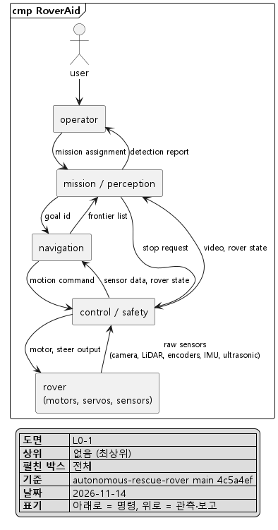

# RoverAid 시스템 아키텍처 — 검토용

작성 2026-11-14 · 강연우 · 기준 main `4c5a4ef`, `jh/live-person-stop` `791f82b`

로버가 해야 하는 일(기능)로 블록을 나누고, 블록 안의 각 부분에 실행 기기(`laptop` · `robot` · `pico`)를 표시했다. 개발 기준이라 **기능 도면만** 그린다.

## 도면 체계

| 레이어 | 내용 | 박스 이름 |
|---|---|---|
| **L0** | 시스템 최상위: 기능 블록 5개와 그 사이의 흐름 | 블록 이름 |
| **L1** | 블록 하나의 내부 (L0 박스 하나를 펼침) | 파일 · 클래스 이름 (아직 없으면 `<<planned>>`) |
| **L2** | 세부 동작 | **함수 이름** |

- 도면 번호 `L<레이어>-<번호>`. 오른쪽 아래 title block에 상위 도면 · 펼친 박스 · 기준 커밋.
- 하위 도면은 상위 박스 이름만 참조하고 (L1에서 점선 박스 = 이웃 L0 블록), 같은 정보는 한 도면에만 둔다. 자주 바뀌는 것(파일 · 함수 · 주기)은 가장 낮은 레이어에만.
- 박스 이름과 코드가 다르면 코드를 기준으로 도면을 고친다. L2는 구현하면서 추가.
- PlantUML 소스, VS Code `jebbs.plantuml` 확장으로 미리보기(Alt+D). 렌더링한 그림은 [`png/`](png/) (소스를 고치면 다시 렌더링해서 같이 커밋).

| 도면 | 내용 |
|---|---|
| [L0-1_system](L0-1_system.puml) | operator → mission / perception → navigation → control / safety → rover |
| [L1-1_operator](L1-1_operator.puml) | 임무 할당 · 결과 검토, 시험용 수동 조작 |
| [L1-2_mission_perception](L1-2_mission_perception.puml) | 사람 관측, 멈출지 · 어디로 갈지 결정 |
| [L1-3_navigation](L1-3_navigation.puml) | 상태 추정, mapping, planning, 경로 추종 |
| [L1-4_control_safety](L1-4_control_safety.puml) | Command Gate, 역기구학, Hardware Interface, Realtime Controller |

## 1. L0 블록 사이의 흐름

| 관계 | 아래로 (명령) | 위로 (관측 · 보고) |
|---|---|---|
| operator ↔ mission / perception | 임무 할당 | 발견 결과 보고 |
| mission / perception ↔ navigation | 목표 frontier id | frontier 후보 목록 (id) |
| mission / perception → control / safety | stop 요청 (navigation을 거치지 않음) | 영상, 로버 상태 |
| navigation ↔ control / safety | 움직임 명령 (v, ω) | 센서 데이터, 로버 상태 |
| control / safety ↔ rover | 모터 · 조향 출력 | 센서 원본 (카메라, LiDAR, 엔코더, IMU, 초음파) |

## 2. 블록별 (L1)

**operator** — 임무를 주고 결과를 검토한다. 운전은 직접 하지 않고 시스템이 한다. 지금 있는 수동 조작 코드(`laptop/demo/live_person_stop.py`, `laptop/communication/control_console.py`)는 시험용.

**mission / perception**
- perception: 영상에서 사람이 있는가와 확률을 관측 (`PersonDetector`).
- mission: 관측을 보고 멈출지, 어디로 갈지 정한다 (`MissionController`). 현재 구현: 연속 3프레임 사람 → 후보, 목표 취소 + 정지.
- 만들 것: navigation이 SLAM 지도에서 뽑은 frontier 후보에 id를 붙여 올리면, LLM이 추가 관측까지 보고 하나를 골라 그 id를 목표로 내린다. 목록에 없는 id는 검증에서 거른다.

**navigation**
- state estimation: 엔코더 + IMU + optical flow를 EKF로 합쳐 pose (`robot`).
- mapping: LiDAR scan + pose로 지도 (slam_toolbox, `laptop`).
- planning: 지도에서 frontier 후보 추출, 목표가 정해지면 costmap 위 A* (`laptop`).
- path tracking: 경로 + pose로 Pure Pursuit → 움직임 명령 (v, ω) (`robot`).

**control / safety**
- Command Gate: 위에서 온 명령을 검증 · 적용. 명령이 끊기면 정지, 로버 상태 보고 (`robot`, 현재 `robot/` C++ 런타임).
- kinematics: (v, ω) → 좌우 속도 + 바퀴 4개 조향각. 역기구학은 ROS 관례대로 여기서 (`robot`).
- Hardware Interface (`robot`): PicoBridge(명령 → 시리얼 → Pico, Pico 센서 데이터를 위로), Sensor Drivers(LiDAR, IMU, 카메라를 읽어 위로).
- Realtime Controller (`pico`, `pico/main.py`): 모터 PWM, 서보, 엔코더 카운트, 소프트 리미트, 슬루 제한, 링크 끊기면 중립 복귀. 프로토콜은 [HARDWARE_INTERFACE.md](../HARDWARE_INTERFACE.md) (PR #5).

## 3. 실행 기기 배치

| 기기 | 부분 | 이유 |
|---|---|---|
| `laptop` | operator, mission / perception, mapping, planning | 계산이 크다 (Pi 4 2GB, 여유 약 1.4GB, swap 없음) |
| `robot` (Pi) | state estimation, path tracking, Command Gate, kinematics, Hardware Interface | 가볍고, Wi-Fi가 끊겨도 위치 추적과 정지 판단이 로버 안에서 계속돼야 함 |
| `pico` | Realtime Controller | ms 단위 제어와 마지막 보호 |

원칙
1. `laptop` → `robot` 경계는 **경로(waypoints)와 stop 요청만** 넘는다. 속도 명령은 Wi-Fi를 타지 않는다.
2. 보호는 두 겹: Command Gate(명령 끊김 · stop 요청)와 Realtime Controller(출력 제한 · 링크 타임아웃).
3. Pico 시리얼은 PicoBridge 하나만 연다.

동작 규칙
- `laptop` ↔ `robot` 끊김: Command Gate가 정지, state estimation과 기록은 계속. 재연결되면 현재 pose를 넘기고 `laptop`이 SLAM으로 보정한 뒤 재계획.
- `robot` ↔ `pico` 끊김: Realtime Controller가 속도 0 · 조향 중립.

## 4. 이미 정한 것

- SLAM은 `laptop` (Pi 메모리 부족).
- Pico 펌웨어와 Pi ↔ Pico 프로토콜 (PR #5).
- 기구 실측: 트레드 중간 62.5 cm / 앞 · 뒤 56.5 cm, 휠베이스 53 cm (앞–중간 28, 중간–뒤 25).

## 5. 검토 요청

1. 블록 · 부분 구성에 빠지거나 불필요한 것.
2. 실행 기기 배치에서 바꿀 것.
3. 통신 두절 시: 즉시 정지 후 대기(초안) vs 마지막 연결 지점으로 복귀.
4. 사람 후보 확인 단계(접근 후 재탐지) 포함 여부.
5. 조향: 앞 · 뒤 반대로 꺾는 대칭 4WS 기본안.
