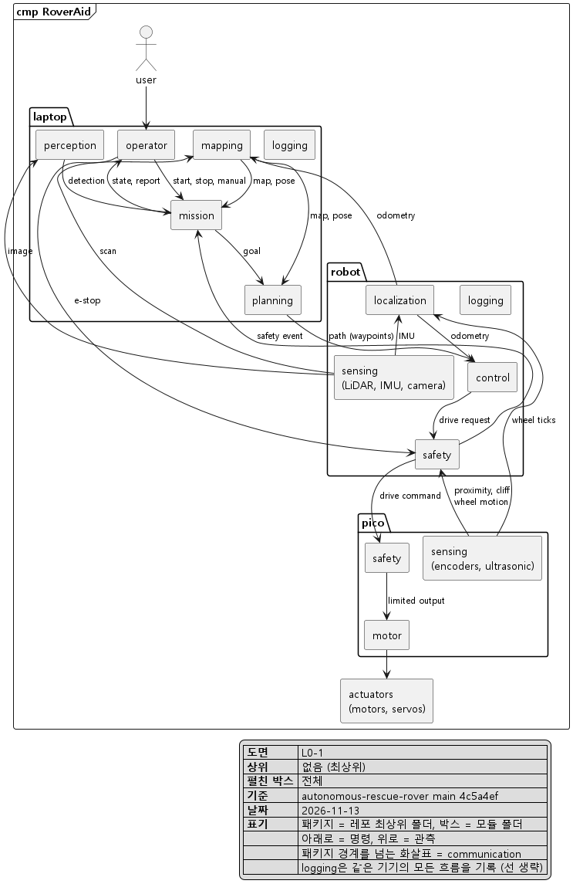

# RoverAid 시스템 아키텍처 (기능 기준) — 검토용

작성 2026-11-13 · 강연우 · 기준 main `4c5a4ef`

로버가 **해야 하는 일(기능)** 에서 출발해 구조를 정하고, 각 기능을 어느 기기에 둘지는 기능의 요구 조건으로 정했다. 구현 방법(ROS 2 사용 범위, 메시지 형식)은 이 문서에서 정하지 않고 하위 도면·문서로 내린다.

## 도면 체계

| 레이어 | 내용 | 박스 이름 |
|---|---|---|
| **L0** | 시스템 최상위 구조: 기기와 모듈, 그 사이의 흐름 | 기기 = 레포 최상위 폴더 (`laptop`, `robot`, `pico`), 모듈 = 모듈 폴더 이름 |
| **L1** | 모듈 하나의 내부 구조 (L0 박스 하나를 펼침) | 파일 · 클래스 이름 |
| **L2** | 세부 동작 | **함수 이름** |

- 도면 번호는 `L<레이어>-<번호>` (예: `L1-3`). title block(오른쪽 아래)에 상위 도면과 펼친 박스를 적는다.
- 하위 도면은 상위 박스 이름만 참조하고, 같은 정보는 한 도면에만 둔다. 자주 바뀌는 것(파일 · 함수 · 주기)은 가장 낮은 레이어에만 적는다.
- 박스 이름과 코드 이름이 다르면 코드를 기준으로 도면을 고친다.
- L1 · L2는 각 모듈을 만들면서 추가한다.

## L0 도면

[L0-1_functions.puml](L0-1_functions.puml) (cmp): 기기(`laptop` · `robot` · `pico`)별로 묶은 모듈과 그 사이의 흐름. 위에서 아래로 명령, 아래에서 위로 관측이 흐른다. 개발 기준으로 **기능 도면만** 그리고, 시간 흐름(미션 순서, 통신 두절)은 아래 4절 동작 규칙에 문장으로 둔다.

PlantUML 소스. VS Code `jebbs.plantuml` 확장으로 미리보기 (Alt+D). 렌더링한 그림은 [`png/`](png/)에 있다 (소스를 고치면 다시 렌더링해서 같이 커밋).

## 1. 미션

운영자가 수색 시작 → 지도 없는 실내를 탐색 → 사람 후보 탐지 → 접근해 확인 → 정지 → 지도 위치와 사진을 보고.

## 2. 모듈

| 모듈 | 하는 일 | 레포에 이미 있는 것 |
|---|---|---|
| `sensing` | 라이다 거리, 바퀴 회전(엔코더), 자세(IMU), 근접 · 바닥 · 천장(초음파), 영상, 소리 | — |
| `localization` | 엔코더 + IMU로 odometry (통신이 끊겨도 위치 유지) | `ros2/rover_localization` |
| `mapping` | SLAM: 지도 생성, 위치 보정 | — |
| `perception` | 사람 탐지(영상), **탐지 위치를 지도 좌표로 변환**(카메라 방향 + 라이다 거리) | `laptop/perception` |
| `mission` | 다음 갈 곳 선택(frontier + LLM), 임무 상태 전환: 탐색 → 접근 · 확인 → 정지 → 보고 → 종료 | `laptop/mission` |
| `planning` | 지도 위 경로 계획 (장애물 회피 포함) | — |
| `control` | 경로 추종, 역기구학 (좌우 속도 + 바퀴 4개 조향각) | — |
| `motor` | PWM 출력 | `robot/motor` (Pi GPIO용, Pico로 이전) |
| `safety` | 통신 두절, 근접 충돌, 낭떠러지(아래 초음파), 천장 간섭(위 초음파), 전복 위험(IMU 기울기), 바퀴 걸림(엔코더 정지), 배터리 저전압, 비상정지 | `laptop/mission/manual_safety`, `robot/state` 일부 |
| `operator` | 지도 · 영상 · 탐지 · 상태 표시, 시작 · 정지 · 수동 개입 | `laptop/demo` GUI |
| `logging` | 주행 전체 기록, 평가 지표: 첫 발견까지 시간 · 이동거리 · 탐색 면적 (frontier 단독 vs frontier + LLM) | — |
| `communication` | 기기 사이 경계면 (L0-1에서 패키지 경계를 넘는 화살표) | `laptop/communication`, `robot/communication` |

`safety`는 흐름의 한 단계가 아니라 **모든 구동 출력 앞의 차단기**다. 상위 판단과 관계없이 `safety`가 막으면 멈춘다.

## 3. 배치 기준과 결과

모듈마다 세 가지를 본다: ① 반응 시간 ② 통신이 끊겨도 돌아야 하는가 ③ 계산량 (Pi 4 2GB 기준).

| 모듈 | 반응 시간 | 끊겨도 동작 | 계산량 | 배치 |
|---|---|---|---|---|
| `safety` (출력 제한 · 링크 타임아웃) | ms | 필수 | 작음 | `pico` |
| `sensing` (엔코더 · 초음파), `motor` | ms | 필수 | 작음 | `pico` |
| `safety` (근접 · 낭떠러지 · 기울기 · 걸림 · 통신 두절) | 수십 ms | 필수 | 작음 | `robot` |
| `localization` | 수십 ms | 필수 (끊긴 동안 위치 유지) | 작음 | `robot` |
| `control` | 수십~수백 ms | 끊기면 안전 정지 | 작음 | `robot` |
| `sensing` (라이다 · IMU · 카메라) | — | — | 작음 | `robot` (장치가 Pi에 연결) |
| `mapping` | 1초 내외 | 없어도 정지 가능 | 큼 | `laptop` |
| `planning` | 1초 내외 | 아니요 | 중간 | `laptop` (지도를 씀) |
| `perception` | 1초 내외 | 아니요 | 큼 | `laptop` |
| `mission` | 수 초 | 아니요 | 큼 | `laptop` |
| `operator`, `logging` | 느슨함 | 아니요 | 중간 | `laptop` (raw `logging`은 `robot`도) |

## 4. 원칙

1. **통신이 끊기면 `robot`은 스스로 안전하게 멈춰 있고, 재연결되면 끊긴 동안의 위치를 이어서 넘긴다.** 그래서 `localization` · `control` · `safety`가 `robot`에 있다.
2. **`laptop`은 경로(웨이포인트)를 내려보내고, 속도 명령을 실시간으로 보내지 않는다.** Wi-Fi 지연 · 끊김이 주행 품질에 직접 들어오지 않게 한다.
3. **`safety`는 두 겹.** `robot`(상황 판단 정지)과 `pico`(출력 제한 · 링크 타임아웃). `robot`이 멈춰도 `pico`가 멈춘다.
4. **`pico` 시리얼은 `robot`의 프로세스 하나만 연다.** 다른 프로그램은 그 프로세스를 거친다.

동작 규칙

- 수색 미션: `operator` 시작 → `mission`이 frontier 중 목표 선택(LLM) → `planning` 경로 → `control` 추종. `safety` 정지가 나면 `mission`에 안전 이벤트, 재계획. `perception`이 사람 후보를 지도 좌표로 넘기면 접근 → 근접 재탐지로 확인 → 확인되면 정지 · 보고(지도 위치, 사진, 시각), 오탐지면 탐색 계속.
- `laptop` ↔ `robot` 끊김: `robot`은 즉시 정지하고 `pico`에는 속도 0 명령을 계속 보낸다. `localization`과 raw `logging`은 계속. 재연결되면 현재 odometry와 끊긴 동안의 안전 이벤트를 넘기고, `laptop`이 `mapping`으로 위치를 보정한 뒤 재계획.
- `robot` ↔ `pico` 끊김: `pico`가 링크 타임아웃으로 속도 0 · 조향 중립.

## 5. 경계면 (`communication`: 무엇이 오가는가만, 형식은 하위 문서)

| 경계 | 위로 (관측) | 아래로 (명령) | 형식 |
|---|---|---|---|
| `laptop` ↔ `robot` (Wi-Fi) | 센서 요약(스캔 · IMU · 초음파), odometry, 상태, 안전 이벤트, 영상 | 경로(웨이포인트), 모드(자동/수동/정지), 수동 조종, 정지 | 미정 (하위 문서) |
| `robot` ↔ `pico` (USB 시리얼) | 엔코더, 초음파, flags | 좌우 속도 + 바퀴 4개 조향각, E-stop | 확정: [HARDWARE_INTERFACE.md](../HARDWARE_INTERFACE.md) (PR #5) |

## 6. 이미 정한 것

- `mapping` · `perception` · `mission`(LLM)은 `laptop` (Pi 4 2GB로는 메모리 · 발열 여유 없음).
- `pico` 펌웨어와 `robot` ↔ `pico` 프로토콜 (PR #5).
- 기구 실측: 트레드 중간 62.5 cm / 앞 · 뒤 56.5 cm, 휠베이스 53 cm (앞–중간 28, 중간–뒤 25).

## 7. 검토 요청 — 이 항목에 의견 주세요

1. 모듈 목록에 빠지거나 불필요한 것.
2. 배치 표에서 바꿔야 할 것.
3. 통신 두절 시 동작: **즉시 정지 후 대기**(4절 초안) vs 마지막 연결 지점으로 복귀.
4. 사람 후보 **확인 단계**(접근 후 재탐지) 포함 여부. 빼면 첫 탐지에서 바로 정지.
5. 조향 방식: 앞 · 뒤 반대로 꺾는 대칭 4WS(회전 반경 최소) 기본안.

검토가 끝나면 이 문서를 확정본으로 바꾸고, 경계면 형식과 각 모듈의 L1 · L2 도면을 이어서 만든다.
