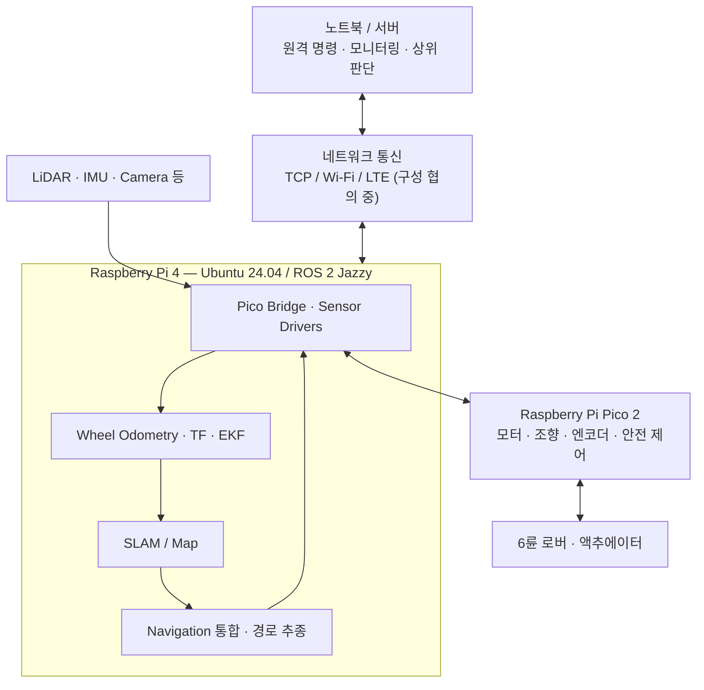

# RoverAid — ROS 2-Based Disaster Exploration Rover

## 📌 프로젝트 개요
RoverAid는 **6륜 구동·4륜 조향 로버**를 기반으로, 재난 환경에서 사람·장애물·주변 상황을 인식하고 반자율적으로 탐색·이동·보고하는 시스템을 개발하는 캡스톤 프로젝트다.

- 3D 프린팅 기반 저비용 로버 플랫폼
- Raspberry Pi 4와 Raspberry Pi Pico 2를 이용한 상위 연산·하위 실시간 제어 분리
- ROS 2 기반 센서 인터페이스, 위치 추정, 지도 작성 및 자율주행 통합
- 서버/노트북과의 통신을 통한 원격 모니터링 및 사람 중심의 임무 감독

> **진행 상태 (2026-10-31)**: ROS 2 개발환경과 모의 엔코더 데이터의 발행·수신·기록·재생을 검증했다. 실제 센서, Pico, 모터 및 서버 통합은 아직 검증 전이다.

---

## 🎯 목표
- 실제 로버에서 센서 데이터 수집부터 주행 제어까지 이어지는 소프트웨어 파이프라인 구축
- Wheel Odometry, IMU, LiDAR를 활용한 위치 추정 및 환경 지도 작성
- 장애물과 탐색 목표를 고려한 반자율 주행 구현
- 원격 명령·상태 보고와 로봇 자체 안전 정지 기능을 분리하여 운영
- 제한된 Raspberry Pi 자원에서 각 기능의 통합 가능성과 성능 검증

---

## 🧠 핵심 기술
- **ROS 2 Jazzy**: 노드·토픽 기반 시스템 통합
- **Robot Localization**: Wheel Odometry, TF, EKF 센서 융합
- **SLAM**: `slam_toolbox` 기반 2D 지도 생성 (예정)
- **Navigation**: 목표 탐색·경로 계획·경로 추종 (팀 공동 통합, 예정)
- **Embedded Control**: Raspberry Pi Pico 2 기반 모터·조향·안전 제어
- **Communication**: Pi ↔ Pico 직렬 통신 및 Pi ↔ 서버 네트워크 통신
- **Perception / Mission**: 카메라·환경 센싱 및 상위 판단 모듈 (팀 공동 개발, 예정)
- **Validation**: 모의 노드, `ros2 bag`, 재현 가능한 테스트

---

## 🧩 시스템 구조

아래는 **목표 아키텍처**이며, 일부 인터페이스 및 실행 위치는 팀 협의와 실물 테스트에 따라 변경될 수 있다.



**설계 원칙**
- 시간에 민감한 모터 제어 및 안전 정지는 Pico 측에서 독립적으로 처리한다.
- Pi는 센서 데이터 수집, 상태 추정, 지도 및 경로 관련 기능을 통합한다.
- 원격 통신 장애가 생겨도 안전 정지 기능이 유지되도록 설계한다.
- AI/LLM 기반 판단을 모터의 실시간 제어 루프에 직접 넣지 않는다.

---

## 🛠️ 개발 환경 및 도구

| 구분 | 환경 / 도구 | 용도 |
|---|---|---|
| 개발 PC | Windows 11 + WSL2 Ubuntu 24.04 | 주 개발환경 |
| 로봇 컴퓨터 | Raspberry Pi 4 Model B (2GB RAM), Ubuntu Server 24.04 ARM64 | 로봇 측 ROS 2 실행 |
| ROS | ROS 2 Jazzy (`ros-base` on Pi) | 노드 통신·패키지 관리 |
| 언어 | Python 3, C/C++ | ROS 2 노드, 임베디드·통신 |
| 개발 | VS Code, Codex, Git/GitHub | 구현·검토·버전 관리 |
| 빌드·시험 | `colcon`, `tmux`, `ros2 bag` | 빌드, 원격 작업, 데이터 기록·재생 |
| 예정 | `robot_localization`, `slam_toolbox`, `tf2`, URDF | 상태 추정·지도·좌표계 |

> Raspberry Pi의 RAM이 약 2GB이므로 고부하 기능은 실행 성능을 측정하고, 필요하면 노트북/서버로 분리한다.

---

## 👥 팀원 역할

| 담당 | 주요 범위 | 협업 인터페이스 |
|---|---|---|
| **A — 하드웨어 / Pico** | 기구·배선, Pico 펌웨어, 엔코더·모터·조향·안전 제어 | Pico ↔ Pi 시리얼 프로토콜 및 테스트 데이터 제공 |
| **B — Pi / ROS 2** | 드라이버·브리지, Wheel Odometry, TF, EKF, SLAM, Navigation 통합·튜닝 | 센서·상태 토픽과 로봇 측 데이터·명령 연결 |
| **C — 상위 SW / 서버** | 탐색·경로 관련 알고리즘, 에이전트, 서버·모니터링, 네트워크 통신 | B와 ROS 2 토픽·좌표계·네트워크 메시지 형식 협의 |
| **팀 공통** | 시스템 아키텍처, 통합 시험, 성능 검증, 시연 | 모듈 간 인터페이스 및 안전 기준 합의 |

*세부 담당 범위는 `sw_layers_assignment.md`를 참고하며, 확정된 팀의 최신 합의를 우선한다. 해당 파일을 수정하기 전에는 반드시 사용자에게 변경 내용을 먼저 알린다.*

---

## 📂 폴더 구조

현재 사용 중인 ROS 2 작업공간을 기준으로 정리했으며, 아래의 일부 폴더와 패키지는 **향후 생성 예정**이다.

```text
rover_aid/
├── README.md
├── AGENTS.md                    # Codex 작업 원칙
├── fulltext.md                  # 외부 LLM 전달용 프로젝트 스냅샷
├── sw_layers_assignment.md      # 역할·계층 설계 참고 문서
├── config/                     # 실물 시험 도구 설정
│   └── demo_drive.toml          # 데모 GPIO/초기 시험값, 실물 보정 필요
├── docs/                        # 작업 계획·변경 기록, 설계 문서는 예정
│   ├── roadmap.md               # B 담당 개발 로드맵
│   ├── interfaces.md            # 예정: 토픽·메시지·좌표계 계약
│   ├── hardware_specs.md        # 조향 서보/MDD10A 핀 배치, 상세 사양 확인 대기
│   ├── plans/                  # 작업 계획
│   └── daily_notes/            # 변경·검증 기록
├── ros2_ws/
│   └── src/
│       ├── rover_sandbox/       # 구현됨: mock_encoder, encoder_listener
│       ├── rover_localization/  # B-01: 직선 모의 Wheel Odometry, EKF는 예정
│       ├── rover_interfaces/    # 선택: 커스텀 ROS 2 메시지
│       └── rover_bringup/       # 예정: launch, 설정 파일
├── firmware/                    # 예정: Pico 소스 또는 외부 저장소 참조
├── scripts/                    # 사람이 실행하는 시험·실험 도구
│   └── demo/
│       ├── roveraid_demo_drive.py         # D-02: MDD10A/서보 제한 시간 시험
│       ├── roveraid_steering_gpio_test.py # 현재: Pi 직결 단일 서보 시험
│       └── roveraid_steering_test.py      # 이전: PCA9685용, 현재 구성 미사용
└── tests/                      # 하드웨어 없이 실행하는 자동 검증
    ├── test_demo_drive.py
    └── test_steering_gpio.py
```

`ros2_ws/build/`, `ros2_ws/install/`, `ros2_ws/log/` 및 대용량 rosbag·영상 파일은 기본적으로 Git 추적 대상에서 제외한다. 실제 폴더 구조는 구현 시점에 맞춰 갱신한다.

실물 시험 도구는 `scripts/demo/`, 설정은 `config/`, 가짜 GPIO 자동 검증은 `tests/`로 구분한다. D-01 같은 작업 번호는 문서에서 관리하고 파일명은 기능으로 구분한다. 기존 루트의 시험 스크립트와 설정 파일은 위 경로로 이동했다. 아래 명령은 저장소 루트에서 실행한다.

ROS 패키지 전용 자동 검증은 각 패키지의 `test/`에 두고 `colcon test`로 실행한다. B-01의 설정은 패키지와 함께 설치되는 `rover_localization/config/mock_wheel_odom.yaml`에 둔다.

```bash
python3 -B -m unittest discover -s tests -v
```

사용자 제공 Pi 측 조향 서보 핀 배치, MDD10A의 PWM1/DIR1/PWM2/DIR2 신호 배치와 확인 대기 항목은 [하드웨어 사양 초안](docs/hardware_specs.md)에 기록한다. 현재 조향 GPIO 시험은 PCA9685 없이 Pi에 서보 신호를 직결하는 구성이다. 실제 결선·신호 설정·보정은 실물 확인 대상이며, MDD10A 신호 표의 기록이 모터 제어 구현이나 시험 완료를 뜻하지 않는다.

직결 시험 도구는 [roveraid_steering_gpio_test.py](scripts/demo/roveraid_steering_gpio_test.py)이며, 바퀴별 BCM 번호는 FL=18, FR=12, RL=13, RR=19이다. 하드웨어에 접근하지 않고 실행 계획을 확인하려면 다음과 같이 실행한다.

```bash
python3 scripts/demo/roveraid_steering_gpio_test.py FL test --dry-run
```

`--gpio`는 선택 사항이며 지정한 바퀴의 BCM 번호와 일치해야 한다. 실제 출력에는 기존의 `--arm` 확인이 필요하고 한 번에 한 서보만 시험한다. [roveraid_steering_test.py](scripts/demo/roveraid_steering_test.py)는 PCA9685 전용 이전 시험 파일로 현재 직결 구성에는 사용하지 않는다.

영상 촬영용 D-01~D-03은 [데모 구동 시험 절차](docs/demo_drive.md)에서 별도로 관리한다. 사용자 확인(2026-11-03)에 따라 Pico 없이 Pi→MDD10A→DC 모터 및 Pi→조향 서보 신호선 구성을 사용한다. [roveraid_demo_drive.py](scripts/demo/roveraid_demo_drive.py)는 단일 서보·한쪽 DC 채널·양쪽 제한 시간 구동을 지원하고 기본은 dry-run이다. 전진 DIR/서보 보정 전 실제 양쪽 주행을 차단하며, 이번 검증은 가짜 GPIO 범위다. 실물 주행·독립 비상정지 검증은 완료되지 않았다. B 로드맵은 유지한다.

```bash
python3 -B scripts/demo/roveraid_demo_drive.py motor --side left --dir-level 0 --seconds 0.5 --dry-run
python3 -B scripts/demo/roveraid_demo_drive.py drive --dry-run
```

외부 LLM에 질문·개발 방향·발표 계획을 요청할 때는 [fulltext.md](fulltext.md)를 함께 전달한다. 프로젝트 요약·실제 구조·진행도와 문서/소스 본문을 묶은 사본이며, 원본을 대신하는 계약 문서는 아니다. 사용자가 업데이트를 요청할 때 현재 파일과 결정 사항을 다시 반영하고, 업데이트 일시와 갱신 이력을 기록한다. 자동으로 갱신되지는 않는다.

---

## ✅ 현재 구현 및 검증 현황

- [x] WSL2 Ubuntu 24.04에 ROS 2 Jazzy 개발환경 구성
- [x] Raspberry Pi Ubuntu Server 24.04 ARM64 및 ROS 2 Jazzy (`ros-base`) 설치
- [x] Raspberry Pi SSH 연결 및 기본 ROS 2 Pub/Sub 테스트
- [x] `rover_sandbox` 패키지 생성 및 Pi 이식·빌드
- [x] `mock_encoder` → `/wheel_ticks` 발행 및 `encoder_listener` 수신
- [x] `/wheel_ticks` rosbag 기록·정보 확인·재생 검증 (2,714개 메시지 기록)
- [x] B-01 직선 모의 Wheel Odometry: 순수 계산·모의 ROS 출력, 패키지 빌드 및 테스트 46개 PASS (2026-11-03)
- [ ] 실제 Pico·센서·모터 연결 및 인터페이스 검증
- [ ] 실제 주행 기반 위치 추정·지도·경로 추종 검증

**주의:** 현재 `/wheel_ticks`는 모의 데이터이며, 실제 바퀴의 이동량이나 주행 성능을 검증한 결과는 아니다.

B-01의 [구현 범위·주의점·실행법](docs/b01_mock_odometry.md)을 별도로 기록한다. 출력 `/mock/odom_wheel`과 `mock_odom`/`mock_base_link` 프레임은 PROPOSED 모의 전용이며 TF를 발행하지 않는다. 반지름·엔코더 해상도·공분산은 모의 설정값이고 회전/횡이동은 지원하지 않는다. 실제 bag 파일 재생과 하드웨어 정확도는 미검증이다. D-01 잔여 확인 → D-02 실물 검증 → D-03 촬영은 [Daily Notes Entry 003](docs/daily_notes/2026-11-03.md#entry-003)의 후속 작업으로 남긴다.

실물 연동 전 A에게 질문하거나 현장에서 측정할 값은 [B-01 하드웨어 확인표](docs/b01_hardware_checklist.md)에 순서대로 정리했다. 엔코더 경로 → 해상도 → 부호 → 바퀴 크기 → 시간/리셋 → 조향/기구 → ROS 계약 → 실측 오차 순서로 답변·단위·출처를 기록한다.

2026-10-31 사용자 결정에 따라 위 기존 완료 항목의 재검증은 생략한다. 이는 새 코드나 향후 실물 통합의 검증을 면제하지 않는다.

---

## 🚀 진행 단계

상세 작업과 우선순위는 [개발 로드맵](docs/roadmap.md)에서 관리한다. 아래 단계는 의존성에 따른 개략적인 순서다.


### 1단계: 개발환경 및 기본 통신 — 완료
- [x] WSL2 / Pi에 Ubuntu 24.04 및 ROS 2 Jazzy 구성
- [x] ROS 2 Pub/Sub 및 `rover_sandbox` 빌드 테스트
- [x] 모의 엔코더의 rosbag 기록·재생 확인

### 2단계: 인터페이스 계약 — 예정
- [ ] A ↔ B: Pico 직렬 프로토콜, 데이터 단위·주기·타임아웃 합의
- [ ] B ↔ C: ROS 2 토픽·메시지 타입·좌표계 합의
- [ ] 바퀴 반지름, 엔코더 해상도, 조향 구조 및 센서 설치 위치 확정
- [ ] 별도 microSD의 기존 C++ TCP 클라이언트 소스 도입 여부 및 ROS 2 연동 방식 결정 (현재 Ubuntu/Jazzy 환경과 맞지 않아 통합에서 배제 중)

### 3단계: 위치 추정 및 센서 통합 — 예정
- [ ] `wheel_odom`: 모의 엔코더 → Odometry 메시지 변환
- [ ] 6륜·전후륜 조향 운동학 적용 및 실제 파라미터 검증
- [ ] `odom`, `base_link`, 센서 프레임 등 TF/URDF 구성
- [ ] IMU·LiDAR·Pico 브리지 및 EKF 융합

### 4단계: 지도·자율주행 통합 — 예정
- [ ] `slam_toolbox` 기반 지도 생성 및 기록 데이터 검증
- [ ] C의 탐색·경로 생성 기능과 ROS 2 인터페이스 통합
- [ ] 경로 추종 및 장애물 대응 시험
- [ ] 지도·상태·이벤트를 상위 판단 및 서버 기능과 연동

### 5단계: 실물 통합 및 검증 — 예정
- [ ] 센서 수집 → 추정 → 경로 → 제어까지 전체 흐름 검증
- [ ] 통신 두절·센서 이상·명령 타임아웃 시 안전 동작 검증
- [ ] Pi 2GB 환경의 CPU·RAM·지연 및 주행 성능 측정
- [ ] 재현 가능한 rosbag과 결과 문서 확보

---

## ▶️ 기본 실행 예시

WSL2 또는 Raspberry Pi의 Ubuntu 터미널에서:

```bash
source /opt/ros/jazzy/setup.bash
cd ~/rover_aid/ros2_ws
colcon build --symlink-install --packages-select rover_sandbox
source install/setup.bash
ros2 run rover_sandbox mock_encoder
```

다른 터미널에서:

```bash
source /opt/ros/jazzy/setup.bash
source ~/rover_aid/ros2_ws/install/setup.bash
ros2 run rover_sandbox encoder_listener
```

토픽 기록 예시:

```bash
cd ~/rover_aid/ros2_ws
mkdir -p bags
ros2 bag record -o bags/encoder_test --topics /wheel_ticks
```

실행 및 기록 명령은 터미널에서 `Ctrl+C`로 종료한다. 위 예시는 모의 데이터 테스트용이며, 실제 모터를 제어하지 않는다.

---

## ⚠️ 개발 및 통합 원칙

- 기존 동작 코드·팀원 담당 모듈은 인터페이스 합의 없이 임의로 변경하지 않는다.
- 센서 값, 기구학 치수, 엔코더 변환계수 등 미확정 항목은 **임시값**으로 명확히 표시한다.
- 개발은 우선 WSL2와 모의 데이터에서 수행하고, 검증된 소스를 Pi에서 다시 빌드한다.
- 실제 모터 명령은 안전 정지·속도 제한·타임아웃 동작을 확인한 뒤 시험한다.
- ROS 2 로그/rosbag은 재현성을 위해 기록하되, 대용량 원본 데이터와 비밀번호·접속 정보는 저장소에 올리지 않는다.
- 프로젝트가 변경되면 README, 인터페이스 문서, 실행 절차를 함께 갱신한다.
- 기존 `rover_sandbox` 코드에는 AGENTS.md 코딩 규약을 소급 적용하지 않는다. 이후 작성·수정하는 코드는 해당 규약을 따르며, 승인·인터페이스·안전 규칙은 계속 적용한다.
