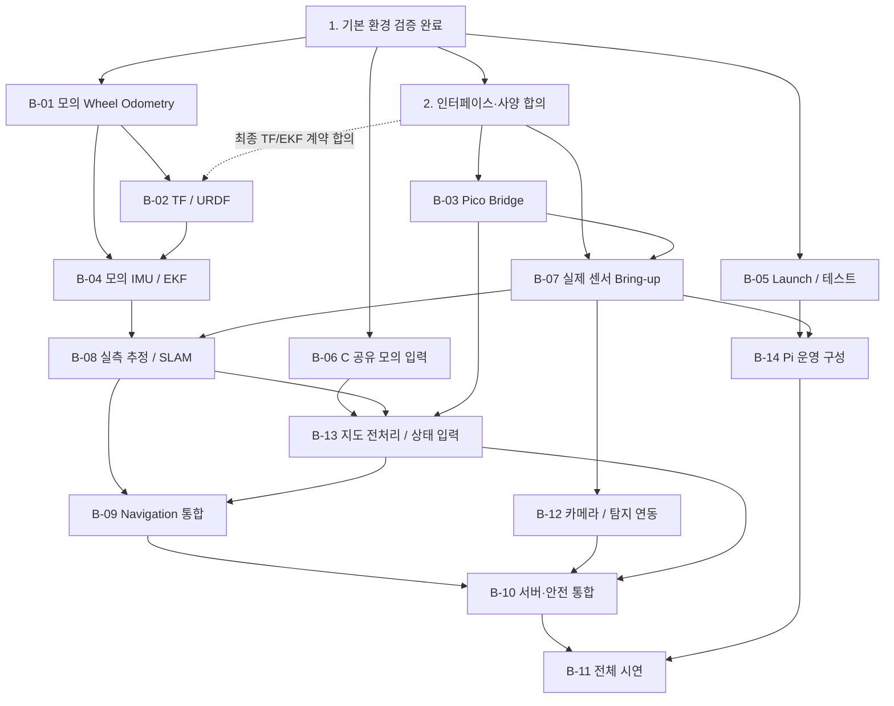

# RoverAid — Development Roadmap

버전: v0.2-draft · 갱신: 2026-10-31 · 대상: 담당 B(Pi / ROS 2)의 실행 업무 및 팀 통합 참조

> 이 문서는 [README.md](../README.md)의 5단계 진행 계획을 담당 B의 세부 작업과 검증 기준으로 나눈다. **작업 완료는 코드 작성이 아니라 검증 결과 확보를 기준**으로 한다. 구현·수정·검증 시 [AGENTS.md](../AGENTS.md)의 승인, 계획서, Daily Notes 규칙을 따른다. 본문의 파일 경로는 저장소 루트 기준이다.

---

## 0. 관리 원칙

- **진행 상태:** `[x]` 완료(근거 확인) / `[ ]` 미완료. 미완료 항목은 `준비 가능`, `합의 대기`, `실물 대기`를 별도로 표기한다.
- **담당:** A = 기구·배선·Pico 펌웨어 / B = Pi·ROS 2·상태 추정·통합 / C = 탐색·경로 알고리즘·에이전트·서버. 이 문서에서 기본 실행 주체는 B다.
- **개발 구분:** WSL2에서 모의 데이터로 검증한 결과와 Pi/실물에서 검증한 결과는 구분한다. 모의 테스트 통과를 실물 검증 완료로 표시하지 않는다.
- **계약 우선:** 확정된 `docs/interfaces.md`, `docs/hardware_specs.md` 및 팀 합의가 임시 구현 가정보다 우선한다. `sw_layers_assignment.md`의 토픽·수치·실행 주기는 **설계 기준안**이며 모두 확정값은 아니다.
- **문서 연결:** 전체 소개는 `README.md`, 에이전트 규칙은 `AGENTS.md`, 작업별 계획은 `docs/plans/`, 검증·변경 결과는 `docs/daily_notes/`에 기록한다.
- **완료 증거:** 검증 명령, 입력 데이터, 기대값/실제값, 테스트 환경, 결과, 커밋 해시를 남긴다. 미검증 항목은 `NOT TESTED`로 명시한다.
- **기존 완료 항목:** 2026-10-31 사용자 결정에 따라 1-A의 기존 완료 항목은 재검증하지 않는다. 새 구현의 검증은 별도로 수행한다.
- **안전 기준 후속 작성:** 하드웨어 완성 및 metric 확정 후 사용자가 실물 시험의 세부 안전 조건·측정 항목·합격 기준을 추가한다. 현재는 수치를 임의로 채우지 않으며, AGENTS.md의 하드웨어 실행 승인 및 안전 제한은 계속 적용한다.

### 담당 B 업무 대응표

[sw_layers_assignment.md](../sw_layers_assignment.md)의 B 범위를 실행 작업으로 대응시킨다. 이 표는 역할 문서의 수치·프로토콜을 확정하지 않으며, 원문은 수정하지 않는다. 아래 추가 업무도 개별 구현 승인 후 수행한다.

| B 책임 | 로드맵 작업 | 주요 산출물 / 협업 경계 |
|---|---|---|
| 3계층: Pico·센서 입력 | B-03, B-07, B-12 | 브리지, IMU·LiDAR·카메라 토픽 및 상태 기록. Pico 펌웨어·저수준 안전 제어는 A |
| Pi 실행환경·TF | B-02, B-05, B-14 | URDF/TF, launch, 장치·권한·운영 절차. 시스템 변경은 별도 승인 |
| 4계층: 상태 추정·지도 | B-01, B-04, B-08 | Wheel Odometry, EKF, SLAM, 지도 저장·복원 및 실측 기록 |
| 지도 전처리·상위 입력 | B-13 | 초음파 별도 레이어, 다운샘플 지도, 탐색률·방문 궤적. C의 frontier·에이전트에 합의한 입력 제공 |
| 5계층: 통합·튜닝 | B-09 | C 작성 코드의 배포·연결·주행 튜닝. 탐색·경로 알고리즘 자체 작성은 C |
| 7계층: 로버 측 통신·보고 | B-10 | 보고 큐, 텔레메트리, 탐지 보고·지도 송신, 조건부 LTE 관리. 서버·UI는 C |
| 팀 전달·통합 검증 | 2-A~C, B-06, B-11 | 인터페이스 문서, 모의 지도/frontier, rosbag, 시연·성능 기록 |

---

## 1. 단계 요약

| 단계 | 핵심 목표 | 현재 상태 | 완료 조건 |
|---|---|---|---|
| **1. 개발환경·기본 통신** | WSL2/Pi의 ROS 2 환경, 모의 Pub/Sub, rosbag | **완료** | 두 환경에서 기초 노드 실행, Pi에서 데이터 기록·재생 확인 |
| **2. 인터페이스·기구 정보** | A↔B, B↔C 계약 및 테스트 대체물 확보 | **진행 전 / 합의 필요** | 합의된 메시지·좌표계·프로토콜 문서화 |
| **3. 위치 추정·센서 통합** | Wheel Odometry, TF/URDF, IMU/EKF, 센서 드라이버 | **B-01 직선 모의 초기 버전 구현 / 나머지 미구현** | 모의 검증 후 실물 입력으로 추정 파이프라인 동작 |
| **4. 지도·자율주행 연동** | SLAM, C의 탐색·경로 코드, 상위 통신 | **미구현** | 지도→목표→명령 흐름과 인터페이스 검증 |
| **5. 실물 통합·안전·성능** | 로버 전체 연결, 안전 동작, Pi 자원 검증 | **미검증** | 제한된 시험환경에서 재현 가능한 실물 시험 기록 |

### 1-A. 현재까지 완료한 항목 (2026-10-31 기준)

- [x] WSL2 Ubuntu 24.04 + ROS 2 Jazzy 구성 및 기본 Python Pub/Sub 시험
- [x] `~/rover_aid/ros2_ws/src/rover_sandbox`에 `mock_encoder`, `encoder_listener` 작성·실행
- [x] Raspberry Pi 4(2GB RAM)에 Ubuntu Server 24.04 ARM64 + ROS 2 Jazzy `ros-base` 구성
- [x] Windows ↔ Pi 유선 LAN/SSH 접속 및 Pi 내부 ROS 2 Pub/Sub 시험
- [x] `rover_sandbox`를 Pi에 이식·빌드하고 `/wheel_ticks` 모의 메시지 송수신 확인
- [x] Pi에서 `/wheel_ticks` rosbag 기록·정보 확인·재생 (`2,714`개 모의 메시지 기록)
- [ ] 실제 엔코더·Pico·IMU·LiDAR 연동 검증 (**미수행**)

> **주의:** 현재 `/wheel_ticks`의 `std_msgs/msg/Int64MultiArray` 형식은 **모의 테스트용**으로 검증되었을 뿐, 실제 Pico의 필드 순서·채널 수·부호·카운트 정의는 확정되지 않았다.

---

## 2. 최우선: Pi 인계 및 팀 인터페이스 합의

### 2-A. Raspberry Pi 인계 (실물 전달 전)

- [ ] `ros2 bag play`, `mock_encoder` 등 테스트 프로세스가 종료됐는지 확인
- [ ] Pi의 새 **Ubuntu microSD**와 기존 **Debian microSD**를 구분하여 보관·전달
- [ ] Pi 환경 정보 공유: Ubuntu 24.04 ARM64, ROS 2 Jazzy `ros-base`, 사용자 계정, 작업 경로
- [ ] `rover_sandbox` 소스 및 검증 기록을 WSL2/Git 저장소에 보존 (비밀번호·SSH 키는 제외)
- [ ] Windows ICS에서 Pi의 IP가 바뀔 수 있음을 안내하고 접속 절차 공유
- [ ] `sudo shutdown -h now`로 정상 종료 후 전원 분리

**완료 기준:** 팀원이 Pi를 안전하게 인수하고 기존 ROS 2 환경을 식별할 수 있다. *SSH 비밀번호는 공개 저장소에 기록하지 않는다.*

### 2-B. 팀 간 계약 (`docs/interfaces.md`) — P0, 합의 대기

- [ ] **A ↔ B:** Pico↔Pi 연결 방식(USB 시리얼 예정), 패킷 구조, 필드 순서, 단위, 부호, 체크섬, 주기, 타임아웃
- [ ] **A ↔ B:** 엔코더가 측정하는 바퀴·축, 누적/증분 카운트, 조향각 측정 가능 여부, 안전 정지 소유권
- [ ] **B ↔ C:** 토픽명·메시지 타입·QoS·발행 주기, `map`/`odom`/`base_link` 프레임 및 TF 발행 주체
- [ ] **B ↔ C:** 경로 입력·제어 출력 인터페이스, 탐색 도구(tool) 입출력, 로버↔서버 텔레메트리 계약
- [ ] **B ↔ C:** 로버↔서버 연결 방식과 명령 우선순위·타임아웃 합의. 기존 C++ TCP 소스 도입 여부는 별도 선택 사항이며, 도입할 때만 ROS 2 연결·이식 범위 합의

**완료 기준:** 각 인터페이스에 제공자/소비자, 입력·출력, 단위, 예제 메시지, 실패 시 동작 및 합의자를 기록한다. 합의 전 후보값은 `PROPOSED`로 표시한다.

### 2-C. 실측 사양 (`docs/hardware_specs.md`) — P0, 실물/팀 자료 대기

- [ ] 바퀴 반지름·좌우 간격·전후 축간거리·구동륜/엔코더 설치 위치 확인
- [ ] 엔코더 CPR/PPR, 체배·감속비, 1카운트당 거리 및 방향 부호 확인
- [ ] 전륜·후륜 조향 모드(일반/역상/Crab 등) 및 각도 피드백 유무 확인
- [ ] IMU·LiDAR·카메라 모델, 포트, 장착 좌표·방향, 샘플링 주기 확인
- [ ] Pi↔Pico 전원·USB 연결, 통신 두절 시 안전 정책 확인

**완료 기준:** 측정치·출처·확정 여부를 구분해 기록한다. `sw_layers_assignment.md`에 적힌 수치를 실측 없이 확정값으로 복사하지 않는다.

---

## 3. WSL2 + Codex에서 우선 개발할 작업 (하드웨어 없이 가능)

각 작업은 **계획 제출 → 승인 → 구현 → 자동 테스트 → Daily Notes 기록** 단위로 수행한다.

### B-01. Wheel Odometry 초기 버전 — P1, 즉시 가능

- [x] 입력·출력 계약을 `PROPOSED / MOCK ONLY`로 명시. 최종 `/odom_wheel` 확정 전 출력은 `/mock/odom_wheel`로 격리한다.
- [x] 엔코더 카운트 차분, 시간 간격, 거리·속도 계산을 독립 함수로 구현
- [x] 직진·정지·직선 후진의 **모의 운동학** 구현. 좌우 증분이 다른 입력은 폐기하며 실제 6륜 회전 추정으로 취급하지 않음
- [x] 파라미터(바퀴 반지름, counts/rev, 프레임, 공분산)를 모의 ROS 2 YAML 설정으로 분리
- [x] 역방향, `dt <= 0`, 누락/큰 점프/오버플로 처리 및 알려진 리셋 초기화 검증. 작은 리셋 자동 식별은 메시지 한계로 미지원이며 노드 재시작 필요
- [x] `nav_msgs/msg/Odometry`의 위치·속도·시간·프레임·공분산 검증
- [x] 기존 `mock_encoder` 직진 입력과 테스트 내부의 명시적 mock 정지·역방향·리셋/clock 입력으로 검증. 기존 모의 노드 수정 없음. 기존 bag 파일은 작업공간에 없어 실제 재생은 NOT RUN
- [x] 시간 기준 명시: 순수 계산은 명시적 ns, ROS 연동은 측정시각 없는 입력의 수신 ROS 시각 사용. 실제 측정 시각/리셋 정보는 향후 엔코더 소스 계약에서 별도 합의
- [ ] bag 재생 시험을 수행할 때 `/clock` 발행 및 소비 노드의 `use_sim_time` 설정을 함께 정하고, 재생 시작·일시정지·재시작과 시간 역행 시 초기화 동작을 검증한다. 시간 근거가 불명확한 bag은 거리·속도 정확도 판정 입력으로 사용하지 않는다.

**2026-11-03 모의 초기 버전:** `rover_localization/mock_wheel_odom` 구현, 변경 패키지만 빌드 및 `colcon test` 46개 PASS. 실제 mock_encoder Pub/Sub와 모의 /clock 초기·정지/후진·일시정지·역행을 검증했다. 마지막 bag 재생 항목은 파일 확보 후 별도 수행한다. [주의점/계약/실행법](b01_mock_odometry.md), [검증 기록](daily_notes/2026-11-03.md#entry-004).

**완료 기준:** 예상 거리·속도와 출력이 일치하는 단위 테스트, `colcon build/test`, 모의 입력으로 Odometry 발행 검증. 실제 조향 회전·횡이동 모델은 **추가 정보 전까지 BLOCKED**.

### B-02. TF / URDF 기본 구조 — P1, 일부 사양 대기

- [ ] `map → odom → base_link → sensor frames` 연결과 발행 주체를 `PROPOSED`로 정리하고, B↔C 합의 후 `docs/interfaces.md`에 확정한다.
- [ ] `robot_state_publisher` 및 정적 프레임 구성; 실제 치수 미확정이면 테스트용 값 명시
- [ ] `odom → base_link`를 EKF가 발행하는 구성은 `PROPOSED` 후보로 검토한다. 최종 발행 주체는 합의 대상이며, 같은 변환은 한 구성요소만 발행하도록 한다.
- [ ] 프레임 누락·중복·단위·축 방향을 검증하는 테스트 추가

**완료 기준:** 승인된 테스트용 구성에서 모의 좌표계가 연결되고 TF 발행자 충돌이 없다. EKF/SLAM 도입 전 필요한 변환은 명시적인 `mock_` 발행자로 대체하고 테스트 한계를 기록한다. 최종 TF 계약은 팀 합의 후 별도 확정하며, **실측 위치 정합은 실물 장착 이후**.

### B-03. Pico Bridge 모의 검증 — P1, A의 프로토콜 대기

- [ ] A에게 시리얼 프로토콜 문서와 가짜 Pico 시뮬레이터 요청
- [ ] `socat` 등 가상 시리얼 환경에서 메시지 파싱·체크섬·잘못된 패킷 처리 테스트
- [ ] 연결 끊김·재연결·오래된 데이터·명령 타임아웃 처리 테스트
- [ ] 실제 모터에 연결하지 않고 ROS 2 토픽 ↔ 시리얼 변환 검증
- [ ] 엔코더·초음파·Pico 상태의 합의된 메시지 변환, 데이터 시각·최신성 및 오류/폐기 카운터를 검증한다. 명령 송신 주기와 타임아웃은 A와 확정한 계약을 사용한다.

**완료 기준:** 합의된 예제 패킷을 ROS 2 메시지로 변환하고, 비정상 입력·끊김에서 정해진 안전 상태를 유지한다. **실제 USB/Pico 검증은 별도**.

### B-04. 모의 IMU + EKF 구성 — P2, B-01/02 이후

- [ ] `robot_localization` 기반 2D EKF 설정 (`two_d_mode` 등)
- [ ] `/odom_wheel`, `/imu/data` 후보 인터페이스로 모의 데이터 발행·융합
- [ ] 입력 타임스탬프·프레임·공분산과 출력 토픽 후보 `/odometry/filtered` (`PROPOSED`)를 검증한다. 출력 이름 및 TF 발행 주체는 B↔C 합의 후 확정한다.
- [ ] IMU 절대 yaw 사용 여부는 자기장 간섭 등 실측 전까지 결정 유보
- [ ] 드리프트·노이즈·입력 중단 사례에 대한 회귀 테스트

**완료 기준:** 모의 입력에서 EKF가 정상 출력되고 TF 중복이 없다. **정확도/튜닝 완료 판정은 실물 데이터 이후**.

### B-05. Launch 및 자동 검증 체계 — P2, 병행 가능

- [ ] `rover_bringup` 등 필요한 최소 패키지만 생성하고 실행 구성 분리
- [ ] `mock` 모드와 `hardware` 모드를 명확히 분리 (기본값은 안전한 모의 모드)
- [ ] `colcon build`, `colcon test`, ROS 2 노드 실행·종료 스모크 테스트 자동화
- [ ] 로그에 입력 조건·사용 파라미터·성공/실패 근거 기록

**완료 기준:** WSL2에서 재현 가능한 명령으로 모의 파이프라인을 실행·검증할 수 있다.

### B-06. C와 공유할 테스트 산출물 — P2, 병행 가능

- [ ] rosbag의 데이터 타입·주기·모의 여부를 명시한 메타데이터 제공
- [ ] 가짜 점유격자 지도(`.pgm` + `.yaml`)와 frontier JSON 제작 (합의한 형식)
- [ ] C가 하드웨어 없이 재생·해석할 수 있는 실행 예시 제공

**완료 기준:** C가 실제 로버 없이 제공된 데이터를 사용해 인터페이스 테스트를 재현한다. *가짜 지도는 SLAM 성공의 증거가 아니다.*

---

## 4. 실제 Pi/로버 수령 후 검증할 작업

### B-07. Pi 하드웨어·센서 Bring-up — P1, 실물 대기

- [ ] Pi에서 ROS 2 패키지 재빌드·실행, 의존성·권한 확인
- [ ] Pico·LiDAR 장치 식별 및 장치별 `udev` 별칭 검토 (`/dev/rover_pico`, `/dev/rover_lidar`는 후보)
- [ ] I2C/USB 권한 및 IMU·LiDAR 드라이버 연결
- [ ] `/wheel_ticks`, `/imu/data`, `/scan` 실제 토픽의 값·단위·주기·타임스탬프 기록
- [ ] 실측 데이터를 **실제 rosbag**으로 기록, 모의 기록과 명확히 분리
- [ ] 카메라 입력은 B-12와 연계하고, 초음파·Pico 상태 토픽의 값·최신성·오류 상태는 A와 합의한 계약에 따라 확인한다.

**완료 기준:** 각 실제 센서가 재현 가능한 토픽 데이터를 발행하고, 데이터 출처 및 오류를 기록한다.

### B-08. 실물 Odometry → EKF → SLAM — P2, B-07 이후

- [ ] 조향 모드별 운동학을 실제 구동·조향 정보에 맞게 적용
- [ ] 실측 이동 거리·방향과 `/odom_wheel` 비교, 부호·파라미터 보정
- [ ] IMU 방향·드리프트·간섭 점검 후 EKF 구성 선택·튜닝
- [ ] `slam_toolbox`의 `/scan`/TF 연동 및 2D 지도 저장·재생 검증
- [ ] 저장 지도 로드 및 SLAM 상태 저장·복원 요구를 구분하고 필요한 기존 도구를 검토한다. 재시작·복원 후 지도/TF 정합과 저장 주기의 자원 사용량을 기록한다.
- [ ] Pi 2GB RAM에서 SLAM 처리 주기·맵 크기·CPU/메모리 측정

**완료 기준:** 실측 주행·지도 데이터에 대한 오차, 실행 조건, 한계를 문서화한다. 성능 수치는 측정 후 기록한다.

### B-09. Navigation / C의 상위 기능 통합 — P2, 팀 합의·실물 대기

- [ ] C가 구현한 frontier·경로 계획·경로 추종 코드를 합의된 토픽/TF에 연결
- [ ] `map` 목표 좌표와 `odom` 경로 추종 좌표를 구분해 검증
- [ ] 속도·조향 제한 및 명령 소유권(서버/자율/수동) 확인
- [ ] 실제 주행 전 안전한 모의 명령·무부하/바퀴 공중 시험부터 수행
- [ ] C의 `path_follower` lookahead·속도 프로파일과 조향 모드별 동작을 B가 실측 튜닝하고, 선회 반경·스톨·초음파 레이어 관련 기준은 A/C와 합의한 범위에서 반영한다. 세부 안전 metric은 사용자 후속 작성 대상이다.
- [ ] B-13의 지도/초음파 전처리 출력과 C의 회피·탐색 입력을 연결하고 좌표·지연·입력 중단 시 동작을 검증한다.

**완료 기준:** 경로 출력→제어 명령까지 추적 가능하고, **안전 승인 후** 제한된 환경에서 주행한다. C의 코드 자체 개발은 B 기본 범위에 포함하지 않는다.

### B-10. 서버·통신·안전 통합 — P3, C 협업

- [ ] C와 로버↔서버 전송 방식·메시지 계약을 합의한다. 별도 microSD의 기존 C++ TCP 코드는 현재 통합에서 배제 중이며, **소스 도입을 결정한 경우에만** Ubuntu/Jazzy 호환성·ROS 2 연결·이식을 검증한다. 미도입 시 기존 TCP 이식은 `대상 아님`으로 기록한다.
- [ ] 네트워크 단절·재접속·명령 타임아웃·로컬 안전 정지 검증
- [ ] 로버 측 텔레메트리(위치·배터리·탐색률 등), 탐지/요구조자 보고(위치·신뢰도·이미지 등)를 합의한 형식으로 송신한다. 탐지 데이터는 B-12, 지도·방문 정보는 B-13과 연계하고 필드·주기는 C와 확정한다.
- [ ] 보고 큐·재전송·중복 처리·적재 상한 정책을 C와 합의해 로버 측에 구현하고, 단절/복구 입력으로 유실·중복·메모리 사용량을 검증한다. 서버 수신·저장·UI 구현은 C 범위다.
- [ ] 지도 압축·증분 송신 필요 여부와 복구 방식을 C와 합의하고, 채택 시 재구성 정합·전송량을 검증한다.
- [ ] LTE 동글이 실제 필요할 경우 재접속·신호 상태 관측을 구성하고 연결 안정성·대역 사용량 및 요금제 예산을 확인한다.

**완료 기준:** 서버가 끊겨도 승인된 로컬 안전 정책이 유지되고, 상태/보고 복구 결과를 재현할 수 있다.

### B-11. 전체 시연·성능 시험 — P3, 최종 통합

- [ ] 실제 센서 → 위치 추정 → 지도 → 목표/경로 → 구동/안전 체인 검증
- [ ] 장애물·통신 두절·센서 누락·재부팅 등 실패 시나리오 시험
- [ ] Pi CPU/RAM/온도·주기·지연 관측, 병목 시 기능 분리 방안 결정
- [ ] 실험 조건·안전 조치·rosbag·결과·개선사항 정리

**완료 기준:** 팀이 합의한 시연 시나리오를 반복 수행하고, 실패를 포함한 결과를 문서화한다.

### B-12. 카메라 수집 및 탐지 기능 연동 — P2, B-07·카메라 사양·C 합의 대기

**담당/선행:** B는 카메라 드라이버·로버 측 데이터 수집·기능 연동·자원 측정을 담당한다. 탐지 모델 자체 개발 및 실행 위치는 C와 별도 합의하며, 이 작업으로 A/C 소유 코드를 임의 수정하지 않는다.

- [ ] 카메라 모델·연결·장착 프레임을 확인하고 기존 ROS 드라이버 후보를 검토한다. 토픽명·타입·시각·해상도·주기는 `PROPOSED`로 제안 후 합의한다.
- [ ] 모의 영상으로 프레임·시각·탐지 결과 연동을 먼저 준비하고 실물 카메라로 수집·누락·재연결 동작을 확인한다.
- [ ] 장치가 지원하는 압축 형식을 확인하고 원본 로컬 처리와 외부 전송용 압축·저주기 정책을 분리한다. 역할 문서의 해상도·fps를 확정 성능으로 가정하지 않는다.
- [ ] 합의된 탐지 노드/결과를 위치·신뢰도·이미지와 연결해 B-10 보고 입력으로 제공한다. 위치 추정 가능 범위와 미확정 위치의 표현은 C와 합의한다.
- [ ] 영상·탐지 처리의 CPU/RAM·지연·대역 사용량과 EKF/SLAM 병행 영향을 측정해 실행 위치·주기를 조정한다.

**산출물/완료 기준:** 승인된 카메라 실행 구성, 토픽/탐지 연동 계약 및 모의/실측 검증 기록. 모의 입력만으로 카메라 실물이나 탐지 정확도 검증 완료를 선언하지 않는다.

### B-13. 지도 전처리 및 C 제공 상태 데이터 — P2, 모의 준비 가능·입출력 계약 합의 대기

**담당/선행:** B가 담당한다. B-06의 가짜 지도와 명시적인 모의 궤적·초음파 입력으로 계산을 준비하고, 실물 연결은 B-08 지도/추정 및 B-03/07 센서 입력 이후 수행한다. 출력 스키마와 소비자는 C와 합의한다.

- [ ] 초음파 입력은 LiDAR `/scan`에 직접 합치지 않고 별도 레이어로 취급하는 후보 설계를 작성한다. 시각·최신성·유효 범위·프레임 변환을 확인하며, 실제 임계값은 하드웨어/metric 확정 후 합의한다.
- [ ] 지도 다운샘플링의 해상도·원점·좌표계·unknown 처리 규칙을 합의하고, 알려진 모의 지도에서 점유/미탐색 영역과 좌표 정합을 검증한다.
- [ ] 탐색률의 분모·관측 영역·갱신 기준을 C와 합의해 계산하고, 지도 크기·탐색률 등 `get_map_summary()`에 필요한 입력을 제공한다. tool/에이전트 자체 구현은 C 범위다.
- [ ] 방문 궤적의 프레임·시각·보존 범위를 정하고 지도 보정·재시작 시 처리와 메모리 상한을 검증한다.
- [ ] C의 frontier·회피·상위 판단 소비자와 모의 통합하고, B-09 및 B-10에 제공할 지도·상태 메타데이터와 재현 예시를 남긴다.

**산출물/완료 기준:** 전처리 입력/출력 계약, 모의 기대값 기반 단위 테스트와 C 전달 예시. 실물 지도·초음파 연동 결과는 별도로 기록한다. 안전 판단 임계 및 실측 성능의 완료 기준은 사용자 후속 작성 대상이다.

### B-14. Pi 실행환경 및 운영 구성 — P2, B-05/07 이후·시스템 변경 별도 승인

**담당/선행:** B가 담당한다. WSL2에서 launch·종료 절차를 준비한 뒤 실제 Pi 환경에서 검증한다. 패키지 설치·그룹/장치 권한·udev·systemd 변경은 구체적인 계획을 제시하고 별도 승인 후 실행한다.

- [ ] 장치 식별·권한·I2C 활성화·udev 별칭을 확인하고 재부팅/재연결 시 인식 절차를 문서화한다.
- [ ] 부팅 시 launch 자동 실행 필요 여부와 시작 순서·재시작 상한·종료/로그 정책을 제안한다. 채택 시 승인된 모드로만 기동되도록 검증한다.
- [ ] Pi 소스 배포·순차 빌드·기동/종료·복구 절차를 정리하고, WSL2 빌드 산출물을 배포하지 않는지 확인한다.
- [ ] Ubuntu 환경에서 사용 가능한 CPU/RAM/온도 관측 방법을 확인하고, 방열 및 장시간 실행 기록을 B-11 성능 시험과 연결한다.

**산출물/완료 기준:** 승인된 운영 설정과 재현 가능한 배포·기동·종료·복구 절차. 실제 Pi 재부팅/복구 시험 결과는 승인 후 별도 기록한다.

---

## 5. 의존성 및 추천 실행 순서

그림의 실물 입력 의존성은 명시된 모의 입력으로 준비하는 작업을 막지 않는다. B-12~14는 추가한 작업 ID이며, 번호순으로 실행할 필요는 없다.

**지금 우선할 일:** B-01의 직선 모의 초기 버전은 2026-11-03 구현/검증했다. 실제 엔코더·조향·TF 계약을 `2-B`에서 합의하고, 다음 B 작업은 개별 계획 승인 후 진행한다. 하드웨어 확보 시 D-01 잔여 확인 → D-02 실물 검증 → D-03 촬영도 별도 수행한다. 하드웨어 없이 B-02·B-04·B-05·B-06과 B-12~14의 명시된 모의 준비를 진행할 수 있으며 실제 정확도/주행 성공으로 간주하지 않는다.

---

## 6. Codex 작업 단위 및 종료 보고 형식

각 `B-xx`는 필요하면 더 작은 계획(`docs/plans/YYYY-MM-DD_###_title.md`)으로 쪼갠다. **최초 구현은 한 작업만 승인하고**, Codex가 해당 범위의 구현·검증·문서 기록까지 마무리하도록 한다.

작업 종료 시 아래 항목을 반드시 보고한다.

1. **작업 ID/목표:** `B-01` 등
2. **변경 파일:** 생성·수정·삭제 경로
3. **검증 실행:** 실제 실행한 명령과 입력 데이터
4. **검증 결과:** PASS / FAIL / NOT TESTED 구분
5. **계약·안전 영향:** 토픽·TF·프로토콜·하드웨어 실행 여부
6. **BLOCKER 및 다음 작업:** 팀원 합의나 실물이 필요한 부분
7. **기록 위치:** 계획서, `docs/daily_notes/` 항목, 커밋 해시

### 최초 Codex 요청 예시

> `docs/roadmap.md`의 B-01 Wheel Odometry 초기 구현을 시작하려고 한다. 먼저 현재 `rover_sandbox` 코드와 `AGENTS.md`를 읽고 계획서 초안을 제시해 줘. 실제 Pico 계약이 없으므로 현재 `/wheel_ticks` 모의 데이터만 사용하고, 처음에는 직진·정지 모델과 단위 테스트에 한정해 줘. 사용자 승인 전에는 파일을 수정하지 마. 승인 후 구현·빌드·자동 검증·Daily Notes 기록까지 수행하고, 실물 미검증 항목은 분리해서 보고해 줘.

---

## 7. 갱신 규칙

- 작업 완료 시 체크박스를 수정하고 검증 근거가 있는 `docs/daily_notes/` 기록을 연결한다.
- 팀 합의가 생기면 `docs/interfaces.md` 또는 `docs/hardware_specs.md`를 갱신하고 이 로드맵의 `합의 대기`를 해제한다.
- 인터페이스 계약 변경은 `AGENTS.md`의 Contract Change 절차를 따른다.
- 실제 하드웨어 문제가 발견되면 완료 항목을 무조건 유지하지 말고 검증 범위를 재표기한다.
- 새 작업을 추가할 때는 담당자, 선행 조건, 기대 산출물 및 검증 기준을 명시한다.
