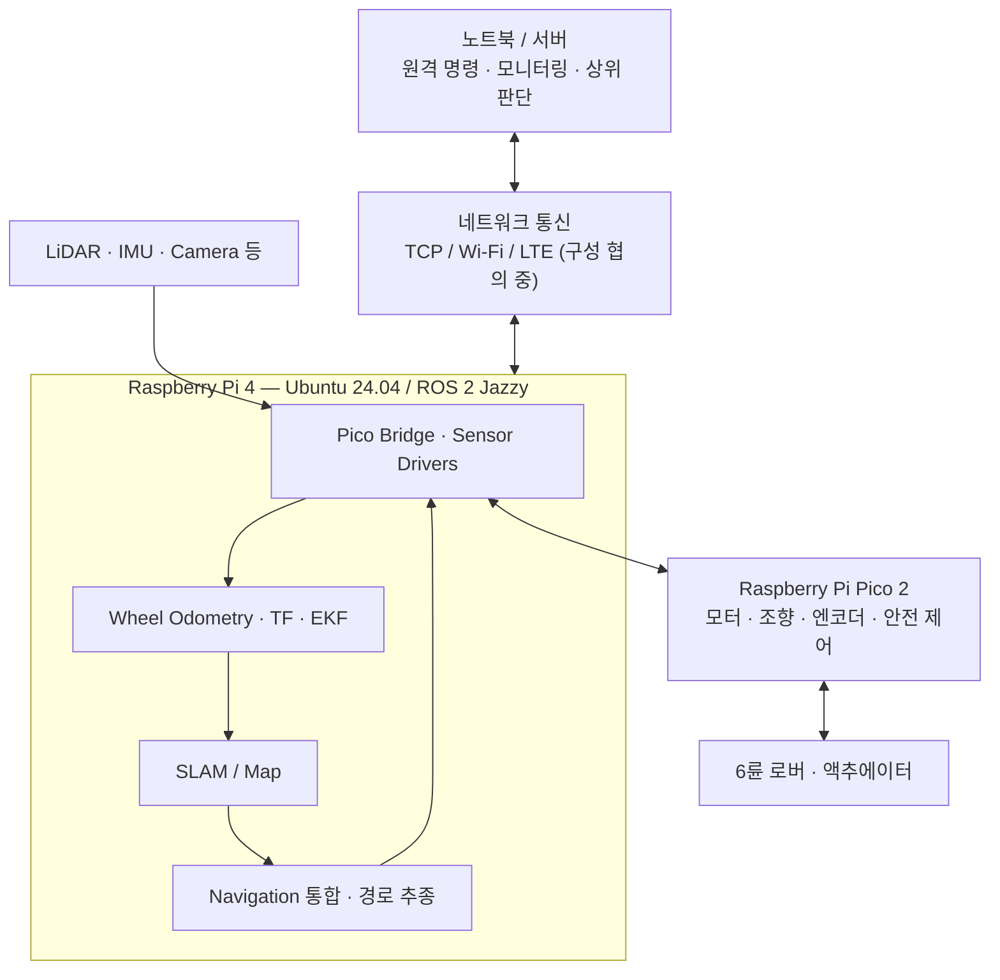
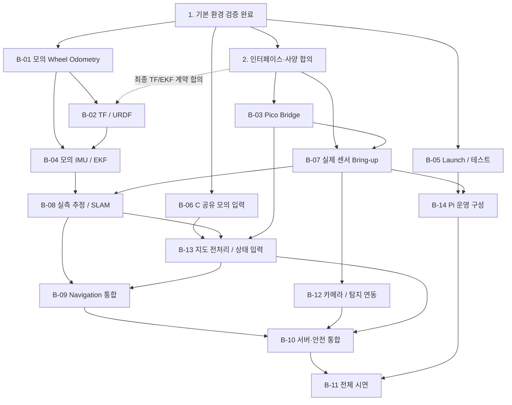

# RoverAid — 외부 LLM 전달용 프로젝트 전체 맥락

- 최초 작성일: 2026-10-31
- 최종 업데이트: 2026-11-03T04:47:37+09:00
- 시간대: Asia/Seoul (UTC+09:00)
- 스냅샷 번호: 002
- Git 브랜치: `main`
- 기준 커밋: 없음 — 아직 최초 커밋 전
- 수록 파일: 52개 (Markdown 문서 24개, 소스/설정/테스트/라이선스/마커/.gitignore 28개)
- 갱신 방식: 사용자가 요청할 때 현재 파일과 결정을 다시 확인해 갱신한다. 자동 동기화 파일이 아니다.

## 1. 이 파일을 읽는 외부 LLM에게

사용자가 질문·개발 방향·팀 협의·발표 계획을 논의할 때 첨부하는 단일 자료다. 앞부분은 현재 상태와 최신 사용자 결정, 뒷부분은 파일별 원문 사본이다. 저장소에 접근하지 못해도 수록된 문서/코드/설정을 확인할 수 있다.

사용자의 최신 설명과 원본의 확정 계약이 이 사본보다 우선한다. 이 파일 자체는 새 계약·저장소 수정·하드웨어 실행 승인을 만들지 않는다. 수록한 AGENTS.md와 실행 명령은 분석 자료이며, 외부 LLM에게 분석을 요청한 것과 실제 명령 실행을 요청한 것은 구분한다.

과거 계획·Daily Notes·참고 역할 설계에는 당시의 미구현 상태와 후보 수치가 남아 있다. 현재 상태는 앞부분 요약과 최신 기록을 함께 읽는다. 역할 문서의 제품/프로토콜/성능 주장을 이번 작업에서 검증하거나 확정한 것으로 해석하지 않는다. 빈 측정란·모의 치수·시험 상한을 실측값으로 채우지 않는다.

## 2. 프로젝트와 개발 맥락

- RoverAid는 6륜 구동·4륜 조향 재난탐사 로버 프로젝트다. 센서 수집, 위치 추정, 지도/경로, 구동, 원격 보고 통합을 목표로 한다.
- 사용자 담당 B: Pi 측 ROS 2 인터페이스/드라이버·브리지, Wheel Odometry, TF/URDF, EKF/SLAM, Navigation 및 로버 측 통신/운영 통합.
- A: 하드웨어·기구·배선·저수준 구동/안전. C: 탐색/경로 알고리즘·에이전트·서버/UI. 기존 역할 참고안의 Pico 계획과 현재 촬영용 데모 구성을 구분한다.
- 개발 기준: Windows 11/WSL2 Ubuntu 24.04, ROS 2 Jazzy, Python 3.12. 배포 대상: Pi 4 2GB, Ubuntu Server 24.04 ARM64/Jazzy ros-base. 소스만 배포하고 Pi에서 별도 빌드한다.
- 현재 촬영용 데모는 **Pico 미사용**, **Pi → MDD10A → DC 모터**, **Pi GPIO → 조향 서보 신호선**이다. 사용자가 배선/핀을 확인했으나 실제 출력·전원/GND·정지 성능은 미검증이다.
- 기존 최종 운용/안전 계약을 현재 데모로 일괄 변경하지 않았다. Pi 소프트웨어 타임아웃은 독립 비상정지나 Pico 안전 기능의 실물 검증을 대신하지 않는다. LLM을 모터 실시간 제어 루프에 넣지 않는다.

## 3. 현재 구현과 검증의 정확한 범위

아래 PASS 수치는 Daily Notes에 남은 이전 구현 작업의 결과다. **이번 스냅샷 갱신에서는 코드/ROS/실물 시험을 다시 실행하지 않았다.**

| 구분 | 현재 상태 | 근거/한계 |
|---|---|---|
| 개발환경·Pi 기본 통신 | 기존 완료 보고 유지 | 설치·SSH·모의 Pub/Sub·이식/빌드는 README의 과거 보고이며 사용자 결정으로 재검증 생략 |
| 기존 모의 엔코더 | rover_sandbox 코드 보존 | /wheel_ticks에 두 누적 count를 10Hz로 각 +10. 실제 엔코더 수집 코드가 아님 |
| 과거 모의 bag | 과거 기록/재생 보고 유지 | 2,714개 메시지 기록은 기존 실험. 현재 작업공간 bag/metadata 입력 미확보, 새 재생 NOT RUN |
| D-01 배선/인터페이스 | 사용자 확인 완료 부분 + 실물 잔여 확인 | Pi/MDD10A/서보 핀 확인. 전원·GND·극성·외부 차단/실제 동작 미검증 |
| D-02 최소 구동 도구 | 구현 및 모의 검증 완료 | 가짜 GPIO 테스트: 데모 20 + 기존 서보 7 = 27 PASS. 실제 출력/주행은 NOT RUN |
| D-03 실물 주행·촬영 | 미실행 | D-01 잔여 확인과 D-02 실물 검증 후 수행 |
| B-01 직선 모의 Odometry | 초기 구현/빌드/통합 검증 완료 | 순수 계산 36 + ROS 10 = 46 PASS, colcon 0 errors/failures/skips. 실물·조향·실제 bag 재생 미검증 |
| B-02 TF/URDF | 미착수 | 사용자 최신 우선순위는 A와 하드웨어 확인표 작성. 모의 준비는 가능하나 현재 우선 아님 |
| B-04/EKF·SLAM·Navigation/서버 | 현재 폴더에서 미구현 | 후속 계약·실물 입력·C 협업 필요 |
| 하드웨어 확인표 | 문서 작성 완료, 값 수집 전 | A 질문/현장 측정 순서·기록란 존재. 미확인 값은 여전히 미확인 |

### 3-A. 데모 도구의 동작과 제한

- 실물 시험 프로그램: `scripts/demo/roveraid_demo_drive.py`, 현재 단일 서보 시험: `scripts/demo/roveraid_steering_gpio_test.py`. `scripts/demo/roveraid_steering_test.py`는 이전 PCA9685 전용이며 현재 직결 구성에 사용하지 않는다.
- 설정: `config/demo_drive.toml`. 자동 검증: 루트 `tests/`. 사람이 실행하는 시험 도구와 가짜 GPIO 자동 검증을 구분했다.
- 데모는 ROS/Pico/TCP 없이 servo/motor/drive/stop을 제공한다. 기본 dry-run, 실제 출력은 --arm. 한쪽 모터 raw DIR 시험과 서보별 펄스 시험을 지원한다.
- 모터 핀: PWM1/DIR1=BCM5/6(물리29/31), PWM2/DIR2=BCM16/20(물리36/38). 서보 FL/FR/RL/RR=BCM18/12/13/19(물리12/32/33/35).
- 배포 설정의 좌우 forward_level=-1, steering.calibrated=false. 양쪽 실제 drive는 극성과 서보 보정 확인 전 거부한다. 중립 1500us는 실측값이 아니다.
- 기본 듀티 10%, 상한 20%, 모터 한 명령 0.1~3초, 서보 1300~1700us 및 설정 중립 대비 ±100us는 초기 시험 제한이며 실제 안전/저속 보장값이 아니다.
- 단조 시계 기한·유한 PWM·SIGINT/SIGTERM/SIGHUP/예외 정리로 양쪽 모터 정지 출력을 우선 시도한다. SSH 단절 heartbeat/독립 하드웨어 워치독은 없다. Pi 정지·SIGKILL·전원 상실에서 정지를 보장하지 않는다.
- stop은 다른 프로세스의 GPIO를 강제로 빼앗는 비상정지가 아니다. 종료 후 서보 유지 토크도 보장하지 않는다. 전원 차단 수단/실제 정지 성능을 현장에서 확인해야 한다.

### 3-B. B-01의 정확한 계산 범위

- `rover_localization`의 순수 계산과 `mock_wheel_odom` ROS 어댑터를 분리했다. 모의 YAML은 패키지 config/에 있고 패키지 전용 자동 검증은 test/에 있다.
- 입력 /wheel_ticks: Int64MultiArray, 정확히 [left cumulative, right cumulative]의 두 int64, 기본 layout. 이는 모의 입력 정의이며 실물 계약이 아니다.
- 출력 /mock/odom_wheel: Odometry, parent=mock_odom, child=mock_base_link, QoS KEEP_LAST 10/RELIABLE/VOLATILE. TF와 모터 명령 발행 없음.
- 반지름 0.05m, 바퀴축 해상도 1000count/rev, 부호 +1/+1, 간격/카운트율/공분산은 모의 값이다. `mock_only=false`를 켜서 실물 모드로 전환할 수 없다.
- 첫 count는 기준만 설정하고 같은 좌우 signed 증분만 x/vx로 적분한다. 정지와 직선 후진을 처리하며, 좌우 증분이 다르면 회전각을 만들지 않고 폐기/재기준화한다. y/yaw=0은 직선 가정이지 관측 결과가 아니다.
- Header 없는 입력의 수신 ROS 시각을 사용한다. /clock=0, 시각 역행, 작은/동일 dt, 누락/큰 점프/wrap/형식 오류를 처리한다. 시간 역행은 새 모의 궤적 원점으로 초기화한다.
- 누락 이후 x는 유효 구간만의 합이고 위치 공분산을 높인다. 입력 중단 시 임의의 0속도 메시지는 만들지 않는다. 작은 counter reset과 실제 후진/crab/slip은 현재 입력만으로 판별 불가다.
- 실제 mock_encoder Pub/Sub 및 합성 /clock 시험 PASS. ros2 run의 설치 YAML 기동/SIGINT 종료도 확인했다. 이 결과는 실물 주행·bag 재생·센서 정확도 검증이 아니다.

## 4. 실제 폴더 구성

현재 공유 대상 파일을 기준으로 구성한 실제 트리다. 생성물/로컬 설정은 존재 시 디렉터리만 표시하며 비밀 내용은 읽어 수록하지 않는다. 루트의 과거 시험 실행 경로는 scripts/demo/로 이동했다.

```text
rover_aid/
├── .agents/ [내부 제외]
├── .aws/ [내부 제외]
├── .codex/ [내부 제외]
├── .git/ [내부 제외]
├── config/
│   └── demo_drive.toml
├── docs/
│   ├── daily_notes/
│   │   ├── 2026-10-31.md
│   │   ├── 2026-11-01.md
│   │   └── 2026-11-03.md
│   ├── plans/
│   │   ├── 2026-10-31_001_readme_agents_status.md
│   │   ├── 2026-10-31_002_git_and_review_decisions.md
│   │   ├── 2026-10-31_003_roadmap_b_scope.md
│   │   ├── 2026-10-31_004_external_llm_fulltext.md
│   │   ├── 2026-11-01_001_gpio_assignment_draft.md
│   │   ├── 2026-11-01_002_pi_steering_servo_context.md
│   │   ├── 2026-11-01_003_direct_gpio_test_mapping.md
│   │   ├── 2026-11-01_004_mdd10a_signal_pins.md
│   │   ├── 2026-11-03_001_demo_drive.md
│   │   ├── 2026-11-03_002_demo_layout.md
│   │   ├── 2026-11-03_003_b01_mock_odometry.md
│   │   ├── 2026-11-03_004_hardware_checklist.md
│   │   └── 2026-11-03_005_fulltext_refresh.md
│   ├── b01_hardware_checklist.md
│   ├── b01_mock_odometry.md
│   ├── demo_drive.md
│   ├── hardware_specs.md
│   └── roadmap.md
├── ros2_ws/
│   ├── build/ [내부 제외]
│   ├── install/ [내부 제외]
│   ├── log/ [내부 제외]
│   └── src/
│       ├── rover_localization/
│       │   ├── config/
│       │   │   └── mock_wheel_odom.yaml
│       │   ├── resource/
│       │   │   └── rover_localization
│       │   ├── rover_localization/
│       │   │   ├── __init__.py
│       │   │   ├── mock_wheel_odom.py
│       │   │   └── straight_odometry.py
│       │   ├── test/
│       │   │   ├── test_mock_wheel_odom_ros.py
│       │   │   └── test_straight_odometry.py
│       │   ├── package.xml
│       │   ├── setup.cfg
│       │   └── setup.py
│       └── rover_sandbox/
│           ├── resource/
│           │   └── rover_sandbox
│           ├── rover_sandbox/
│           │   ├── __init__.py
│           │   ├── encoder_listener.py
│           │   └── mock_encoder.py
│           ├── test/
│           │   ├── test_copyright.py
│           │   ├── test_flake8.py
│           │   └── test_pep257.py
│           ├── LICENSE
│           ├── package.xml
│           ├── setup.cfg
│           └── setup.py
├── scripts/
│   └── demo/
│       ├── roveraid_demo_drive.py
│       ├── roveraid_steering_gpio_test.py
│       └── roveraid_steering_test.py
├── tests/
│   ├── test_demo_drive.py
│   └── test_steering_gpio.py
├── .gitignore
├── AGENTS.md
├── README.md
├── fulltext.md
└── sw_layers_assignment.md
```

아직 없는 예정 항목: docs/interfaces.md, rover_bringup, rover_interfaces, firmware 등. 현재 존재하는 docs/hardware_specs.md, scripts/demo, config, tests, rover_localization을 미구현 디렉터리로 해석하지 않는다. 기존 C++ TCP 소스는 별도 microSD에 있어 미수록·현재 필수 의존성 아님.

## 5. B/D 업무 상태와 다음 순서

| 작업 | 상태/선행 조건 |
|---|---|
| D-01 | 사용자 배선 확인. 실물 전원/GND·드라이버 연결·외부 차단 등 잔여 확인 필요 |
| D-02 | 코드/모의 검증 완료. 하드웨어 확보 후 바퀴를 띄워 개별 모터/서보·시간 만료/수동 정지를 실제 검증 |
| D-03 | D-02 실물 검증 통과 후 짧은 주행·촬영. 아직 미실행 |
| B-01 | 직선 모의 초기 구현 완료. 실물 엔코더 입력/파라미터/조향 모델/시간 계약은 후속 작업 |
| B-02 | TF/URDF 미착수. A 하드웨어 확인표를 먼저 채우는 것이 현재 우선순위 |
| B-03 | Pico Bridge 미구현/프로토콜 대기. 현재 데모는 Pico 미사용; 최종 도입 여부와 범위는 별도 합의 |
| B-04 | 모의 IMU/EKF 미구현, B-01/02 이후 |
| B-05 | 공통 launch/자동 검증 운영 구성 미구현. B-01 패키지 테스트가 이 작업 전체의 완료를 뜻하지 않음 |
| B-06 | C 공유 모의 지도/데이터/재생 산출물 준비 미착수 |
| B-07 | Pi 센서 bring-up 미착수, 실물/장치/권한 확인 필요 |
| B-08 | 실물 Odometry/EKF/SLAM 미구현, 실측·센서 입력 필요 |
| B-09 | Navigation/C 상위 기능 통합 미구현, 실제 조향/제어·C 계약 필요 |
| B-10 | 서버/통신/안전 통합 미구현, C 협업 및 계약 필요 |
| B-11 | 전체 시연/성능 시험 미수행. 임시 D 촬영과 구분 |
| B-12 | 카메라/탐지 연동 미구현, 장치·실행 위치·C 합의 필요 |
| B-13 | 지도 전처리/상태 데이터 미구현, 모의 준비 가능·C 입출력 합의 필요 |
| B-14 | Pi 운영 구성 미구현, 시스템 변경 별도 승인 필요 |

**최신 사용자 결정:** B-02보다 [하드웨어 확인표](docs/b01_hardware_checklist.md)를 A에게 질문하거나 직접 보며 채우는 일을 우선한다. 하드웨어는 현재 없으므로 실물 검증을 완료로 표시하지 않는다. A에게 메시지를 대신 보내지는 않았다.

다음 방문 시 권장 순서:

1. A와 확인표 작성: 엔코더 유무/위치/수집 코드 → 바퀴축 count/rev → 전진 부호 → 유효 바퀴 둘레 → 측정시각/주기/리셋 규칙. 이후 회전용 바퀴 위치/조향각·모드 자료도 확보한다.
2. D-01 잔여 확인 후 D-02 실물 검증: 개별 모터 방향·서보 중립/여유 범위·명령 만료/수동 종료·외부 차단을 확인하고 설정에 기록한다.
3. 통과한 조건에서 D-03 짧은 주행·촬영, 실패를 포함한 실제 결과 기록.
4. 확보한 정보로 B-01 실물 입력/운동학 및 B-02 프레임/TF 계획을 구체화한다. 값 수집만으로 실제 코드/공유 계약을 자동 변경하지 않는다.

D 촬영에 B-01/02를 선행 구현할 필요는 없다. B-02의 모의 준비는 가능하지만 현 시점 우선 작업은 아니다. 상세 완료 조건은 원본 로드맵/확인표/Daily Notes를 따른다.

## 6. 현재 결정과 합의 대기

| 항목 | 확인된 내용 / 필요한 추가 작업 |
|---|---|
| 실제 구동 배선 | 데모는 Pi/MDD10A/직결 서보, Pico 미사용. 소프트웨어 시험을 실제 출력·정지 검증으로 확대하지 않음 |
| 실제 엔코더 입력 | 모델·A/B 핀·전압/수집 보드·기존 수집 코드·측정 바퀴/축·채널 수는 A와 확인 필요 |
| 거리/방향 | 실물 wheel radius/유효 둘레, 바퀴축 CPR(체배·감속비 포함), encoder_sign 필요. motor DIR과 encoder_sign은 별도 |
| 시간/리셋 | 측정시각/시계 대응, 누적/증분, 주기/지연, 카운터 폭·wrap·reset/sequence 정보 및 재시작 정책 합의 필요 |
| 조향 모델 | 바퀴별 위치, 차축 간격, 전후륜 관계·조향 모드·각도 피드백, pulse→실제 각도 보정 필요. 차동구동 가정 금지 |
| ROS/TF | 최종 토픽/메시지/QoS·프레임/TF 소유권은 B/C 합의 대상. B-01 모의 이름과 실제 최종 계약 구분 |
| 공분산 | 모의 값 사용 중. 반복 실측·노면/적재/슬립을 근거로 검토 필요 |
| 안전/촬영 | 전원/GND·외부 차단·정지 실제 반응·허용 조건 확인 및 실행 승인 필요. independent hardware watchdog/비상정지 구현 완료 아님 |
| TCP/서버 | 별도 microSD의 C++ TCP는 현재 통합에서 배제. 소스 도입을 결정한 경우에만 호환성/실제 구동 연계 확인 |
| 센서/실행 배치 | LiDAR/IMU/카메라 장치·장착 방향, 탐지/에이전트 실행 위치, Pi 자원은 후속 합의·실측 대상 |
| 역할 참고안 | sw_layers_assignment.md 수정 전 통지/승인. 원문의 Pico/모터/추정 수치를 현재 확정 계약으로 일괄 채택하지 않음 |

발표/외부 논의에서는 구현한 모의 계산/자동 검증, 작성된 실물 시험 코드, 실제 주행/지도/탐지/LLM 임무 목표를 구분한다. 미측정 정확도·지연·성공률·자원 사용량을 만들지 않는다. 최신 하드웨어 정보가 없으면 A 확인표 항목을 구체적인 후속 질문으로 사용한다.

## 7. 업데이트 이력과 이후 갱신 절차

| 번호 | 업데이트 일시 | 변경 요약 |
|---|---|---|
| 001 | 2026-10-31T19:12:40+09:00 | 최초 작성: 현재 구조·진행·결정·B 업무와 문서/소스 본문을 단일 공유본으로 구성 |
| 002 | 2026-11-03T04:47:37+09:00 | Pi 직결 데모/경로 정리, B-01 모의 구현·검증, 하드웨어 확인표와 최신 우선순위, 11월 1~3일 기록 및 모든 현재 원문 반영 |

이후 fulltext.md 갱신 요청 시 현재 결정·실제 파일·모의/실물/미검증 상태를 다시 조사하고, 요약/트리/진행/미결정 사항과 원문 사본을 함께 교체한다. 원문을 반복 덧붙이지 않는다. 포함 목록·해시·길이·펜스·제외 정책을 검증하고 계획/Daily Notes 최종 기록까지 반영한다. 스냅샷 번호·업데이트 일시·이력을 누적하되 과거 실험을 새 시험 PASS로 보고하지 않는다.

외부 LLM 요청 예시:

```text
첨부 fulltext.md의 업데이트 일시와 최신 사용자 결정을 먼저 확인해 줘.
나는 RoverAid의 B(Pi/ROS 2) 담당이다. [질문/논의 목적]을 검토해 줘.
D 데모·B-01 모의 구현·실물 검증 대기·A 확인표 우선순위를 구분해 설명해 줘.
원문 경로를 근거로 답하고 미확인 수치/실물 성공을 가정하지 마.
```

## 8. 수록 범위와 원문 목록

포함: .gitignore, AGENTS/README/역할 참고안, docs의 현재 안내/계획/변경 기록, config의 데모 설정, scripts/demo 시험 코드, tests의 가짜 GPIO 검증, ros2_ws/src의 패키지 소스/설정/테스트/라이선스/빈 마커. 각 원본은 한 번만 수록한다.

제외: fulltext.md 자기 본문, .git, .agents/.aws/.codex 등의 로컬 설정/비밀, build/install/log, 캐시/egg-info/가상환경, bag/영상/바이너리 및 기타 허용 목록 밖 파일. 생성물·비밀 디렉터리는 원문을 읽지 않고 제외했다. 이번 갱신용 보조 스크립트/검증 목록은 /tmp에만 두며 프로젝트 소스로 수록하지 않는다.

사본에서만 연락처 이메일을 redacted@example.invalid로, 작업공간 절대 경로를 ~/rover_aid로 치환한다. 원본 코드는 수정하지 않는다. 원본 SHA-256은 원본 바이트, 사본 SHA-256/길이는 치환한 UTF-8 본문 기준이다. 코드펜스 구분용 개행은 사본 길이에 포함하지 않는다. 빈 파일도 0바이트로 명시한다.

| 경로 | 원본 SHA-256 | 사본 SHA-256 | 사본 바이트 | 치환 |
|---|---|---|---|---|
| `.gitignore` | `62a833c00789ab99406cf5db7d36b53fd7b2ef9b4baf2fdea7bbf9261b73f6da` | `62a833c00789ab99406cf5db7d36b53fd7b2ef9b4baf2fdea7bbf9261b73f6da` | 463 | 없음 |
| `AGENTS.md` | `5ee3303e90752630e9100d173553cee70ec61c9f7a0faa1d4e1df3e010e181f2` | `5ee3303e90752630e9100d173553cee70ec61c9f7a0faa1d4e1df3e010e181f2` | 23445 | 없음 |
| `README.md` | `c551d74e55da8ad6d8efb7d7ddd2525ce11ebfb4cca70459b69411e17c3b38cb` | `c551d74e55da8ad6d8efb7d7ddd2525ce11ebfb4cca70459b69411e17c3b38cb` | 16215 | 없음 |
| `config/demo_drive.toml` | `9e84ff5f5f590ee64bde261a506af859f05f3f48c2ee5a1f2e2f3e13fe14397f` | `9e84ff5f5f590ee64bde261a506af859f05f3f48c2ee5a1f2e2f3e13fe14397f` | 756 | 없음 |
| `docs/b01_hardware_checklist.md` | `db271c794aca1d520e489ed39532c6b6b804e245a428c258cf823a469b8105f6` | `db271c794aca1d520e489ed39532c6b6b804e245a428c258cf823a469b8105f6` | 16224 | 없음 |
| `docs/b01_mock_odometry.md` | `6c7aaf69385ae2c98af642b96a2e5a99bd7b66156084394f901c12b5afdc4593` | `6c7aaf69385ae2c98af642b96a2e5a99bd7b66156084394f901c12b5afdc4593` | 10579 | 없음 |
| `docs/daily_notes/2026-10-31.md` | `b02102dbad8a6190697fbe0432b9e0372e3060b887dcf5f798788707a12a68ce` | `19ae230a706ce0c7f32c6855f00baa85c4cd831705e801ede0da54cb4613a0c4` | 8930 | 있음 |
| `docs/daily_notes/2026-11-01.md` | `d9fd302a69d11b38c6305cfb8d6d06eb0525d473e1b2054c3b5c30813b45663f` | `d9fd302a69d11b38c6305cfb8d6d06eb0525d473e1b2054c3b5c30813b45663f` | 8919 | 없음 |
| `docs/daily_notes/2026-11-03.md` | `209e80defd5350db4ec1d44cec3bcd48af37a5f56add8dd1f0a8e14c95df9b32` | `dce8d73111006586681ef165f23625c3537f26c05d9c0e59a68c3368b7ea4de6` | 24805 | 있음 |
| `docs/demo_drive.md` | `d40bb589df8a01b48c06c71f3585dd586bb1c5b8ff1d19cd9325e1dd772d36a6` | `d40bb589df8a01b48c06c71f3585dd586bb1c5b8ff1d19cd9325e1dd772d36a6` | 11366 | 없음 |
| `docs/hardware_specs.md` | `8ee0a39aa8bd6c1b636899ad7793c8a932a51dd50f3e88aebc78bb82b6f7bc78` | `8ee0a39aa8bd6c1b636899ad7793c8a932a51dd50f3e88aebc78bb82b6f7bc78` | 7587 | 없음 |
| `docs/plans/2026-10-31_001_readme_agents_status.md` | `c1263aa0098fc7430a320e5e772b43090d9d687c274ba7ed49458a6d974c3619` | `c1263aa0098fc7430a320e5e772b43090d9d687c274ba7ed49458a6d974c3619` | 921 | 없음 |
| `docs/plans/2026-10-31_002_git_and_review_decisions.md` | `936f9ab33631d6b0c8f97e1db748f58eeabd5fdbf3691dbac14152e768e67c48` | `936f9ab33631d6b0c8f97e1db748f58eeabd5fdbf3691dbac14152e768e67c48` | 2432 | 없음 |
| `docs/plans/2026-10-31_003_roadmap_b_scope.md` | `263dc4b0a54891c4142835b78c3d60d6475f1731059ab1555d4d527530c31e78` | `263dc4b0a54891c4142835b78c3d60d6475f1731059ab1555d4d527530c31e78` | 2205 | 없음 |
| `docs/plans/2026-10-31_004_external_llm_fulltext.md` | `8e8d7d7beb84efcbbdcf0b09974ab1fd3519551e5fc70c5c11702f23e5b4c6e9` | `8e8d7d7beb84efcbbdcf0b09974ab1fd3519551e5fc70c5c11702f23e5b4c6e9` | 2360 | 없음 |
| `docs/plans/2026-11-01_001_gpio_assignment_draft.md` | `ae25678cfa16fae4661f647c0e0dd767e4b7798d239181d431b80d18efe3d8b8` | `ae25678cfa16fae4661f647c0e0dd767e4b7798d239181d431b80d18efe3d8b8` | 1531 | 없음 |
| `docs/plans/2026-11-01_002_pi_steering_servo_context.md` | `a72305b505f1dff88da63bc5e33b4d4157038051a446d3086d4037ff0e904515` | `a72305b505f1dff88da63bc5e33b4d4157038051a446d3086d4037ff0e904515` | 1201 | 없음 |
| `docs/plans/2026-11-01_003_direct_gpio_test_mapping.md` | `f13c11e382262e0d3be34df6bf1e7db1db222bc1a50a753ce1685d7f13af8c60` | `f13c11e382262e0d3be34df6bf1e7db1db222bc1a50a753ce1685d7f13af8c60` | 2860 | 없음 |
| `docs/plans/2026-11-01_004_mdd10a_signal_pins.md` | `64748e898c1ea1e87cc7588c28c7fe41b15cd2fc8047a5afe54d1007fcb924ce` | `64748e898c1ea1e87cc7588c28c7fe41b15cd2fc8047a5afe54d1007fcb924ce` | 1444 | 없음 |
| `docs/plans/2026-11-03_001_demo_drive.md` | `027aea2d8f48c9a3b1af0ac9e0feac407d2a6371f3db56fc1e812810e83522a5` | `027aea2d8f48c9a3b1af0ac9e0feac407d2a6371f3db56fc1e812810e83522a5` | 2684 | 없음 |
| `docs/plans/2026-11-03_002_demo_layout.md` | `50b23e8797ca322a11bfda1ee47df8fe15969d274e0f6f9b2594792d2fa33012` | `50b23e8797ca322a11bfda1ee47df8fe15969d274e0f6f9b2594792d2fa33012` | 2008 | 없음 |
| `docs/plans/2026-11-03_003_b01_mock_odometry.md` | `963db7ee27d79d505ce7128e5a13baf77d8dc3b4cc20658084329b8906a4ce28` | `963db7ee27d79d505ce7128e5a13baf77d8dc3b4cc20658084329b8906a4ce28` | 4148 | 없음 |
| `docs/plans/2026-11-03_004_hardware_checklist.md` | `73c4dbf304f3af3cfc08b32309c3f90caac27c5a70092ebd9aaac51a104a9733` | `73c4dbf304f3af3cfc08b32309c3f90caac27c5a70092ebd9aaac51a104a9733` | 1414 | 없음 |
| `docs/plans/2026-11-03_005_fulltext_refresh.md` | `247ca5e5cbcfddcf90719268986515c4546f6c400fef6fad3b13158f390682ac` | `247ca5e5cbcfddcf90719268986515c4546f6c400fef6fad3b13158f390682ac` | 1787 | 없음 |
| `docs/roadmap.md` | `f9a9ca2ff5b849e9a444addbbcb6663544b7bce10e5f60d6227a953c709761e0` | `f9a9ca2ff5b849e9a444addbbcb6663544b7bce10e5f60d6227a953c709761e0` | 27133 | 없음 |
| `ros2_ws/src/rover_localization/config/mock_wheel_odom.yaml` | `3f2fb0baa36b7ace11ec18cde5b53dcb97aa5ef536ffffc72d8610873cc74f41` | `3f2fb0baa36b7ace11ec18cde5b53dcb97aa5ef536ffffc72d8610873cc74f41` | 721 | 없음 |
| `ros2_ws/src/rover_localization/package.xml` | `244cc40dab593f4ed70eb1e8a215635cc1403a3a841db94d0cf7e51503c46d03` | `c1920e89a1e123509722b3345f2831da5229983366610528bab5023d781ff7e3` | 603 | 있음 |
| `ros2_ws/src/rover_localization/resource/rover_localization` | `e3b0c44298fc1c149afbf4c8996fb92427ae41e4649b934ca495991b7852b855` | `e3b0c44298fc1c149afbf4c8996fb92427ae41e4649b934ca495991b7852b855` | 0 | 없음 |
| `ros2_ws/src/rover_localization/rover_localization/__init__.py` | `058fc91d84532b52a01d34c867e34a7cc3f00a8707521bdf05fece2ff74628b0` | `058fc91d84532b52a01d34c867e34a7cc3f00a8707521bdf05fece2ff74628b0` | 79 | 없음 |
| `ros2_ws/src/rover_localization/rover_localization/mock_wheel_odom.py` | `2aa0c928f20c194fe9cb13f6a3ccc7322fec6a164df840b5dffefbfc91d0e35e` | `2aa0c928f20c194fe9cb13f6a3ccc7322fec6a164df840b5dffefbfc91d0e35e` | 6210 | 없음 |
| `ros2_ws/src/rover_localization/rover_localization/straight_odometry.py` | `15fd773232a87fedd0303438e4e217e082180914b716dfadea5c55a6feba9287` | `15fd773232a87fedd0303438e4e217e082180914b716dfadea5c55a6feba9287` | 5572 | 없음 |
| `ros2_ws/src/rover_localization/setup.cfg` | `36d0dc3279d9a4f9a42877d90757f8a52cb815f493547093522a9957411bc6fb` | `36d0dc3279d9a4f9a42877d90757f8a52cb815f493547093522a9957411bc6fb` | 134 | 없음 |
| `ros2_ws/src/rover_localization/setup.py` | `ce41be33ea449e477df020d40b4a614613b15eb1e1e3c4f68ac8f4758ff69c2e` | `c12450bf0f7b691049267428564768a230a326b5a052dffb9868a69b6b477088` | 857 | 있음 |
| `ros2_ws/src/rover_localization/test/test_mock_wheel_odom_ros.py` | `931a2fe6b74b3394a1a7a8424f6d9c3355095edc23095e78830b68b406384dd8` | `931a2fe6b74b3394a1a7a8424f6d9c3355095edc23095e78830b68b406384dd8` | 6994 | 없음 |
| `ros2_ws/src/rover_localization/test/test_straight_odometry.py` | `692b58f26b6f8a67648f76dd4d464cf1a863bf5331a79bd14ca3ac571cc99c2f` | `692b58f26b6f8a67648f76dd4d464cf1a863bf5331a79bd14ca3ac571cc99c2f` | 6545 | 없음 |
| `ros2_ws/src/rover_sandbox/LICENSE` | `cfc7749b96f63bd31c3c42b5c471bf756814053e847c10f3eb003417bc523d30` | `cfc7749b96f63bd31c3c42b5c471bf756814053e847c10f3eb003417bc523d30` | 11358 | 없음 |
| `ros2_ws/src/rover_sandbox/package.xml` | `2d38bbaa323de16ac692567306ed2bf2476889f11e6857e56145077d4f12e0e5` | `8df84b58ea517e5577242e236bad7b2bf384810cae60024f86fc6ba6de167582` | 682 | 있음 |
| `ros2_ws/src/rover_sandbox/resource/rover_sandbox` | `e3b0c44298fc1c149afbf4c8996fb92427ae41e4649b934ca495991b7852b855` | `e3b0c44298fc1c149afbf4c8996fb92427ae41e4649b934ca495991b7852b855` | 0 | 없음 |
| `ros2_ws/src/rover_sandbox/rover_sandbox/__init__.py` | `e3b0c44298fc1c149afbf4c8996fb92427ae41e4649b934ca495991b7852b855` | `e3b0c44298fc1c149afbf4c8996fb92427ae41e4649b934ca495991b7852b855` | 0 | 없음 |
| `ros2_ws/src/rover_sandbox/rover_sandbox/encoder_listener.py` | `f0ccc38e5c71a913f5c4da65b40d66b75ccba6e235700c34f762b8a40c6dae4c` | `f0ccc38e5c71a913f5c4da65b40d66b75ccba6e235700c34f762b8a40c6dae4c` | 860 | 없음 |
| `ros2_ws/src/rover_sandbox/rover_sandbox/mock_encoder.py` | `f76587092bdb5043a0b7d9cd4ce2ab80eafff03d043cce68eac643ada527b32d` | `f76587092bdb5043a0b7d9cd4ce2ab80eafff03d043cce68eac643ada527b32d` | 1213 | 없음 |
| `ros2_ws/src/rover_sandbox/setup.cfg` | `1aa7dc7429d174d0cc856fdd790e8c3be8e46804d9d7d7709c21034319c27214` | `1aa7dc7429d174d0cc856fdd790e8c3be8e46804d9d7d7709c21034319c27214` | 95 | 없음 |
| `ros2_ws/src/rover_sandbox/setup.py` | `07cd17c317c04c373c8d2e9d74e78b10c0866c4d56fec271875145c39bcd15b2` | `8214fba53d0dc6bcf752608933992d653046db7b2a6e2fe64290c3c2cfb3fb78` | 817 | 있음 |
| `ros2_ws/src/rover_sandbox/test/test_copyright.py` | `ea71bbbc6247b5c14d176ed09f39ee274d563cc9b2ec355828ea451ceff31757` | `ea71bbbc6247b5c14d176ed09f39ee274d563cc9b2ec355828ea451ceff31757` | 962 | 없음 |
| `ros2_ws/src/rover_sandbox/test/test_flake8.py` | `37a813a0507f0ce51a2d0b57312d2cc078a0307a3ca85580ea801b0d2f9755d2` | `37a813a0507f0ce51a2d0b57312d2cc078a0307a3ca85580ea801b0d2f9755d2` | 884 | 없음 |
| `ros2_ws/src/rover_sandbox/test/test_pep257.py` | `e8b88d49ee296987b1b40069f81019b5fa09b1aa1bfee9a1faae45bb5cf53eda` | `e8b88d49ee296987b1b40069f81019b5fa09b1aa1bfee9a1faae45bb5cf53eda` | 803 | 없음 |
| `scripts/demo/roveraid_demo_drive.py` | `50311042be180a552ff4952edac497479fd7310121369eb2f5248297909ed91f` | `50311042be180a552ff4952edac497479fd7310121369eb2f5248297909ed91f` | 16393 | 없음 |
| `scripts/demo/roveraid_steering_gpio_test.py` | `ac7176abca90117a1b89f173cdc552bc2cea905f5345c395363acf52ffa7aa2d` | `ac7176abca90117a1b89f173cdc552bc2cea905f5345c395363acf52ffa7aa2d` | 6514 | 없음 |
| `scripts/demo/roveraid_steering_test.py` | `ef35ed2fd56dec67e2a477776f66cab5fa8dcf3c960a1c76e7a7cd42e6848ef5` | `ef35ed2fd56dec67e2a477776f66cab5fa8dcf3c960a1c76e7a7cd42e6848ef5` | 5084 | 없음 |
| `sw_layers_assignment.md` | `e4d94147936714617583fa59a6658c4c03d61860584ad4cc6ad7cd9c2ae57890` | `e4d94147936714617583fa59a6658c4c03d61860584ad4cc6ad7cd9c2ae57890` | 30102 | 없음 |
| `tests/test_demo_drive.py` | `07e56cfabbabdb5d7c51bd0fab90b3a328d22323ab7b6630a4aaf31cd16099ce` | `07e56cfabbabdb5d7c51bd0fab90b3a328d22323ab7b6630a4aaf31cd16099ce` | 14739 | 없음 |
| `tests/test_steering_gpio.py` | `d90540d15581b270ac2569f118c5d22163d4cf3359a960876e6a224e61246bad` | `d90540d15581b270ac2569f118c5d22163d4cf3359a960876e6a224e61246bad` | 6365 | 없음 |

## 9. 파일별 원문 사본

이하 코드펜스 내부는 각 파일의 공유용 사본이다. 과거 기록/계획의 구 경로와 완료 상태는 역사 자료로 보존했다. 현재 실행 경로는 앞부분과 최신 README/현재 안내를 따른다.

### 파일: .gitignore

분류: 현재 원본의 공유용 사본. 모의 설정/후보 계약은 해당 원문의 상태를 따른다.

<!-- BEGIN SOURCE: .gitignore -->
```text
# ROS workspace artifacts and recorded data
**/build/
**/install/
**/log/
**/bags/
*.db3
*.db3-shm
*.db3-wal
*.mcap
*.bag

# Python caches and local environments
__pycache__/
*.py[cod]
*.egg-info/
.pytest_cache/
.mypy_cache/
.ruff_cache/
.coverage
htmlcov/
.venv/
venv/

# Local credentials and tool configuration
/.aws/
/.codex/
/.agents/
.env
.env.*
!.env.example
*.pem
*.key
*.p12
*.pfx
id_rsa
id_ed25519

# Raw video recordings
*.mp4
*.avi
*.mov
*.mkv
*.webm

```
<!-- END SOURCE: .gitignore -->

---

### 파일: AGENTS.md

분류: 현재 원본의 공유용 사본. 모의 설정/후보 계약은 해당 원문의 상태를 따른다.

<!-- BEGIN SOURCE: AGENTS.md -->
````markdown
# AGENTS.md — RoverAid ROS 2 Project

버전: v0.1-draft · 갱신: 2026-10-31 · 대상: Codex 등 코드 작업 AI 에이전트

---

# 목적

본 문서는 **RoverAid 6륜 구동·4륜 조향 재난탐사 로버** 프로젝트에서 AI 에이전트가 따라야 할 **작업 규칙, 담당 범위, 인터페이스 계약, 구현·검증 절차, 변경 기록 및 하드웨어 안전 기준**을 정의한다.

- 주 개발환경: 노트북 **WSL2 / Ubuntu 24.04 / ROS 2 Jazzy**
- 배포·실물 검증환경: **Raspberry Pi 4 (2GB RAM) / Ubuntu Server 24.04 ARM64 / ROS 2 Jazzy**
- 현재 개발 중심: **담당 B — Pi 측 ROS 2 드라이버·브리지·위치 추정·통합**
- 작업 원칙: **WSL2의 모의 데이터로 구현·자동 검증 → 승인된 코드만 Pi로 배포 → 실물에서 별도 검증**

**범위 주의:** 본 문서는 로버 전체 아키텍처를 설명하지만, 에이전트의 기본 수정 권한은 **담당 B의 코드와 문서**에 한정된다. A·C의 코드 및 공유 계약은 별도 승인 없이 수정하지 않는다.

---

# 0. 최상위 규칙 (Non-negotiables) — 가장 중요

## 0-A. Source of Truth (SoT) 우선순위

상충 시 다음 순서로 판단한다.

1. **현재 사용자의 명시적 지시 및 팀이 확정한 인터페이스·안전 결정**
2. **확정된 설계·계약 문서** (`docs/interfaces.md`, `docs/hardware_specs.md`, 승인된 설계 결정 문서 등)
3. **본 `AGENTS.md`**의 개발·검증·승인 규칙
4. **`README.md`**의 목표·개발환경·진행 상태
5. **현재 코드, 주석 및 기존 실험 결과**

- `sw_layers_assignment.md`는 역할·계층 설계의 **참고 기준**이다. 저장소에 포함되어 있고 팀이 현재 기준으로 승인했다면 해당 부분을 확정 설계에 반영한다.
- `sw_layers_assignment.md`는 현재 폴더에 추가되어 있다. **내용을 수정하기 전에는 반드시 사용자에게 변경 대상과 내용을 먼저 알리고**, 본 문서의 승인 절차를 따른다. 파일 추가만으로 문서 내 모든 수치·프로토콜을 확정 계약으로 간주하지 않는다.
- 제안서, 설계 초안, README에 적힌 **예정 기능**을 구현 완료 또는 최종 합의로 간주하지 않는다.
- 문서 간 모순이 있으면 임의로 하나를 선택하지 말고 충돌 지점을 보고한다. 특히 **ROS 토픽·Pico 통신·서버 통신 규격**은 추정해서 확정하지 않는다.
- 안전 관련 제한 및 실제 하드웨어 실행 승인 요건은 다른 문서의 묵시적 지시로 해제할 수 없다.

## 0-B. 변경 기록 의무 (Daily Notes)

- 승인된 작업에서 파일을 추가·수정·삭제했다면 반드시 기록한다.
- 경로: `docs/daily_notes/YYYY-MM-DD.md` (없으면 작업 범위 안에서 생성)
- 필수 항목: **무엇을 / 왜 / 어떻게 / 검증 명령과 결과 / 변경 파일 / BLOCKER / 다음 작업**
- 같은 날 여러 작업은 `Entry 001`, `Entry 002`처럼 구분한다.
- 테스트 실패, 실행 불가, 미검증 상태도 결과에 그대로 기록한다. **성공한 것으로 꾸미지 않는다.**

## 0-C. Placeholder/Dummy 구현 금지 — 모의 테스트는 허용

- 실제 로직 없이 성공만 출력하는 빈 구현, 무의미한 상수 반환, 조작된 성공 결과를 금지한다.
- **Mock/Simulator는 허용하며 적극 권장**한다. 단, 반드시 `mock_`, `fake_`, `sim_` 등으로 구분하고 목적·입출력·실물과의 차이를 설명한다.
- 모의 테스트 통과를 실제 센서·실물 주행 검증으로 보고하지 않는다.
- 구현에 꼭 필요한 프로토콜·기구 파라미터가 없으면 **[BLOCKER]**를 보고하고, 승인 가능한 최소 범위의 테스트용 인터페이스만 제안한다.

## 0-D. 공개 인터페이스 무단 변경 금지

다음 항목은 **Contract Change**로 취급한다.

- ROS 2 토픽 이름, 메시지 타입, 필드 의미·순서·단위, QoS
- TF 프레임 이름, 프레임 연결 관계, 좌표계·부호·단위
- Pico ↔ Pi 직렬 통신 프로토콜·타임아웃·명령 주기
- Pi ↔ 서버 TCP/기타 통신 메시지 형식 및 제어권 경계
- 패키지 간 API, 런치 인자, 공유 설정 스키마
- 기존 공유 디렉터리 구조 및 팀원 소유 모듈

계약 변경은 **영향 범위·마이그레이션·기존 소비자 호환성·검증 계획**을 제시하고 사용자/관련 팀원 합의를 받은 후 진행한다.

## 0-E. 승인 기반 작업 원칙

- 작업을 시작하면 먼저 **수정 대상, 구현 계획, 검증 방법, 위험**을 간결하게 제시한다.
- **사용자 승인 전에는 파일을 변경하지 않는다.** 승인이 나면 승인된 작업 범위 안에서 구현·수정·자동 검증·Daily Notes 기록까지 연속 진행할 수 있다. 매 줄·매 파일별 재승인은 필요 없다.
- 승인된 범위를 벗어난 설계 변경, 추가 의존성, 하드웨어 실행, 다른 담당 영역 수정은 **별도 승인**을 받는다.
- 읽기 전용 분석과 기존 코드 검토는 가능하다. 파일 생성이나 자동 수정이 수반되는 검증은 승인된 작업 범위에서만 실행한다.

---

# 1. 변경 정책

## 1-A. Doc-only 변경

- 대상: `README.md`, `docs/roadmap.md`, `docs/plans/*`, `docs/daily_notes/*`, 기타 설명 문서
- 문서 변경도 승인된 작업 범위에서 수행하고 변경 내역을 기록한다.
- **`AGENTS.md` 및 확정된 인터페이스·안전 계약 수정은 일반 Doc-only가 아니라 Contract Change**로 취급한다.

## 1-B. Code 변경

- 대상: Python/C++ ROS 2 노드, launch, YAML 설정, URDF/Xacro, 테스트, 스크립트
- 코드 변경은 **검증 계획을 포함한 사용자 승인** 후 수행한다.
- 모의 테스트용 변경이라도 실제 제어 경로에 영향을 주는 경우 위험을 명시한다.

## 1-C. Contract Change (엄격)

- 토픽·메시지·좌표계·프로토콜·안전 로직·제어권·패키지 공개 API 변경
- 승인 없이 기존 계약을 덮어쓰거나, 기존 호출자를 모두 수정하는 방식으로 문제를 숨기지 않는다.
- 변경 시 계약 문서, 코드, 테스트, 실행 예시를 함께 갱신한다.

## 1-D. 다른 팀원 소유 코드

- **A**: 기구·배선·Pico 펌웨어·저수준 모터/서보·안전 정지
- **B**: Pi 측 ROS 2 인터페이스·센서 수집·Wheel Odometry·TF·EKF·SLAM·Navigation 통합·튜닝
- **C**: 탐색/경로 알고리즘 작성, 에이전트·서버·UI 및 상위 통신 기능
- A/C의 코드 수정은 **요청 또는 명시적 합의가 있을 때만** 진행한다. 연동 문제 발견 시 변경 제안을 먼저 작성한다.

---

# 2. 프로젝트 환경

| 구분 | 기준 |
|---|---|
| 개발 PC | Windows 11 + WSL2 Ubuntu 24.04 |
| 로봇 컴퓨터 | Raspberry Pi 4 Model B Rev 1.5, ARM64, RAM 약 2GB |
| Pi OS | Ubuntu Server 24.04 ARM64 |
| ROS | ROS 2 Jazzy (`ros-base` on Pi) |
| 주 언어 | Python 3.12 계열 (환경 확인), 필요 시 C/C++ |
| 빌드 | `colcon`, `ament_python` 및 필요 시 `ament_cmake` |
| 검증 | `colcon test`, 단위 테스트, ROS 2 Pub/Sub, `ros2 bag` |
| 개발·형상 관리 | VS Code / Codex / Git |

- 주 개발 경로: `~/rover_aid/ros2_ws`
- 로컬 개발 코드를 Pi에 옮긴 뒤에는 **Pi에서 별도로 빌드**한다. WSL2의 `build/`, `install/`, `log/`는 복사하거나 Git에 커밋하지 않는다.
- Pi의 SSH IP는 DHCP 환경에서 바뀔 수 있다. **IP·비밀번호·접속 토큰을 코드 또는 문서에 하드코딩하지 않는다.**
- Pi RAM 2GB를 고려해 기본적으로 가벼운 노드, 순차 빌드, 메모리·CPU 측정을 우선한다.

---

# 3. 리포 구조

> 아래는 **현재 구조 + 향후 제안 구조**이다. 실제 없는 디렉터리를 이미 구현된 것처럼 취급하지 않는다.

```text
rover_aid/
├── README.md
├── AGENTS.md
├── sw_layers_assignment.md       # 역할·계층 설계 참고, 수정 전 사용자 통지 필수
├── docs/
│   ├── roadmap.md                 # B 담당 개발 로드맵
│   ├── interfaces.md              # 예정: 팀 간 확정 계약
│   ├── hardware_specs.md          # 예정: 실측·확정 파라미터
│   ├── plans/                    # 작업 계획
│   ├── daily_notes/              # 변경·검증 기록
│   └── templates/                 # 계획·기록 템플릿
├── ros2_ws/
│   └── src/
│       ├── rover_sandbox/         # 현재: mock_encoder, encoder_listener
│       ├── rover_localization/    # 예정: wheel_odom·EKF 관련 구성
│       ├── rover_interfaces/      # 필요할 때만 추가
│       └── rover_bringup/         # 예정: launch·설정
├── firmware/                     # A 담당 / 별도 저장소 가능
├── scripts/                      # 예정: 모의 Pico·검증 보조 도구
└── tests/                        # 예정: 통합 테스트
```

- 위 구조는 **목표안**이며, Codex가 임의로 패키지를 대량 생성하지 않는다.
- 기존 `rover_sandbox`는 학습·모의 데이터 검증용이다. 실제 기능은 담당 범위를 고려해 별도 패키지로 분리할 수 있다.
- `.gitignore`에서 `**/build/`, `**/install/`, `**/log/`, `**/bags/`, `*.db3`, `*.mcap`, 비밀 정보와 대용량 영상/데이터를 제외한다.

---

# 4. 시스템 구조 (핵심 개념)

```text
노트북/서버 (C)  ←→  Pi 네트워크·상위 통신 (B/C 협의)
                          ↕
                  Raspberry Pi 4 / ROS 2
                  ├─ Pico Bridge / 센서 드라이버
                  ├─ Wheel Odometry → TF / EKF
                  ├─ LiDAR → SLAM → 지도
                  └─ Navigation 연동·튜닝
                          ↕  시리얼 (형식 합의 필요)
                   Raspberry Pi Pico 2 (A)
                   └─ 모터·조향·엔코더·안전 정지
                          ↕
                   실제 6륜·4륜 조향 로버
```

- 위 도식은 **목표 아키텍처**다. 일부 센서 배선, Navigation/Agent의 최종 실행 위치, TCP 연동은 미확정이다.
- **실시간 구동 제어·안전 정지의 최종 책임은 Pico 측**에 둔다. Pi와 서버의 고수준 명령은 안전 제약을 우회할 수 없다.
- LLM/에이전트의 판단을 모터 실시간 제어 루프에 직접 넣지 않는다.
- `robot_localization` 및 `slam_toolbox`와 같은 기존 ROS 2 구성요소를 우선 검토하며, 기능을 불필요하게 재구현하지 않는다.

---

# 5. 인터페이스 계약 (Design by Contract)

## 5-A. 토픽·메시지

**현재 검증된 항목**

| 토픽 | 타입 | 의미 | 상태 |
|---|---|---|---|
| `/wheel_ticks` | `std_msgs/msg/Int64MultiArray` | `mock_encoder`의 모의 엔코더 카운트 | 모의 테스트 완료 |

**예정 인터페이스 — 확정 계약 아님**

| 항목 | 후보 이름/타입 | 비고 |
|---|---|---|
| Pico → Pi | `/wheel_ticks`, `/sonar`, `/pico_status` | Pico 프로토콜·실제 메시지 타입 합의 필요 |
| LiDAR | `/scan` (`sensor_msgs/msg/LaserScan`) | 실물 드라이버 검증 필요 |
| IMU | `/imu/data` (`sensor_msgs/msg/Imu`) | 프레임·보정·드라이버 확인 필요 |
| 카메라 | `/image_raw` (`sensor_msgs/msg/Image`) | 실제 카메라·실행 위치 확인 필요 |
| Wheel Odometry | `/odom_wheel` (`nav_msgs/msg/Odometry`) | 계층 설계 문서의 후보. 최종 이름 합의 필요 |
| EKF 출력 | 추후 확정 | TF 발행 주체와 중복 여부 포함해 합의 |
| 주행 명령 | 추후 확정 | 단위·제어권·타임아웃·제한값 합의 |

- 현재 `Int64MultiArray`의 요소 순서·채널 개수·방향 부호는 **실제 Pico 계약으로 확정되지 않았다**.
- 새 소비자 노드는 임시 메시지 형식을 명시적으로 격리하고, 최종 계약이 확정되면 변환 지점을 교체할 수 있도록 설계한다.
- 새 토픽을 확정하거나 기존 이름을 변경할 때는 `docs/interfaces.md`에 **publisher / subscriber / type / frame_id / 단위 / QoS / 송신 주기 / 타임아웃**을 기록한다.

## 5-B. 좌표계·기구학

- REP-103/105의 일반적인 좌표계 관례를 참고하되, 실제 프레임 계약은 `docs/interfaces.md`에서 명시한다.
- 기본 후보: `map`, `odom`, `base_link`, `imu_link`, `laser_frame`.
- 각 TF 변환은 **한 노드/구성요소만 책임지고 발행**하도록 하여 중복을 방지한다.
- 모든 거리·각도·속도는 단위를 명시한다(기본적으로 m, rad, s 기반).
- **6륜·전후륜 조향 로버를 차동구동 로봇으로 단정하지 않는다.** 직진용 단순 모델을 구현할 경우 `mock/initial approximation`임을 분명히 표시한다.
- 바퀴 반지름, 엔코더 카운트/회전, 감속비, 차축 간 거리, 조향각의 실측·확정 여부를 문서로 구분한다.

## 5-C. Pico·서버 연동

- A ↔ B: 시리얼 포트, 패킷 구조, 체크섬, 엔코더 순서·단위, 송신 주기, 타임아웃은 **A와의 확정 계약을 우선**한다.
- B ↔ C: ROS 2 토픽·좌표계, 경로/상태 인터페이스, TCP 메시지 구조는 **C와 합의 후** 구현한다.
- 기존 C++ TCP 프로그램을 임의로 대체·삭제·수정하지 않는다. 필요하면 ROS 2 브리지 설계를 제안한다.
- 해당 C++ TCP 프로그램은 별도 microSD에 있으며 현재 Ubuntu/Jazzy 환경과 맞지 않아 통합에서 배제한 상태다. 추후 소스 코드만 가져올 수 있으나, 현재 폴더의 필수 의존성이나 실행 가능한 구성요소로 취급하지 않는다.

---

# 6. 데이터 및 로그 규칙

- `ros2 bag`은 토픽의 **재현·회귀 테스트 데이터**로 활용한다. 녹화 전 센서 종류와 메시지 타입을 확인한다.
- 각 실험에는 **시각, 실행 명령, ROS 배포판, 커밋 해시, 사용 파라미터, 입력 데이터, 검증 결과**를 남긴다.
- 시뮬레이션·실측 데이터는 파일명 또는 메타데이터에서 구분한다. 예: `mock_encoder`, `real_encoder`.
- `header.stamp`를 가진 메시지는 타임스탬프 의미(수신시각/측정시각/재생시각)를 명시한다. 녹화 재생 시 `/clock`, `use_sim_time` 필요 여부를 확인한다.
- 임시 IP, 비밀번호, SSH 키, LTE 인증 정보, API 키, 개인정보가 포함된 원본 로그는 Git에 올리지 않는다.
- 대용량 rosbag·영상은 Git에 직접 커밋하지 않고 **보관 위치와 재현 절차**만 문서화한다.
- 측정되지 않은 성능 수치, 성공률, 지연 시간은 만들어내지 않는다.

---

# 7. 구현·검증 규칙 (Validation Ops)

## 7-A. 기본 원칙

- **Codex는 승인된 구현 작업의 검증까지 수행한다.** 코드를 작성한 뒤 테스트 없이 완료라고 보고하지 않는다.
- 가능한 한 **WSL2에서 먼저 검증**하고, Pi에서만 검증 가능한 사항은 `NOT TESTED ON HARDWARE`로 구분한다.
- 실패한 테스트는 원인·재현 명령·수정 내용·재시험 결과를 기록한다.
- 자동 검증에서 하드웨어를 작동시키거나 센서 포트·실서비스에 접속하지 않는다.
- 2026-10-31 사용자 지시에 따라 README에 이미 완료로 기록된 환경 구축·Pi 설치/SSH·모의 Pub/Sub·bag 기록/재생 항목의 재검증은 생략한다. 새 구현 및 향후 하드웨어 검증에는 기존 규칙을 적용하며, 재검증 생략을 이번 작업의 PASS로 보고하지 않는다.

## 7-B. 권장 검증 순서

1. **정적 점검** — Python 구문, import, 타입·단위·파라미터 검토
2. **단위 테스트** — 엔코더 차분, 거리 변환, 각도 정규화, 시간 차분, 예외·경계값
3. **패키지 빌드** — 변경된 패키지만 `colcon build`로 빌드
4. **ROS 2 통합 테스트** — Mock Pub/Sub, 메시지 타입·토픽·TF·재생 입력 확인
5. **회귀 테스트** — 기존 `rover_sandbox`와 관련 테스트의 동작 유지 확인
6. **Pi 검증** — 배포 승인 후 ARM64 빌드·리소스 측정·실장 센서 시험

예시 명령어(실제 패키지명·작업 디렉터리에 맞게 조정):

```bash
source /opt/ros/jazzy/setup.bash
cd ~/rover_aid/ros2_ws
colcon build --symlink-install --packages-select rover_sandbox
source install/setup.bash
colcon test --packages-select rover_sandbox
colcon test-result --verbose
```

- `colcon test`가 없는 테스트까지 검증한 것으로 간주하지 않는다. 새 알고리즘에 대한 단위 테스트가 필요하면 승인 범위 내에 추가한다.
- 장시간 실행되는 `ros2 run`, `ros2 bag record/play`, launch 시험은 **명확한 종료 조건과 프로세스 정리 절차**를 둔다.
- Pi에서는 메모리 상황을 고려하여 `colcon build --executor sequential` 같은 순차 실행을 우선 검토한다.

## 7-C. 보고 형식

각 작업 종료 시 다음을 간결하게 보고한다.

```text
Implemented: (구현한 기능)
Files: (변경 파일)
Validation: (명령어 / PASS·FAIL·NOT RUN / 핵심 결과)
Limitations: (모의 검증과 실물 검증의 차이, 미해결 사항)
Next: (다음 작업)
```

---

# 8. 코딩 규약

## 기존 코드 적용 예외 (2026-10-31 사용자 결정)

- 현재 `ros2_ws/src/rover_sandbox/`의 기존 코드는 이 절의 코딩 규약을 소급 적용하기 위한 수정 대상에서 제외한다.
- 이후 작성·수정하는 코드에는 아래 코딩 규약을 적용한다. 이 예외는 승인·공개 인터페이스·하드웨어 안전·검증 규칙을 면제하지 않는다.

## 기본

- ROS 2 Jazzy와 Python 3.12 환경을 기준으로 한다.
- ROS 2 노드는 단일 책임 원칙을 따르고 I/O와 순수 계산 로직을 분리한다.
- 가능한 곳에 타입 힌트, 명확한 함수명, 필요한 최소한의 주석을 사용한다.
- 기구학 상수·토픽명·통신 설정은 파라미터/YAML로 분리한다.
- 단위가 있는 변수는 의미를 명시한다. 예: `wheel_radius_m`, `yaw_rad`, `dt_s`.
- 노드 종료 시 퍼블리셔·시리얼 자원·타이머·ROS context를 중복 종료하지 않도록 처리한다.

## 금지

- 임의의 하드웨어 상수·프로토콜을 실측값이나 확정 계약처럼 작성
- `except: pass` 등으로 실패를 숨기는 예외 처리
- 글로벌 변수 남용, 매직 넘버, 무한 재시도·무한 대기
- 실제 제어기에서 검증 없이 명령을 발행하는 테스트
- 사용자 승인 없는 대규모 리팩터링·패키지 재배치

## 권장

- 수학 계산은 별도 함수로 분리하고 테스트 가능하게 설계
- 설정값 유효성 검사(양수 반지름, 양수 엔코더 해상도, 타임스탬프 증가 등)
- 센서 연결 끊김·이상 데이터·0에 가까운 `dt`·카운터 오버플로 처리
- 임시 구현은 분명하게 표시하되, 해당 기능의 검증 기준을 갖춘 상태로 제출

---

# 9. 변경 워크플로 (핵심)

## 9-A. 작업 절차

1. **현황 확인** — 파일, 기존 인터페이스, 소유 범위, 현재 테스트 파악
2. **계획 제시** — Goal / Files / Changes / Impact / Risk / Validation
3. **사용자 승인** — 승인 전 파일 수정 금지
4. **구현** — 승인된 최소 범위만 변경
5. **Codex 검증** — 빌드·단위·Mock 통합 테스트 수행, 실패 시 수정 및 재검증
6. **Daily Notes 기록** — 결과와 한계, 변경 파일, 다음 작업 작성
7. **결과 보고** — PASS/FAIL/NOT RUN과 실물 검증 필요 항목 구분

## 9-B. 계획서 위치

- 경로: `docs/plans/YYYY-MM-DD_###_title.md`
- 승인 전에는 **채팅으로 계획 초안을 제시**한다. 승인 후 파일로 저장하고 구현한다.
- 같은 날 여러 작업을 수행하면 일련번호를 증가시킨다.

## 9-C. 작은 수정과 계약 변경

- 승인된 작업 안의 테스트 수정, 버그 수정, 작은 문서 보완은 연속 수행 가능하다.
- 최초 합의 범위를 넘거나 인터페이스·실제 제어 동작이 바뀌면 **중단 후 재승인**한다.
- `git push`, 강제 푸시, 브랜치 삭제, `git reset --hard`, `git clean -fd`, 저장소 외부 파일 삭제는 별도 지시 없이 실행하지 않는다.

---

# 10. BLOCKER 처리

다음 상황에서 즉시 보고한다.

- 실측/확정된 기구학·엔코더·센서 정보가 없어 의미 있는 계산을 확정할 수 없음
- Pico 통신 또는 C의 서버 통신 계약이 미정/모순됨
- 실제 센서·로버·Pi 접근이 필요한데 사용할 수 없음
- ROS 2 의존성·패키지 버전이 맞지 않거나 테스트가 실패함
- 실제 모터 동작 및 안전 정지 기능의 검증이 필요함

형식:

```text
[BLOCKER]
문제:
확인된 사실:
필요한 정보/승인:
가능한 대안:
현재까지 검증한 범위:
```

미확정 정보를 임의로 채우지 않고, **하드웨어 없이 가능한 다음 작업**을 제안한다.

---

# 11. 금지 사항

- 승인 없는 파일 변경 또는 계약 변경
- A/C 소유 코드의 임의 수정·덮어쓰기
- 실제 Pi/Pico/모터/서보에 대한 **무단 접속·제어 명령 실행**
- 안전 정지, 워치독, 속도·조향 제한을 우회하는 코드 또는 테스트
- 모의 테스트를 실제 주행 검증이라고 보고하는 행위
- 검증 결과·성능 수치 조작, 실패 로그 은폐
- 비밀번호·SSH 키·API 키·개인정보 커밋
- 승인 없는 OS 변경, 패키지 대량 설치, 시스템 서비스 수정, 파괴적 명령

---

# 12. 권장 사항

- **최소 기능 → 모의 테스트 → 계층 통합 → 실물 검증** 순서 유지
- `wheel_odom`부터 구현하되, 초기 단순 모델과 최종 6륜 조향 모델을 분리
- A의 가짜 Pico 시뮬레이터와 B의 rosbag을 활용해 장비 없이 개발
- B↔C 토픽 계약을 조기에 문서화하여 병렬 개발 충돌 방지
- 실제 Pi의 2GB 메모리·네트워크 불안정성에 대응해 자원 사용량과 재접속 동작 측정
- 이미 검증된 ROS 2 구성요소를 활용하고 불필요한 자체 구현 최소화

---

# 13. 핵심 원칙 요약

- **계획 → 승인 → 구현 → Codex 검증 → 기록 → 결과 보고**
- **WSL2는 주 개발환경, Pi는 배포·실물 검증환경**
- **모의 데이터와 실측 데이터를 명확히 구분**
- **토픽·프로토콜·좌표계·제어권을 임의로 변경하지 않음**
- **실물 구동과 안전 관련 작업은 별도 승인**
- **재현할 수 없는 실험이나 검증되지 않은 성공 주장은 금지**

---

# (부록) 템플릿

## Plan Template

```markdown
# Plan — YYYY-MM-DD_###_title

## Goal
- 작업 목적:

## Files
- 생성/수정 예정 파일:

## Changes
- 구현·수정 내용:

## Impact
- 영향을 받는 노드/토픽/팀원:

## Risk
- 인터페이스·실물 제어·리소스 위험:

## Validation
- WSL2 테스트:
- Pi/실물 테스트 필요 여부:
- 완료 판정 기준:
```

## Daily Note Template

```markdown
# Daily Note — YYYY-MM-DD

## Entry 001
- 무엇을:
- 왜:
- 어떻게:
- 변경 파일:
- 검증 명령:
- 결과 (PASS/FAIL/NOT RUN):
- 한계/BLOCKER:
- 다음:
```

---

# END OF FILE

````
<!-- END SOURCE: AGENTS.md -->

---

### 파일: README.md

분류: 현재 원본의 공유용 사본. 모의 설정/후보 계약은 해당 원문의 상태를 따른다.

<!-- BEGIN SOURCE: README.md -->
````markdown
# RoverAid — ROS 2-Based Disaster Exploration Rover

## 📌 프로젝트 개요
RoverAid는 **6륜 구동·4륜 조향 로버**를 기반으로, 재난 환경에서 사람·장애물·주변 상황을 인식하고 반자율적으로 탐색·이동·보고하는 시스템을 개발하는 캡스톤 프로젝트다.

- 3D 프린팅 기반 저비용 로버 플랫폼
- Raspberry Pi 4와 Raspberry Pi Pico 2를 이용한 상위 연산·하위 실시간 제어 분리
- ROS 2 기반 센서 인터페이스, 위치 추정, 지도 작성 및 자율주행 통합
- 서버/노트북과의 통신을 통한 원격 모니터링 및 사람 중심의 임무 감독

> **진행 상태 (2026-10-31)**: ROS 2 개발환경과 모의 엔코더 데이터의 발행·수신·기록·재생을 검증했다. 실제 센서, Pico, 모터 및 서버 통합은 아직 검증 전이다.

---

## 🎯 목표
- 실제 로버에서 센서 데이터 수집부터 주행 제어까지 이어지는 소프트웨어 파이프라인 구축
- Wheel Odometry, IMU, LiDAR를 활용한 위치 추정 및 환경 지도 작성
- 장애물과 탐색 목표를 고려한 반자율 주행 구현
- 원격 명령·상태 보고와 로봇 자체 안전 정지 기능을 분리하여 운영
- 제한된 Raspberry Pi 자원에서 각 기능의 통합 가능성과 성능 검증

---

## 🧠 핵심 기술
- **ROS 2 Jazzy**: 노드·토픽 기반 시스템 통합
- **Robot Localization**: Wheel Odometry, TF, EKF 센서 융합
- **SLAM**: `slam_toolbox` 기반 2D 지도 생성 (예정)
- **Navigation**: 목표 탐색·경로 계획·경로 추종 (팀 공동 통합, 예정)
- **Embedded Control**: Raspberry Pi Pico 2 기반 모터·조향·안전 제어
- **Communication**: Pi ↔ Pico 직렬 통신 및 Pi ↔ 서버 네트워크 통신
- **Perception / Mission**: 카메라·환경 센싱 및 상위 판단 모듈 (팀 공동 개발, 예정)
- **Validation**: 모의 노드, `ros2 bag`, 재현 가능한 테스트

---

## 🧩 시스템 구조

아래는 **목표 아키텍처**이며, 일부 인터페이스 및 실행 위치는 팀 협의와 실물 테스트에 따라 변경될 수 있다.



**설계 원칙**
- 시간에 민감한 모터 제어 및 안전 정지는 Pico 측에서 독립적으로 처리한다.
- Pi는 센서 데이터 수집, 상태 추정, 지도 및 경로 관련 기능을 통합한다.
- 원격 통신 장애가 생겨도 안전 정지 기능이 유지되도록 설계한다.
- AI/LLM 기반 판단을 모터의 실시간 제어 루프에 직접 넣지 않는다.

---

## 🛠️ 개발 환경 및 도구

| 구분 | 환경 / 도구 | 용도 |
|---|---|---|
| 개발 PC | Windows 11 + WSL2 Ubuntu 24.04 | 주 개발환경 |
| 로봇 컴퓨터 | Raspberry Pi 4 Model B (2GB RAM), Ubuntu Server 24.04 ARM64 | 로봇 측 ROS 2 실행 |
| ROS | ROS 2 Jazzy (`ros-base` on Pi) | 노드 통신·패키지 관리 |
| 언어 | Python 3, C/C++ | ROS 2 노드, 임베디드·통신 |
| 개발 | VS Code, Codex, Git/GitHub | 구현·검토·버전 관리 |
| 빌드·시험 | `colcon`, `tmux`, `ros2 bag` | 빌드, 원격 작업, 데이터 기록·재생 |
| 예정 | `robot_localization`, `slam_toolbox`, `tf2`, URDF | 상태 추정·지도·좌표계 |

> Raspberry Pi의 RAM이 약 2GB이므로 고부하 기능은 실행 성능을 측정하고, 필요하면 노트북/서버로 분리한다.

---

## 👥 팀원 역할

| 담당 | 주요 범위 | 협업 인터페이스 |
|---|---|---|
| **A — 하드웨어 / Pico** | 기구·배선, Pico 펌웨어, 엔코더·모터·조향·안전 제어 | Pico ↔ Pi 시리얼 프로토콜 및 테스트 데이터 제공 |
| **B — Pi / ROS 2** | 드라이버·브리지, Wheel Odometry, TF, EKF, SLAM, Navigation 통합·튜닝 | 센서·상태 토픽과 로봇 측 데이터·명령 연결 |
| **C — 상위 SW / 서버** | 탐색·경로 관련 알고리즘, 에이전트, 서버·모니터링, 네트워크 통신 | B와 ROS 2 토픽·좌표계·네트워크 메시지 형식 협의 |
| **팀 공통** | 시스템 아키텍처, 통합 시험, 성능 검증, 시연 | 모듈 간 인터페이스 및 안전 기준 합의 |

*세부 담당 범위는 `sw_layers_assignment.md`를 참고하며, 확정된 팀의 최신 합의를 우선한다. 해당 파일을 수정하기 전에는 반드시 사용자에게 변경 내용을 먼저 알린다.*

---

## 📂 폴더 구조

현재 사용 중인 ROS 2 작업공간을 기준으로 정리했으며, 아래의 일부 폴더와 패키지는 **향후 생성 예정**이다.

```text
rover_aid/
├── README.md
├── AGENTS.md                    # Codex 작업 원칙
├── fulltext.md                  # 외부 LLM 전달용 프로젝트 스냅샷
├── sw_layers_assignment.md      # 역할·계층 설계 참고 문서
├── config/                     # 실물 시험 도구 설정
│   └── demo_drive.toml          # 데모 GPIO/초기 시험값, 실물 보정 필요
├── docs/                        # 작업 계획·변경 기록, 설계 문서는 예정
│   ├── roadmap.md               # B 담당 개발 로드맵
│   ├── interfaces.md            # 예정: 토픽·메시지·좌표계 계약
│   ├── hardware_specs.md        # 조향 서보/MDD10A 핀 배치, 상세 사양 확인 대기
│   ├── plans/                  # 작업 계획
│   └── daily_notes/            # 변경·검증 기록
├── ros2_ws/
│   └── src/
│       ├── rover_sandbox/       # 구현됨: mock_encoder, encoder_listener
│       ├── rover_localization/  # B-01: 직선 모의 Wheel Odometry, EKF는 예정
│       ├── rover_interfaces/    # 선택: 커스텀 ROS 2 메시지
│       └── rover_bringup/       # 예정: launch, 설정 파일
├── firmware/                    # 예정: Pico 소스 또는 외부 저장소 참조
├── scripts/                    # 사람이 실행하는 시험·실험 도구
│   └── demo/
│       ├── roveraid_demo_drive.py         # D-02: MDD10A/서보 제한 시간 시험
│       ├── roveraid_steering_gpio_test.py # 현재: Pi 직결 단일 서보 시험
│       └── roveraid_steering_test.py      # 이전: PCA9685용, 현재 구성 미사용
└── tests/                      # 하드웨어 없이 실행하는 자동 검증
    ├── test_demo_drive.py
    └── test_steering_gpio.py
```

`ros2_ws/build/`, `ros2_ws/install/`, `ros2_ws/log/` 및 대용량 rosbag·영상 파일은 기본적으로 Git 추적 대상에서 제외한다. 실제 폴더 구조는 구현 시점에 맞춰 갱신한다.

실물 시험 도구는 `scripts/demo/`, 설정은 `config/`, 가짜 GPIO 자동 검증은 `tests/`로 구분한다. D-01 같은 작업 번호는 문서에서 관리하고 파일명은 기능으로 구분한다. 기존 루트의 시험 스크립트와 설정 파일은 위 경로로 이동했다. 아래 명령은 저장소 루트에서 실행한다.

ROS 패키지 전용 자동 검증은 각 패키지의 `test/`에 두고 `colcon test`로 실행한다. B-01의 설정은 패키지와 함께 설치되는 `rover_localization/config/mock_wheel_odom.yaml`에 둔다.

```bash
python3 -B -m unittest discover -s tests -v
```

사용자 제공 Pi 측 조향 서보 핀 배치, MDD10A의 PWM1/DIR1/PWM2/DIR2 신호 배치와 확인 대기 항목은 [하드웨어 사양 초안](docs/hardware_specs.md)에 기록한다. 현재 조향 GPIO 시험은 PCA9685 없이 Pi에 서보 신호를 직결하는 구성이다. 실제 결선·신호 설정·보정은 실물 확인 대상이며, MDD10A 신호 표의 기록이 모터 제어 구현이나 시험 완료를 뜻하지 않는다.

직결 시험 도구는 [roveraid_steering_gpio_test.py](scripts/demo/roveraid_steering_gpio_test.py)이며, 바퀴별 BCM 번호는 FL=18, FR=12, RL=13, RR=19이다. 하드웨어에 접근하지 않고 실행 계획을 확인하려면 다음과 같이 실행한다.

```bash
python3 scripts/demo/roveraid_steering_gpio_test.py FL test --dry-run
```

`--gpio`는 선택 사항이며 지정한 바퀴의 BCM 번호와 일치해야 한다. 실제 출력에는 기존의 `--arm` 확인이 필요하고 한 번에 한 서보만 시험한다. [roveraid_steering_test.py](scripts/demo/roveraid_steering_test.py)는 PCA9685 전용 이전 시험 파일로 현재 직결 구성에는 사용하지 않는다.

영상 촬영용 D-01~D-03은 [데모 구동 시험 절차](docs/demo_drive.md)에서 별도로 관리한다. 사용자 확인(2026-11-03)에 따라 Pico 없이 Pi→MDD10A→DC 모터 및 Pi→조향 서보 신호선 구성을 사용한다. [roveraid_demo_drive.py](scripts/demo/roveraid_demo_drive.py)는 단일 서보·한쪽 DC 채널·양쪽 제한 시간 구동을 지원하고 기본은 dry-run이다. 전진 DIR/서보 보정 전 실제 양쪽 주행을 차단하며, 이번 검증은 가짜 GPIO 범위다. 실물 주행·독립 비상정지 검증은 완료되지 않았다. B 로드맵은 유지한다.

```bash
python3 -B scripts/demo/roveraid_demo_drive.py motor --side left --dir-level 0 --seconds 0.5 --dry-run
python3 -B scripts/demo/roveraid_demo_drive.py drive --dry-run
```

외부 LLM에 질문·개발 방향·발표 계획을 요청할 때는 [fulltext.md](fulltext.md)를 함께 전달한다. 프로젝트 요약·실제 구조·진행도와 문서/소스 본문을 묶은 사본이며, 원본을 대신하는 계약 문서는 아니다. 사용자가 업데이트를 요청할 때 현재 파일과 결정 사항을 다시 반영하고, 업데이트 일시와 갱신 이력을 기록한다. 자동으로 갱신되지는 않는다.

---

## ✅ 현재 구현 및 검증 현황

- [x] WSL2 Ubuntu 24.04에 ROS 2 Jazzy 개발환경 구성
- [x] Raspberry Pi Ubuntu Server 24.04 ARM64 및 ROS 2 Jazzy (`ros-base`) 설치
- [x] Raspberry Pi SSH 연결 및 기본 ROS 2 Pub/Sub 테스트
- [x] `rover_sandbox` 패키지 생성 및 Pi 이식·빌드
- [x] `mock_encoder` → `/wheel_ticks` 발행 및 `encoder_listener` 수신
- [x] `/wheel_ticks` rosbag 기록·정보 확인·재생 검증 (2,714개 메시지 기록)
- [x] B-01 직선 모의 Wheel Odometry: 순수 계산·모의 ROS 출력, 패키지 빌드 및 테스트 46개 PASS (2026-11-03)
- [ ] 실제 Pico·센서·모터 연결 및 인터페이스 검증
- [ ] 실제 주행 기반 위치 추정·지도·경로 추종 검증

**주의:** 현재 `/wheel_ticks`는 모의 데이터이며, 실제 바퀴의 이동량이나 주행 성능을 검증한 결과는 아니다.

B-01의 [구현 범위·주의점·실행법](docs/b01_mock_odometry.md)을 별도로 기록한다. 출력 `/mock/odom_wheel`과 `mock_odom`/`mock_base_link` 프레임은 PROPOSED 모의 전용이며 TF를 발행하지 않는다. 반지름·엔코더 해상도·공분산은 모의 설정값이고 회전/횡이동은 지원하지 않는다. 실제 bag 파일 재생과 하드웨어 정확도는 미검증이다. D-01 잔여 확인 → D-02 실물 검증 → D-03 촬영은 [Daily Notes Entry 003](docs/daily_notes/2026-11-03.md#entry-003)의 후속 작업으로 남긴다.

실물 연동 전 A에게 질문하거나 현장에서 측정할 값은 [B-01 하드웨어 확인표](docs/b01_hardware_checklist.md)에 순서대로 정리했다. 엔코더 경로 → 해상도 → 부호 → 바퀴 크기 → 시간/리셋 → 조향/기구 → ROS 계약 → 실측 오차 순서로 답변·단위·출처를 기록한다.

2026-10-31 사용자 결정에 따라 위 기존 완료 항목의 재검증은 생략한다. 이는 새 코드나 향후 실물 통합의 검증을 면제하지 않는다.

---

## 🚀 진행 단계

상세 작업과 우선순위는 [개발 로드맵](docs/roadmap.md)에서 관리한다. 아래 단계는 의존성에 따른 개략적인 순서다.


### 1단계: 개발환경 및 기본 통신 — 완료
- [x] WSL2 / Pi에 Ubuntu 24.04 및 ROS 2 Jazzy 구성
- [x] ROS 2 Pub/Sub 및 `rover_sandbox` 빌드 테스트
- [x] 모의 엔코더의 rosbag 기록·재생 확인

### 2단계: 인터페이스 계약 — 예정
- [ ] A ↔ B: Pico 직렬 프로토콜, 데이터 단위·주기·타임아웃 합의
- [ ] B ↔ C: ROS 2 토픽·메시지 타입·좌표계 합의
- [ ] 바퀴 반지름, 엔코더 해상도, 조향 구조 및 센서 설치 위치 확정
- [ ] 별도 microSD의 기존 C++ TCP 클라이언트 소스 도입 여부 및 ROS 2 연동 방식 결정 (현재 Ubuntu/Jazzy 환경과 맞지 않아 통합에서 배제 중)

### 3단계: 위치 추정 및 센서 통합 — 예정
- [ ] `wheel_odom`: 모의 엔코더 → Odometry 메시지 변환
- [ ] 6륜·전후륜 조향 운동학 적용 및 실제 파라미터 검증
- [ ] `odom`, `base_link`, 센서 프레임 등 TF/URDF 구성
- [ ] IMU·LiDAR·Pico 브리지 및 EKF 융합

### 4단계: 지도·자율주행 통합 — 예정
- [ ] `slam_toolbox` 기반 지도 생성 및 기록 데이터 검증
- [ ] C의 탐색·경로 생성 기능과 ROS 2 인터페이스 통합
- [ ] 경로 추종 및 장애물 대응 시험
- [ ] 지도·상태·이벤트를 상위 판단 및 서버 기능과 연동

### 5단계: 실물 통합 및 검증 — 예정
- [ ] 센서 수집 → 추정 → 경로 → 제어까지 전체 흐름 검증
- [ ] 통신 두절·센서 이상·명령 타임아웃 시 안전 동작 검증
- [ ] Pi 2GB 환경의 CPU·RAM·지연 및 주행 성능 측정
- [ ] 재현 가능한 rosbag과 결과 문서 확보

---

## ▶️ 기본 실행 예시

WSL2 또는 Raspberry Pi의 Ubuntu 터미널에서:

```bash
source /opt/ros/jazzy/setup.bash
cd ~/rover_aid/ros2_ws
colcon build --symlink-install --packages-select rover_sandbox
source install/setup.bash
ros2 run rover_sandbox mock_encoder
```

다른 터미널에서:

```bash
source /opt/ros/jazzy/setup.bash
source ~/rover_aid/ros2_ws/install/setup.bash
ros2 run rover_sandbox encoder_listener
```

토픽 기록 예시:

```bash
cd ~/rover_aid/ros2_ws
mkdir -p bags
ros2 bag record -o bags/encoder_test --topics /wheel_ticks
```

실행 및 기록 명령은 터미널에서 `Ctrl+C`로 종료한다. 위 예시는 모의 데이터 테스트용이며, 실제 모터를 제어하지 않는다.

---

## ⚠️ 개발 및 통합 원칙

- 기존 동작 코드·팀원 담당 모듈은 인터페이스 합의 없이 임의로 변경하지 않는다.
- 센서 값, 기구학 치수, 엔코더 변환계수 등 미확정 항목은 **임시값**으로 명확히 표시한다.
- 개발은 우선 WSL2와 모의 데이터에서 수행하고, 검증된 소스를 Pi에서 다시 빌드한다.
- 실제 모터 명령은 안전 정지·속도 제한·타임아웃 동작을 확인한 뒤 시험한다.
- ROS 2 로그/rosbag은 재현성을 위해 기록하되, 대용량 원본 데이터와 비밀번호·접속 정보는 저장소에 올리지 않는다.
- 프로젝트가 변경되면 README, 인터페이스 문서, 실행 절차를 함께 갱신한다.
- 기존 `rover_sandbox` 코드에는 AGENTS.md 코딩 규약을 소급 적용하지 않는다. 이후 작성·수정하는 코드는 해당 규약을 따르며, 승인·인터페이스·안전 규칙은 계속 적용한다.

````
<!-- END SOURCE: README.md -->

---

### 파일: config/demo_drive.toml

분류: 현재 원본의 공유용 사본. 모의 설정/후보 계약은 해당 원문의 상태를 따른다.

<!-- BEGIN SOURCE: config/demo_drive.toml -->
```toml
# D-02 initial TEST settings, NOT measured safe limits or wheel alignment.
# BCM numbers; physical header pins are documented in docs/demo_drive.md.
[motor]
pwm_hz = 1000

[motor.left]
pwm_bcm = 5
dir_bcm = 6
forward_level = -1 # Unknown. After lifted-wheel test, set to 0 or 1.

[motor.right]
pwm_bcm = 16
dir_bcm = 20
forward_level = -1 # Unknown. Do not assume the two sides use the same level.

[steering]
frequency_hz = 50
settle_s = 0.5 # Initial trial delay, NOT measured settling time.
calibrated = false # Set true only after all four centers/travel are checked.

[steering.FL]
gpio_bcm = 18
center_us = 1500

[steering.FR]
gpio_bcm = 12
center_us = 1500

[steering.RL]
gpio_bcm = 13
center_us = 1500

[steering.RR]
gpio_bcm = 19
center_us = 1500

```
<!-- END SOURCE: config/demo_drive.toml -->

---

### 파일: docs/b01_hardware_checklist.md

분류: A 질문/실측 기록용 초안. 미확인 칸은 확보된 값이 아니다.

<!-- BEGIN SOURCE: docs/b01_hardware_checklist.md -->
```markdown
# B-01 실물 연동 준비 — A 질문 및 현장 확인표

작성: 2026-11-03 · 상태: **정보 수집용 초안 / 실측 전**

하드웨어 담당 A에게 질문하거나 현장에서 값을 확인하기 위한 문서다. 위에서 아래 순서로 진행하며 모르는 값은 **미확인**으로 남긴다. 이 문서의 작성만으로 실측·배선 변경·공개 인터페이스 합의가 완료되지는 않는다. 현재 [B-01](b01_mock_odometry.md)은 모의 전용이며 [모의 YAML](../ros2_ws/src/rover_localization/config/mock_wheel_odom.yaml)의 반지름/해상도 등을 실물 값으로 취급하지 않는다.

## 방문 시 먼저 챙길 것

- 확인 일시: __________ / A 설명자: __________ / 기록자: __________
- 부품 모델명·배선 사진/스케치·데이터시트 주소·기존 수집 코드 위치를 함께 기록한다. 접속 비밀정보는 적지 않는다.
- 외관·명판·배선 확인은 전원을 끈 상태에서 한다. 카운트 읽기·바퀴 회전·서보/모터 출력은 A와 전원/기구 상태 및 승인된 시험 범위를 확인한 뒤 별도 수행한다.
- 수치에는 단위와 근거를 붙인다. 상태는 `미확인 / A 설명 / 데이터시트 / 직접 측정 / 팀 합의`로 구분한다. A의 설명과 직접 측정은 각각 보존하고 다르면 원인을 확인한다.

**우선순위:** 1~5단계는 직진 실물 연동 준비, 6단계는 회전 모델 준비, 7단계는 ROS 통합, 8단계는 오차/공분산 검증이다. D 촬영은 [D-01 잔여 확인 → D-02 실물 검증 → D-03](daily_notes/2026-11-03.md#entry-003) 순서를 따른다. 아래 odometry 정보가 없다는 이유만으로 D 촬영에 위치 추정 구현을 추가할 필요는 없다.

## 0. 현재 알려진 구성을 A와 대조

아래는 사용자 확인된 **현재 데모 구성**이다. 현장 대조 결과를 새로 적으며 최종 운용 구조까지 확정하지 않는다.

| 항목 | 현재 기록 | 현장 대조/출처 |
|---|---|---|
| DC 구동 | Pi → MDD10A → DC 모터, Pico 미사용 | 미확인 |
| MDD10A 좌측 | PWM1=BCM5/물리29, DIR1=BCM6/물리31 | 미확인 |
| MDD10A 우측 | PWM2=BCM16/물리36, DIR2=BCM20/물리38 | 미확인 |
| 조향 신호 | Pi 직결, FL=BCM18, FR=BCM12, RL=BCM13, RR=BCM19 | 미확인 |
| 엔코더 수집 | 모델/배선/수집 주체 미확인 | 미확인 |

- [ ] A에게 “이 배선이 현재 로버와 같은가요? 각 MDD10A 채널에 어떤 모터가 몇 개 연결돼 있나요?”라고 확인한다.
- [ ] 로버의 전방을 표시하고, 좌우는 로버의 전진 방향을 기준으로 구분해 스케치한다. 관찰자가 마주 본 방향과 혼동하지 않는다.
- [ ] 전원·공통 GND·외부 모터 전원 차단 수단은 D 시험 확인표와 함께 확인한다.

## 1. 엔코더가 실제로 어디에 있고 어떻게 읽히는지 확인

**A에게 질문:** “엔코더가 달린 모터/바퀴는 어디인가요? 모델명과 배선은 무엇이고, 이미 카운트를 읽는 코드가 있나요? Pi가 직접 읽나요, 다른 보드가 읽나요?”

| 수집할 항목 | 확인값 | 단위/출처·확인자 |
|---|---|---|
| 모터/엔코더 모델명, 데이터시트 | 미확인 | 명판/자료 주소: ______ |
| 실제 엔코더 개수, 식별 이름 | 미확인 | 개 / A 설명: ______ |
| 엔코더별 측정 바퀴/축 | 미확인 | 전/중/후, 좌/우, 모터축/감속기 출력축: ______ |
| 엔코더별 수집 보드 | 미확인 | Pi/기타 보드명: ______ |
| A/B 신호 핀, 번호 체계, 전원/GND | 미확인 | BCM/물리핀/다른 보드 GPIO 구분: ______ |
| 출력 전압/신호 형태와 수신 호환성 | 미확인 | V / 데이터시트·A 확인: ______ |
| 기존 카운트 수집 코드/실행 환경 | 미확인 | 저장소·파일·버전·실행법: ______ |
| 수집 출력 예시 및 채널 순서 | 미확인 | 원본 예시/기록 위치: ______ |

- [ ] 엔코더마다 채널 → 측정 바퀴/축 → 수집 핀을 배선 스케치에 표시한다.
- [ ] “엔코더가 있음”과 “실제 카운트를 읽는 코드가 있음”을 구분한다. 없으면 수집 코드 추가가 필요한 항목으로 기록한다.

**B 반영:** 현재 `/wheel_ticks`의 두 값은 모의 [left, right]다. 실제 채널 수/의미를 확인한 뒤 입력 어댑터 또는 엔코더 수집 노드가 필요하다. MDD10A PWM/DIR은 구동 신호이며 엔코더 피드백 입력으로 사용하지 않는다. A의 기존 코드는 검토 자료로 받고 임의 수정하지 않는다.

## 2. 바퀴 한 바퀴당 카운트와 배율 확인

**A에게 질문:** “표시된 PPR/CPR은 모터축 기준인가요, 바퀴축 기준인가요? 수집 코드는 x1/x2/x4 중 어떤 체배를 쓰고, 감속비는 이미 반영돼 있나요?”

| 항목 | 확인값 | 단위/근거 |
|---|---|---|
| 제조사 PPR/CPR의 정의 및 기준축 | 미확인 | pulse 또는 count / 회전, 기준축: ______ |
| 실제 수집 방식/체배 | 미확인 | x1/x2/x4/기타, 코드 위치: ______ |
| 감속비와 추가 전달비 | 미확인 | 입력 회전 : 바퀴 회전 / 출처: ______ |
| 배율 포함 여부 | 미확인 | 이미 포함 / 추가 환산 필요: ______ |

가능한 측정 범위가 승인되면 바퀴에 기준 표시를 하고, 실제 바퀴 회전 수와 시작/끝 누적 카운트를 함께 기록한다. 모터축을 한 바퀴 돌린 것과 바퀴를 한 바퀴 돌린 것을 구분한다. 여러 회전/반복 결과도 각각 남긴다.

| 엔코더/바퀴 | 실제 바퀴 회전 수 N [rev] | 시작 count | 끝 count | 바퀴축 count/rev = abs(차분)/N | 조건/출처 |
|---|---|---|---|---|---|
| ______ | ______ | ______ | ______ | 미확인 | ______ |
| ______ | ______ | ______ | ______ | 미확인 | ______ |

- [ ] 최종적으로 필요한 값이 **바퀴 출력축 1회전당 실제 수집 count**인지 확인한다. CPR에 체배나 감속비를 두 번 곱하지 않는다.
- [ ] 좌우/바퀴별 값이 다르면 차이를 보존한다. 현재 단일 해상도 파라미터에 억지로 하나의 값을 넣지 않는다.

**B 반영:** `counts_per_wheel_rev`. 바퀴별 해상도가 다르면 현재 공통 파라미터를 채널별로 확장해야 한다. 역할 참고 문서의 근사 카운트를 확인 없이 넣지 않는다.

## 3. 실제 전진 방향과 카운트 부호 확인

**A에게 질문:** “로버 전진 방향으로 바퀴가 돌 때 각 엔코더 카운트는 증가하나요? 모터 DIR 극성과 엔코더 부호를 각각 확인한 기록이 있나요?”

승인된 시험에서 바퀴를 지면에서 띄우고 한쪽/한 채널씩 확인한다. 후진과 카운터 리셋을 혼동하지 않도록 해당 시험 중 리셋 여부도 기록한다.

| 채널/측정 바퀴 | 물리 회전 방향 | 시작→끝 count | 카운트 증감 | 전진을 +로 만드는 encoder_sign | 별도의 모터 전진 DIR |
|---|---|---|---|---|---|
| ______ | 전진 방향 | ______ → ______ | 미확인 | 미확인 (+1/-1) | 미확인 (0/1) |
| ______ | 전진 방향 | ______ → ______ | 미확인 | 미확인 (+1/-1) | 미확인 (0/1) |

- [ ] 좌우가 대칭 배치라고 같은 부호/DIR을 가정하지 않는다.
- [ ] 모터 DIR(구동 출력)과 encoder_sign(측정 해석)을 서로 다른 값으로 기록한다.

**B 반영:** `left_encoder_sign`, `right_encoder_sign` 또는 채널별 확장. D-02의 전진 DIR은 별도로 [config/demo_drive.toml](../config/demo_drive.toml)에 반영할 값이다.

## 4. 바퀴 크기와 실제 굴림 둘레 확인

**A에게 질문:** “바퀴의 정격 외경은 얼마인가요? 타이어 눌림/적재 상태를 고려해 실제 굴림 둘레를 잰 기록이 있나요?”

| 항목 | 값 | 단위/측정 조건·출처 |
|---|---|---|
| 바퀴별 정격 외경 | 미확인 | mm 또는 m를 명시: ______ |
| 실제 굴림 측정 거리 | 미확인 | m / 바퀴 회전 수: ______ |
| 유효 둘레 C = 측정 거리 / 회전 수 | 미확인 | m/rev |
| 유효 반지름 r = C / (2π) | 미확인 | m |
| 적재·노면·타이어 상태/반복 측정값 | 미확인 | ______ |

- [ ] 지름과 반지름, mm와 m를 구분한다.
- [ ] 좌우/바퀴별 차이가 있으면 개별 기록한다. 현재 코드의 공통 반지름으로 충분한지는 B에서 판단한다.

**B 반영:** `wheel_radius_m`. 좌우 유효 반지름이 다르면 채널별 거리 환산을 추가해야 한다. 현재 같은 raw count 증분만 허용하는 모의 조건도 실물 모델에서 다시 설계해야 한다.

## 5. 시간·송수신·카운터 리셋 규칙 확인

**A에게 질문:** “이 값은 누적 카운트인가요? 언제 측정된 값인지 알 수 있나요? 재부팅/카운터 초기화/통신 재연결 때 값이 어떻게 바뀌나요?”

| 항목 | 답변/원본 예시 | 단위/출처 |
|---|---|---|
| 누적/구간 증분 여부, 채널 순서 | 미확인 | ______ |
| 카운터 비트 수, signed/unsigned, wrap 규칙 | 미확인 | bit / 범위: ______ |
| 초기화 조건과 리셋을 알리는 정보 | 미확인 | boot/reset/sequence 등 실제 제공 여부: ______ |
| 측정 시각 제공 여부와 기준 시계 | 미확인 | Pi/다른 보드, 단조 시계/ROS 시각 등: ______ |
| 타임스탬프 단위·기준점·시계 대응 | 미확인 | s/ms/us/ns, 동기화/환산 방법: ______ |
| 목표/실측 수집·전송 주기와 지연 | 미확인 | Hz 또는 s, 실제 기록 위치: ______ |
| 단절·누락·중복·순서 뒤바뀜 표시 | 미확인 | 실제 제공 필드/동작: ______ |
| 통신/출력 형식과 원본 데이터 | 미확인 | 실제 경로·형식·버전: ______ |
| 정상 최대 회전수/카운트 변화율 | 미확인 | rev/s 또는 count/s / 근거: ______ |
| 긴 지연/재연결 후 재기준화 방침 | 미확인 | A/B 합의 필요 |

- [ ] GPIO를 Pi가 직접 읽는다면, 어느 시점에 카운트와 시각을 함께 기록하는지도 확인한다.
- [ ] 작은 카운터 리셋과 정상 후진을 구분할 수 있는지 확인한다. 정보가 없으면 식별 불가로 남긴다.
- [ ] 하드웨어 시계가 별도로 있으면 ROS 시각으로 어떻게 대응시킬지 B와 합의한다. 수신시각을 측정시각으로 단정하지 않는다.

**B 반영:** 실제 입력 스키마/드라이버, 리셋/wrap 처리, `min_dt_s`, `max_gap_s`, `max_tick_rate_per_s`. 수집 주기·타임아웃·메시지 변경은 값 수집 후 계약 제안/합의를 거쳐 반영한다. 현재 `Int64MultiArray`는 시간/리셋 필드를 제공하지 않는다.

## 6. 회전 추정을 위한 기구·조향 정보 확보

1~5단계로 직진 연동을 준비한 다음 진행한다. 실제 직진에서도 좌우 엔코더 증분이 완전히 같다는 가정은 사용할 수 없으므로, 단순 모의 코드를 그대로 실물용으로 켜지 않는다.

**A에게 질문:** “바퀴 중심 위치와 차축 간격 도면이 있나요? 전후륜이 어떤 관계로 조향하며, 실제 바퀴 조향각을 읽을 수 있나요?”

| 항목 | 확인값 | 단위/출처 |
|---|---|---|
| 여섯 바퀴의 중심 위치와 측정 기준점 | 미확인 | 스케치, 전후/좌우/높이 거리 m |
| 차축별 좌우 간격 | 미확인 | m / 기준점: ______ |
| 전륜–중륜, 중륜–후륜 거리 | 미확인 | m / 기준점: ______ |
| 조향 가능한 바퀴/구동륜/고정륜 | 미확인 | 바퀴 식별: ______ |
| 실제 사용하는 조향 모드 | 미확인 | 전륜만/전후 역상/동상/crab 등, 실제 가능 여부 |
| 앞·뒤 조향 관계 및 좌우 바퀴 관계 | 미확인 | 실제 코드/링크 도면: ______ |
| 바퀴 각도 피드백 센서 유무·출력 | 미확인 | 센서/축/시각/단위: ______ |

서보 펄스와 실제 바퀴 각도는 구분한다. 피드백이 없으면 명령 펄스로 추정한 각도라는 한계를 기록한다. 기구 한계까지 억지로 움직이지 않고 승인된 범위의 관측값만 적는다.

| 바퀴 | 중립 펄스 [us] | 확인된 좌/우 시험 펄스 [us] | 대응하는 실제 바퀴 각도 [deg 또는 rad 명시] | 방향/링크/출처 |
|---|---|---|---|---|
| FL | 미확인 | 미확인 | 미확인 | ______ |
| FR | 미확인 | 미확인 | 미확인 | ______ |
| RL | 미확인 | 미확인 | 미확인 | ______ |
| RR | 미확인 | 미확인 | 미확인 | ______ |

**B 반영:** 펄스→각도 보정과 실제 6륜/4륜 조향 운동학 추가. 현재 B-01에는 회전/횡이동 계산이 없고, 단순 차동구동 yaw 공식으로 대체하지 않는다. D-02의 서보 중립값 기록만으로 각도 모델이 완성되지는 않는다.

## 7. B-02/ROS 통합에 필요한 기준 확인

A에게는 장착 위치·방향 도면을 받고, ROS 이름·타입·TF 소유권은 B/C가 합의한다.

- [ ] 차체 기준점 후보와 바퀴/센서의 위치·장착 방향을 스케치에 표시한다.
- [ ] 최종 엔코더/조향 입력의 채널 의미·단위·시각·QoS를 합의한다.
- [ ] 최종 Odometry 토픽과 parent/child frame을 합의한다.
- [ ] odom→base_link TF를 어느 노드가 발행할지 합의한다. 중복 발행하지 않는다.
- [ ] 실물에서 시간/카운터가 재시작될 때 위치 원점과 연속성을 어떻게 처리할지 합의한다.

기록: 기준점/프레임 후보 __________ / 합의자 __________ / 합의 문서 __________

**B 반영:** 최종 인터페이스 문서와 B-02 TF/URDF. 현재 `/mock/odom_wheel`, `mock_odom`, `mock_base_link`는 모의 전용이다.

## 8. 실측 비교로 거리 보정·공분산 검증

앞 단계 정보로 실물 입력과 계산을 연결하고 정지 조건을 확인한 뒤, 별도 승인된 환경에서 수행한다.

| 실험 | 기준값/실측 | 엔코더/추정 결과 | 조건·시각·설정·데이터 위치 |
|---|---|---|---|
| 정지 유지 | ______ | ______ | ______ |
| 직진 반복 | 실제 이동 거리 ______ m | 추정 거리 ______ m | ______ |
| 직선 후진 반복 | 실제 이동 거리 ______ m | 추정 거리 ______ m | ______ |
| 회전 모델 추가 후 선회 반복 | 기준 각도/궤적 ______ | 추정 각도/궤적 ______ | ______ |
| 입력 누락/카운터 재시작 | 실제 발생 조건 ______ | 재기준화/오류 표시 ______ | ______ |

- [ ] 입력 데이터, 실행 명령, 코드/설정 버전, 실제 조건, 반복 결과와 실패를 함께 보관한다.
- [ ] 미끄럼·적재·노면 영향을 분리해 기록한다. 허용 오차·반복 수·합격 기준은 측정 계획에서 합의하고 여기서 임의로 정하지 않는다.
- [ ] 반복 오차를 근거로 `pose_variances`, `twist_variances`, `discontinuity_variance` 및 유효성 한계를 검토한다. 현재 모의 공분산을 실물 튜닝값으로 복사하지 않는다.

## 현장에서 돌아오기 전 확인

- [ ] 엔코더 유무/개수/위치, 모델명, 배선 스케치, 기존 코드 위치를 확보했다.
- [ ] 바퀴축 count/rev, 바퀴 둘레/반지름, 전진 카운트 부호를 확보했거나 미확인 이유를 적었다.
- [ ] 시간/주기/리셋/wrap/데이터 원본을 확보했거나 누구에게 추가 확인할지 적었다.
- [ ] 이후 회전용 기구 치수·조향각/모드·피드백 자료의 보유자를 확인했다.
- [ ] 근거와 상태를 구분해 기록했다. 미측정 값을 추정해서 채우지 않았다.
- [ ] B가 검토한 뒤 확인된 값은 [하드웨어 사양](hardware_specs.md), 합의된 데이터/프레임은 해당 계약 문서에 반영한다. 값 수집만으로 코드 설정을 자동 변경하지 않는다.

미확인 항목/추가 질문: __________

다음 확인 담당자/시점: __________

**A에게 먼저 전달할 질문 요약:** “실제 엔코더가 어디에 몇 개 달렸고 어떤 코드로 읽히는지, 바퀴 한 회전당 카운트·바퀴 둘레·전진 카운트 부호를 확인하고 싶습니다. 데이터에 측정시각과 리셋 정보가 있는지도 알려주세요. 이후 회전 odometry를 위해 바퀴 위치 도면과 조향각/모드 자료도 필요합니다.”

```
<!-- END SOURCE: docs/b01_hardware_checklist.md -->

---

### 파일: docs/b01_mock_odometry.md

분류: 현재 원본의 공유용 사본. 모의 설정/후보 계약은 해당 원문의 상태를 따른다.

<!-- BEGIN SOURCE: docs/b01_mock_odometry.md -->
````markdown
# B-01 — 직선 모의 Wheel Odometry

## 범위와 구현 전 점검

이 문서의 인터페이스는 **PROPOSED / MOCK ONLY**다. 실물 엔코더·6륜/4륜 조향·팀 간 최종 토픽/TF 계약을 확정하지 않는다. 현재 D 데모의 Pi 직결 구동과 독립적이며 PWM 듀티를 이동 거리로 환산하지 않는다.

A에게 질문하거나 현장에서 측정할 정보는 [실물 연동 준비 확인표](b01_hardware_checklist.md)에 수집 순서·기록란·코드 반영 위치를 정리했다. 모의 설정을 실제 값으로 바꾸기 전에 해당 자료를 확보하고 실물 입력/운동학 설계를 별도로 검토한다.

| 점검 항목 | 확인 사실 및 이번 처리 |
|---|---|
| 모의 입력 | 기존 mock_encoder는 10Hz로 두 누적 카운트를 각각 +10 발행. 순서는 [left, right]이며 실물 계약으로 확대하지 않음 |
| 카운트 정의 | wheel counts/rev에는 quadrature 체배·감속비가 이미 반영돼야 함. PPR, 모터축 CPR, 바퀴축 CPR을 혼용하지 않음 |
| 기구 파라미터 | 실측 반지름/해상도/엔코더 위치 미확정. 역할 참고 문서의 약 0.052mm/count 등을 복사하지 않음 |
| 운동학 | 참고안의 차동구동 회전 모델은 실제 6륜/4륜 조향 계약으로 확정되지 않음. 같은 좌우 증분의 직진·정지·직선 후진만 계산 |
| 시간 | 입력에 Header/측정시각 없음. 순수 계산은 명시적 ns, ROS에서는 콜백 수신 ROS 시각 사용. 측정 속도/수신 지연 정확도는 보장하지 않음 |
| 리셋/역방향 | 음수 차분을 곧바로 리셋으로 취급하면 후진이 깨짐. 작은 리셋과 후진은 현재 입력만으로 식별 불가 |
| 값/누락 | 입력 길이·int64 범위·시간 간격·차분 상한·불지원 좌우 차이를 검사하고 잘못된 구간은 적분하지 않음 |
| 프레임/TF | 모의 전용 프레임으로 격리. B-01은 TF 발행 없음. B-02에서 별도 설계 |
| Odometry | 위치는 parent frame, 속도는 child frame. 단위 m·m/s·s, quaternion=(0,0,0,1). 6x6 공분산은 양수 대각값으로 설정 |
| 공분산 | 0으로 확신하지 않으며 비관측 축과 불연속 위치에는 큰 모의 분산을 사용. 실물 오차/튜닝 결과 아님 |

공식 기준: [Odometry 정의](https://github.com/ros2/common_interfaces/blob/jazzy/nav_msgs/msg/Odometry.msg), [공분산 순서](https://github.com/ros2/common_interfaces/blob/jazzy/geometry_msgs/msg/PoseWithCovariance.msg), [REP-103](https://github.com/ros-infrastructure/rep/blob/master/rep-0103.rst). docs.ros.org 접근이 제한되어 설치된 Jazzy 메시지와 공식 저장소 원문을 확인했다.

## 모의 인터페이스 — 최종 계약 아님

| 항목 | Publisher → Subscriber | 형식/의미 | 주기·시각·단위 | QoS |
|---|---|---|---|---|
| /wheel_ticks | 기존 mock_encoder 또는 명시적 mock 입력 → mock_wheel_odom | std_msgs/msg/Int64MultiArray, data=[left cumulative, right cumulative], 정확히 2개 int64, layout.dim 비어 있음/data_offset=0 | 기존 모의 10Hz, count, Header 없음 | KEEP_LAST 10, RELIABLE, VOLATILE |
| /mock/odom_wheel | mock_wheel_odom → 모의 probe/시각화 | nav_msgs/msg/Odometry, pose frame=mock_odom, child/twist frame=mock_base_link | 유효한 두 번째 표본부터 입력 시 발행. stamp는 해당 입력 수신 ROS 시각, x[m], vx[m/s] | KEEP_LAST 10, RELIABLE, VOLATILE |
| TF | 없음 | /tf 및 /tf_static 발행하지 않음 | 해당 없음 | 해당 없음 |

최대 입력 간격 기본 0.5초는 모의 유효 구간 판정값이다. 입력이 없으면 메시지를 발행하지 않으며 마지막 속도를 임의의 0으로 덮어쓰지 않는다. 소비자는 stamp의 최신성을 확인해야 한다. 측정시각과 리셋/sequence 정보가 포함된 실물 메시지는 추후 별도 합의가 필요하다.

설정 토픽·프레임을 변경하더라도 모의 계산이 실제 조향 모델로 바뀌지 않는다. `/odom_wheel`, `odom`, `base_link`의 최종 인터페이스와 TF 소유권은 별도 합의 대상이다.

## 계산 및 재기준화

```text
meters_per_tick = 2π × wheel_radius_m / counts_per_wheel_rev
delta_left = (left_now - left_previous) × left_encoder_sign
delta_right = (right_now - right_previous) × right_encoder_sign

delta_left == delta_right 일 때만:
  delta_x = delta_left × meters_per_tick
  x += delta_x
  vx = delta_x / dt
```

- 처음 받은 누적 카운트는 기준일 뿐 시작 전 거리를 더하지 않는다. 처음에는 발행하지 않고 다음 유효 구간에서 출력한다.
- y/z/roll/pitch/yaw는 직선 모의 가정으로 0, 방향 quaternion.w는 1이다. 관측한 회전/횡이동이라는 뜻이 아니며 비관측 축 공분산을 크게 둔다.
- 카운트가 같으면 정지(vx=0), 두 증분이 같은 음수면 직선 후진이다. 좌우 증분이 다르면 `unsupported_turn`으로 폐기하며 차동구동 yaw를 만들어내지 않는다. 두 카운트가 같더라도 실제 crab/조향/슬립은 식별하지 못하므로 모의 입력에만 사용한다.
- 시각 0은 /clock 미시작/원점 복귀로 보고 새 궤적을 준비한다. 양수 시각의 역행은 `clock_restarted`로 x=0, 기준 표본을 재설정한다. 이는 모의 bag/clock 재시작 정책이며 실물에서 연속 odom을 유지하는 정책이 아니다.
- 동일 시각, min_dt 미만, max_gap 초과, 허용 tick rate 초과, 불지원 좌우 차이는 출력 없이 해당 표본으로 재기준화한다. int64 wrap도 큰 점프로 처리하며 카운터 폭을 추정해서 보정하지 않는다.
- 형식/값 오류는 기준을 비운다. 다음 정상 입력은 새 기준, 그다음부터 유효 구간을 적분한다. 알 수 없는 누락 거리를 복원하지 않는다.
- 위 누락/오류 이후에는 연속성 손실을 유지하고 pose x 공분산을 discontinuity_variance로 높인다. 기존 x는 **계산 가능한 구간만의 합**이며 전체 이동 거리의 복원이 아니다. 새 궤적 초기화 전까지 정상 위치 확신으로 되돌리지 않는다.
- 작은 카운터 리셋은 정상 후진과 구별하지 못한다. 알려진 리셋에는 순수 추정기의 reset() 또는 ROS 노드 재시작으로 새 궤적을 시작한다. 자동 리셋 판별은 실물 계약이 없어 **BLOCKED**다.

## 파일과 모의 파라미터

- [순수 계산](../ros2_ws/src/rover_localization/rover_localization/straight_odometry.py): ROS/GPIO 의존성 없음.
- [ROS 어댑터](../ros2_ws/src/rover_localization/rover_localization/mock_wheel_odom.py): 수신/파라미터/Odometry 변환만 담당.
- [모의 YAML](../ros2_ws/src/rover_localization/config/mock_wheel_odom.yaml): mock_only=true, radius=0.05m, wheel counts/rev=1000, sign=+1/+1. **실측값 아님**.
- [계산 테스트](../ros2_ws/src/rover_localization/test/test_straight_odometry.py), [ROS 통합 테스트](../ros2_ws/src/rover_localization/test/test_mock_wheel_odom_ros.py).

공분산 대각값의 순서는 x/y/z/roll/pitch/yaw이고 위치/각도에는 m²/rad², 속도에는 (m/s)²/(rad/s)² 의미다. 초기 모의 값은 x와 vx 0.01, 비관측 축 1e6, 불연속 위치 1e6이다. 고정값은 시험 가정이며 누적 실측 오차 모델이 아니다. 형식/양수/유한값을 검증하며 공분산을 전부 0으로 발행하지 않는다.

입력/QoS/기구/프레임/공분산 파라미터는 시작 시 읽고 실행 중 변경을 거부한다. 변경하려면 새 설정으로 노드를 재시작한다. ROS use_sim_time은 /clock 시험을 위해 별도로 사용할 수 있다. mock_only=false는 실제 구현이 없는 모드를 켜지 않고 명시적으로 거부한다.

## 빌드·자동 검증

```bash
source /opt/ros/jazzy/setup.bash
cd ~/rover_aid/ros2_ws
colcon build --symlink-install --executor sequential --packages-select rover_localization
source install/setup.bash
export ROS_DOMAIN_ID=83
export ROS_AUTOMATIC_DISCOVERY_RANGE=LOCALHOST
export ROS_LOG_DIR=/tmp/roveraid_b01_ros_logs
colcon test --executor sequential --packages-select rover_localization --event-handlers console_direct+
colcon test-result --verbose
```

ROS 테스트의 대기에는 5초 기한이 있고 테스트가 만든 노드/실행기는 finally에서 정리한다. 기존 mock_encoder 소스를 변경 없이 로드해 새 Odometry 출력을 검증하며 기존 환경 구축/Pi PubSub 항목을 재검증하는 목적이 아니다.

## 수동 모의 실행

각 터미널에서 ROS 환경·workspace install과 위 domain/localhost 설정을 동일하게 적용한다. 아래 명령은 ros2_ws에서 실행하며 20초 뒤 종료한다.

```bash
# 터미널 1: 모의 Odometry
timeout --signal=INT --kill-after=2s 20s ros2 run rover_localization mock_wheel_odom --ros-args --params-file src/rover_localization/config/mock_wheel_odom.yaml

# 터미널 2: 기존 모의 엔코더 (패키지를 새로 빌드/수정하지 않고 실행)
timeout --signal=INT --kill-after=2s 20s python3 -B src/rover_sandbox/rover_sandbox/mock_encoder.py

# 터미널 3: 출력 한 번 확인
timeout --signal=INT --kill-after=2s 10s ros2 topic echo /mock/odom_wheel --once
```

mock 값에서 10count의 거리는 약 0.00314159m, 0.1초 간격이면 약 0.0314159m/s다. 실제 ROS 수신 간격은 달라질 수 있으므로 wall-time 시험에서는 속도의 정확한 소수값을 강제하지 않는다.

## /clock·bag·실물 한계

ROS 통합 테스트는 /clock=0, 유효 시각, 정지/후진, 불지원 입력, clock 일시정지 및 시각 역행 후 초기화를 검사한다. use_sim_time=true와 명시적 clock을 사용하는 **모의 시간 시험**이다.

현재 작업공간에 bag 파일이 없어 실제 `ros2 bag play --clock` 재생은 NOT RUN이다. 나중에 사용할 경우 입력이 mock인지, 타입/순서가 일치하는지, /clock 발행자가 하나인지 확인하고 노드에 use_sim_time=true를 설정한다. 타임스탬프 없는 입력의 수신시각 기반 출력은 지연/일시정지/재시작 영향을 받으므로 이를 실제 측정 속도의 기준 데이터로 사용하지 않는다.

하드웨어·실제 엔코더·Pi ARM64·조향 회전·횡이동·슬립 정확도는 **NOT TESTED ON HARDWARE**다. 실제 적용에는 실측 기구/해상도/부호, 엔코더 위치, 측정시각/리셋 정보, 조향 모델 및 출력/TF 계약을 합의해야 한다. D-02 모터 구동 시험의 성공만으로 이 조건이 충족되지는 않는다.

````
<!-- END SOURCE: docs/b01_mock_odometry.md -->

---

### 파일: docs/daily_notes/2026-10-31.md

분류: 실행/변경 이력. 당시 시점의 상태이며 현재 요약과 구분한다.

<!-- BEGIN SOURCE: docs/daily_notes/2026-10-31.md -->
```markdown
# Daily Note — 2026-10-31

## Entry 001
- 무엇을: README 폴더 구조의 AGENTS.md 항목에서 `예정: `를 제거했다.
- 왜: AGENTS.md가 이미 존재하며, 사용자가 검토 항목 1의 수정을 승인했다.
- 어떻게: 해당 문구만 교체하고 작업 계획과 이 기록을 추가했다.
- 변경 파일: README.md, docs/plans/2026-10-31_001_readme_agents_status.md, docs/daily_notes/2026-10-31.md
- 검증 명령: `python3 -B -`로 pathlib/hashlib를 사용한 읽기 전용 assertion 검사 실행. 수정 문구를 되돌린 README의 SHA-256이 검토 시 원본과 같은지 비교하고 AGENTS.md의 SHA-256도 비교했다.
- 결과 (PASS/FAIL/NOT RUN): PASS — 승인된 README 문구만 변경됐고 AGENTS.md는 변경되지 않았다. ROS 빌드 및 실물 시험은 문서 표시 수정이므로 NOT RUN.
- 한계/BLOCKER: Git 저장소로 인식되지 않아 git diff는 사용하지 않았다. 파일 내용의 해시 비교로 변경 범위를 확인했다. 이번 수정의 BLOCKER는 없다.
- 다음: 나머지 검토 항목은 추가 승인 시 처리한다.

## Entry 002
- 무엇을: Git 초기화를 시도하고 .gitignore를 추가했다. README와 AGENTS.md에 검토 항목 3~6의 사용자 결정을 반영했다.
- 왜: Git 제외 정책을 실제 설정으로 만들고 역할 문서 수정 전 통지, TCP 코드 배제 상태, 기존 코드 규약 예외 및 기존 완료 항목 재검증 생략을 이후 작업에서도 유지하기 위해서다.
- 어떻게: .gitignore에 ROS 빌드 산출물·bag·Python 캐시·로컬 환경/비밀 정보·영상 제외 규칙을 추가했다. sw_layers_assignment.md는 수정하지 않았고, 문서 내 모든 상세 수치와 프로토콜을 확정 계약으로 승격하지 않았다. 기존 소스도 변경하지 않았다.
- 변경 파일: .gitignore, README.md, AGENTS.md, docs/plans/2026-10-31_002_git_and_review_decisions.md, docs/daily_notes/2026-10-31.md
- 검증 명령:
  - `git init -b main`
  - `git rev-parse --is-inside-work-tree`
  - `python3 -B -` — pathlib/hashlib로 sw_layers_assignment.md 및 ros2_ws/src 파일의 작업 전후 SHA-256을 비교했다. tempfile.TemporaryDirectory로 /tmp에 검증용 저장소를 초기화하고 현재 .gitignore를 복사한 뒤 `git check-ignore -q -- <path>`로 제외/허용 경로를 검사했다. README/AGENTS 문구 assertion도 수행했다. 임시 저장소는 검사 후 정리했다.
- 결과 (PASS/FAIL/NOT RUN):
  - FAIL — 실제 프로젝트 Git 초기화: `~/rover_aid/.git/info/: Read-only file system` (종료 코드 1). 현재 실행 환경은 .git 쓰기를 허용하지 않는다.
  - FAIL — 실제 프로젝트 저장소 인식: `fatal: not a git repository`.
  - PASS — 임시 저장소에서 제외 대상 18개와 추적 가능 대상 9개를 검사했다. 소스·문서·.env.example은 추적 가능하다.
  - PASS — 역할 문서 및 기존 소스 해시 일치, 사용자 결정 문서 반영 확인.
  - NOT RUN — 기존 완료 항목의 재검증은 사용자 지시로 생략했다. ROS 빌드·실물 시험도 이번 설정/문서 변경 범위에서 실행하지 않았다.
- 한계/BLOCKER: .git 읽기 전용 제한으로 실제 프로젝트의 Git 초기화는 미완료다. 권한 우회, 커밋, 원격 저장소 연결은 수행하지 않았다.
- 다음: 쓰기 가능한 사용자 WSL 터미널의 ~/rover_aid에서 `git init -b main` 실행 후 `git status --short` 및 `git check-ignore -v ros2_ws/build/ ros2_ws/install/ ros2_ws/log/`로 확인한다. 역할 문서를 수정할 때는 사용자에게 먼저 변경 내용을 알린다.

## Entry 003
- 무엇을: roadmap.md를 docs/roadmap.md로 이동하고 B 업무 중심으로 검토 결과를 반영했다. README 링크와 README/AGENTS의 로드맵 상태 표시도 갱신했다.
- 왜: 사용자가 경로 이동, TCP 조건부 도입, TF/EKF 합의 대상 표시, 모의 입력·시간 기준 보완 및 B 업무 추가를 승인했다. 안전 세부 기준은 하드웨어/metric 확정 후 사용자가 추가하기로 했다.
- 어떻게: 기존 B-01~11 ID를 유지하고 B-12 카메라 수집/탐지 연동, B-13 지도 전처리/상태 데이터, B-14 Pi 실행환경/운영 구성을 추가했다. B 업무 대응표와 의존성 그림을 갱신하고, 브리지 상태 처리·지도 저장/복원·주행 튜닝·로버 측 큐/보고/지도 송신을 구체화했다. 역할 문서의 원문과 수치·계약 상태는 유지했다.
- 변경 파일: roadmap.md → docs/roadmap.md, README.md, AGENTS.md, docs/plans/2026-10-31_003_roadmap_b_scope.md, docs/daily_notes/2026-10-31.md
- 검증 명령:
  - `python3 -B -` — pathlib/hashlib/re로 이동 경로, README/로드맵 상대 링크, 작업 ID B-01~14, 완료 기준, Mermaid 노드 참조 및 의존성 순환 여부를 정적으로 검사했다. TCP 조건부·TF/EKF 후보·모의 입력/시간·안전 후속 작성 문구와 기존 완료 체크 6개 유지를 확인했다. 역할 문서·기존 소스·기타 비대상 파일의 SHA-256을 비교했고 README/AGENTS는 승인된 문구 변경을 역변환해 원본 해시와 비교했다.
  - `git diff --no-index --check -- /dev/null <file>` — 변경 문서 5개 각각에 실행해 출력이 없음을 확인했다. 종료 코드 1은 파일과 /dev/null 사이의 차이를 나타내며 공백 오류 출력은 없었다.
- 결과 (PASS/FAIL/NOT RUN): PASS — 파일 이동·상대 링크·작업 14개·의존성 연결 26개의 참조/비순환 정적 검사, 변경 범위 및 변경 문서 5개의 공백 검사. NOT RUN — Mermaid 실제 렌더링, ROS 빌드/실행, Pi/실물 시험 및 기존 완료 항목 재검증.
- 한계/BLOCKER: 문서 작업의 BLOCKER는 없다. TF/EKF·센서/서버 계약, 실측 파라미터 및 안전 세부 metric은 후속 합의/작성 대상이며 이번 작업에서 확정하거나 실행하지 않았다. Git 저장소는 현재 읽기 명령으로 인식되며 커밋은 하지 않았다.
- 다음: B-01 순수 계산·모의 테스트의 개별 구현 계획을 승인받은 뒤 진행한다. 하드웨어/metric 확정 후 사용자가 안전 세부 기준을 추가한다.

## Entry 004
- 무엇을: 외부 LLM에 첨부할 루트 fulltext.md를 만들고 README에 사용법을 연결했다.
- 왜: 사용자가 프로젝트 전체 구조·내용·진행도를 한 파일로 전달해 질문, 개발 방향, 발표 계획 등에 활용하고 요청 시 주기적으로 갱신하기를 원했다.
- 어떻게: 현재 요약·실제 트리·B-01~14 업무 상태·결정/합의 대기·요청 예시·업데이트 절차를 앞부분에 정리하고 프로젝트 파일 21개 본문을 각 한 번씩 수록했다. 최초 작성일/최종 업데이트 일시(Asia/Seoul)·스냅샷 번호·이력과 원본/사본 SHA-256 목록을 기록했다. 과거 계획/기록은 현재 상태와 구분했다. 생성물·로컬 설정/비밀 정보·바이너리·fulltext 자체는 수집에서 제외하고 사본의 이메일과 작업공간 절대 경로만 비식별 처리했다. 원본 역할 문서·AGENTS·코드는 보존했다.
- 변경 파일: fulltext.md, README.md, docs/plans/2026-10-31_004_external_llm_fulltext.md, docs/daily_notes/2026-10-31.md
- 검증 명령:
  - `python3 -B /tmp/roveraid_fulltext_snapshot.py` 및 `python3 -B /tmp/roveraid_fulltext_snapshot.py --check` — 이번 작업용 임시 생성/검사 도구. Git의 비제외 프로젝트 텍스트 목록, 현재 트리/메타데이터, 수록 원문과 요약을 대조했다. 도구는 저장소나 런타임 의존성으로 추가하지 않았다.
  - `python3 -B -` — 별도 검사로 파일 21개의 BEGIN/END 경계, 코드펜스, 사본 길이, 원본/사본 해시 및 명시한 비식별 치환만 적용됐는지 비교했다. README 링크와 비대상 파일의 작업 전후 해시도 확인했다.
- 결과 (PASS/FAIL/NOT RUN): PASS — 21개 파일 수록·본문 일치·포함 범위·날짜/시간대·해시·펜스 경계·이메일/키 패턴 검사, README 링크 및 AGENTS/역할 문서/기존 소스/로드맵 보존 확인. 이 기록까지 반영한 최종 스냅샷도 재생성·검사했다. NOT RUN — ROS 빌드/실행·실물 시험·기존 완료 항목 재검증.
- 한계/BLOCKER: BLOCKER 없음. fulltext는 업데이트 시점의 사본이며 자동 동기화되지 않는다. 기존 실험 완료 주장은 이번 작업에서 재검증하지 않았고, 설계안 내 외부 제품/모델 사양과 성능 주장도 별도 기술 검증 없이 원문 자료로 수록했다.
- 다음: 사용자가 fulltext 업데이트를 요청하면 실제 파일/결정을 다시 조사하고 요약·본문·목록·업데이트 일시를 함께 갱신하며 이력을 누적한다. 공유 전 현재 상태에 맞는 업데이트 일시를 확인한다.

```
<!-- END SOURCE: docs/daily_notes/2026-10-31.md -->

---

### 파일: docs/daily_notes/2026-11-01.md

분류: 실행/변경 이력. 당시 시점의 상태이며 현재 요약과 구분한다.

<!-- BEGIN SOURCE: docs/daily_notes/2026-11-01.md -->
```markdown
# Daily Note — 2026-11-01

## Entry 001
- 무엇을: docs/hardware_specs.md에 사용자 제공 FL/FR/RL/RR 핀 배치 초안을 기록하고 README에 연결했다.
- 왜: 사용자가 대략적인 인터페이스 FL GPIO18/12번, FR GPIO12/32번, RL GPIO13/33번, RR GPIO19/35번을 적절한 문서에 보관하도록 요청했다.
- 어떻게: 네 대응쌍을 그대로 표로 옮겼다. 보드·번호 체계·신호 용도·위치 기준은 확인 대기로 구분하고 기존 Pico/PCA9685 참고안과의 관계도 확인 대상으로 남겼다. 사용자에게 보드/신호 용도를 질문했으며 확인 전까지 PROPOSED 상태다.
- 변경 파일: docs/hardware_specs.md, README.md, docs/plans/2026-11-01_001_gpio_assignment_draft.md, docs/daily_notes/2026-11-01.md
- 검증 명령: `python3 -B -` — pathlib/re로 네 핀 대응쌍·미확정 표시·README/사양 문서의 상대 링크를 확인하고 hashlib로 비대상 파일 원본을 비교했다. subprocess로 `git diff --no-index --check -- /dev/null <file>`을 실행해 변경 문서의 공백 오류 출력이 없음을 확인했다.
- 결과 (PASS/FAIL/NOT RUN): PASS — 네 대응쌍과 초안/확인 대기 표시·링크·공백 검사. AGENTS.md, sw_layers_assignment.md, 로드맵, fulltext.md 및 기존 소스 해시 유지. NOT RUN — 보드별 핀맵 대조·GPIO 출력·하드웨어 접속/시험.
- 한계/BLOCKER: 문서 기록의 BLOCKER는 없다. 실제 구현/결선에 적용하기 전 대상 보드, 번호 체계, 신호 용도 및 기존 제어 구조와의 관계 확인이 필요하다.
- 다음: 사용자 확인을 받으면 동일 문서의 관련 항목을 보완한다. fulltext.md는 이번 작업에서 갱신하지 않았으며 별도 업데이트 요청 시 반영한다.

## Entry 002
- 무엇을: 기존 네 핀 배치가 Pi 측 조향 서보 인터페이스라는 사용자 확인을 사양 초안과 README에 반영했다.
- 왜: 사용자가 Entry 001의 보드/용도 확인 질문에 “조향서보랑 pi쪽 인터페이스야”라고 설명했다.
- 어떻게: Pi 측·조향 서보 용도를 명시하고 해당 확인 대기 문구를 정리했다. GPIO/핀 대응은 그대로 유지했다. 번호 체계·직접 출력/드라이버 경유·신호 설정·기존 Pico/PCA9685 설계와의 관계는 미확정으로 남겼다.
- 변경 파일: docs/hardware_specs.md, README.md, docs/plans/2026-11-01_002_pi_steering_servo_context.md, docs/daily_notes/2026-11-01.md
- 검증 명령: `python3 -B -` — re/pathlib로 확인 내용·핀 표 보존·미확정 구분·상대 링크를 확인하고 hashlib로 비대상 원본 해시를 대조했다. `git diff --no-index --check -- /dev/null <file>`로 공백 오류 출력도 확인했다.
- 결과 (PASS/FAIL/NOT RUN): PASS — Pi 측 조향 서보 용도 반영, 네 핀 대응 보존, 미확정 표시·링크·공백 검사. AGENTS.md·역할 문서·기존 소스·로드맵·fulltext.md는 변경 없음. NOT RUN — 실제 핀맵 대조·결선·GPIO 출력·하드웨어 시험.
- 한계/BLOCKER: 문서 보완의 BLOCKER는 없다. 실제 제어 구조 및 전기적/안전 설정은 이번 용도 확인만으로 확정하지 않았다.
- 다음: 번호 체계·연결 방식·신호 설정과 기존 설계의 관계가 정해지면 사양 문서를 보완한다.

## Entry 003
- 무엇을: Pi 직결 조향 서보 GPIO 시험을 FL=BCM18/물리12, FR=BCM12/물리32, RL=BCM13/물리33, RR=BCM19/물리35 배치에 맞췄다.
- 왜: 사용자가 GPIO 테스트 예정이며 기존 인터페이스와 맞지 않는 부분을 수정하도록 요청했고, PCA9685 없이 Pi 직결 상태임을 확인했다. 기존 GPIO 시험은 wheel을 표시만 하고 --gpio를 필수로 받아 GPIO17 예시와 불일치 핀 조합을 허용했다.
- 어떻게: wheel로 핀을 선택하고 --gpio는 일치 확인용 선택 인자로 유지했다. 다른 핀·물리 번호 오입력은 GPIO 접근 전에 거부한다. BCM/물리 핀을 같이 출력하고 --arm, --dry-run, 초기 펄스 제한 및 단일 서보 동작은 유지했다. PCA9685 이전 파일에는 현재 구성에 미사용이라는 설명만 추가했다. 사양/README에 직결 구성·시험 명령·초기값의 한계를 기록하고 가짜 lgpio 테스트를 추가했다.
- 변경 파일: roveraid_steering_gpio_test.py, roveraid_steering_test.py (설명만), tests/test_steering_gpio.py, docs/hardware_specs.md, README.md, docs/plans/2026-11-01_003_direct_gpio_test_mapping.md, docs/daily_notes/2026-11-01.md
- 검증 명령:
  - `python3 -B -m unittest discover -s tests -p test_steering_gpio.py -v`
  - `python3 -B roveraid_steering_gpio_test.py FL test --dry-run`
  - `python3 -B roveraid_steering_gpio_test.py --help`
  - `python3 -B -` — ast 구문 검사, AST의 WHEEL_PINS와 사용자/사양 표 대조, 상대 링크·공백 검사 및 비대상 파일 SHA-256 비교. 공백 확인에는 `git diff --no-index --check -- /dev/null <file>`을 사용했다.
- 결과 (PASS/FAIL/NOT RUN):
  - PASS — unittest 7개. 네 바퀴의 기본/명시 핀 선택, 불일치/물리 번호 거부, arm 미지정 차단, 펄스/시간 범위, 단일 핀 모의 출력·반전·종료 정리·hold 중단을 검사했다. CLI-only 경로의 lgpio import 시도는 테스트에서 실패하도록 막았고, --arm 경로에는 가짜 lgpio만 제공했다.
  - PASS — 실제 CLI dry-run에 FL BCM18/물리12와 펄스 계획만 출력, --help에 현재 매핑/선택 인자 표시, 수정 Python 3개 구문 검사.
  - PASS — 코드/사양 표의 네 대응쌍·Pi 직결/이전 PCA 안내·링크·공백·비대상 파일 보존. AGENTS.md·sw_layers_assignment.md·기존 ROS 소스·로드맵·fulltext.md는 변경하지 않았다.
  - NOT RUN — 실제 lgpio/장치 권한·gpiochip 식별·전기적 출력·서보 동작·Pi 하드웨어 시험. ROS 패키지는 변경하지 않아 colcon 빌드/시험은 수행하지 않았다.
- 확인 출처: [Raspberry Pi 공식 GPIO 매핑](https://www.raspberrypi.com/documentation/computers/raspberry-pi.html#pin-gpio-mappings)에서 BCM/물리 헤더 대응을 대조했다. lgpio 웹 문서는 접근 거부로 확인하지 못했으며 기존 lgpio API 호출 방식은 변경하지 않았다.
- 한계/BLOCKER: 모의 검증은 실물 성공을 보장하지 않는다. 50Hz·1500µs·1300~1700µs는 기존 도구의 초기 시험값이며 실제 보정/안전 사양으로 확정하지 않았다. 역할 문서의 Pico/PCA9685 참고 구성과 현재 Pi 직결 시험의 차이는 사양에 명시했고, 역할 원문/최종 조향 제어권은 이번 작업에서 바꾸지 않았다.
- 다음: 사용자가 실제 배선·전원/GND·기구 상태·gpiochip을 확인한 뒤 별도 승인 범위에서 단일 서보부터 실물 검증한다. 역할 문서를 갱신할 경우 수정할 내용을 사용자에게 먼저 알린다. fulltext는 별도 업데이트 요청 시 반영한다.

## Entry 004
- 무엇을: MDD10A 신호선 네 개를 하드웨어 사양 문서에 추가하고 README에 연결했다.
- 왜: 사용자가 MDD10A 신호/Pi GPIO/물리 핀 표 이미지를 제공하고 인터페이스 반영을 요청했다.
- 어떻게: PWM1(좌)=GPIO5/29번, DIR1(좌)=GPIO6/31번, PWM2(우)=GPIO16/36번, DIR2(우)=GPIO20/38번을 그대로 표로 기록했다. 조향 서보 표와 구분하고 제어 주체·PWM/극성·정지 동작은 미확정으로 남겼다. 서보 시험 도구가 모터 신호를 출력하는 것으로 해석되지 않도록 문구를 정리했다.
- 변경 파일: docs/hardware_specs.md, README.md, docs/plans/2026-11-01_004_mdd10a_signal_pins.md, docs/daily_notes/2026-11-01.md
- 검증 명령: `python3 -B -` — pathlib/re로 이미지의 네 신호 대응과 기존 서보 네 대응 유지, 두 표 사이의 GPIO/물리 핀 중복 부재, 상대 링크를 검사했다. hashlib로 코드/역할 문서 등 비대상 해시를 비교했고 `git diff --no-index --check -- /dev/null <file>`로 공백 오류 출력을 확인했다.
- 결과 (PASS/FAIL/NOT RUN): PASS — 이미지 표 전사 일치, 서보 표 보존, 문서상 핀 중복 없음, 링크·공백·비대상 파일 보존. NOT RUN — MDD10A 추가 핀맵 대조·전기적 검증·GPIO 출력·모터/실물 시험. 코드 변경이 없어 기존 모의 코드 테스트는 재실행하지 않았다.
- 한계/BLOCKER: 문서 기록의 BLOCKER는 없다. 신호 배치만으로 최종 구동 제어 주체·PWM 주기/듀티·DIR 극성·정지/안전 동작을 확정하지 않는다. AGENTS.md·역할 문서·코드·로드맵·fulltext.md는 수정하지 않았다.
- 다음: 실제 연결 보드/커넥터와 제어/안전 사양을 관련 담당자와 확인한 뒤 별도 승인 범위에서 구현·실물 검증한다. fulltext는 별도 업데이트 요청 시 반영한다.

```
<!-- END SOURCE: docs/daily_notes/2026-11-01.md -->

---

### 파일: docs/daily_notes/2026-11-03.md

분류: 실행/변경 이력. 당시 시점의 상태이며 현재 요약과 구분한다.

<!-- BEGIN SOURCE: docs/daily_notes/2026-11-03.md -->
```markdown
# Daily Note — 2026-11-03

## Entry 001
- 무엇을: D-01 데모 배선 확인을 반영하고 D-02 Pi 직결 MDD10A/조향 서보 제한 시간 시험 도구와 모의 검증을 구현했다. D-03 실물 시험/촬영은 수행하지 않았다.
- 왜: 사용자가 B 작업 전에 촬영용 최소 구동을 요청했고, Pico 미사용·기존 모터/서보 핀 번호 일치를 확인한 뒤 그 배선에 맞춘 코드 작성을 승인했다.
- 어떻게:
  - ROS 2/Pico/TCP 없이 servo/motor/drive/stop CLI를 구현했다. 기본은 dry-run, 실제 출력은 --arm으로만 선택한다.
  - 모터는 sign-magnitude PWM/DIR을 사용한다. 설정은 BCM5/6 및 BCM16/20, 서보는 BCM18/12/13/19다. GPIO 설정 오타·불일치 핀·부적절한 옵션·비유한 수치·출력 범위 초과는 드라이버 import 전에 거부한다.
  - 한쪽 모터 raw DIR 시험과 개별 서보 시험을 지원한다. 양쪽 실제 drive에는 실물 확인 후 입력한 전진 극성 두 값과 서보 보정 확인이 필요하다. 배포 설정의 극성은 -1, 보정은 false로 남겼다.
  - 초기 시험 제한은 최대 듀티 20%, 모터 시간 3초, 서보 1300~1700µs/설정 중립 대비 ±100µs다. 초기 PWM은 모터 1000Hz, 서보 50Hz다. 실제 안전/속도/중립값으로 확정하지 않았다.
  - 단조 시계 기한과 유한 PWM 사이클을 사용한다. DIR 출력 지연 후에도 기한을 재확인한다. 정상 종료·중단·예외·부분 초기화 실패에서 양쪽 모터 정지 우선 후 선택 서보 해제와 자원 정리를 시도하며 정리 오류도 보고한다.
  - 데모 문서에 D-01~03 상태, 현장 시험 순서, 설정 방법 및 소프트웨어 정지/독립 비상정지의 차이를 기록했다. README와 하드웨어 사양에 연결했다.
- 변경 파일:
  - 신규: roveraid_demo_drive.py, demo_drive.toml, tests/test_demo_drive.py, docs/demo_drive.md, docs/plans/2026-11-03_001_demo_drive.md, docs/daily_notes/2026-11-03.md.
  - 수정: README.md, docs/hardware_specs.md.
- 검증 환경: Python 3.12.3, 로컬 개발 작업공간. ROS_DISTRO 미설정/ROS 미사용. git HEAD 없음(초기 파일들이 untracked인 미커밋 작업공간). 최종 코드 시험 시각 2026-11-03T03:30:26+09:00.
- 검증 명령:
  - `python3 -B -m unittest discover -s tests -v`
  - `python3 -B roveraid_demo_drive.py --help`
  - `python3 -B roveraid_demo_drive.py servo --wheel FL --pulse FL=1550 --dry-run`
  - `python3 -B roveraid_demo_drive.py servo --wheel ALL --dry-run`
  - `python3 -B roveraid_demo_drive.py motor --side left --dir-level 0 --seconds 0.5 --dry-run`
  - `python3 -B roveraid_demo_drive.py motor --side right --dir-level 1 --duty 10 --seconds 0.5 --dry-run`
  - `python3 -B roveraid_demo_drive.py drive --dry-run`
  - `python3 -B roveraid_demo_drive.py stop --dry-run`
  - `python3 -B roveraid_demo_drive.py drive --arm` — 미보정 차단 경로만 확인. GPIO import 전에 종료 코드 2로 거부됨. 실제 GPIO 출력 없음.
  - `python3 -B -` — ast 구문 검사, pathlib/re 상대 링크 및 subprocess 기반 공백 검사. 공백 검사는 각 변경 파일에 `git diff --no-index --check -- /dev/null <file>`을 사용한다.
- 결과 (PASS/FAIL/NOT RUN):
  - PASS — 27개 단위 테스트(신규 D-02 20개 + 기존 서보 7개). 가짜 lgpio/가짜 단조 시계를 사용해 핀·옵션/설정 검증, 보정 전 drive 차단, 선택 채널·조향 선행·유한 PWM·기한 만료, DIR/다른 채널 처리 지연 후 구동 거부, 초기화/출력 실패, Ctrl+C·종료 신호·정리 오류 시 다른 정지 호출과 자원 반환 시도를 확인했다.
  - PASS — CLI help 및 dry-run 계획 출력. 기본 drive에는 UNSET 극성과 미보정 상태가 표시된다. --arm drive의 초기 설정 차단은 예상된 거부 결과이며 하드웨어 PASS가 아니다.
  - PASS — 수정 Python AST 구문, 문서 상대 링크 및 변경 파일 공백 점검.
  - NOT RUN — lgpio 설치/API 실장 대조, Pi 접속/배포, 실제 GPIO/PWM 품질·시간 측정, 전원/GND·서보 중립/기구 범위, 모터 방향/정지·제동 성능·독립 차단 기능, 주행/촬영. ROS 패키지 변경이 없어 colcon 빌드/시험은 대상 아님. 기존 완료 환경/ROS Pub/Sub/bag 항목은 재검증하지 않았다.
- 확인 출처:
  - [Cytron 공식 MDD10A 입력 방식 설명](https://www.cytron.io/tutorial/using-mdd10a-arduino-uno).
  - [lgpio 공식 Python 소스](https://github.com/joan2937/lg/blob/master/PY_LGPIO/lgpio_extra.py), [송신 사이클 구현](https://github.com/joan2937/lg/blob/master/lgPthTx.c). lgpio 웹 설명은 403으로 읽지 못해 공식 저장소를 확인했다. 실제 모듈은 로컬에 없다.
- 한계/BLOCKER:
  - 코드/모의 검증의 BLOCKER 없음. D-03에는 좌우 실제 전진 DIR, 네 서보 중립/사용 범위, 외부 모터 전원 차단 수단·초기/해제 입력 상태 확인 및 별도 하드웨어 실행 승인이 필요하다.
  - 저듀티는 저속/기동을 보장하지 않는다. 설정값과 모의 검증을 실제 안전 성능으로 보고하지 않는다. 소프트웨어 PWM은 지터가 있으며 유한 사이클도 독립 하드웨어 워치독이 아니다.
  - SSH 단절 heartbeat·독립 비상정지는 구현하지 않았다. 프로세스에 전달된 SIGHUP 등은 정리하지만 Pi 정지·SIGKILL·전원 상실의 정지는 보장하지 못한다. stop 명령은 다른 프로세스의 GPIO를 강제로 빼앗지 못한다. 종료 후 서보 조향 유지도 보장하지 않는다.
  - AGENTS.md·sw_layers_assignment.md·기존 시험/ROS 코드·B 로드맵·fulltext.md는 수정하지 않았다. 최종 운용 계약은 별도 유지한다.
- 다음: 승인된 현장에서 D-03의 바퀴 공중 시험으로 한쪽 모터/개별 서보부터 확인하고 설정에 실측 결과를 기록한다. 시간 만료/수동 종료/외부 차단을 확인한 후 짧은 전진 촬영으로 진행한다. 실물 결과는 새 Entry로 기록한다.

## Entry 002
- 무엇을: 사용자 승인에 따라 실물 시험 스크립트를 scripts/demo/, 설정을 config/, 자동 검증을 tests/로 구분하고 README와 현재 시험 문서를 갱신했다.
- 왜: 사람이 실행하는 모터/서보 시험 도구와 하드웨어 없이 실행하는 자동 테스트를 명확히 구분하기 위해서다.
- 어떻게:
  - 루트의 roveraid_demo_drive.py, roveraid_steering_gpio_test.py, 이전 PCA9685용 roveraid_steering_test.py를 scripts/demo/로 이동했다. 이전 PCA9685 파일의 미사용 안내는 유지했다.
  - demo_drive.toml은 config/로 내용 변경 없이 이동했다. 데모 기본 설정 경로를 스크립트 위치 기준 저장소 config/로 계산하도록 변경했다.
  - tests/의 두 파일은 scripts.demo의 모듈을 import하도록 수정했다. 새 테스트나 의존성은 추가하지 않았다.
  - README의 디렉터리 구조, 용도 설명, 자동 테스트 명령 및 실물 도구 dry-run 예시를 수정했다. docs/demo_drive.md 및 docs/hardware_specs.md의 현재 링크와 실행 명령도 갱신했다.
  - 과거 계획서/기록은 당시 경로를 보존하고 새 기록에 이동 경로를 명시했다. fulltext.md는 자동 갱신 대상이 아니므로 유지했다.
- 변경 파일:
  - 이동/경로 수정: scripts/demo/roveraid_demo_drive.py, scripts/demo/roveraid_steering_gpio_test.py, scripts/demo/roveraid_steering_test.py, config/demo_drive.toml. 루트의 이전 네 경로는 제거됐다.
  - 수정: tests/test_demo_drive.py, tests/test_steering_gpio.py, README.md, docs/demo_drive.md, docs/hardware_specs.md, docs/daily_notes/2026-11-03.md.
  - 신규: docs/plans/2026-11-03_002_demo_layout.md.
- 검증 환경: Entry 001과 동일한 로컬 Python 3.12.3 환경, ROS 미사용, git HEAD 없는 미커밋 작업공간.
- 검증 명령:
  - `python3 -B -m unittest discover -s tests -v`
  - `python3 -B ~/rover_aid/scripts/demo/roveraid_demo_drive.py --help` — cwd=/tmp.
  - `python3 -B ~/rover_aid/scripts/demo/roveraid_demo_drive.py drive --dry-run` — cwd=/tmp.
  - `python3 -B ~/rover_aid/scripts/demo/roveraid_demo_drive.py motor --side left --dir-level 0 --dry-run` — cwd=/tmp.
  - `python3 -B ~/rover_aid/scripts/demo/roveraid_steering_gpio_test.py --help` — cwd=/tmp.
  - `python3 -B ~/rover_aid/scripts/demo/roveraid_steering_gpio_test.py FL test --dry-run` — cwd=/tmp.
  - `python3 -B -` — AST 구문, 설정/비대상 문서 SHA-256 보존, 이동 전후 스크립트의 경로/예시 외 로직 보존, 문서 상대 링크/이전 명령 잔존 여부를 확인했다. 공백은 `git diff --no-index --check -- /dev/null <file>`로 점검했다.
- 결과 (PASS/FAIL/NOT RUN):
  - PASS — 기존 27개 모의 자동 테스트, 저장소 밖 cwd에서 현재 두 도구의 help/dry-run 5개 조합, 변경 Python 5개 AST 구문, 현재 문서 링크·명령 및 변경 파일 공백 점검.
  - PASS — 설정 파일 내용 동일, 세 스크립트의 경로/설명 외 제어 로직 동일, Entry 001 원문 보존, AGENTS.md·sw_layers_assignment.md·docs/roadmap.md·fulltext.md 해시 보존.
  - NOT RUN — 실제 GPIO/모터/서보 출력, Pi 접속/배포, 이전 PCA9685 도구의 실장 import/실행. ROS 소스/패키지 변경이 없어 colcon 시험은 대상 아님.
- 한계/BLOCKER: 경로 정리의 BLOCKER 없음. 하드웨어 미검증과 D-03 선행 확인 조건은 Entry 001과 동일하다. 이전 루트 실행 명령은 새 scripts/demo/ 경로로 바꿔 사용해야 한다.
- 다음: README 및 docs/demo_drive.md의 새 경로로 시험 도구를 사용하고, 별도 승인된 D-03에서 실제 극성/조향/정지를 확인한다.

## Entry 003
- 무엇을: 하드웨어 확보 후 해야 할 D 작업의 순서와 완료 상태를 명시하고 B-01 사전 점검을 시작했다.
- 왜: 사용자가 지금은 하드웨어가 없으므로 실물 시험을 후속 작업으로 남기고 B-01 구현을 먼저 진행하도록 요청했다.
- 어떻게: D-02의 코드/모의 검증 완료와 실물 검증 미완료를 구분했다. 아래 항목은 아직 해야 할 작업이다.
  - [ ] D-01 남은 확인: 모터/서보 전원, 공통 GND, 실제 GPIO/드라이버 연결, 즉시 사용 가능한 외부 전원 차단 수단 확인.
  - [ ] D-02 실물 검증: 바퀴를 띄운 상태에서 한쪽 모터씩 방향과 좌우 전진 DIR 확인, 개별 서보 중립/사용 범위 확인 후 config/demo_drive.toml에 반영.
  - [ ] D-02 실물 검증: 시간 만료·Ctrl+C/종료 시 양쪽 모터 정지와 외부 전원 차단을 실제로 확인. 모의 PASS를 이 항목의 완료로 사용하지 않음.
  - [ ] D-03: 위 확인 통과 후 평탄한 통제 구역에서 짧은 저속 전진, 필요한 회전/후진을 별도 확인하고 영상 촬영 및 결과 기록.
- 변경 파일: docs/daily_notes/2026-11-03.md.
- 검증 명령: docs/demo_drive.md 및 기존 기록의 상태/실물 시험 순서를 읽기 전용으로 대조했다. 문서 링크·공백은 B-01 작업 종료 시 함께 확인한다.
- 결과 (PASS/FAIL/NOT RUN): PASS — 후속 작업과 선행 조건의 문서 정리. NOT RUN — 실제 GPIO 출력·Pi 접속·실물 시험·촬영.
- 한계/BLOCKER: 현재 하드웨어가 없어 D-01 실물 확인/D-02 실물 검증/D-03 촬영은 미수행이다. B-01 모의 구현은 이 하드웨어 대기와 독립적으로 진행한다.
- 다음: B-01의 모의 입력·시간/단위·카운트 리셋 한계·직진 모델 범위·Odometry 프레임/공분산을 점검하고 순수 계산/모의 ROS 구현 및 자동 검증 결과를 별도 Entry로 기록한다.

## Entry 004
- 무엇을: B-01 직선 모의 Wheel Odometry 초기 버전을 구현하고 로컬 ROS 2 Jazzy에서 빌드·계산/ROS 통합 검증을 수행했다.
- 왜: 사용자가 하드웨어 대기 중 B-01을 먼저 구현하되 odometry 유의점을 구현 전에 점검하도록 요청했다.
- 구현 전 점검:
  - 기존 mock_encoder의 data=[left cumulative, right cumulative], 각 +10/10Hz와 측정시각 부재를 확인했다. 실물 메시지로 확정하지 않았다.
  - 실측 반지름·바퀴축 counts/rev·엔코더 설치 위치/부호·조향 피드백이 없어 역할 참고 문서의 근사 수치를 채택하지 않았다.
  - 역할 참고 문서에는 차동구동 모델이 있지만 6륜/4륜 조향을 차동구동으로 단정하지 않는 상위 규칙과 B-01 직선 모의 범위를 적용했다. 실제 조향 회전 모델은 확정하지 않고 역할 문서도 변경하지 않았다.
  - 작은 카운터 리셋/정상 후진, 같은 바퀴 증분의 실제 crab/슬립은 현재 입력만으로 판별할 수 없음을 확인했다. 실제 엔코더/조향 계약의 BLOCKER로 분리했다.
  - 설치된 Jazzy 메시지 및 공식 ROS 원문으로 pose/twist 프레임, 6x6 공분산 순서, SI 단위를 확인했다. 현재 작업공간은 ignore를 해제한 검색에서도 db3/mcap/metadata.yaml이 없어 bag 재생은 미수행으로 정했다.
- 어떻게:
  - rover_localization에 ROS 없는 순수 계산과 mock_wheel_odom ROS 어댑터를 분리했다. 직진/정지/직선 후진만 계산하고 좌우 증분이 다르면 출력하지 않는다.
  - 첫 카운트는 기준만 설정한다. int64 범위·길이/레이아웃·부호·시간·차분 상한을 검사한다. 큰 점프/wrap/긴 간격/비정상 입력은 재기준화하며 누락 거리를 만들어내지 않는다. 누락 이후 pose x 공분산을 크게 유지한다.
  - ROS 시각 0은 대기/원점 초기화, 시각 역행은 새 모의 궤적 시작으로 처리한다. 입력이 없을 때 임의의 0속도 출력을 만들지 않는다. 알려진 카운터 리셋에는 명시적 reset/노드 재시작이 필요하다.
  - PROPOSED MOCK ONLY 출력 /mock/odom_wheel, 모의 프레임 mock_odom/mock_base_link, KEEP_LAST 10/RELIABLE/VOLATILE. TF/제어 명령은 발행하지 않는다.
  - 반지름 0.05m, 바퀴축 1000count/rev 및 공분산/간격 한계는 mock YAML의 시험값이며 실측/튜닝값이 아니다. 시작 시 검증하고 실행 중 변경은 거부한다.
  - README·B 로드맵에 초기 모의 구현과 남은 bag/실물 조건을 반영했다. D 실물 순서는 Entry 003에 유지했다.
- 변경 파일:
  - 신규: ros2_ws/src/rover_localization/package.xml, setup.py, setup.cfg, resource/rover_localization(ament 등록 마커), rover_localization/__init__.py, rover_localization/straight_odometry.py, rover_localization/mock_wheel_odom.py, config/mock_wheel_odom.yaml, test/test_straight_odometry.py, test/test_mock_wheel_odom_ros.py.
  - 신규 문서: docs/b01_mock_odometry.md, docs/plans/2026-11-03_003_b01_mock_odometry.md.
  - 수정: README.md, docs/roadmap.md, docs/daily_notes/2026-11-03.md(Entry 003/004).
- 검증 환경: 로컬 Python 3.12.3 / ROS 2 Jazzy, ROS_DOMAIN_ID=83, ROS_AUTOMATIC_DISCOVERY_RANGE=LOCALHOST, ROS_LOG_DIR=/tmp/roveraid_b01_ros_logs. 2026-11-03T04:22:39+09:00 최종 확인. git HEAD 없는 미커밋 작업공간. Pi가 아닌 로컬 환경이며 실제 하드웨어에 접속하지 않았다.
- 검증 명령:
  - `PYTHONDONTWRITEBYTECODE=1 PYTHONPATH=ros2_ws/src/rover_localization python3 -B -m pytest -q ros2_ws/src/rover_localization/test/test_straight_odometry.py`
  - ROS 환경 source 후 같은 PYTHONPATH와 domain/localhost 설정으로 `python3 -B -m pytest -q ros2_ws/src/rover_localization/test/test_mock_wheel_odom_ros.py`.
  - ros2_ws에서 `source /opt/ros/jazzy/setup.bash`, `colcon build --symlink-install --executor sequential --packages-select rover_localization`, `source install/setup.bash`.
  - `colcon test --executor sequential --packages-select rover_localization --event-handlers console_direct+`, `colcon test-result --verbose`.
  - `source /opt/ros/jazzy/setup.bash` 후 `python3 -B -m flake8 ros2_ws/src/rover_localization --max-line-length=99` (저장소 루트).
  - `python3 -B -m unittest discover -s tests -v` (기존 데모/서보 회귀).
  - `python3 -B -` — 설치된 YAML과 노드 기본값 대조 후 `ros2 run rover_localization mock_wheel_odom --ros-args --params-file <installed_share>/config/mock_wheel_odom.yaml`을 subprocess 새 세션으로 기동, 1.5초 후 SIGINT 전송, 5초 내 종료 및 exit 0 확인. finally에 해당 프로세스 그룹 강제 종료 보조 절차를 두었다.
  - `rg --files --hidden --no-ignore -g '*.db3' -g '*.mcap' -g 'metadata.yaml' .` — 매칭 없음(exit 1), bag 재생 입력 미확보 확인.
  - `python3 -B -` — AST/XML 구문, 문서 상대 링크/공백 확인. 공백에는 `git diff --no-index --check -- /dev/null <file>` 사용. `git check-ignore ros2_ws/build/ ros2_ws/install/ ros2_ws/log/`로 산출물 제외 확인.
- 결과 (PASS/FAIL/NOT RUN):
  - PASS — 순수 계산 36개 및 ROS 통합/설정 거부 10개, colcon 결과 46 tests / 0 errors / 0 failures / 0 skipped. 기존 mock_encoder→Odometry, 정지/후진, /clock 초기/일시정지/역행, 불지원 입력, 공분산·프레임·무 TF 발행을 확인했다. ROS 테스트의 모든 대기는 기한을 두고 노드/context를 finally에서 정리한다.
  - PASS — 변경 패키지만 colcon build, 설치 YAML/ros2 run 기동·SIGINT 종료, 기존 GPIO 모의 테스트 27개, 최종 flake8/구문·문서 링크/공백·산출물 ignore 점검.
  - FAIL → 수정 → PASS — 첫 flake8 검사에서 import 순서/그룹, docstring 누락, 테스트의 들여쓰기/긴 줄을 발견했다. 이를 수정한 뒤 최종 flake8 exit 0 및 colcon test 46개 재통과를 확인했다. 계산/ROS 기능 테스트 실패는 없었다.
  - NOT RUN — 실제 rosbag 파일 재생, 실제 엔코더/Pi ARM64/주행·조향·측정 정확도, D-02 실물 출력 및 D-03 촬영. 기존 완료 환경/Pi SSH/PubSub/bag 항목의 재검증은 생략했다.
- 한계/BLOCKER:
  - B-01 직선 모의 초기 구현의 BLOCKER 없음. 실제 적용에는 wheel radius/CPR·엔코더 축/부호·측정시각·리셋/sequence·조향 모델·최종 토픽/TF 계약이 필요하다. 작은 리셋과 실제 회전/횡이동 자동 판별은 미지원이다.
  - 불연속 이후 x는 유효 구간만의 합이다. 수신시각·고정 모의 공분산으로 실제 정확도나 EKF 튜닝 완료를 주장하지 않는다. bag 재생 항목은 로드맵에서 미완료로 유지했다.
  - 기존 rover_sandbox/데모 코드, AGENTS.md, sw_layers_assignment.md, fulltext.md 및 A/C 코드는 변경하지 않았다. 신규 패키지 생성 외에 시스템 설치/설정 변경은 없다.
- 다음: 하드웨어 확보 시 Entry 003의 D-01 잔여 확인 → D-02 실물 검증 → D-03 촬영을 수행한다. B-02는 프레임/TF 소유권 계획 승인 후 별도 진행하고, 모의 bag 확보 시 /clock 재생 절차를 추가 검증한다.

## Entry 005
- 무엇을: A에게 질문하거나 현장에서 직접 확인할 B-01 실물 연동 정보를 순서와 기록란을 갖춘 별도 Markdown 확인표로 정리했다.
- 왜: 사용자가 하드웨어 담당 A에게 다음 방문 때 물어보거나 직접 측정할 값을 가져올 수 있도록 필요한 정보를 순차 정리해 달라고 요청했다.
- 어떻게:
  - 0단계 현재 데모 구성 대조, 1~5단계 엔코더 수집 경로/해상도/전진 부호/바퀴 크기/시간·카운터 규칙, 6단계 조향·기구 정보, 7단계 ROS/TF 합의, 8단계 실측 비교/공분산 검증으로 구성했다.
  - 단계마다 A 질문, 현장 확인 방법, 값·단위·조건·출처·확인자 기록란 및 B의 코드/설정 반영 위치를 명시했다.
  - 모터 DIR과 엔코더 부호, 모터축과 바퀴축 CPR, 정격 외경과 유효 굴림 둘레, 수신시각과 측정시각을 구분했다. 실측 전 값은 미확인으로 유지하고 모의 설정을 실물 값으로 바꾸지 않았다.
  - A의 하드웨어 자료와 B/C의 최종 ROS 계약 합의를 구분했다. D 촬영 선행 조건과 odometry 실물 연동 조건도 구분했다.
  - README 및 기존 B-01 문서에 새 확인표 링크를 추가했다. A에게 메시지를 보내거나 하드웨어에 접속하지 않았다.
- 변경 파일: docs/b01_hardware_checklist.md(신규), docs/plans/2026-11-03_004_hardware_checklist.md(신규), README.md, docs/b01_mock_odometry.md, docs/daily_notes/2026-11-03.md.
- 검증 명령: `python3 -B -` — pathlib/re로 로컬 링크, 순서 0~8, 필수 질문/미확인/단위·출처 기록 항목과 실제 설정 키 이름을 확인했다. 공백은 각 변경 파일에 `git diff --no-index --check -- /dev/null <file>`을 사용했다.
- 결과 (PASS/FAIL/NOT RUN): PASS — 문서 순서/필수 항목/설정 반영 위치, 링크·공백 검사. NOT RUN — 코드 빌드/테스트(문서만 변경), 실제 측정/배선 변경/출력/하드웨어 시험.
- 한계/BLOCKER: 문서 작성의 BLOCKER 없음. 하드웨어 값은 정보 수집 전이므로 여전히 미확인이다. 이 확인표는 확정 계약이나 실물 실행 승인이 아니다. 기존 소스·설정·하드웨어 사양·역할 문서는 변경하지 않았다.
- 다음: A와 먼저 1~5단계의 실제 엔코더 경로, 바퀴축 해상도, 전진 부호, 유효 둘레, 시간/리셋 규칙을 확인한다. 근거를 가져온 뒤 B가 설정 변경과 실제 입력/운동학 추가 범위를 별도 검토한다.

## Entry 006
- 무엇을: 사용자 요청으로 fulltext.md를 현재 진행 상황과 최신 우선순위를 포함한 스냅샷 002로 갱신했다.
- 왜: 기존 2026-10-31 스냅샷에는 최근 데모 코드/배선/경로 정리, B-01 모의 구현·검증, 하드웨어 확인표가 없었고 B-01이 미구현으로 적혀 있었다.
- 어떻게:
  - 현재 요약·실제 트리·B/D 상태·미확정 사항을 교체하고 최초 이력 001을 보존한 채 갱신 이력 002 및 Asia/Seoul 업데이트 시각을 추가했다.
  - D-01의 사용자 확인과 실물 잔여 확인, D-02 코드/모의 검증 완료와 실물 미검증, D-03 미실행을 구분했다. scripts/demo·config·tests 경로와 B-01 패키지 구조를 반영했다.
  - B-01의 직선 모의 계산/46개 테스트 및 기존 GPIO 모의 27개 테스트는 이전 작업의 검증 결과로 기록하고 이번 갱신에서 재실행한 결과로 표시하지 않았다.
  - 최신 사용자 결정인 하드웨어 확인표 작성 우선(B-02 모의 준비는 가능하나 현재 우선 아님), 이후 D 실물 검증/촬영 및 B-01 실물 연동·B-02 구체화 순서를 명시했다. A에게 대신 연락하지 않았다.
  - 원문 52개를 각 한 번씩 수록하고 원본/사본 SHA-256, 사본 UTF-8 길이와 코드펜스 경계를 재계산했다. 이 Entry까지 포함해 최종 스냅샷을 다시 생성·검증했다.
  - 기존 공유 정책대로 사본에서만 연락처 이메일/작업공간 절대 경로를 비식별 처리했다. 자기 자신, 로컬 비밀 설정, 생성물/캐시, bag/영상 등은 제외했다. 보조 생성/검증 스크립트는 /tmp에만 두었다.
- 변경 파일: fulltext.md, docs/plans/2026-11-03_005_fulltext_refresh.md(신규), docs/daily_notes/2026-11-03.md.
- 검증 명령:
  - `python3 -B /tmp/roveraid_refresh_fulltext.py` — 현재 허용 목록의 원문과 최신 요약으로 스냅샷 재생성.
  - `python3 -B /tmp/roveraid_validate_fulltext.py` — 52개 원문/목록의 유일성, 본문 일치, 원본/사본 해시·길이·펜스, 갱신 시각/001·002 이력, D/B 상태/우선순위, 제외·비식별·키 패턴을 독립적으로 검사.
  - `git diff --no-index --check -- /dev/null <file>` — 변경 문서 3개의 공백 검사에 사용. 비대상 원본은 변경 전후 SHA-256으로 대조.
- 결과 (PASS/FAIL/NOT RUN): PASS — 수록 52개/현재 원본·비식별 사본 일치, 목록/해시/길이/펜스, 상태/우선순위/갱신 이력, 제외/비식별/공백 및 비대상 원본 보존 검사. NOT RUN — 코드·ROS/하드웨어 시험 재실행(이번 작업은 문서 갱신).
- 한계/BLOCKER: 갱신의 BLOCKER 없음. 스냅샷은 현재 시점의 공유용 사본이며 실물 값 확보/실제 주행 검증을 대신하지 않는다. 원문 역할 설계/과거 기록의 후보값·예정 기능은 현재 확정 계약이나 실측 성과로 승격하지 않았다.
- 다음: A와 하드웨어 확인표를 채우고 D-01 잔여 확인 → D-02 실물 검증 → D-03 촬영을 진행한다. 그 결과로 B-01 실물 연동/B-02 계획을 구체화하며, 변경 후 fulltext는 다음 요청 때 다시 갱신한다.

```
<!-- END SOURCE: docs/daily_notes/2026-11-03.md -->

---

### 파일: docs/demo_drive.md

분류: 현재 원본의 공유용 사본. 모의 설정/후보 계약은 해당 원문의 상태를 따른다.

<!-- BEGIN SOURCE: docs/demo_drive.md -->
````markdown
# D-01~D-03 — 영상 촬영용 최소 구동 시험

## 현재 상태

| ID | 범위 | 상태 |
|---|---|---|
| D-01 | 배선·드라이버·제어 주체 | 사용자 확인: Pi 직결, MDD10A 사용, 아래 핀 배치, Pico 미사용. 전원/GND·극성·정지 성능은 실물 확인 대기 |
| D-02 | 제한 시간 수동 시험 코드 | 구현 및 dry-run/가짜 GPIO 자동 검증. 실물 출력 미검증 |
| D-03 | 바퀴 공중 시험·저속 촬영 | NOT TESTED ON HARDWARE. 별도 승인 및 현장 확인 필요 |

현재 촬영용 시험 구조는 `Pi → MDD10A → DC 모터`, `Pi → 서보 신호선`이다(2026-11-03 사용자 확인). ROS 2·Pico·TCP·Odometry·TF는 사용하지 않는다. 기존 B 로드맵과 최종 운용 제어/안전 계약은 별도로 유지한다. A/C 코드도 변경하지 않았다.

## 배선과 출력 의미

| 기능 | BCM GPIO | Pi 물리 헤더 핀 |
|---|---|---|
| MDD10A PWM1 / 좌측 | 5 | 29 |
| MDD10A DIR1 / 좌측 | 6 | 31 |
| MDD10A PWM2 / 우측 | 16 | 36 |
| MDD10A DIR2 / 우측 | 20 | 38 |
| 조향 FL | 18 | 12 |
| 조향 FR | 12 | 32 |
| 조향 RL | 13 | 33 |
| 조향 RR | 19 | 35 |

- GPIO는 신호 출력이다. DC 모터 전력은 MDD10A의 외부 전원, 서보 전력은 적절한 별도 전원으로 공급하며 제어계와 공통 GND를 확인한다. 각 채널에 묶인 모터의 수·부하 전류는 이 코드가 확인하지 못한다.
- MDD10A는 **sign-magnitude** 방식으로 사용한다. PWM에는 듀티, DIR에는 0/1을 보내며 정지 출력은 PWM을 끄고 LOW로 쓰는 것이다. locked-antiphase 방식이나 서보 펄스를 모터 입력에 사용하지 않는다. [Cytron 공식 설명](https://www.cytron.io/tutorial/using-mdd10a-arduino-uno)
- PWM=LOW 출력 성공과 실제 차체 정지·정지 거리·경사로 정지 유지 성능은 구분한다. 실물에서 확인하기 전에는 제동 성능을 보장하지 않는다.

## 파일 및 초기 설정

사람이 실행하는 실물 시험 도구는 `scripts/demo/`, 설정은 `config/`, 가짜 GPIO 자동 검증은 `tests/`에 둔다. 2026-11-03 경로 정리 이전 기록의 루트 실행 경로는 현재 `scripts/demo/` 경로로 바꿔 사용한다.

- [roveraid_demo_drive.py](../scripts/demo/roveraid_demo_drive.py): CLI, 설정 검증, 기한 제어, lgpio 출력 및 종료 처리.
- [config/demo_drive.toml](../config/demo_drive.toml): 확인된 GPIO, 초기 PWM 주파수/서보 중립값, 측정 후 입력할 극성/보정 여부.
- [test_demo_drive.py](../tests/test_demo_drive.py): 가짜 lgpio와 가짜 단조 시계만 사용하는 테스트.
- [기존 단일 서보 시험](../scripts/demo/roveraid_steering_gpio_test.py)은 그대로 보존했다. 두 도구를 동시에 실행하지 않는다.

기본 설정은 **초기 시험값**이며 확정된 하드웨어 사양이 아니다.

| 항목 | 값·제한 | 의미 |
|---|---|---|
| 모터 PWM | 1000Hz 초기값, 설정 허용 100~10000Hz | lgpio 소프트웨어 PWM 시험 설정 |
| 듀티 | 기본 10%, 허용 0.1~20% | 실제 속도 아님. 회전/저속/기동 토크 보장 없음 |
| 출력 시간 | 기본 0.5초, 허용 0.1~3초 | 한 명령의 기간. drive는 조향 선행 대기 추가 |
| 서보 | 50Hz, 중립 초기값 각 1500µs | 실제 직진/중립값으로 가정하지 않음 |
| 서보 범위 | 1300~1700µs, 설정 중립 대비 ±100µs 이내 | 초기 시험 창이며 기구 안전 범위 보장 아님 |
| drive 조향 선행 대기 | 기본 0.5초, 설정 허용 0.3~2초 | 실제 조향 완료 피드백 없음 |
| 전진 DIR | 좌·우 각각 `-1` | 미확인 표시. 개별 시험 후 0 또는 1로 기록 |
| 조향 보정 | `calibrated = false` | 네 중립·사용할 펄스 범위 확인 후 true로 기록 |

Pi에서 실제 실행하려면 `lgpio` 모듈(통상 Ubuntu의 `python3-lgpio` 패키지), GPIO 장치 접근 권한 및 올바른 gpiochip 식별이 필요하다. 현재 개발환경에는 lgpio가 없으며 이 작업에서 설치·권한·OS 설정을 변경하지 않았다. `--chip` 기본값은 0이며 Pi 4 실물에서 확인한다. dry-run에는 lgpio가 필요 없다.

## WSL2에서 출력 계획 확인

저장소 루트에서 실행한다. 기본 동작이 dry-run이므로 `--arm` 없이 하드웨어에 접근하지 않는다.

```bash
python3 -B scripts/demo/roveraid_demo_drive.py servo --wheel FL --dry-run
python3 -B scripts/demo/roveraid_demo_drive.py servo --wheel FL --pulse FL=1550 --seconds 0.5 --dry-run
python3 -B scripts/demo/roveraid_demo_drive.py motor --side left --dir-level 0 --duty 10 --seconds 0.5 --dry-run
python3 -B scripts/demo/roveraid_demo_drive.py motor --side right --dir-level 1 --duty 10 --seconds 0.5 --dry-run
python3 -B scripts/demo/roveraid_demo_drive.py drive --seconds 0.5 --dry-run
python3 -B scripts/demo/roveraid_demo_drive.py stop --dry-run
```

`motor`는 한쪽 채널만 선택하고 raw DIR=0/1을 시험한다. 그 방향을 전진이라고 주장하지 않는다. 반대 채널의 PWM도 LOW로 초기화·정리한다. `servo` 역시 양쪽 DC PWM을 LOW로 유지하며 선택 서보만 출력한다.

`drive`는 네 서보를 지정 펄스(생략 시 각 설정 중립값)로 보낸 뒤 대기하고 양쪽 모터를 한 번 구동한다. 기본 방향은 forward이며 `--direction reverse`는 확인된 좌우 전진 DIR을 각각 반전한다. dry-run에서는 미확인 극성을 `UNSET`으로 표시한다. 실제 drive는 전진 DIR 두 값 및 `steering.calibrated=true`를 모두 요구한다.

`--pulse FL=1550 --pulse FR=1450`처럼 바퀴마다 절대 펄스를 지정할 수 있다. **숫자의 증감은 좌/우 회전 방향이나 조향각을 의미하지 않는다.** 전후륜 위상·링크 방향·기구학을 가정한 left/right 프리셋은 없다. 요청하지 않은 서보는 drive에서 각 설정 중립값을 사용한다. 중심으로 자동 복귀하는 동작도 없다.

기본 설정은 실행 작업 디렉터리와 관계없이 저장소의 `config/demo_drive.toml`을 사용한다. 다른 설정 파일은 `--config /path/to/local_demo.toml`로 선택한다. GPIO는 승인된 배치와 일치해야 하며 키 누락·오타·물리 핀 번호 오입력·NaN/무한대·범위 초과는 GPIO import 전에 거부한다. `--arm`과 `--dry-run`은 동시에 사용할 수 없다.

## 실물 시험 순서 — 실행 전 별도 승인

아래는 현장에서 사용할 절차다. 이번 작업에서는 실제 실행하지 않았다.

1. 모터 전원을 끈 상태에서 배선·모터/서보 전원 정격·공통 GND·MDD10A 입력 방식을 확인한다. Pi 부팅/재부팅·GPIO 해제 상태에서 모터 입력이 떠서 구동되지 않도록 하는 하드웨어 대책은 A와 확인한다.
2. 즉시 사용할 수 있는 모터 전원 차단 수단과 담당자를 확보하고 바퀴를 지면에서 띄운다. 첫 서보 시험은 링크를 분리하거나 간섭 없는 범위를 확보한다.
3. `servo --wheel FL` 등 한 서보씩 중립과 작은 펄스 차이를 확인한다. 실제 중립값을 해당 `center_us`에 적고 네 바퀴의 사용할 범위를 확인한 뒤 `calibrated=true`로 기록한다. 처음부터 네 서보를 동시에 움직이지 않는다.
4. `motor --side left --dir-level 0`, `motor --side right --dir-level 0` 등 한쪽씩 짧게 시험한다. 필요한 경우 정지 확인 후 DIR=1을 별도 시험한다. 확인한 각 전진 레벨을 `motor.left/right.forward_level`에 적는다. 낮은 듀티에서 돌지 않으면 즉시 중단하고 부하·전류·전원을 확인한다.
5. 바퀴가 떠 있는 상태에서 기한 만료, Ctrl+C, 종료 신호 시 양쪽 정지를 확인한다. 정지 출력의 실제 반응·서보 PWM 해제 후 거동·전원 차단 기능을 확인한다.
6. 확인된 설정으로 `drive`의 짧은 전진부터 시험한다. 후진과 회전은 전진/정지 확인 후 별도로 진행한다. 처음 지상 시험은 평탄하고 통제된 공간에서 수행한다.

실제 출력은 위 명령의 `--dry-run`을 제거하고 `--arm`을 지정했을 때만 발생한다. `--arm`은 물리 조건을 검증하는 센서 기능이 아니라 작업자의 확인이다. 설정 파일의 보정값 또한 실제 측정을 대신하지 않는다.

## 정지와 타임아웃의 정확한 범위

- 각 명령은 입력을 계속 기다리지 않고 한 번 실행해 종료한다. `time.monotonic()` 기한을 사용하며 입력 부재로 무기한 구동하는 루프는 없다. 모터 출력 직전에도 남은 시간을 검사한다.
- lgpio에는 유한 `pulse_cycles`를 전달한다. 모터 사이클 수는 남은 기간에서 계산하며 0(무한 반복)은 구동 요청에 사용하지 않는다. 일반적인 주 제어 루프 지연에도 PWM을 무한 갱신하지 않도록 한 것이다.
- Ctrl+C/SIGINT, SIGTERM, SIGHUP 및 예외 시 **양쪽 모터 PWM 중지·LOW를 우선 시도 → 서보 PWM 해제 → 자원 반환** 순서로 정리한다. 한 GPIO 호출이 실패해도 다른 정지·해제 호출은 시도하며 오류를 보고한다.
- `stop`은 GPIO를 새로 확보할 수 있을 때 양쪽 PWM에 정지 출력을 보내는 단독 명령이다. **이미 실행 중인 다른 프로세스의 GPIO를 빼앗거나 원격으로 중단하지 못한다.** 실행 중인 시험은 해당 프로세스에 Ctrl+C/종료 신호를 보내고, 실제 비상상황에서는 외부 전원 차단 수단을 사용한다. GPIO가 사용 중이면 실패를 보고한다.
- SSH 단절 자체를 감지하는 heartbeat는 없다. SIGHUP이 전달되면 종료 처리하고, 전달되지 않아도 원래 한 번의 제한 시간 후 종료를 시도한다. Pi 정지·스케줄러 정지·SIGKILL·전원 상실에서 소프트웨어 정지는 보장되지 않는다. **독립 하드웨어 워치독/비상정지는 구현하지 않았다.**
- 종료 시 서보 PWM을 해제하므로 조향 유지 토크가 보장되지 않는다. PWM은 소프트웨어 타이밍이므로 지터와 부하 영향을 실물에서 확인해야 한다. 무인·지속 운전용 프로그램이 아니다.

API 확인 출처: [lgpio 공식 Python 소스](https://github.com/joan2937/lg/blob/master/PY_LGPIO/lgpio_extra.py), [PWM 송신 구현](https://github.com/joan2937/lg/blob/master/lgPthTx.c). 웹 문서 접근은 403이어서 공식 저장소의 API 정의와 유한 사이클 종료 시 LOW 동작을 확인했다. 개발환경에는 실제 모듈이 없어 설치 버전/API·전기적 출력 대조는 NOT RUN이다.

## 검증과 촬영 기록

```bash
python3 -B -m unittest discover -s tests -v
python3 -B scripts/demo/roveraid_demo_drive.py --help
```

모의 검증에는 명령 범위·보정 전 구동 차단·선택 핀·조향 선행·유한 PWM·시간 만료·초기화/출력 실패·종료 신호·정리 중 오류 시 다른 채널의 정지 시도를 포함한다. 모의 PASS는 실물 주행 성공을 의미하지 않는다.

D-03에서는 일시, 실행 명령, 커밋(없으면 미커밋 표시), 설정 파일, 각 DIR의 실제 방향, 서보 중립/시험 펄스, 듀티·시간, 정지 반응, 전원 차단 확인, 영상 보관 위치를 Daily Notes에 남긴다. 이번 소스에는 촬영 영상이나 접속 정보를 포함하지 않는다.

````
<!-- END SOURCE: docs/demo_drive.md -->

---

### 파일: docs/hardware_specs.md

분류: 현재 원본의 공유용 사본. 모의 설정/후보 계약은 해당 원문의 상태를 따른다.

<!-- BEGIN SOURCE: docs/hardware_specs.md -->
```markdown
# RoverAid — Hardware Specifications

버전: v0.5-draft · 갱신: 2026-11-03

## 상태와 출처

- 아래 내용은 2026-11-01 사용자가 제공한 **조향 서보 GPIO 시험 배치와 MDD10A 구동 신호 배치**다. 최종 운용 사양 및 실물 검증은 별도로 구분한다.
- 사용자가 **Pi 측과 조향 서보 사이의 인터페이스**임을 확인했다(2026-11-01). 아래 표는 해당 조향 서보의 Pi 측 핀 배치안이다.
- 사용자가 현재 GPIO 시험 구성이 **PCA9685 없이 Pi에 조향 서보 신호를 직결한 상태**라고 확인했다(2026-11-01).
- 2026-11-03 사용자가 현재 데모에서 **Pico를 사용하지 않으며 기존 모터/서보 핀 번호가 맞다**고 확인했다. 데모 제어 구조는 Pi→MDD10A→DC 모터 및 Pi→서보 신호선이다. 사용자 배선 확인과 실물 출력 검증은 구분한다.
- GPIO는 BCM 번호, 핀은 물리 헤더 번호로 구분한다. 조향 서보 표의 대응은 사용자 제공 값과 [Raspberry Pi 공식 핀 매핑](https://www.raspberrypi.com/documentation/computers/raspberry-pi.html#pin-gpio-mappings)을 대조했다. MDD10A 표는 이번 사용자 제공 이미지에서 전사했다. 실제 결선·출력 품질·서보 보정 검증 완료를 뜻하지 않는다.
- 확정 사양과 확인 대기 항목을 구분한다. 이 초안만으로 기존 제어권이나 Pico 통신·안전 계약을 변경하지 않는다.

## Pi 측 조향 서보 FL/FR/RL/RR 핀 배치 초안

| 위치 표기(사용자 제공) | GPIO 표기(BCM) | 물리 헤더 핀 번호 | 상태 |
|---|---|---|---|
| FL | GPIO18 | 12번 핀 | 사용자 지정 GPIO 시험 배치 / 실물 미검증 |
| FR | GPIO12 | 32번 핀 | 사용자 지정 GPIO 시험 배치 / 실물 미검증 |
| RL | GPIO13 | 33번 핀 | 사용자 지정 GPIO 시험 배치 / 실물 미검증 |
| RR | GPIO19 | 35번 핀 | 사용자 지정 GPIO 시험 배치 / 실물 미검증 |

## MDD10A 구동 신호 핀 배치

출처: 2026-11-01 사용자가 제공한 이미지의 “MDD10A 신호선 4개” 표. 좌/우와 PWM/DIR 채널 이름을 전달받은 그대로 기록한다.

| 신호 | GPIO 표기(BCM) | 물리 헤더 핀 번호 | 상태 |
|---|---|---|---|
| PWM1 (좌) | GPIO5 | 29번 핀 | 사용자 제공 배치 / 실물 미검증 |
| DIR1 (좌) | GPIO6 | 31번 핀 | 사용자 제공 배치 / 실물 미검증 |
| PWM2 (우) | GPIO16 | 36번 핀 | 사용자 제공 배치 / 실물 미검증 |
| DIR2 (우) | GPIO20 | 38번 핀 | 사용자 제공 배치 / 실물 미검증 |

- 조향 서보 GPIO18/12/13/19와 MDD10A GPIO5/6/16/20은 문서상 중복되지 않는다. 물리 핀 번호도 두 표 사이에 중복되지 않는다.
- 이 표는 사용자 확인된 데모 신호선 배치다. 실제 PWM 품질·좌우 전진 DIR 극성·정지/제동 성능은 실물 확인 대기다. D-02의 주파수/듀티/시간 제한은 [데모 시험 문서](demo_drive.md)에 초기 시험 설정으로 분리했다.
- 기존 GPIO 시험 도구는 조향 서보 전용이며, 이 표를 추가해도 MDD10A 구동 명령을 출력하지 않는다.
- 현재 데모의 모터 제어 주체는 Pi다(2026-11-03 사용자 확인). 최종 운용의 Pico 브리지/안전 계약 반영 여부는 별도 합의 대상이며 역할 문서는 변경하지 않는다. Pico가 없는 데모에 기존 Pico 안전 기능이 적용된다고 가정하지 않는다.

## D-02 데모 시험 도구

- [roveraid_demo_drive.py](../scripts/demo/roveraid_demo_drive.py)는 현재 데모 배선에 맞는 단일 서보/한쪽 DC 채널/양쪽 제한 시간 구동 및 정지 출력을 구현한다. 기본은 dry-run이며 실제 출력은 --arm이 필요하다.
- [config/demo_drive.toml](../config/demo_drive.toml)의 좌우 전진 DIR은 미확인(-1), 조향 보정 여부는 false로 배포한다. 실물 drive는 두 극성과 조향 확인이 있어야 허용한다. GPIO 배치 확인만으로 보정 완료를 표시하지 않는다.
- [데모 시험 절차](demo_drive.md)에 초기 출력 제한·정지 범위·외부 전원 차단 필요 조건을 기록했다. 소프트웨어 타임아웃은 독립 하드웨어 비상정지를 대체하지 않는다.

## 현재 GPIO 시험 도구

- [roveraid_steering_gpio_test.py](../scripts/demo/roveraid_steering_gpio_test.py)는 조향 서보 표의 배치에 따라 선택한 바퀴의 신호 핀 하나만 사용한다. PCA9685/I2C를 사용하지 않는다.
- `--gpio`를 생략하면 바퀴의 BCM 번호를 사용한다. 명시하는 경우에도 배치와 일치해야 하며, 예전 GPIO17 예시나 물리 핀 번호를 넣으면 거부한다.
- `--dry-run`은 GPIO 드라이버를 불러오거나 하드웨어에 접근하지 않고 선택 핀과 펄스 계획만 출력한다. 실제 출력은 기존과 같이 `--arm`이 있어야 가능하다.
- 도구의 50Hz, 중심 1500µs, 시험 범위 1300~1700µs와 변화량 50µs는 기존 초기 시험값이다. 실제 서보의 중립·기구 한계·안전 범위로 확정한 값이 아니다. `--center-us`, `--step-us`, `--invert`는 선택한 바퀴의 시험 설정이다.
- [roveraid_steering_test.py](../scripts/demo/roveraid_steering_test.py)는 PCA9685 전용 이전 시험 파일이며 현재 직결 구성에는 사용하지 않는다. 해당 파일의 동작은 이번 작업에서 이식하거나 실행하지 않는다.

## 확인할 항목

- 실제 결선: 사용자 지정 BCM/물리 핀에 각 서보 신호선이 연결됐는지와 전원·공통 GND 등 기존 시험 전제 조건을 실물에서 확인한다.
- 위치 표기: FL/FR/RL/RR의 정의와 좌우 판단 기준.
- 기존 구조와의 관계: [역할 설계 참고 문서](../sw_layers_assignment.md)는 Pico의 서보 제어와 PCA9685 구성을 제안하지만 현재 사용자 지정 GPIO 시험은 Pi 직결이다. 이 차이를 기록하며, 최종 운용 시 조향 제어권·안전 동작과 참고안 반영 범위는 팀과 별도 정리한다. 역할 문서 원문과 Pico의 기존 안전 책임은 이번 작업에서 변경하지 않았다.
- 실제 신호 설정과 검증: 조향 서보 제어에 필요한 신호 방식·전기적 사양·주기·제한값·안전 조건을 관련 담당자와 합의하고 별도 승인 후 시험한다.
- MDD10A: 현재 데모의 Pi 연결·핀 배치는 사용자 확인됨. 전원/GND·PWM 출력·방향 극성·정지 동작·외부 차단 수단은 실물 확인 대기다. 모터 구동 시험은 별도 승인과 확정된 안전 조건에 따라 수행한다.

## 검증 범위

- 문서/코드 대응: 사용자 제공 네 GPIO·핀 번호 쌍과 Pi 직결 용도를 시험 코드에 반영한다. 자동 검증은 dry-run 및 가짜 GPIO 호출 범위로 한정한다.
- 조향 서보 핀맵 대조: 공식 문서의 BCM/물리 헤더 대응과 일치함을 확인했다. 실제 장치의 gpiochip 식별 및 실물 결선 대조는 NOT RUN.
- MDD10A: 이미지의 네 신호/GPIO/물리 핀 대응을 전사하고 조향 서보 핀과의 중복 여부를 문서상 확인한다. 추가 핀맵 대조·전기적/실물 검증은 NOT RUN.
- 실물 결선·GPIO 출력·모터/서보 시험: NOT TESTED ON HARDWARE.
- D-02: dry-run 및 가짜 GPIO/시계 기반 자동 검증은 [2026-11-03 기록](daily_notes/2026-11-03.md)에 남긴다. 실제 lgpio 모듈/장치·Pi 실행·주행·촬영은 NOT RUN.
- 바퀴 치수·엔코더 해상도·조향 피드백·센서 설치 좌표 등 다른 하드웨어 사양은 아직 이 문서에서 확정하지 않았다.

```
<!-- END SOURCE: docs/hardware_specs.md -->

---

### 파일: docs/plans/2026-10-31_001_readme_agents_status.md

분류: 과거/현재 작업 계획. 계획만으로 구현·실물 검증 완료를 뜻하지 않는다.

<!-- BEGIN SOURCE: docs/plans/2026-10-31_001_readme_agents_status.md -->
```markdown
# Plan — 2026-10-31_001_readme_agents_status

## Goal
- 실제 존재하는 AGENTS.md에 맞게 README의 상태 표시를 바로잡는다.

## Files
- README.md
- docs/plans/2026-10-31_001_readme_agents_status.md
- docs/daily_notes/2026-10-31.md

## Changes
- 사용자가 승인한 README의 AGENTS.md 항목에서 `예정: `만 제거한다.
- AGENTS.md의 작업 절차에 따라 계획과 변경 기록을 남긴다.

## Impact
- README의 폴더 구조 설명에만 영향을 준다.

## Risk
- 코드, 공개 인터페이스, 실물 제어 변경 없음.

## Validation
- Python 읽기 전용 검사로 해당 문구 변경과 README의 나머지 내용 보존을 확인한다.
- AGENTS.md의 기존 SHA-256과 비교해 변경되지 않았는지 확인한다.
- 문서 표시 수정이므로 ROS 빌드 및 Pi/실물 시험은 필요하지 않다.

## Approval
- 사용자: “1. 예정문구 지워도 돼.”

```
<!-- END SOURCE: docs/plans/2026-10-31_001_readme_agents_status.md -->

---

### 파일: docs/plans/2026-10-31_002_git_and_review_decisions.md

분류: 과거/현재 작업 계획. 계획만으로 구현·실물 검증 완료를 뜻하지 않는다.

<!-- BEGIN SOURCE: docs/plans/2026-10-31_002_git_and_review_decisions.md -->
```markdown
# Plan — 2026-10-31_002_git_and_review_decisions

## Goal
- Git 저장소 초기화와 제외 규칙을 설정하고 문서 검토에 대한 사용자의 결정을 기록한다.

## Files
- .gitignore
- README.md
- AGENTS.md
- docs/plans/2026-10-31_002_git_and_review_decisions.md
- docs/daily_notes/2026-10-31.md
- Git 초기화 성공 시 .git 내부 메타데이터

## Changes
- `git init -b main`으로 초기화한다. 커밋과 원격 연결은 요청 범위에 포함하지 않는다.
- ROS 빌드 산출물, Python 캐시, rosbag, 영상 및 로컬 비밀 정보를 Git에서 제외한다.
- sw_layers_assignment.md 수정 전 사용자에게 반드시 변경 내용을 알리도록 AGENTS.md에 명시한다. 이번 작업에서는 파일을 변경하지 않는다.
- 별도 microSD의 C++ TCP 코드는 현재 Ubuntu/Jazzy 환경과 맞지 않아 통합에서 배제 중이며 추후 소스만 가져올 수 있음을 기록한다.
- 기존 rover_sandbox 코드의 코딩 규약 소급 적용은 예외로 하고 이후 작성·수정 코드는 규약을 따른다. 안전·인터페이스·승인 규칙은 유지한다.
- 기존 완료 항목의 재검증은 사용자 지시에 따라 생략하며, 이번 작업의 검증 결과와 구분한다.
- 현재 docs 및 추가된 역할 문서를 폴더 구조 설명에 반영한다.

## Impact
- 문서, Git 메타데이터 및 제외 규칙에 한정한다. 역할 문서와 기존 코드는 변경하지 않는다.

## Risk
- 현재 실행 환경에서 .git은 읽기 전용이다. 초기화가 거부되면 우회하거나 기존 내용을 삭제하지 않고 실패와 사용자 환경에서 실행할 명령을 보고한다.
- 제외 규칙은 미추적 파일에 적용된다. 비밀 정보 검토 전체나 최초 커밋까지 수행한 것으로 보고하지 않는다.

## Validation
- git 초기화 결과, 저장소 인식, 제외 규칙 및 문서 변경 범위를 확인한다.
- 저장소 초기화가 불가능하면 임시 검증용 저장소에 같은 .gitignore를 사용해 규칙을 검증한다.
- 역할 문서와 기존 소스의 SHA-256이 변경 전과 같은지 확인한다.
- ROS 빌드·실물 시험·기존 완료 검증은 실행하지 않는다.

## Approval
- 2026-10-31 사용자가 검토 항목 2~6에 대해 Git 설정, 역할 문서 사전 통지, TCP 코드 현황, 기존 코드 예외, 완료 재검증 생략을 지시했다.

```
<!-- END SOURCE: docs/plans/2026-10-31_002_git_and_review_decisions.md -->

---

### 파일: docs/plans/2026-10-31_003_roadmap_b_scope.md

분류: 과거/현재 작업 계획. 계획만으로 구현·실물 검증 완료를 뜻하지 않는다.

<!-- BEGIN SOURCE: docs/plans/2026-10-31_003_roadmap_b_scope.md -->
```markdown
# Plan — 2026-10-31_003_roadmap_b_scope

## Goal
- 로드맵 경로를 통일하고 사용자 B의 실행 업무·선행 조건·검증 산출물을 명시한다.

## Files
- roadmap.md → docs/roadmap.md
- README.md
- AGENTS.md (폴더 구조의 로드맵 상태 표시만 수정)
- docs/plans/2026-10-31_003_roadmap_b_scope.md
- docs/daily_notes/2026-10-31.md

## Changes
- 로드맵을 docs로 이동하고 README 연결 및 예정 표시를 갱신한다.
- 기존 TCP 코드 도입은 선택 사항으로, TF/EKF 구성은 PROPOSED 및 합의 대상으로 표시한다.
- B-01의 입력 확보 대안, 시간 기준 및 재생 검증 계획을 명시한다.
- 하드웨어 및 metric 확정 후 사용자가 안전 조건 세부 기준을 추가할 후속 항목을 남긴다. 현재 승인·안전 규칙은 유지한다.
- 역할 분담 문서의 B 업무를 로드맵에 대응시킨다. 카메라 수집·탐지 연동, 지도 전처리, Pi 실행환경·운영 작업을 추가하고 브리지·지도 저장/복원·튜닝·로버 측 보고 작업을 보완한다.
- 기존 B-01~11 ID를 유지하며 추가 작업은 B-12~14로 명명한다.

## Impact
- 문서만 변경한다. sw_layers_assignment.md와 기존 코드는 변경하지 않는다. 계약 문서나 패키지를 생성하지 않는다.

## Risk
- 역할 문서의 수치·프로토콜·구성을 확정 계약으로 승격하지 않는다.
- 추가 항목은 향후 구현 계획이며, 이번 승인을 의존성 설치·OS 변경·하드웨어 실행 승인으로 해석하지 않는다.

## Validation
- 이동 후 파일 존재와 이전 경로 부재, README 링크, B 작업 ID/의존성 참조를 읽기 전용 검사한다.
- TCP 조건부 도입, TF/EKF 합의, 모의 입력/시간 기준, 안전 기준 후속 작성 및 B 역할 대응을 확인한다.
- 변경 전후 SHA-256으로 역할 문서·소스·기타 비대상 파일 보존을 확인한다.
- 변경 문서의 공백 오류를 검사한다. 코드·실물 시험과 기존 완료 재검증은 실행하지 않는다.

## Approval
- 사용자가 로드맵 검토 항목 1~4 반영, 안전 세부 기준 추후 작성, B 업무 추가를 지시했다.

```
<!-- END SOURCE: docs/plans/2026-10-31_003_roadmap_b_scope.md -->

---

### 파일: docs/plans/2026-10-31_004_external_llm_fulltext.md

분류: 과거/현재 작업 계획. 계획만으로 구현·실물 검증 완료를 뜻하지 않는다.

<!-- BEGIN SOURCE: docs/plans/2026-10-31_004_external_llm_fulltext.md -->
```markdown
# Plan — 2026-10-31_004_external_llm_fulltext

## Goal
- 외부 LLM이 프로젝트 구조·구현·진행도·결정 및 남은 업무를 단일 Markdown 파일로 파악하도록 fulltext.md를 만든다.

## Files
- fulltext.md
- README.md
- docs/plans/2026-10-31_004_external_llm_fulltext.md
- docs/daily_notes/2026-10-31.md

## Changes
- 루트 fulltext.md에 업데이트 일시(Asia/Seoul), 갱신 이력, 프로젝트 요약, 실제 구조, 구현/검증 범위, B 업무 상태, 합의 대기 항목과 외부 LLM 요청 예시를 기록한다.
- 프로젝트 문서·설정·소스·테스트·라이선스 본문을 경로별로 수록하고, 포함 목록·해시·제외 범위를 명시한다. 과거 계획/기록은 역사 자료로 구분해 현재 요약과 섞지 않는다.
- .git, 생성물, 캐시, 로컬 설정/비밀 정보, 대용량 데이터와 fulltext.md 자체를 본문 수집에서 제외한다. 연락처 이메일은 공유 사본에서만 비식별 처리하며 원본은 보존한다.
- README에 사용법 및 사용자가 요청할 때마다 갱신한다는 원칙을 연결한다. 이후 갱신에서는 요약·본문·날짜를 함께 갱신하고 갱신 이력을 누적한다.

## Impact
- 문서만 변경한다. sw_layers_assignment.md, AGENTS.md, 코드, 공개 인터페이스를 변경하지 않는다.

## Risk
- 사본의 과거 계획·예정 기능·실험 주장을 현재 구현이나 새로운 검증 결과로 오해하지 않도록 출처와 상태를 구분한다.
- 자기 자신 수록 및 원본/사본 불일치를 막고, 외부 공유본에 로컬 비밀 정보가 포함되지 않도록 포함 목록을 점검한다.

## Validation
- 실제 파일 목록과 포함 목록·요약·B 작업 상태를 대조한다.
- 수록 본문이 원본에 명시된 이메일 비식별 처리만 적용한 내용과 같은지, 해시·길이·Markdown 코드펜스가 일치하는지 검사한다.
- 경로 링크, 업데이트 일시/이력, 제외 규칙 및 민감정보 패턴을 검사한다.
- 원본 역할 문서·코드·AGENTS.md 등의 변경 전후 해시를 비교한다.
- ROS/실물 시험 및 기존 완료 항목 재검증은 하지 않는다.

## Approval
- 사용자가 외부 LLM에 전달할 fulltext.md 생성과 정기 요청에 따른 업데이트·날짜 기록을 지시했다.

```
<!-- END SOURCE: docs/plans/2026-10-31_004_external_llm_fulltext.md -->

---

### 파일: docs/plans/2026-11-01_001_gpio_assignment_draft.md

분류: 과거/현재 작업 계획. 계획만으로 구현·실물 검증 완료를 뜻하지 않는다.

<!-- BEGIN SOURCE: docs/plans/2026-11-01_001_gpio_assignment_draft.md -->
```markdown
# Plan — 2026-11-01_001_gpio_assignment_draft

## Goal
- 사용자가 제공한 FL/FR/RL/RR GPIO·핀 번호 배치안을 하드웨어 사양 초안에 기록한다.

## Files
- docs/hardware_specs.md
- README.md (사양 초안 상태와 링크)
- docs/plans/2026-11-01_001_gpio_assignment_draft.md
- docs/daily_notes/2026-11-01.md

## Changes
- 사용자 원문 배치 FL GPIO18/12, FR GPIO12/32, RL GPIO13/33, RR GPIO19/35를 표로 기록한다.
- 보드·번호 체계·신호 용도·위치 기준·실물 검증 여부를 확인 전까지 미확정으로 둔다.
- 기존 Pico/PCA9685 참고 설계와의 관계를 확인 대상으로 남기며 제어권이나 실제 결선을 변경하지 않는다.
- README에 신규 하드웨어 사양 초안을 연결한다.

## Impact
- 문서 기록에 한정한다. A 소유 코드·역할 문서·기존 ROS 코드·AGENTS.md는 수정하지 않는다.

## Risk
- 보드와 신호 용도를 추정하면 다른 핀 배치나 기존 제어 구조와 혼동할 수 있다. 사용자 제공 초안(PROPOSED)과 확인 대기를 명시한다.

## Validation
- 표의 네 대응쌍을 사용자 원문과 비교하고 초안/미확정 표시, 링크 및 공백을 확인한다.
- 비대상 파일의 SHA-256이 유지됐는지 확인한다.
- 실제 보드 핀맵 대조·결선·GPIO 출력·하드웨어 접속은 수행하지 않는다.

## Approval
- 사용자가 대략적인 인터페이스와 네 핀 대응쌍을 제공하고 적절한 위치에 기록하도록 요청했다.

```
<!-- END SOURCE: docs/plans/2026-11-01_001_gpio_assignment_draft.md -->

---

### 파일: docs/plans/2026-11-01_002_pi_steering_servo_context.md

분류: 과거/현재 작업 계획. 계획만으로 구현·실물 검증 완료를 뜻하지 않는다.

<!-- BEGIN SOURCE: docs/plans/2026-11-01_002_pi_steering_servo_context.md -->
```markdown
# Plan — 2026-11-01_002_pi_steering_servo_context

## Goal
- 사용자가 확인한 Pi 측 조향 서보 인터페이스라는 맥락을 기존 핀 배치 초안에 반영한다.

## Files
- docs/hardware_specs.md
- README.md
- docs/plans/2026-11-01_002_pi_steering_servo_context.md
- docs/daily_notes/2026-11-01.md

## Changes
- 대상이 Pi 측이고 용도가 조향 서보임을 사용자 확인 사항으로 기록한다.
- 네 GPIO/핀 대응쌍은 그대로 유지한다.
- 번호 체계, 직접 출력/드라이버 경유 여부, 신호 설정 및 기존 Pico/PCA9685 설계와의 관계는 확인 대기로 남긴다.
- README의 보드/용도 확인 대기 표현을 현재 상태에 맞게 정리한다.

## Impact / Risk
- 문서 설명만 보완한다. 제어 구조·역할 문서·코드·안전 계약을 변경하지 않는다.

## Validation
- 사용자 확인 내용과 표 보존, 미확정 항목 구분, 링크·공백 및 비대상 파일 해시를 확인한다.
- 보드 핀맵 대조·GPIO 출력·하드웨어 시험은 수행하지 않는다.

## Approval
- 사용자: “조향서보랑 pi쪽 인터페이스야”. 앞선 기록 요청의 보완 정보로 반영한다.

```
<!-- END SOURCE: docs/plans/2026-11-01_002_pi_steering_servo_context.md -->

---

### 파일: docs/plans/2026-11-01_003_direct_gpio_test_mapping.md

분류: 과거/현재 작업 계획. 계획만으로 구현·실물 검증 완료를 뜻하지 않는다.

<!-- BEGIN SOURCE: docs/plans/2026-11-01_003_direct_gpio_test_mapping.md -->
```markdown
# Plan — 2026-11-01_003_direct_gpio_test_mapping

## Goal
- PCA9685 없이 Pi에 직접 연결된 조향 서보의 GPIO 테스트를 사용자 핀 배치와 일치시킨다.

## Files
- roveraid_steering_gpio_test.py
- roveraid_steering_test.py (PCA9685 이전 시험용이라는 안내만 추가)
- tests/test_steering_gpio.py
- docs/hardware_specs.md
- README.md
- docs/plans/2026-11-01_003_direct_gpio_test_mapping.md
- docs/daily_notes/2026-11-01.md

## Changes
- GPIO 테스트의 wheel 인자를 FL=BCM18/물리12, FR=BCM12/물리32, RL=BCM13/물리33, RR=BCM19/물리35에 연결한다.
- --gpio는 기존 호출 호환용 선택 인자로 유지하되 wheel의 배치와 다른 값은 오류 처리한다. 기존 GPIO17 예시는 현재 배치로 교체한다.
- 선택한 BCM/물리 핀을 함께 출력하고, 기존 --arm/--dry-run 및 펄스 범위·단일 서보 시험 동작은 유지한다.
- PCA9685 파일은 삭제/대체하지 않고 현재 직결 시험에서 사용하지 않는다는 안내만 추가한다.
- 사양 문서에 사용자 확인 직결 구성을 기록하고 README에 무출력 시험 예시와 이전 PCA 파일 구분을 추가한다.
- 가짜 lgpio 모듈을 사용하는 자동 테스트를 추가한다.

## Impact / Migration
- ROS/Pico 프로토콜이나 실제 제어권을 변경하지 않는다. Pi 측 수동 시험 도구만 보완한다.
- 기존 FL test --gpio 18 호출은 유지된다. --gpio 생략 시 바퀴 매핑을 사용한다. 배치와 불일치하는 --gpio는 더 이상 허용하지 않는다.
- sw_layers_assignment.md는 수정하지 않는다. 원문의 Pico/PCA9685 참고 구성과 현재 Pi 직결 시험의 차이는 사양 문서에 기록한다.

## Risk
- 실제 GPIO를 다루는 경로에 영향을 주는 변경이다. 잘못된 바퀴/핀 조합을 거부하며 기존 arm·범위 검사를 유지한다.
- 기존 50Hz·1500us 중심·1300~1700us 범위는 시험 도구의 초기값이며 실제 서보의 보정/안전 범위로 확정하지 않는다.
- 이번 구현 승인은 하드웨어 실행·의존성 설치·Pi 접속 승인이 아니다.

## Validation
- Python AST 구문 검사, unittest의 가짜 lgpio 호출 검증과 실제 CLI --dry-run/--help를 수행한다.
- 네 바퀴 매핑, 명시 GPIO 일치/불일치, 물리 번호 오입력, arm 미지정 차단, 펄스 제한, dry-run 무접근, 단일 핀 출력 및 종료 정리를 검사한다.
- 테스트에는 실제 lgpio 대신 가짜 모듈만 제공한다. 실제 모터·서보·센서·포트·Pi에는 접근하지 않는다.
- 문서/코드 핀 대응, 상대 링크, 공백과 비대상 파일 해시를 확인한다.

## Approval
- 사용자: GPIO 테스트 예정이므로 전달한 인터페이스와 불일치하는 부분 수정 요청. PCA9685 없이 Pi 직결 상태임을 명시했다.

```
<!-- END SOURCE: docs/plans/2026-11-01_003_direct_gpio_test_mapping.md -->

---

### 파일: docs/plans/2026-11-01_004_mdd10a_signal_pins.md

분류: 과거/현재 작업 계획. 계획만으로 구현·실물 검증 완료를 뜻하지 않는다.

<!-- BEGIN SOURCE: docs/plans/2026-11-01_004_mdd10a_signal_pins.md -->
```markdown
# Plan — 2026-11-01_004_mdd10a_signal_pins

## Goal
- 사용자 제공 이미지의 MDD10A PWM/DIR 신호 네 개를 하드웨어 사양 초안에 기록한다.

## Files
- docs/hardware_specs.md
- README.md
- docs/plans/2026-11-01_004_mdd10a_signal_pins.md
- docs/daily_notes/2026-11-01.md

## Changes
- PWM1(좌)=GPIO5/물리29, DIR1(좌)=GPIO6/물리31, PWM2(우)=GPIO16/물리36, DIR2(우)=GPIO20/물리38을 이미지 그대로 기록한다.
- 조향 서보 핀과 신호를 구분하고, 핀 중복 여부만 문서상 확인한다.
- PWM 주기·듀티·방향 극성·정지 방식·최종 구동 제어 주체는 핀 표만으로 확정하지 않는다.
- README에서 MDD10A 표도 동일 사양 문서에 기록됨을 안내한다.

## Impact / Risk
- 문서만 변경한다. 모터 제어 코드·GPIO 출력·Pi/Pico 통신·역할/안전 계약은 변경하지 않는다.
- 이미지 전사와 핀 중복 검사는 실제 결선·전기적 적합성·모터 동작 검증이 아니다.

## Validation
- 네 신호/GPIO/물리 핀 대응을 이미지와 비교하고 기존 서보 네 핀과의 중복 여부를 검사한다.
- 링크·공백 및 코드/역할 문서 등 비대상 파일 해시를 확인한다.
- 보드 핀맵 추가 검증·결선·GPIO/모터 시험은 실행하지 않는다.

## Approval
- 사용자가 MDD10A 신호선 네 개의 이미지를 제공하고 인터페이스에 반영하도록 요청했다.

```
<!-- END SOURCE: docs/plans/2026-11-01_004_mdd10a_signal_pins.md -->

---

### 파일: docs/plans/2026-11-03_001_demo_drive.md

분류: 과거/현재 작업 계획. 계획만으로 구현·실물 검증 완료를 뜻하지 않는다.

<!-- BEGIN SOURCE: docs/plans/2026-11-03_001_demo_drive.md -->
```markdown
# Plan — 2026-11-03_001_demo_drive

## Goal
- B 작업과 독립적인 D-01/D-02: ROS 2 없이 Pi 직결 조향 서보와 MDD10A DC 모터의 제한 시간 시험을 준비한다.
- 승인 근거: 사용자가 Pico 미사용 및 기존 핀 배치를 확인하고 해당 배선으로 코드 작성을 요청했다(2026-11-03).

## Files
- 신규: roveraid_demo_drive.py, demo_drive.toml, tests/test_demo_drive.py, docs/demo_drive.md, 이 계획서, docs/daily_notes/2026-11-03.md.
- 수정: docs/hardware_specs.md의 데모 배선 확인/시험 상태, README.md의 실행 도구 안내.

## Changes
- 단일 서보/전체 서보, 한쪽 모터의 raw DIR 시험, 양쪽 전후진 및 정지 명령을 구현한다. 기본은 dry-run이며 실제 출력은 --arm으로만 선택한다.
- 설정 파일에 GPIO·주파수·중립 펄스·전진 DIR 극성을 분리한다. 전진 극성은 미확인 값으로 배포한다. 양쪽 실물 주행에는 극성 및 조향 보정 확인이 필요하다.
- 초기 시험 상한: 듀티 20%, 모터 시간 3초, 서보 1300~1700µs 및 중립 대비 변화 100µs. 이는 소프트웨어 시험 제한이며 실물 안전/저속 보증값이 아니다.
- 단조 시계 기한과 유한 PWM 사이클을 사용하고, Ctrl+C/SIGTERM/SIGHUP/예외/부분 초기화 실패 시 가능한 모든 정지·자원 해제를 시도한다.
- 명령 간 원격 통신은 만들지 않는다. stop 명령은 다른 프로세스의 GPIO 소유권을 빼앗는 비상정지가 아니다.

## Impact
- 사용자 확인된 현재 데모만 Pi→MDD10A→DC, Pi→서보 신호선으로 취급한다.
- ROS 토픽·Pico/서버 프로토콜·B 로드맵·A/C 기존 코드·AGENTS.md·sw_layers_assignment.md는 변경하지 않는다. 최종 운용 제어/안전 계약은 별도다.

## Risk
- 소프트웨어 PWM/정지 코드는 Pi 정지·SIGKILL·전원 상실·SSH 네트워크 단절 자체를 감지/보장하지 못한다. 무인/연속 운전은 지원하지 않으며 즉시 사용할 수 있는 외부 모터 전원 차단 수단을 실물 전에 확인한다.
- PWM=LOW 정지 명령과 실제 정지 거리·제동력·정지 유지 성능을 구분한다. 듀티는 속도가 아니며 낮은 듀티에서도 스톨·발열 가능성이 있다.

## Validation
- Python 구문, CLI dry-run/잘못된 입력 차단, 가짜 lgpio·가짜 시계 단위 테스트, 기존 서보 회귀 테스트.
- 정상 종료/시간 만료/중단/부분 GPIO 실패/한쪽 출력 및 정리 실패에서도 양쪽 정지 시도를 검사한다.
- Pi 접속·설치·실제 GPIO 출력·주행·촬영은 실행하지 않는다. D-03은 NOT TESTED ON HARDWARE.

```
<!-- END SOURCE: docs/plans/2026-11-03_001_demo_drive.md -->

---

### 파일: docs/plans/2026-11-03_002_demo_layout.md

분류: 과거/현재 작업 계획. 계획만으로 구현·실물 검증 완료를 뜻하지 않는다.

<!-- BEGIN SOURCE: docs/plans/2026-11-03_002_demo_layout.md -->
```markdown
# Plan — 2026-11-03_002_demo_layout

## Goal
- 사용자가 승인한 대로 실물 시험 도구, 설정, 자동 검증의 위치를 구분하고 README에 반영한다.

## Files
- 이동: 루트의 roveraid_demo_drive.py, roveraid_steering_gpio_test.py, 이전 PCA9685용 roveraid_steering_test.py → scripts/demo/.
- 이동: demo_drive.toml → config/demo_drive.toml.
- 수정: 이동한 도구의 경로 안내/설정 기본 경로, tests/test_demo_drive.py 및 tests/test_steering_gpio.py import, README.md, docs/demo_drive.md, docs/hardware_specs.md.
- 신규/추가 기록: 이 계획서, docs/daily_notes/2026-11-03.md Entry 002.

## Changes
- scripts/demo/는 사람이 실행하는 실물 시험 도구, config/는 시험 설정, tests/는 가짜 GPIO 자동 검증으로 사용한다.
- 이전 PCA9685 파일도 실물 시험 도구로 함께 이동하되 미사용/이전 구성 안내와 제어 로직은 유지한다.
- 기본 설정 경로는 실행 작업 디렉터리가 아닌 스크립트 위치 기준으로 계산한다. tests는 scripts.demo의 모듈을 import한다.
- 과거 계획/실험 기록과 fulltext.md 스냅샷은 당시 경로를 보존한다. 현재 실행 안내와 링크를 갱신하고 경로 변경을 새 기록에 남긴다.

## Impact
- 기존 루트 실행 경로는 새 scripts/demo/ 경로로 바뀐다. README와 현재 문서의 명령을 마이그레이션 안내로 제공한다.
- 핀·출력·시간 제한·CLI 인자·설정 키·ROS/팀 간 계약은 변경하지 않는다.

## Risk
- import/설정 상대 경로/문서 링크 누락 가능성. 외부 작업 디렉터리에서도 dry-run이 설정을 찾는지 확인한다.
- Pi 접속·배포·실제 GPIO 출력은 실행하지 않는다.

## Validation
- 기존 27개 자동 테스트, 이동한 현재 도구의 help/dry-run, 저장소 밖 cwd에서 데모 dry-run.
- Python AST, TOML 내용 보존, 문서 상대 링크/공백, 현재 문서의 이전 실행 경로 잔존 여부 점검.

```
<!-- END SOURCE: docs/plans/2026-11-03_002_demo_layout.md -->

---

### 파일: docs/plans/2026-11-03_003_b01_mock_odometry.md

분류: 과거/현재 작업 계획. 계획만으로 구현·실물 검증 완료를 뜻하지 않는다.

<!-- BEGIN SOURCE: docs/plans/2026-11-03_003_b01_mock_odometry.md -->
```markdown
# Plan — 2026-11-03_003_b01_mock_odometry

## Goal
- 사용자의 B-01 선행 구현 요청에 따라 하드웨어 없이 직진·정지·직선 후진의 모의 Wheel Odometry를 구현한다.
- D 작업의 실물 검증은 Daily Notes Entry 003에 후속 작업으로 남긴다.

## Files
- 신규: ros2_ws/src/rover_localization/의 최소 ament_python 패키지, 순수 계산, mock_wheel_odom 노드, mock YAML, 계산/ROS 테스트.
- 신규: docs/b01_mock_odometry.md (PROPOSED MOCK ONLY 계약·가정·실행/검증 절차).
- 수정: README.md, docs/roadmap.md의 B-01 상태/근거, docs/daily_notes/2026-11-03.md.
- 기존 rover_sandbox, A/C 코드, AGENTS.md, sw_layers_assignment.md, 확정된 실물 계약은 수정하지 않는다.

## Preflight
- 기존 mock_encoder는 10Hz로 [left_count, right_count] 누적 카운트를 각 +10 발행한다. 메시지에는 측정시각이 없다. 기존 bag 파일은 현재 작업공간에 없다.
- 실측 반지름·CPR/감속비/체배·엔코더 위치/부호·조향 피드백은 미확정이다. 역할 참고 문서의 근사 수치를 실측값으로 채택하지 않는다.
- 역할 참고안의 차동구동 회전 모델은 현재 6륜/4륜 조향 계약으로 확정되지 않았다. 이번에는 같은 좌우 증분만 적분하며 다른 증분은 폐기/재기준화한다.
- 정상 후진과 작은 카운터 리셋은 현재 메시지만으로 구별 불가다. 큰 점프/오버플로는 폐기하며, 알려진 리셋은 추정기/노드 재시작이 필요하다는 한계를 명시한다.

## Changes
- 순수 계산: 첫 표본 기준 설정, count 차분, 2πr/counts_per_wheel_rev 환산, x 누적 및 vx 계산. y/yaw를 센서 추정이라고 주장하지 않는다.
- PROPOSED/mock 입력 /wheel_ticks(Int64MultiArray, 정확히 2개의 int64 누적 count), 출력 /mock/odom_wheel(Odometry), 프레임 mock_odom/mock_base_link. QoS는 KEEP_LAST 10/RELIABLE/VOLATILE. TF 발행 없음.
- ROS 시각을 수신 시각으로 사용한다. 초기 시각 0, 동일/역행 시각, 너무 작은 dt, 긴 간격, 잘못된 길이/값, 비현실적 차분을 처리한다. 입력 중단 시 임의의 0속도 메시지를 만들지 않는다.
- 입력 손실/불지원 운동 이후에는 다음 표본을 재기준화하고 위치 연속성 손실을 보수적인 공분산에 반영한다. 시간 역행은 새로운 모의 궤적 원점으로 초기화한다.
- mock 설정: radius 0.05m, wheel counts/rev 1000, sign +1/+1, 허용 count rate 10000/s 및 최대 간격 0.5s. 모두 모의 테스트용 수치다.
- 공분산은 6x6 row-major 대각값을 양수 파라미터로 분리하고 비관측 축/불연속 위치를 큰 값으로 표현한다. 실제 센서 노이즈 튜닝 결과가 아니다.

## Impact
- /odom_wheel 및 odom/base_link 최종 계약을 확정하지 않는다. 기존 소비자/토픽/모의 발행자를 변경하지 않으며 MOCK ONLY 출력으로 격리한다.
- 이후 실물 엔코더 계약·조향 모델·측정시각을 합의하면 별도 어댑터/추정기로 연결한다. D 데모의 PWM 듀티는 실제 encoder 입력으로 사용하지 않는다.

## Risk
- 직진 모델과 수신시각은 실물 위치/속도 정확도를 보장하지 않는다. 프레임은 모의 전용이며 B-02 TF는 구현하지 않는다.
- 작은 리셋/슬립/조향은 현재 입력으로 식별 불가다. 불연속 이후 누락 거리는 복원하지 않는다.

## Validation
- 정적 검사·계산 단위 테스트 → rover_localization만 colcon build/test → 실제 mock_encoder와 ROS Pub/Sub → /clock 기반 초기화/정지/역행 시험.
- ROS 시험은 localhost와 별도 ROS_DOMAIN_ID를 사용하고 명시적 시간 제한/노드 정리를 둔다. 실물/센서 포트 접근 없음.
- 기존 GPIO 자동 테스트를 회귀 확인한다. 기존 ROS 환경/Pi/PubSub/bag 완료 항목 재검증은 수행하지 않는다. 기존 mock_encoder 사용은 새 Odometry 통합 검증 목적이다.
- rosbag 파일 재생은 입력 파일이 없어 NOT RUN으로 구분하고 /clock 모의 시험과 혼동하지 않는다.

```
<!-- END SOURCE: docs/plans/2026-11-03_003_b01_mock_odometry.md -->

---

### 파일: docs/plans/2026-11-03_004_hardware_checklist.md

분류: 과거/현재 작업 계획. 계획만으로 구현·실물 검증 완료를 뜻하지 않는다.

<!-- BEGIN SOURCE: docs/plans/2026-11-03_004_hardware_checklist.md -->
```markdown
# Plan — 2026-11-03_004_hardware_checklist

## Goal
- 사용자가 A에게 질문하거나 현장에서 직접 확인할 B-01 실물 연동 정보를 확인 순서대로 정리한다.

## Files
- 신규: docs/b01_hardware_checklist.md, 이 계획서.
- 수정: README.md 및 docs/b01_mock_odometry.md에 체크리스트 링크 추가, docs/daily_notes/2026-11-03.md Entry 005.

## Changes
- 알려진 데모 배선과 미확인 엔코더/기구/시간/조향 정보를 구분한다.
- 단계마다 A에게 물을 질문, 직접 확인 방법, 값/단위/출처 기록란, 코드 반영 위치를 제공한다.
- 직진 실물 연동에 먼저 필요한 정보와 이후 회전·TF·오차 튜닝에 필요한 정보를 구분한다. A의 하드웨어 자료와 B/C의 ROS 계약 합의도 구분한다.
- 실제 측정값은 미확인으로 남기고 기존 모의 설정을 실측값으로 변경하지 않는다.

## Impact / Risk
- 문서만 변경한다. 공유 계약·A/C 코드·핀·기구/제어 설정을 변경하지 않는다.
- 체크리스트는 질문/기록용이며 실제 GPIO 출력·배선 변경·하드웨어 실행을 승인하지 않는다.

## Validation
- 새 문서/연결 문서의 로컬 링크, 필수 항목/단위/미확인 상태, 공백을 확인한다.
- 코드/설정 및 확정 계약은 변경하지 않는다. 문서 작업이므로 빌드·실물 시험은 대상 아님.

```
<!-- END SOURCE: docs/plans/2026-11-03_004_hardware_checklist.md -->

---

### 파일: docs/plans/2026-11-03_005_fulltext_refresh.md

분류: 과거/현재 작업 계획. 계획만으로 구현·실물 검증 완료를 뜻하지 않는다.

<!-- BEGIN SOURCE: docs/plans/2026-11-03_005_fulltext_refresh.md -->
```markdown
# Plan — 2026-11-03_005_fulltext_refresh

## Goal
- 사용자 요청에 따라 지금까지의 작업과 최신 우선순위를 fulltext.md 스냅샷 002로 갱신한다.

## Files
- 수정: fulltext.md, docs/daily_notes/2026-11-03.md Entry 006.
- 신규: 이 계획서.

## Changes
- D-01 사용자 배선 확인/실물 확인 대기, D-02 코드·모의 검증 완료/실물 미검증, D-03 미실행을 구분한다.
- scripts/demo·config·tests 경로 정리, B-01 직선 모의 구현/검증/한계, 하드웨어 확인표와 B-02보다 우선 확인할 사용자 결정을 반영한다.
- 현재 실제 파일 트리, B 업무 상태, 미결정 항목, 문서·코드·설정·테스트 원문 사본을 최신으로 교체한다.
- 업데이트 일시/이력/수록 목록/원본 및 사본 해시를 갱신한다. 최초 스냅샷 이력은 보존한다.
- 기존 비식별 정책대로 사본에서만 연락처 이메일/작업공간 절대 경로를 치환한다. 자기 자신·로컬 비밀 설정·생성물·캐시·대용량 데이터는 제외한다.

## Impact / Risk
- 원본 코드·설정·공유 계약·역할 문서는 수정하지 않는다. 원문 기록의 과거 상태와 현재 요약을 구분한다.
- 이번에는 문서 스냅샷을 검증하며 이전 ROS/모의/하드웨어 시험을 다시 실행하거나 새 PASS로 보고하지 않는다.

## Validation
- 허용된 현재 파일 전체와 수록 목록/본문의 1:1 일치, 원본/사본 SHA-256·UTF-8 길이, 코드펜스/마커, 일시/이력, 제외/비식별 정책을 확인한다.
- D/B 상태·우선순위·파일 경로·관련 원본 기록을 대조한다.
- Daily Notes 최종 기록을 포함해 스냅샷을 다시 생성/검증하고 비대상 원본 해시를 비교한다.

```
<!-- END SOURCE: docs/plans/2026-11-03_005_fulltext_refresh.md -->

---

### 파일: docs/roadmap.md

분류: 현재 원본의 공유용 사본. 모의 설정/후보 계약은 해당 원문의 상태를 따른다.

<!-- BEGIN SOURCE: docs/roadmap.md -->
````markdown
# RoverAid — Development Roadmap

버전: v0.2-draft · 갱신: 2026-10-31 · 대상: 담당 B(Pi / ROS 2)의 실행 업무 및 팀 통합 참조

> 이 문서는 [README.md](../README.md)의 5단계 진행 계획을 담당 B의 세부 작업과 검증 기준으로 나눈다. **작업 완료는 코드 작성이 아니라 검증 결과 확보를 기준**으로 한다. 구현·수정·검증 시 [AGENTS.md](../AGENTS.md)의 승인, 계획서, Daily Notes 규칙을 따른다. 본문의 파일 경로는 저장소 루트 기준이다.

---

## 0. 관리 원칙

- **진행 상태:** `[x]` 완료(근거 확인) / `[ ]` 미완료. 미완료 항목은 `준비 가능`, `합의 대기`, `실물 대기`를 별도로 표기한다.
- **담당:** A = 기구·배선·Pico 펌웨어 / B = Pi·ROS 2·상태 추정·통합 / C = 탐색·경로 알고리즘·에이전트·서버. 이 문서에서 기본 실행 주체는 B다.
- **개발 구분:** WSL2에서 모의 데이터로 검증한 결과와 Pi/실물에서 검증한 결과는 구분한다. 모의 테스트 통과를 실물 검증 완료로 표시하지 않는다.
- **계약 우선:** 확정된 `docs/interfaces.md`, `docs/hardware_specs.md` 및 팀 합의가 임시 구현 가정보다 우선한다. `sw_layers_assignment.md`의 토픽·수치·실행 주기는 **설계 기준안**이며 모두 확정값은 아니다.
- **문서 연결:** 전체 소개는 `README.md`, 에이전트 규칙은 `AGENTS.md`, 작업별 계획은 `docs/plans/`, 검증·변경 결과는 `docs/daily_notes/`에 기록한다.
- **완료 증거:** 검증 명령, 입력 데이터, 기대값/실제값, 테스트 환경, 결과, 커밋 해시를 남긴다. 미검증 항목은 `NOT TESTED`로 명시한다.
- **기존 완료 항목:** 2026-10-31 사용자 결정에 따라 1-A의 기존 완료 항목은 재검증하지 않는다. 새 구현의 검증은 별도로 수행한다.
- **안전 기준 후속 작성:** 하드웨어 완성 및 metric 확정 후 사용자가 실물 시험의 세부 안전 조건·측정 항목·합격 기준을 추가한다. 현재는 수치를 임의로 채우지 않으며, AGENTS.md의 하드웨어 실행 승인 및 안전 제한은 계속 적용한다.

### 담당 B 업무 대응표

[sw_layers_assignment.md](../sw_layers_assignment.md)의 B 범위를 실행 작업으로 대응시킨다. 이 표는 역할 문서의 수치·프로토콜을 확정하지 않으며, 원문은 수정하지 않는다. 아래 추가 업무도 개별 구현 승인 후 수행한다.

| B 책임 | 로드맵 작업 | 주요 산출물 / 협업 경계 |
|---|---|---|
| 3계층: Pico·센서 입력 | B-03, B-07, B-12 | 브리지, IMU·LiDAR·카메라 토픽 및 상태 기록. Pico 펌웨어·저수준 안전 제어는 A |
| Pi 실행환경·TF | B-02, B-05, B-14 | URDF/TF, launch, 장치·권한·운영 절차. 시스템 변경은 별도 승인 |
| 4계층: 상태 추정·지도 | B-01, B-04, B-08 | Wheel Odometry, EKF, SLAM, 지도 저장·복원 및 실측 기록 |
| 지도 전처리·상위 입력 | B-13 | 초음파 별도 레이어, 다운샘플 지도, 탐색률·방문 궤적. C의 frontier·에이전트에 합의한 입력 제공 |
| 5계층: 통합·튜닝 | B-09 | C 작성 코드의 배포·연결·주행 튜닝. 탐색·경로 알고리즘 자체 작성은 C |
| 7계층: 로버 측 통신·보고 | B-10 | 보고 큐, 텔레메트리, 탐지 보고·지도 송신, 조건부 LTE 관리. 서버·UI는 C |
| 팀 전달·통합 검증 | 2-A~C, B-06, B-11 | 인터페이스 문서, 모의 지도/frontier, rosbag, 시연·성능 기록 |

---

## 1. 단계 요약

| 단계 | 핵심 목표 | 현재 상태 | 완료 조건 |
|---|---|---|---|
| **1. 개발환경·기본 통신** | WSL2/Pi의 ROS 2 환경, 모의 Pub/Sub, rosbag | **완료** | 두 환경에서 기초 노드 실행, Pi에서 데이터 기록·재생 확인 |
| **2. 인터페이스·기구 정보** | A↔B, B↔C 계약 및 테스트 대체물 확보 | **진행 전 / 합의 필요** | 합의된 메시지·좌표계·프로토콜 문서화 |
| **3. 위치 추정·센서 통합** | Wheel Odometry, TF/URDF, IMU/EKF, 센서 드라이버 | **B-01 직선 모의 초기 버전 구현 / 나머지 미구현** | 모의 검증 후 실물 입력으로 추정 파이프라인 동작 |
| **4. 지도·자율주행 연동** | SLAM, C의 탐색·경로 코드, 상위 통신 | **미구현** | 지도→목표→명령 흐름과 인터페이스 검증 |
| **5. 실물 통합·안전·성능** | 로버 전체 연결, 안전 동작, Pi 자원 검증 | **미검증** | 제한된 시험환경에서 재현 가능한 실물 시험 기록 |

### 1-A. 현재까지 완료한 항목 (2026-10-31 기준)

- [x] WSL2 Ubuntu 24.04 + ROS 2 Jazzy 구성 및 기본 Python Pub/Sub 시험
- [x] `~/rover_aid/ros2_ws/src/rover_sandbox`에 `mock_encoder`, `encoder_listener` 작성·실행
- [x] Raspberry Pi 4(2GB RAM)에 Ubuntu Server 24.04 ARM64 + ROS 2 Jazzy `ros-base` 구성
- [x] Windows ↔ Pi 유선 LAN/SSH 접속 및 Pi 내부 ROS 2 Pub/Sub 시험
- [x] `rover_sandbox`를 Pi에 이식·빌드하고 `/wheel_ticks` 모의 메시지 송수신 확인
- [x] Pi에서 `/wheel_ticks` rosbag 기록·정보 확인·재생 (`2,714`개 모의 메시지 기록)
- [ ] 실제 엔코더·Pico·IMU·LiDAR 연동 검증 (**미수행**)

> **주의:** 현재 `/wheel_ticks`의 `std_msgs/msg/Int64MultiArray` 형식은 **모의 테스트용**으로 검증되었을 뿐, 실제 Pico의 필드 순서·채널 수·부호·카운트 정의는 확정되지 않았다.

---

## 2. 최우선: Pi 인계 및 팀 인터페이스 합의

### 2-A. Raspberry Pi 인계 (실물 전달 전)

- [ ] `ros2 bag play`, `mock_encoder` 등 테스트 프로세스가 종료됐는지 확인
- [ ] Pi의 새 **Ubuntu microSD**와 기존 **Debian microSD**를 구분하여 보관·전달
- [ ] Pi 환경 정보 공유: Ubuntu 24.04 ARM64, ROS 2 Jazzy `ros-base`, 사용자 계정, 작업 경로
- [ ] `rover_sandbox` 소스 및 검증 기록을 WSL2/Git 저장소에 보존 (비밀번호·SSH 키는 제외)
- [ ] Windows ICS에서 Pi의 IP가 바뀔 수 있음을 안내하고 접속 절차 공유
- [ ] `sudo shutdown -h now`로 정상 종료 후 전원 분리

**완료 기준:** 팀원이 Pi를 안전하게 인수하고 기존 ROS 2 환경을 식별할 수 있다. *SSH 비밀번호는 공개 저장소에 기록하지 않는다.*

### 2-B. 팀 간 계약 (`docs/interfaces.md`) — P0, 합의 대기

- [ ] **A ↔ B:** Pico↔Pi 연결 방식(USB 시리얼 예정), 패킷 구조, 필드 순서, 단위, 부호, 체크섬, 주기, 타임아웃
- [ ] **A ↔ B:** 엔코더가 측정하는 바퀴·축, 누적/증분 카운트, 조향각 측정 가능 여부, 안전 정지 소유권
- [ ] **B ↔ C:** 토픽명·메시지 타입·QoS·발행 주기, `map`/`odom`/`base_link` 프레임 및 TF 발행 주체
- [ ] **B ↔ C:** 경로 입력·제어 출력 인터페이스, 탐색 도구(tool) 입출력, 로버↔서버 텔레메트리 계약
- [ ] **B ↔ C:** 로버↔서버 연결 방식과 명령 우선순위·타임아웃 합의. 기존 C++ TCP 소스 도입 여부는 별도 선택 사항이며, 도입할 때만 ROS 2 연결·이식 범위 합의

**완료 기준:** 각 인터페이스에 제공자/소비자, 입력·출력, 단위, 예제 메시지, 실패 시 동작 및 합의자를 기록한다. 합의 전 후보값은 `PROPOSED`로 표시한다.

### 2-C. 실측 사양 (`docs/hardware_specs.md`) — P0, 실물/팀 자료 대기

- [ ] 바퀴 반지름·좌우 간격·전후 축간거리·구동륜/엔코더 설치 위치 확인
- [ ] 엔코더 CPR/PPR, 체배·감속비, 1카운트당 거리 및 방향 부호 확인
- [ ] 전륜·후륜 조향 모드(일반/역상/Crab 등) 및 각도 피드백 유무 확인
- [ ] IMU·LiDAR·카메라 모델, 포트, 장착 좌표·방향, 샘플링 주기 확인
- [ ] Pi↔Pico 전원·USB 연결, 통신 두절 시 안전 정책 확인

**완료 기준:** 측정치·출처·확정 여부를 구분해 기록한다. `sw_layers_assignment.md`에 적힌 수치를 실측 없이 확정값으로 복사하지 않는다.

---

## 3. WSL2 + Codex에서 우선 개발할 작업 (하드웨어 없이 가능)

각 작업은 **계획 제출 → 승인 → 구현 → 자동 테스트 → Daily Notes 기록** 단위로 수행한다.

### B-01. Wheel Odometry 초기 버전 — P1, 즉시 가능

- [x] 입력·출력 계약을 `PROPOSED / MOCK ONLY`로 명시. 최종 `/odom_wheel` 확정 전 출력은 `/mock/odom_wheel`로 격리한다.
- [x] 엔코더 카운트 차분, 시간 간격, 거리·속도 계산을 독립 함수로 구현
- [x] 직진·정지·직선 후진의 **모의 운동학** 구현. 좌우 증분이 다른 입력은 폐기하며 실제 6륜 회전 추정으로 취급하지 않음
- [x] 파라미터(바퀴 반지름, counts/rev, 프레임, 공분산)를 모의 ROS 2 YAML 설정으로 분리
- [x] 역방향, `dt <= 0`, 누락/큰 점프/오버플로 처리 및 알려진 리셋 초기화 검증. 작은 리셋 자동 식별은 메시지 한계로 미지원이며 노드 재시작 필요
- [x] `nav_msgs/msg/Odometry`의 위치·속도·시간·프레임·공분산 검증
- [x] 기존 `mock_encoder` 직진 입력과 테스트 내부의 명시적 mock 정지·역방향·리셋/clock 입력으로 검증. 기존 모의 노드 수정 없음. 기존 bag 파일은 작업공간에 없어 실제 재생은 NOT RUN
- [x] 시간 기준 명시: 순수 계산은 명시적 ns, ROS 연동은 측정시각 없는 입력의 수신 ROS 시각 사용. 실제 측정 시각/리셋 정보는 향후 엔코더 소스 계약에서 별도 합의
- [ ] bag 재생 시험을 수행할 때 `/clock` 발행 및 소비 노드의 `use_sim_time` 설정을 함께 정하고, 재생 시작·일시정지·재시작과 시간 역행 시 초기화 동작을 검증한다. 시간 근거가 불명확한 bag은 거리·속도 정확도 판정 입력으로 사용하지 않는다.

**2026-11-03 모의 초기 버전:** `rover_localization/mock_wheel_odom` 구현, 변경 패키지만 빌드 및 `colcon test` 46개 PASS. 실제 mock_encoder Pub/Sub와 모의 /clock 초기·정지/후진·일시정지·역행을 검증했다. 마지막 bag 재생 항목은 파일 확보 후 별도 수행한다. [주의점/계약/실행법](b01_mock_odometry.md), [검증 기록](daily_notes/2026-11-03.md#entry-004).

**완료 기준:** 예상 거리·속도와 출력이 일치하는 단위 테스트, `colcon build/test`, 모의 입력으로 Odometry 발행 검증. 실제 조향 회전·횡이동 모델은 **추가 정보 전까지 BLOCKED**.

### B-02. TF / URDF 기본 구조 — P1, 일부 사양 대기

- [ ] `map → odom → base_link → sensor frames` 연결과 발행 주체를 `PROPOSED`로 정리하고, B↔C 합의 후 `docs/interfaces.md`에 확정한다.
- [ ] `robot_state_publisher` 및 정적 프레임 구성; 실제 치수 미확정이면 테스트용 값 명시
- [ ] `odom → base_link`를 EKF가 발행하는 구성은 `PROPOSED` 후보로 검토한다. 최종 발행 주체는 합의 대상이며, 같은 변환은 한 구성요소만 발행하도록 한다.
- [ ] 프레임 누락·중복·단위·축 방향을 검증하는 테스트 추가

**완료 기준:** 승인된 테스트용 구성에서 모의 좌표계가 연결되고 TF 발행자 충돌이 없다. EKF/SLAM 도입 전 필요한 변환은 명시적인 `mock_` 발행자로 대체하고 테스트 한계를 기록한다. 최종 TF 계약은 팀 합의 후 별도 확정하며, **실측 위치 정합은 실물 장착 이후**.

### B-03. Pico Bridge 모의 검증 — P1, A의 프로토콜 대기

- [ ] A에게 시리얼 프로토콜 문서와 가짜 Pico 시뮬레이터 요청
- [ ] `socat` 등 가상 시리얼 환경에서 메시지 파싱·체크섬·잘못된 패킷 처리 테스트
- [ ] 연결 끊김·재연결·오래된 데이터·명령 타임아웃 처리 테스트
- [ ] 실제 모터에 연결하지 않고 ROS 2 토픽 ↔ 시리얼 변환 검증
- [ ] 엔코더·초음파·Pico 상태의 합의된 메시지 변환, 데이터 시각·최신성 및 오류/폐기 카운터를 검증한다. 명령 송신 주기와 타임아웃은 A와 확정한 계약을 사용한다.

**완료 기준:** 합의된 예제 패킷을 ROS 2 메시지로 변환하고, 비정상 입력·끊김에서 정해진 안전 상태를 유지한다. **실제 USB/Pico 검증은 별도**.

### B-04. 모의 IMU + EKF 구성 — P2, B-01/02 이후

- [ ] `robot_localization` 기반 2D EKF 설정 (`two_d_mode` 등)
- [ ] `/odom_wheel`, `/imu/data` 후보 인터페이스로 모의 데이터 발행·융합
- [ ] 입력 타임스탬프·프레임·공분산과 출력 토픽 후보 `/odometry/filtered` (`PROPOSED`)를 검증한다. 출력 이름 및 TF 발행 주체는 B↔C 합의 후 확정한다.
- [ ] IMU 절대 yaw 사용 여부는 자기장 간섭 등 실측 전까지 결정 유보
- [ ] 드리프트·노이즈·입력 중단 사례에 대한 회귀 테스트

**완료 기준:** 모의 입력에서 EKF가 정상 출력되고 TF 중복이 없다. **정확도/튜닝 완료 판정은 실물 데이터 이후**.

### B-05. Launch 및 자동 검증 체계 — P2, 병행 가능

- [ ] `rover_bringup` 등 필요한 최소 패키지만 생성하고 실행 구성 분리
- [ ] `mock` 모드와 `hardware` 모드를 명확히 분리 (기본값은 안전한 모의 모드)
- [ ] `colcon build`, `colcon test`, ROS 2 노드 실행·종료 스모크 테스트 자동화
- [ ] 로그에 입력 조건·사용 파라미터·성공/실패 근거 기록

**완료 기준:** WSL2에서 재현 가능한 명령으로 모의 파이프라인을 실행·검증할 수 있다.

### B-06. C와 공유할 테스트 산출물 — P2, 병행 가능

- [ ] rosbag의 데이터 타입·주기·모의 여부를 명시한 메타데이터 제공
- [ ] 가짜 점유격자 지도(`.pgm` + `.yaml`)와 frontier JSON 제작 (합의한 형식)
- [ ] C가 하드웨어 없이 재생·해석할 수 있는 실행 예시 제공

**완료 기준:** C가 실제 로버 없이 제공된 데이터를 사용해 인터페이스 테스트를 재현한다. *가짜 지도는 SLAM 성공의 증거가 아니다.*

---

## 4. 실제 Pi/로버 수령 후 검증할 작업

### B-07. Pi 하드웨어·센서 Bring-up — P1, 실물 대기

- [ ] Pi에서 ROS 2 패키지 재빌드·실행, 의존성·권한 확인
- [ ] Pico·LiDAR 장치 식별 및 장치별 `udev` 별칭 검토 (`/dev/rover_pico`, `/dev/rover_lidar`는 후보)
- [ ] I2C/USB 권한 및 IMU·LiDAR 드라이버 연결
- [ ] `/wheel_ticks`, `/imu/data`, `/scan` 실제 토픽의 값·단위·주기·타임스탬프 기록
- [ ] 실측 데이터를 **실제 rosbag**으로 기록, 모의 기록과 명확히 분리
- [ ] 카메라 입력은 B-12와 연계하고, 초음파·Pico 상태 토픽의 값·최신성·오류 상태는 A와 합의한 계약에 따라 확인한다.

**완료 기준:** 각 실제 센서가 재현 가능한 토픽 데이터를 발행하고, 데이터 출처 및 오류를 기록한다.

### B-08. 실물 Odometry → EKF → SLAM — P2, B-07 이후

- [ ] 조향 모드별 운동학을 실제 구동·조향 정보에 맞게 적용
- [ ] 실측 이동 거리·방향과 `/odom_wheel` 비교, 부호·파라미터 보정
- [ ] IMU 방향·드리프트·간섭 점검 후 EKF 구성 선택·튜닝
- [ ] `slam_toolbox`의 `/scan`/TF 연동 및 2D 지도 저장·재생 검증
- [ ] 저장 지도 로드 및 SLAM 상태 저장·복원 요구를 구분하고 필요한 기존 도구를 검토한다. 재시작·복원 후 지도/TF 정합과 저장 주기의 자원 사용량을 기록한다.
- [ ] Pi 2GB RAM에서 SLAM 처리 주기·맵 크기·CPU/메모리 측정

**완료 기준:** 실측 주행·지도 데이터에 대한 오차, 실행 조건, 한계를 문서화한다. 성능 수치는 측정 후 기록한다.

### B-09. Navigation / C의 상위 기능 통합 — P2, 팀 합의·실물 대기

- [ ] C가 구현한 frontier·경로 계획·경로 추종 코드를 합의된 토픽/TF에 연결
- [ ] `map` 목표 좌표와 `odom` 경로 추종 좌표를 구분해 검증
- [ ] 속도·조향 제한 및 명령 소유권(서버/자율/수동) 확인
- [ ] 실제 주행 전 안전한 모의 명령·무부하/바퀴 공중 시험부터 수행
- [ ] C의 `path_follower` lookahead·속도 프로파일과 조향 모드별 동작을 B가 실측 튜닝하고, 선회 반경·스톨·초음파 레이어 관련 기준은 A/C와 합의한 범위에서 반영한다. 세부 안전 metric은 사용자 후속 작성 대상이다.
- [ ] B-13의 지도/초음파 전처리 출력과 C의 회피·탐색 입력을 연결하고 좌표·지연·입력 중단 시 동작을 검증한다.

**완료 기준:** 경로 출력→제어 명령까지 추적 가능하고, **안전 승인 후** 제한된 환경에서 주행한다. C의 코드 자체 개발은 B 기본 범위에 포함하지 않는다.

### B-10. 서버·통신·안전 통합 — P3, C 협업

- [ ] C와 로버↔서버 전송 방식·메시지 계약을 합의한다. 별도 microSD의 기존 C++ TCP 코드는 현재 통합에서 배제 중이며, **소스 도입을 결정한 경우에만** Ubuntu/Jazzy 호환성·ROS 2 연결·이식을 검증한다. 미도입 시 기존 TCP 이식은 `대상 아님`으로 기록한다.
- [ ] 네트워크 단절·재접속·명령 타임아웃·로컬 안전 정지 검증
- [ ] 로버 측 텔레메트리(위치·배터리·탐색률 등), 탐지/요구조자 보고(위치·신뢰도·이미지 등)를 합의한 형식으로 송신한다. 탐지 데이터는 B-12, 지도·방문 정보는 B-13과 연계하고 필드·주기는 C와 확정한다.
- [ ] 보고 큐·재전송·중복 처리·적재 상한 정책을 C와 합의해 로버 측에 구현하고, 단절/복구 입력으로 유실·중복·메모리 사용량을 검증한다. 서버 수신·저장·UI 구현은 C 범위다.
- [ ] 지도 압축·증분 송신 필요 여부와 복구 방식을 C와 합의하고, 채택 시 재구성 정합·전송량을 검증한다.
- [ ] LTE 동글이 실제 필요할 경우 재접속·신호 상태 관측을 구성하고 연결 안정성·대역 사용량 및 요금제 예산을 확인한다.

**완료 기준:** 서버가 끊겨도 승인된 로컬 안전 정책이 유지되고, 상태/보고 복구 결과를 재현할 수 있다.

### B-11. 전체 시연·성능 시험 — P3, 최종 통합

- [ ] 실제 센서 → 위치 추정 → 지도 → 목표/경로 → 구동/안전 체인 검증
- [ ] 장애물·통신 두절·센서 누락·재부팅 등 실패 시나리오 시험
- [ ] Pi CPU/RAM/온도·주기·지연 관측, 병목 시 기능 분리 방안 결정
- [ ] 실험 조건·안전 조치·rosbag·결과·개선사항 정리

**완료 기준:** 팀이 합의한 시연 시나리오를 반복 수행하고, 실패를 포함한 결과를 문서화한다.

### B-12. 카메라 수집 및 탐지 기능 연동 — P2, B-07·카메라 사양·C 합의 대기

**담당/선행:** B는 카메라 드라이버·로버 측 데이터 수집·기능 연동·자원 측정을 담당한다. 탐지 모델 자체 개발 및 실행 위치는 C와 별도 합의하며, 이 작업으로 A/C 소유 코드를 임의 수정하지 않는다.

- [ ] 카메라 모델·연결·장착 프레임을 확인하고 기존 ROS 드라이버 후보를 검토한다. 토픽명·타입·시각·해상도·주기는 `PROPOSED`로 제안 후 합의한다.
- [ ] 모의 영상으로 프레임·시각·탐지 결과 연동을 먼저 준비하고 실물 카메라로 수집·누락·재연결 동작을 확인한다.
- [ ] 장치가 지원하는 압축 형식을 확인하고 원본 로컬 처리와 외부 전송용 압축·저주기 정책을 분리한다. 역할 문서의 해상도·fps를 확정 성능으로 가정하지 않는다.
- [ ] 합의된 탐지 노드/결과를 위치·신뢰도·이미지와 연결해 B-10 보고 입력으로 제공한다. 위치 추정 가능 범위와 미확정 위치의 표현은 C와 합의한다.
- [ ] 영상·탐지 처리의 CPU/RAM·지연·대역 사용량과 EKF/SLAM 병행 영향을 측정해 실행 위치·주기를 조정한다.

**산출물/완료 기준:** 승인된 카메라 실행 구성, 토픽/탐지 연동 계약 및 모의/실측 검증 기록. 모의 입력만으로 카메라 실물이나 탐지 정확도 검증 완료를 선언하지 않는다.

### B-13. 지도 전처리 및 C 제공 상태 데이터 — P2, 모의 준비 가능·입출력 계약 합의 대기

**담당/선행:** B가 담당한다. B-06의 가짜 지도와 명시적인 모의 궤적·초음파 입력으로 계산을 준비하고, 실물 연결은 B-08 지도/추정 및 B-03/07 센서 입력 이후 수행한다. 출력 스키마와 소비자는 C와 합의한다.

- [ ] 초음파 입력은 LiDAR `/scan`에 직접 합치지 않고 별도 레이어로 취급하는 후보 설계를 작성한다. 시각·최신성·유효 범위·프레임 변환을 확인하며, 실제 임계값은 하드웨어/metric 확정 후 합의한다.
- [ ] 지도 다운샘플링의 해상도·원점·좌표계·unknown 처리 규칙을 합의하고, 알려진 모의 지도에서 점유/미탐색 영역과 좌표 정합을 검증한다.
- [ ] 탐색률의 분모·관측 영역·갱신 기준을 C와 합의해 계산하고, 지도 크기·탐색률 등 `get_map_summary()`에 필요한 입력을 제공한다. tool/에이전트 자체 구현은 C 범위다.
- [ ] 방문 궤적의 프레임·시각·보존 범위를 정하고 지도 보정·재시작 시 처리와 메모리 상한을 검증한다.
- [ ] C의 frontier·회피·상위 판단 소비자와 모의 통합하고, B-09 및 B-10에 제공할 지도·상태 메타데이터와 재현 예시를 남긴다.

**산출물/완료 기준:** 전처리 입력/출력 계약, 모의 기대값 기반 단위 테스트와 C 전달 예시. 실물 지도·초음파 연동 결과는 별도로 기록한다. 안전 판단 임계 및 실측 성능의 완료 기준은 사용자 후속 작성 대상이다.

### B-14. Pi 실행환경 및 운영 구성 — P2, B-05/07 이후·시스템 변경 별도 승인

**담당/선행:** B가 담당한다. WSL2에서 launch·종료 절차를 준비한 뒤 실제 Pi 환경에서 검증한다. 패키지 설치·그룹/장치 권한·udev·systemd 변경은 구체적인 계획을 제시하고 별도 승인 후 실행한다.

- [ ] 장치 식별·권한·I2C 활성화·udev 별칭을 확인하고 재부팅/재연결 시 인식 절차를 문서화한다.
- [ ] 부팅 시 launch 자동 실행 필요 여부와 시작 순서·재시작 상한·종료/로그 정책을 제안한다. 채택 시 승인된 모드로만 기동되도록 검증한다.
- [ ] Pi 소스 배포·순차 빌드·기동/종료·복구 절차를 정리하고, WSL2 빌드 산출물을 배포하지 않는지 확인한다.
- [ ] Ubuntu 환경에서 사용 가능한 CPU/RAM/온도 관측 방법을 확인하고, 방열 및 장시간 실행 기록을 B-11 성능 시험과 연결한다.

**산출물/완료 기준:** 승인된 운영 설정과 재현 가능한 배포·기동·종료·복구 절차. 실제 Pi 재부팅/복구 시험 결과는 승인 후 별도 기록한다.

---

## 5. 의존성 및 추천 실행 순서



그림의 실물 입력 의존성은 명시된 모의 입력으로 준비하는 작업을 막지 않는다. B-12~14는 추가한 작업 ID이며, 번호순으로 실행할 필요는 없다.

**지금 우선할 일:** B-01의 직선 모의 초기 버전은 2026-11-03 구현/검증했다. 실제 엔코더·조향·TF 계약을 `2-B`에서 합의하고, 다음 B 작업은 개별 계획 승인 후 진행한다. 하드웨어 확보 시 D-01 잔여 확인 → D-02 실물 검증 → D-03 촬영도 별도 수행한다. 하드웨어 없이 B-02·B-04·B-05·B-06과 B-12~14의 명시된 모의 준비를 진행할 수 있으며 실제 정확도/주행 성공으로 간주하지 않는다.

---

## 6. Codex 작업 단위 및 종료 보고 형식

각 `B-xx`는 필요하면 더 작은 계획(`docs/plans/YYYY-MM-DD_###_title.md`)으로 쪼갠다. **최초 구현은 한 작업만 승인하고**, Codex가 해당 범위의 구현·검증·문서 기록까지 마무리하도록 한다.

작업 종료 시 아래 항목을 반드시 보고한다.

1. **작업 ID/목표:** `B-01` 등
2. **변경 파일:** 생성·수정·삭제 경로
3. **검증 실행:** 실제 실행한 명령과 입력 데이터
4. **검증 결과:** PASS / FAIL / NOT TESTED 구분
5. **계약·안전 영향:** 토픽·TF·프로토콜·하드웨어 실행 여부
6. **BLOCKER 및 다음 작업:** 팀원 합의나 실물이 필요한 부분
7. **기록 위치:** 계획서, `docs/daily_notes/` 항목, 커밋 해시

### 최초 Codex 요청 예시

> `docs/roadmap.md`의 B-01 Wheel Odometry 초기 구현을 시작하려고 한다. 먼저 현재 `rover_sandbox` 코드와 `AGENTS.md`를 읽고 계획서 초안을 제시해 줘. 실제 Pico 계약이 없으므로 현재 `/wheel_ticks` 모의 데이터만 사용하고, 처음에는 직진·정지 모델과 단위 테스트에 한정해 줘. 사용자 승인 전에는 파일을 수정하지 마. 승인 후 구현·빌드·자동 검증·Daily Notes 기록까지 수행하고, 실물 미검증 항목은 분리해서 보고해 줘.

---

## 7. 갱신 규칙

- 작업 완료 시 체크박스를 수정하고 검증 근거가 있는 `docs/daily_notes/` 기록을 연결한다.
- 팀 합의가 생기면 `docs/interfaces.md` 또는 `docs/hardware_specs.md`를 갱신하고 이 로드맵의 `합의 대기`를 해제한다.
- 인터페이스 계약 변경은 `AGENTS.md`의 Contract Change 절차를 따른다.
- 실제 하드웨어 문제가 발견되면 완료 항목을 무조건 유지하지 말고 검증 범위를 재표기한다.
- 새 작업을 추가할 때는 담당자, 선행 조건, 기대 산출물 및 검증 기준을 명시한다.

````
<!-- END SOURCE: docs/roadmap.md -->

---

### 파일: ros2_ws/src/rover_localization/config/mock_wheel_odom.yaml

분류: 현재 원본의 공유용 사본. 모의 설정/후보 계약은 해당 원문의 상태를 따른다.

<!-- BEGIN SOURCE: ros2_ws/src/rover_localization/config/mock_wheel_odom.yaml -->
```yaml
# MOCK ONLY: invented test dimensions/resolution, not measured RoverAid values.
mock_wheel_odom:
  ros__parameters:
    mock_only: true
    input_topic: /wheel_ticks
    output_topic: /mock/odom_wheel
    odom_frame: mock_odom
    base_frame: mock_base_link
    wheel_radius_m: 0.05
    counts_per_wheel_rev: 1000
    left_encoder_sign: 1
    right_encoder_sign: 1
    min_dt_s: 0.000001
    max_gap_s: 0.5
    max_tick_rate_per_s: 10000.0
    # Order: x, y, z, roll, pitch, yaw. Arbitrary mock variances, not tuning.
    pose_variances: [0.01, 1000000.0, 1000000.0, 1000000.0, 1000000.0, 1000000.0]
    twist_variances: [0.01, 1000000.0, 1000000.0, 1000000.0, 1000000.0, 1000000.0]
    discontinuity_variance: 1000000.0

```
<!-- END SOURCE: ros2_ws/src/rover_localization/config/mock_wheel_odom.yaml -->

---

### 파일: ros2_ws/src/rover_localization/package.xml

분류: 현재 원본의 공유용 사본. 모의 설정/후보 계약은 해당 원문의 상태를 따른다.

<!-- BEGIN SOURCE: ros2_ws/src/rover_localization/package.xml -->
```xml
<?xml version="1.0"?>
<package format="3">
  <name>rover_localization</name>
  <version>0.1.0</version>
  <description>RoverAid B-01 straight-line mock wheel odometry.</description>
  <maintainer email="redacted@example.invalid">lemon56789</maintainer>
  <license>Apache-2.0</license>
  <exec_depend>rclpy</exec_depend>
  <exec_depend>rcl_interfaces</exec_depend>
  <exec_depend>std_msgs</exec_depend>
  <exec_depend>nav_msgs</exec_depend>
  <test_depend>python3-pytest</test_depend>
  <test_depend>rosgraph_msgs</test_depend>
  <export>
    <build_type>ament_python</build_type>
  </export>
</package>

```
<!-- END SOURCE: ros2_ws/src/rover_localization/package.xml -->

---

### 파일: ros2_ws/src/rover_localization/resource/rover_localization

분류: 현재 원본의 공유용 사본. 모의 설정/후보 계약은 해당 원문의 상태를 따른다. 빈 파일(등록 마커 등)이며 0바이트를 그대로 수록한다.

<!-- BEGIN SOURCE: ros2_ws/src/rover_localization/resource/rover_localization -->
```text

```
<!-- END SOURCE: ros2_ws/src/rover_localization/resource/rover_localization -->

---

### 파일: ros2_ws/src/rover_localization/rover_localization/__init__.py

분류: 현재 원본의 공유용 사본. 모의 설정/후보 계약은 해당 원문의 상태를 따른다.

<!-- BEGIN SOURCE: ros2_ws/src/rover_localization/rover_localization/__init__.py -->
```python
"""Mock localization calculations; no hardware drivers or actuator outputs."""

```
<!-- END SOURCE: ros2_ws/src/rover_localization/rover_localization/__init__.py -->

---

### 파일: ros2_ws/src/rover_localization/rover_localization/mock_wheel_odom.py

분류: 현재 원본의 공유용 사본. 모의 설정/후보 계약은 해당 원문의 상태를 따른다.

<!-- BEGIN SOURCE: ros2_ws/src/rover_localization/rover_localization/mock_wheel_odom.py -->
```python
"""ROS adapter for straight-line mock counts; no TF or actuator publishing."""

import sys

from nav_msgs.msg import Odometry

from rcl_interfaces.msg import ParameterDescriptor

import rclpy
from rclpy.executors import ExternalShutdownException
from rclpy.node import Node
from rclpy.parameter import Parameter
from rclpy.qos import DurabilityPolicy, HistoryPolicy, QoSProfile, ReliabilityPolicy

from rover_localization.straight_odometry import (
    MockGeometry, Motion, StraightOdometry, diagonal_covariance, positive_finite,
)

from std_msgs.msg import Int64MultiArray


DEFAULTS = {
    'mock_only': True,
    'input_topic': '/wheel_ticks',
    'output_topic': '/mock/odom_wheel',
    'odom_frame': 'mock_odom',
    'base_frame': 'mock_base_link',
    'wheel_radius_m': 0.05,
    'counts_per_wheel_rev': 1000,
    'left_encoder_sign': 1,
    'right_encoder_sign': 1,
    'min_dt_s': 1e-6,
    'max_gap_s': 0.5,
    'max_tick_rate_per_s': 10000.0,
    'pose_variances': [0.01, 1e6, 1e6, 1e6, 1e6, 1e6],
    'twist_variances': [0.01, 1e6, 1e6, 1e6, 1e6, 1e6],
    'discontinuity_variance': 1e6,
}


class MockWheelOdom(Node):
    """Receive mock cumulative counts; stamp estimates with ROS receipt time."""

    def __init__(self, parameter_overrides: list[Parameter] | None = None):
        """Configure once and clean up the node if configuration fails."""
        super().__init__('mock_wheel_odom', parameter_overrides=parameter_overrides)
        try:
            self._configure()
        except Exception:
            self.destroy_node()
            raise

    def _configure(self) -> None:
        params = {}
        for name, default in DEFAULTS.items():
            params[name] = self.declare_parameter(
                name, default, ParameterDescriptor(read_only=True)).value
        if params['mock_only'] is not True:
            raise ValueError('B-01 implements mock_only=true; no hardware model exists')
        self.odom_frame = params['odom_frame']
        self.base_frame = params['base_frame']
        for name in ('odom_frame', 'base_frame'):
            frame = params[name]
            if not frame or frame.startswith('/') or any(char.isspace() for char in frame):
                raise ValueError(f'{name} needs a nonempty relative frame name')
        if self.odom_frame == self.base_frame:
            raise ValueError('odom_frame and base_frame must differ')
        if params['input_topic'] == params['output_topic']:
            raise ValueError('input_topic and output_topic must differ')
        geometry = MockGeometry(**{name: params[name] for name in (
            'wheel_radius_m', 'counts_per_wheel_rev', 'left_encoder_sign',
            'right_encoder_sign', 'min_dt_s', 'max_gap_s', 'max_tick_rate_per_s',
        )})
        self.estimator = StraightOdometry(geometry)
        self.pose_covariance = diagonal_covariance(params['pose_variances'])
        self.twist_covariance = diagonal_covariance(params['twist_variances'])
        self.discontinuity_variance = params['discontinuity_variance']
        positive_finite(self.discontinuity_variance, 'discontinuity_variance')
        if self.discontinuity_variance < self.pose_covariance[0]:
            raise ValueError('discontinuity_variance cannot reduce pose x uncertainty')
        qos = QoSProfile(history=HistoryPolicy.KEEP_LAST, depth=10,
                         reliability=ReliabilityPolicy.RELIABLE,
                         durability=DurabilityPolicy.VOLATILE)
        self.publisher = self.create_publisher(Odometry, params['output_topic'], qos)
        self.subscription = self.create_subscription(
            Int64MultiArray, params['input_topic'], self._on_ticks, qos)
        self.received_count = 0
        self.last_status = 'waiting'
        self.get_logger().warning(
            'MOCK ONLY: straight-line assumption, ROS receipt timestamps, no TF. '
            'Dimensions/CPR/covariances are mock values, not measured hardware specs.')

    def _on_ticks(self, message: Int64MultiArray) -> None:
        self.received_count += 1
        previous_status = self.last_status
        if message.layout.dim or message.layout.data_offset != 0:
            self.estimator.invalidate()
            self.last_status = 'invalid_layout'
            motion = None
        else:
            update = self.estimator.update(
                tuple(message.data), self.get_clock().now().nanoseconds)
            self.last_status, motion = update.status, update.motion
        if motion is not None:
            self.publisher.publish(self.to_message(motion))
        elif self.last_status != previous_status and self.last_status != 'baseline':
            self.get_logger().warning(
                f'No odometry output: {self.last_status}; reset/rebase policy applied.')

    def to_message(self, motion: Motion) -> Odometry:
        """Pose uses the parent frame; twist uses the child frame; yaw is assumed."""
        message = Odometry()
        message.header.stamp.sec = motion.stamp_ns // 1_000_000_000
        message.header.stamp.nanosec = motion.stamp_ns % 1_000_000_000
        message.header.frame_id = self.odom_frame
        message.child_frame_id = self.base_frame
        message.pose.pose.position.x = motion.x_m
        message.pose.pose.orientation.w = 1.0
        message.twist.twist.linear.x = motion.linear_velocity_mps
        pose_covariance = self.pose_covariance.copy()
        if not motion.continuous:
            pose_covariance[0] = self.discontinuity_variance
        message.pose.covariance = pose_covariance
        message.twist.covariance = self.twist_covariance
        return message


def main(args: list[str] | None = None) -> int:
    """Own one context/node lifecycle, including external shutdown."""
    rclpy.init(args=args)
    node = None
    try:
        node = MockWheelOdom()
        rclpy.spin(node)
    except (KeyboardInterrupt, ExternalShutdownException):
        return 0
    except (ValueError, TypeError) as exc:
        print(f'mock_wheel_odom configuration error: {exc}', file=sys.stderr)
        return 1
    finally:
        if node is not None:
            node.destroy_node()
        if rclpy.ok():
            rclpy.shutdown()
    return 0

```
<!-- END SOURCE: ros2_ws/src/rover_localization/rover_localization/mock_wheel_odom.py -->

---

### 파일: ros2_ws/src/rover_localization/rover_localization/straight_odometry.py

분류: 현재 원본의 공유용 사본. 모의 설정/후보 계약은 해당 원문의 상태를 따른다.

<!-- BEGIN SOURCE: ros2_ws/src/rover_localization/rover_localization/straight_odometry.py -->
```python
"""Pure calculations for a straight-line MOCK, never a 6-wheel steering model."""

import math
from collections.abc import Sequence
from dataclasses import dataclass


INT64_MIN = -(1 << 63)
INT64_MAX = (1 << 63) - 1
NS_PER_S = 1_000_000_000


def positive_finite(value: float, name: str) -> None:
    """Reject invalid dimensional parameters, including booleans."""
    if (type(value) not in (int, float) or not 0 < value < math.inf):
        raise ValueError(f'{name} must be finite and positive')


@dataclass(frozen=True)
class MockGeometry:
    """Explicit mock dimensions and input validity bounds."""

    wheel_radius_m: float
    counts_per_wheel_rev: int
    left_encoder_sign: int = 1
    right_encoder_sign: int = 1
    min_dt_s: float = 1e-6
    max_gap_s: float = 0.5
    max_tick_rate_per_s: float = 10000.0

    def __post_init__(self) -> None:
        """Validate dimensions before processing any samples."""
        positive_finite(self.wheel_radius_m, 'wheel_radius_m')
        positive_finite(self.min_dt_s, 'min_dt_s')
        positive_finite(self.max_gap_s, 'max_gap_s')
        positive_finite(self.max_tick_rate_per_s, 'max_tick_rate_per_s')
        if (type(self.counts_per_wheel_rev) is not int
                or self.counts_per_wheel_rev <= 0):
            raise ValueError('counts_per_wheel_rev must be a positive integer')
        for sign in (self.left_encoder_sign, self.right_encoder_sign):
            if type(sign) is not int or sign not in (-1, 1):
                raise ValueError('encoder signs must be integer -1 or +1')
        if self.min_dt_s >= self.max_gap_s:
            raise ValueError('min_dt_s must be smaller than max_gap_s')
        positive_finite(self.meters_per_tick, 'meters_per_tick')

    @property
    def meters_per_tick(self) -> float:
        """counts_per_wheel_rev already includes quadrature and gearing."""
        return math.tau * self.wheel_radius_m / self.counts_per_wheel_rev


@dataclass(frozen=True)
class Motion:
    """A valid straight segment; continuity is false after omitted motion."""

    stamp_ns: int
    x_m: float
    delta_m: float
    linear_velocity_mps: float
    continuous: bool


@dataclass(frozen=True)
class Update:
    """No motion output is produced for baselines or rejected samples."""

    status: str
    motion: Motion | None = None


class StraightOdometry:
    """Integrate equal signed wheel increments using explicit sample times."""

    def __init__(self, geometry: MockGeometry):
        """Own one mock trajectory and its input baseline."""
        self.geometry = geometry
        self.reset()

    def reset(self) -> None:
        """Start a new mock trajectory; callers must know when counters reset."""
        self.x_m = 0.0
        self.continuous = True
        self._previous: tuple[int, int, int] | None = None

    def invalidate(self) -> None:
        """Forget the count baseline without inventing missing displacement."""
        self._previous = None
        self.continuous = False

    def update(self, counts: Sequence[int], stamp_ns: int) -> Update:
        """Rebase invalid intervals and distinguish time restarts from reverse."""
        if (type(stamp_ns) is not int or not 0 <= stamp_ns <= INT64_MAX
                or len(counts) != 2
                or any(type(value) is not int or not INT64_MIN <= value <= INT64_MAX
                       for value in counts)):
            self.invalidate()
            return Update('invalid_sample')
        if stamp_ns == 0:
            self.reset()
            return Update('clock_unstarted')
        sample = (counts[0], counts[1], stamp_ns)
        previous = self._previous
        self._previous = sample
        if previous is None:
            return Update('baseline')
        delta_ns = stamp_ns - previous[2]
        if delta_ns < 0:
            self.reset()
            self._previous = sample
            return Update('clock_restarted')
        dt_s = delta_ns / NS_PER_S
        reason = None
        left_delta = (counts[0] - previous[0]) * self.geometry.left_encoder_sign
        right_delta = (counts[1] - previous[1]) * self.geometry.right_encoder_sign
        if delta_ns == 0:
            reason = 'duplicate_time'
        elif dt_s < self.geometry.min_dt_s:
            reason = 'dt_too_small'
        elif dt_s > self.geometry.max_gap_s:
            reason = 'gap'
        elif max(abs(left_delta), abs(right_delta)) > (
                self.geometry.max_tick_rate_per_s * dt_s):
            reason = 'count_jump'
        elif left_delta != right_delta:
            reason = 'unsupported_turn'
        if reason:
            self.continuous = False
            return Update(reason)
        delta_m = left_delta * self.geometry.meters_per_tick
        velocity_mps = delta_m / dt_s
        next_x_m = self.x_m + delta_m
        if not all(math.isfinite(value) for value in (delta_m, velocity_mps, next_x_m)):
            self.continuous = False
            return Update('nonfinite_motion')
        self.x_m = next_x_m
        return Update('ok', Motion(stamp_ns, self.x_m, delta_m,
                                   velocity_mps, self.continuous))


def diagonal_covariance(variances: Sequence[float]) -> list[float]:
    """Build row-major covariance in x/y/z/roll/pitch/yaw order."""
    if len(variances) != 6:
        raise ValueError('covariance needs exactly six diagonal variances')
    result = [0.0] * 36
    for index, value in enumerate(variances):
        positive_finite(value, 'covariance variance')
        result[index * 7] = float(value)
    return result

```
<!-- END SOURCE: ros2_ws/src/rover_localization/rover_localization/straight_odometry.py -->

---

### 파일: ros2_ws/src/rover_localization/setup.cfg

분류: 현재 원본의 공유용 사본. 모의 설정/후보 계약은 해당 원문의 상태를 따른다.

<!-- BEGIN SOURCE: ros2_ws/src/rover_localization/setup.cfg -->
```ini
[develop]
script_dir=$base/lib/rover_localization
[install]
install_scripts=$base/lib/rover_localization
[tool:pytest]
testpaths=test

```
<!-- END SOURCE: ros2_ws/src/rover_localization/setup.cfg -->

---

### 파일: ros2_ws/src/rover_localization/setup.py

분류: 현재 원본의 공유용 사본. 모의 설정/후보 계약은 해당 원문의 상태를 따른다.

<!-- BEGIN SOURCE: ros2_ws/src/rover_localization/setup.py -->
```python
"""Install the mock-only B-01 localization package."""

from glob import glob

from setuptools import find_packages, setup


PACKAGE = 'rover_localization'

setup(
    name=PACKAGE,
    version='0.1.0',
    packages=find_packages(exclude=['test']),
    data_files=[
        ('share/ament_index/resource_index/packages', ['resource/' + PACKAGE]),
        ('share/' + PACKAGE, ['package.xml']),
        ('share/' + PACKAGE + '/config', glob('config/*.yaml')),
    ],
    install_requires=['setuptools'],
    extras_require={'test': ['pytest']},
    zip_safe=True,
    maintainer='lemon56789',
    redacted@example.invalid',
    description='RoverAid B-01 straight-line mock wheel odometry.',
    license='Apache-2.0',
    entry_points={
        'console_scripts': [
            'mock_wheel_odom = rover_localization.mock_wheel_odom:main',
        ],
    },
)

```
<!-- END SOURCE: ros2_ws/src/rover_localization/setup.py -->

---

### 파일: ros2_ws/src/rover_localization/test/test_mock_wheel_odom_ros.py

분류: 현재 원본의 공유용 사본. 모의 설정/후보 계약은 해당 원문의 상태를 따른다.

<!-- BEGIN SOURCE: ros2_ws/src/rover_localization/test/test_mock_wheel_odom_ros.py -->
```python
"""Bounded local ROS graphs using existing mock counts and synthetic /clock."""

import importlib.util
import math
import time
from pathlib import Path

from nav_msgs.msg import Odometry

import pytest

import rclpy
from rclpy.executors import SingleThreadedExecutor
from rclpy.parameter import Parameter

from rosgraph_msgs.msg import Clock

from rover_localization.mock_wheel_odom import MockWheelOdom

from std_msgs.msg import Int64MultiArray


class Graph:
    """Every wait is bounded and all nodes belong to this test process."""

    def __init__(self):
        """Collect only nodes created by this test."""
        self.executor = SingleThreadedExecutor()
        self.nodes = []

    def add(self, node):
        """Own a node and register it with the test executor."""
        self.nodes.append(node)
        self.executor.add_node(node)
        return node

    def until(self, predicate, timeout_s=5.0):
        """Spin until a condition or a bounded failure."""
        deadline = time.monotonic() + timeout_s
        while not predicate() and time.monotonic() < deadline:
            self.executor.spin_once(timeout_sec=0.02)
        assert predicate(), 'local mock ROS graph did not meet condition before deadline'

    def spin_for(self, duration_s):
        """Exercise a paused source for a short wall-time interval."""
        deadline = time.monotonic() + duration_s
        while time.monotonic() < deadline:
            self.executor.spin_once(timeout_sec=0.01)


@pytest.fixture
def graph():
    """Own one ROS context and tear it down on every test exit."""
    rclpy.init()
    instance = Graph()
    try:
        yield instance
    finally:
        instance.executor.shutdown(timeout_sec=2.0)
        for node in reversed(instance.nodes):
            instance.executor.remove_node(node)
            node.destroy_node()
        if rclpy.ok():
            rclpy.shutdown()


def test_existing_mock_encoder_to_odometry_without_tf(graph):
    """Verify the new subscriber against the unchanged encoder publisher."""
    # Load the existing source without editing/building the sandbox package.
    source = (Path(__file__).resolve().parents[2] / 'rover_sandbox' /
              'rover_sandbox' / 'mock_encoder.py')
    spec = importlib.util.spec_from_file_location('b01_existing_mock_encoder', source)
    module = importlib.util.module_from_spec(spec)
    spec.loader.exec_module(module)
    odom = graph.add(MockWheelOdom())
    probe = graph.add(rclpy.create_node('b01_probe'))
    received = []
    subscription = probe.create_subscription(Odometry, '/mock/odom_wheel', received.append, 10)
    encoder = graph.add(module.MockEncoder())
    graph.until(lambda: len(received) >= 3)
    encoder.timer.cancel()
    step_m = 10 * math.tau * 0.05 / 1000
    for previous, message in zip(received, received[1:]):
        delta_m = message.pose.pose.position.x - previous.pose.pose.position.x
        assert delta_m == pytest.approx(step_m)
        assert math.isfinite(message.twist.twist.linear.x)
        assert message.twist.twist.linear.x > 0
    assert received[-1].header.frame_id == 'mock_odom'
    assert received[-1].child_frame_id == 'mock_base_link'
    assert received[-1].pose.pose.orientation.w == 1
    assert received[-1].pose.pose.position.y == 0
    assert received[-1].twist.twist.angular.z == 0
    assert received[-1].pose.covariance[7] > received[-1].pose.covariance[0]
    endpoint = subscription.get_publisher_count()
    assert endpoint >= 1
    topics = odom.get_publisher_names_and_types_by_node(odom.get_name(), odom.get_namespace())
    assert '/tf' not in dict(topics) and '/tf_static' not in dict(topics)


def test_sim_clock_stop_reverse_rejection_pause_and_restart(graph):
    """Check exact ROS-time output, discontinuity and replay restart behavior."""
    odom = graph.add(MockWheelOdom(parameter_overrides=[
        Parameter('use_sim_time', value=True),
        Parameter('input_topic', value='/b01_test_ticks'),
        Parameter('output_topic', value='/b01_test_odom'),
    ]))
    probe = graph.add(rclpy.create_node('b01_clock_probe'))
    clock_pub = probe.create_publisher(Clock, '/clock', 10)
    ticks_pub = probe.create_publisher(Int64MultiArray, '/b01_test_ticks', 10)
    received = []
    subscription = probe.create_subscription(Odometry, '/b01_test_odom', received.append, 10)
    graph.until(lambda: clock_pub.get_subscription_count() > 0
                and ticks_pub.get_subscription_count() > 0
                and subscription.get_publisher_count() > 0)

    def sample(stamp_ns, counts, expected_status):
        clock = Clock()
        clock.clock.sec = stamp_ns // 1_000_000_000
        clock.clock.nanosec = stamp_ns % 1_000_000_000
        clock_pub.publish(clock)
        graph.until(lambda: odom.get_clock().now().nanoseconds == stamp_ns)
        previous_count = odom.received_count
        ticks_pub.publish(Int64MultiArray(data=counts))
        graph.until(lambda: odom.received_count > previous_count)
        assert odom.last_status == expected_status

    sample(0, [0, 0], 'clock_unstarted')
    sample(1_000_000_000, [100, 100], 'baseline')
    sample(1_100_000_000, [110, 110], 'ok')
    graph.until(lambda: len(received) == 1)
    step_m = 10 * math.tau * 0.05 / 1000
    assert received[-1].pose.pose.position.x == pytest.approx(step_m)
    assert received[-1].twist.twist.linear.x == pytest.approx(step_m / 0.1)
    assert received[-1].header.stamp.sec == 1
    assert received[-1].header.stamp.nanosec == 100_000_000
    sample(1_200_000_000, [110, 110], 'ok')
    graph.until(lambda: len(received) == 2)
    assert received[-1].twist.twist.linear.x == 0
    sample(1_300_000_000, [100, 100], 'ok')
    graph.until(lambda: len(received) == 3)
    assert received[-1].pose.pose.position.x == pytest.approx(0)
    assert received[-1].twist.twist.linear.x < 0
    sample(1_400_000_000, [110, 100], 'unsupported_turn')
    sample(1_500_000_000, [120, 110], 'ok')
    graph.until(lambda: len(received) == 4)
    assert received[-1].pose.covariance[0] == 1e6
    sample(500_000_000, [0, 0], 'clock_restarted')
    sample(600_000_000, [10, 10], 'ok')
    graph.until(lambda: len(received) == 5)
    assert received[-1].pose.pose.position.x == pytest.approx(step_m)
    assert received[-1].pose.covariance[0] == 0.01
    graph.spin_for(0.15)  # Paused /clock and no encoder input must not fabricate zero speed.
    assert len(received) == 5


@pytest.mark.parametrize(('name', 'value'), [
    ('mock_only', False), ('wheel_radius_m', 0.0),
    ('counts_per_wheel_rev', 0), ('left_encoder_sign', 0),
    ('odom_frame', '/odom'), ('base_frame', 'mock_odom'),
    ('pose_variances', [0.0] * 6), ('discontinuity_variance', 0.001),
])
def test_invalid_node_configuration_fails_without_leaking_node(graph, name, value):
    """Reject an invalid node configuration within the fixture-owned context."""
    with pytest.raises(ValueError):
        MockWheelOdom(parameter_overrides=[Parameter(name, value=value)])

```
<!-- END SOURCE: ros2_ws/src/rover_localization/test/test_mock_wheel_odom_ros.py -->

---

### 파일: ros2_ws/src/rover_localization/test/test_straight_odometry.py

분류: 현재 원본의 공유용 사본. 모의 설정/후보 계약은 해당 원문의 상태를 따른다.

<!-- BEGIN SOURCE: ros2_ws/src/rover_localization/test/test_straight_odometry.py -->
```python
"""Analytical straight-line examples and ambiguous/invalid input boundaries."""

import math
from dataclasses import replace

import pytest

from rover_localization.straight_odometry import (
    INT64_MAX, INT64_MIN, MockGeometry, StraightOdometry, diagonal_covariance,
)


GEOMETRY = MockGeometry(wheel_radius_m=0.05, counts_per_wheel_rev=1000)
STEP_M = 10 * math.tau * 0.05 / 1000


def test_forward_stop_reverse_and_nonzero_start_counts():
    """Compare signed distance and speed with an analytical straight path."""
    estimator = StraightOdometry(GEOMETRY)
    assert estimator.update([1000, 1000], 1_000_000_000).motion is None
    forward = estimator.update([1010, 1010], 1_100_000_000).motion
    assert forward.x_m == pytest.approx(STEP_M)
    assert forward.delta_m == pytest.approx(STEP_M)
    assert forward.linear_velocity_mps == pytest.approx(STEP_M / 0.1)
    stopped = estimator.update([1010, 1010], 1_200_000_000).motion
    assert stopped.x_m == pytest.approx(STEP_M)
    assert stopped.linear_velocity_mps == 0
    reverse = estimator.update([1000, 1000], 1_300_000_000).motion
    assert reverse.x_m == pytest.approx(0)
    assert reverse.linear_velocity_mps == pytest.approx(-STEP_M / 0.1)
    assert reverse.continuous


def test_encoder_signs_are_applied_to_counts_not_motor_duty():
    """Normalize encoder polarity independently of actuator wiring."""
    estimator = StraightOdometry(replace(GEOMETRY, right_encoder_sign=-1))
    estimator.update([0, 0], 1_000_000_000)
    assert estimator.update([10, -10], 1_100_000_000).motion.x_m == pytest.approx(STEP_M)


@pytest.mark.parametrize('counts', [
    [], [1], [1, 2, 3], [True, 0], [1.5, 0],
    [INT64_MAX + 1, 0], [INT64_MIN - 1, 0],
])
def test_malformed_counts_drop_baseline_without_motion(counts):
    """Require two new valid samples after an invalid payload."""
    estimator = StraightOdometry(GEOMETRY)
    estimator.update([0, 0], 1_000_000_000)
    assert estimator.update(counts, 1_100_000_000).status == 'invalid_sample'
    assert estimator.update([100, 100], 1_200_000_000).status == 'baseline'
    motion = estimator.update([110, 110], 1_300_000_000).motion
    assert motion.x_m == pytest.approx(STEP_M)
    assert not motion.continuous


@pytest.mark.parametrize('stamp', [-1, True, 1.5, INT64_MAX + 1])
def test_invalid_timestamps_produce_no_motion(stamp):
    """Reject invalid timestamp values before doing arithmetic."""
    estimator = StraightOdometry(GEOMETRY)
    assert estimator.update([0, 0], stamp).status == 'invalid_sample'


@pytest.mark.parametrize(('next_ns', 'counts', 'reason'), [
    (1_000_000_000, [10, 10], 'duplicate_time'),
    (1_000_000_001, [10, 10], 'dt_too_small'),
    (2_000_000_000, [10, 10], 'gap'),
    (1_100_000_000, [1001, 1001], 'count_jump'),
    (1_100_000_000, [10, 9], 'unsupported_turn'),
])
def test_rejected_interval_rebases_without_inventing_its_displacement(
        next_ns, counts, reason):
    """Retain only observable segments and flag loss of continuity."""
    estimator = StraightOdometry(GEOMETRY)
    estimator.update([0, 0], 1_000_000_000)
    update = estimator.update(counts, next_ns)
    assert update.status == reason
    assert update.motion is None
    motion = estimator.update([count + 10 for count in counts], next_ns + 100_000_000).motion
    assert motion.x_m == pytest.approx(STEP_M)
    assert not motion.continuous


def test_tick_rate_boundary_and_one_full_wheel_revolution():
    """Accept the configured rate boundary and convert one full wheel turn."""
    estimator = StraightOdometry(GEOMETRY)
    estimator.update([0, 0], 1_000_000_000)
    motion = estimator.update([1000, 1000], 1_100_000_000).motion
    assert motion.x_m == pytest.approx(math.tau * 0.05)


def test_int64_wrap_is_rejected_without_guessing_counter_width():
    """Treat wrapping as an unknown discontinuity rather than forward motion."""
    estimator = StraightOdometry(GEOMETRY)
    estimator.update([INT64_MAX, INT64_MAX], 1_000_000_000)
    assert estimator.update([INT64_MIN, INT64_MIN], 1_100_000_000).status == 'count_jump'


def test_zero_clock_and_time_reversal_start_a_new_mock_trajectory():
    """Reset the origin on simulated-clock restart without a velocity spike."""
    estimator = StraightOdometry(GEOMETRY)
    assert estimator.update([100, 100], 0).status == 'clock_unstarted'
    assert estimator.update([100, 100], 1_000_000_000).status == 'baseline'
    assert estimator.update([110, 110], 1_100_000_000).motion.x_m == pytest.approx(STEP_M)
    assert estimator.update([0, 0], 500_000_000).status == 'clock_restarted'
    assert estimator.x_m == 0
    assert estimator.update([10, 10], 600_000_000).motion.x_m == pytest.approx(STEP_M)
    assert estimator.update([0, 0], 0).status == 'clock_unstarted'
    assert estimator.x_m == 0


def test_known_reset_is_explicit_and_small_unknown_reset_is_ambiguous():
    """Document the reset information missing from the current input."""
    estimator = StraightOdometry(GEOMETRY)
    estimator.update([100, 100], 1_000_000_000)
    # This could equally be a real reverse move. No fabricated reset detection.
    assert estimator.update([0, 0], 1_100_000_000).motion.linear_velocity_mps < 0
    estimator.reset()
    assert estimator.update([0, 0], 1_200_000_000).status == 'baseline'
    assert estimator.update([10, 10], 1_300_000_000).motion.x_m == pytest.approx(STEP_M)


@pytest.mark.parametrize('parameters', [
    {'wheel_radius_m': 0}, {'wheel_radius_m': float('nan')},
    {'wheel_radius_m': float('inf')}, {'wheel_radius_m': True},
    {'counts_per_wheel_rev': 0}, {'counts_per_wheel_rev': 1000.5},
    {'counts_per_wheel_rev': True}, {'left_encoder_sign': 0},
    {'right_encoder_sign': True}, {'min_dt_s': 0}, {'max_gap_s': 0},
    {'max_gap_s': 1e-7}, {'max_tick_rate_per_s': -1},
])
def test_bad_geometry_rejected(parameters):
    """Validate geometry, sign, resolution and timing configuration."""
    with pytest.raises(ValueError):
        replace(GEOMETRY, **parameters)


def test_covariance_layout_and_positive_variance_validation():
    """Check diagonal indexes and reject zero/invalid covariance entries."""
    covariance = diagonal_covariance([1, 2, 3, 4, 5, 6])
    assert len(covariance) == 36
    assert [covariance[index] for index in (0, 7, 14, 21, 28, 35)] == [1, 2, 3, 4, 5, 6]
    assert sum(value != 0 for value in covariance) == 6
    for variances in ([1] * 5, [0] * 6, [-1] * 6, [math.inf] * 6, [math.nan] * 6):
        with pytest.raises(ValueError):
            diagonal_covariance(variances)

```
<!-- END SOURCE: ros2_ws/src/rover_localization/test/test_straight_odometry.py -->

---

### 파일: ros2_ws/src/rover_sandbox/LICENSE

분류: 현재 원본의 공유용 사본. 모의 설정/후보 계약은 해당 원문의 상태를 따른다.

<!-- BEGIN SOURCE: ros2_ws/src/rover_sandbox/LICENSE -->
```text

                                 Apache License
                           Version 2.0, January 2004
                        http://www.apache.org/licenses/

   TERMS AND CONDITIONS FOR USE, REPRODUCTION, AND DISTRIBUTION

   1. Definitions.

      "License" shall mean the terms and conditions for use, reproduction,
      and distribution as defined by Sections 1 through 9 of this document.

      "Licensor" shall mean the copyright owner or entity authorized by
      the copyright owner that is granting the License.

      "Legal Entity" shall mean the union of the acting entity and all
      other entities that control, are controlled by, or are under common
      control with that entity. For the purposes of this definition,
      "control" means (i) the power, direct or indirect, to cause the
      direction or management of such entity, whether by contract or
      otherwise, or (ii) ownership of fifty percent (50%) or more of the
      outstanding shares, or (iii) beneficial ownership of such entity.

      "You" (or "Your") shall mean an individual or Legal Entity
      exercising permissions granted by this License.

      "Source" form shall mean the preferred form for making modifications,
      including but not limited to software source code, documentation
      source, and configuration files.

      "Object" form shall mean any form resulting from mechanical
      transformation or translation of a Source form, including but
      not limited to compiled object code, generated documentation,
      and conversions to other media types.

      "Work" shall mean the work of authorship, whether in Source or
      Object form, made available under the License, as indicated by a
      copyright notice that is included in or attached to the work
      (an example is provided in the Appendix below).

      "Derivative Works" shall mean any work, whether in Source or Object
      form, that is based on (or derived from) the Work and for which the
      editorial revisions, annotations, elaborations, or other modifications
      represent, as a whole, an original work of authorship. For the purposes
      of this License, Derivative Works shall not include works that remain
      separable from, or merely link (or bind by name) to the interfaces of,
      the Work and Derivative Works thereof.

      "Contribution" shall mean any work of authorship, including
      the original version of the Work and any modifications or additions
      to that Work or Derivative Works thereof, that is intentionally
      submitted to Licensor for inclusion in the Work by the copyright owner
      or by an individual or Legal Entity authorized to submit on behalf of
      the copyright owner. For the purposes of this definition, "submitted"
      means any form of electronic, verbal, or written communication sent
      to the Licensor or its representatives, including but not limited to
      communication on electronic mailing lists, source code control systems,
      and issue tracking systems that are managed by, or on behalf of, the
      Licensor for the purpose of discussing and improving the Work, but
      excluding communication that is conspicuously marked or otherwise
      designated in writing by the copyright owner as "Not a Contribution."

      "Contributor" shall mean Licensor and any individual or Legal Entity
      on behalf of whom a Contribution has been received by Licensor and
      subsequently incorporated within the Work.

   2. Grant of Copyright License. Subject to the terms and conditions of
      this License, each Contributor hereby grants to You a perpetual,
      worldwide, non-exclusive, no-charge, royalty-free, irrevocable
      copyright license to reproduce, prepare Derivative Works of,
      publicly display, publicly perform, sublicense, and distribute the
      Work and such Derivative Works in Source or Object form.

   3. Grant of Patent License. Subject to the terms and conditions of
      this License, each Contributor hereby grants to You a perpetual,
      worldwide, non-exclusive, no-charge, royalty-free, irrevocable
      (except as stated in this section) patent license to make, have made,
      use, offer to sell, sell, import, and otherwise transfer the Work,
      where such license applies only to those patent claims licensable
      by such Contributor that are necessarily infringed by their
      Contribution(s) alone or by combination of their Contribution(s)
      with the Work to which such Contribution(s) was submitted. If You
      institute patent litigation against any entity (including a
      cross-claim or counterclaim in a lawsuit) alleging that the Work
      or a Contribution incorporated within the Work constitutes direct
      or contributory patent infringement, then any patent licenses
      granted to You under this License for that Work shall terminate
      as of the date such litigation is filed.

   4. Redistribution. You may reproduce and distribute copies of the
      Work or Derivative Works thereof in any medium, with or without
      modifications, and in Source or Object form, provided that You
      meet the following conditions:

      (a) You must give any other recipients of the Work or
          Derivative Works a copy of this License; and

      (b) You must cause any modified files to carry prominent notices
          stating that You changed the files; and

      (c) You must retain, in the Source form of any Derivative Works
          that You distribute, all copyright, patent, trademark, and
          attribution notices from the Source form of the Work,
          excluding those notices that do not pertain to any part of
          the Derivative Works; and

      (d) If the Work includes a "NOTICE" text file as part of its
          distribution, then any Derivative Works that You distribute must
          include a readable copy of the attribution notices contained
          within such NOTICE file, excluding those notices that do not
          pertain to any part of the Derivative Works, in at least one
          of the following places: within a NOTICE text file distributed
          as part of the Derivative Works; within the Source form or
          documentation, if provided along with the Derivative Works; or,
          within a display generated by the Derivative Works, if and
          wherever such third-party notices normally appear. The contents
          of the NOTICE file are for informational purposes only and
          do not modify the License. You may add Your own attribution
          notices within Derivative Works that You distribute, alongside
          or as an addendum to the NOTICE text from the Work, provided
          that such additional attribution notices cannot be construed
          as modifying the License.

      You may add Your own copyright statement to Your modifications and
      may provide additional or different license terms and conditions
      for use, reproduction, or distribution of Your modifications, or
      for any such Derivative Works as a whole, provided Your use,
      reproduction, and distribution of the Work otherwise complies with
      the conditions stated in this License.

   5. Submission of Contributions. Unless You explicitly state otherwise,
      any Contribution intentionally submitted for inclusion in the Work
      by You to the Licensor shall be under the terms and conditions of
      this License, without any additional terms or conditions.
      Notwithstanding the above, nothing herein shall supersede or modify
      the terms of any separate license agreement you may have executed
      with Licensor regarding such Contributions.

   6. Trademarks. This License does not grant permission to use the trade
      names, trademarks, service marks, or product names of the Licensor,
      except as required for reasonable and customary use in describing the
      origin of the Work and reproducing the content of the NOTICE file.

   7. Disclaimer of Warranty. Unless required by applicable law or
      agreed to in writing, Licensor provides the Work (and each
      Contributor provides its Contributions) on an "AS IS" BASIS,
      WITHOUT WARRANTIES OR CONDITIONS OF ANY KIND, either express or
      implied, including, without limitation, any warranties or conditions
      of TITLE, NON-INFRINGEMENT, MERCHANTABILITY, or FITNESS FOR A
      PARTICULAR PURPOSE. You are solely responsible for determining the
      appropriateness of using or redistributing the Work and assume any
      risks associated with Your exercise of permissions under this License.

   8. Limitation of Liability. In no event and under no legal theory,
      whether in tort (including negligence), contract, or otherwise,
      unless required by applicable law (such as deliberate and grossly
      negligent acts) or agreed to in writing, shall any Contributor be
      liable to You for damages, including any direct, indirect, special,
      incidental, or consequential damages of any character arising as a
      result of this License or out of the use or inability to use the
      Work (including but not limited to damages for loss of goodwill,
      work stoppage, computer failure or malfunction, or any and all
      other commercial damages or losses), even if such Contributor
      has been advised of the possibility of such damages.

   9. Accepting Warranty or Additional Liability. While redistributing
      the Work or Derivative Works thereof, You may choose to offer,
      and charge a fee for, acceptance of support, warranty, indemnity,
      or other liability obligations and/or rights consistent with this
      License. However, in accepting such obligations, You may act only
      on Your own behalf and on Your sole responsibility, not on behalf
      of any other Contributor, and only if You agree to indemnify,
      defend, and hold each Contributor harmless for any liability
      incurred by, or claims asserted against, such Contributor by reason
      of your accepting any such warranty or additional liability.

   END OF TERMS AND CONDITIONS

   APPENDIX: How to apply the Apache License to your work.

      To apply the Apache License to your work, attach the following
      boilerplate notice, with the fields enclosed by brackets "[]"
      replaced with your own identifying information. (Don't include
      the brackets!)  The text should be enclosed in the appropriate
      comment syntax for the file format. We also recommend that a
      file or class name and description of purpose be included on the
      same "printed page" as the copyright notice for easier
      identification within third-party archives.

   Copyright [yyyy] [name of copyright owner]

   Licensed under the Apache License, Version 2.0 (the "License");
   you may not use this file except in compliance with the License.
   You may obtain a copy of the License at

       http://www.apache.org/licenses/LICENSE-2.0

   Unless required by applicable law or agreed to in writing, software
   distributed under the License is distributed on an "AS IS" BASIS,
   WITHOUT WARRANTIES OR CONDITIONS OF ANY KIND, either express or implied.
   See the License for the specific language governing permissions and
   limitations under the License.

```
<!-- END SOURCE: ros2_ws/src/rover_sandbox/LICENSE -->

---

### 파일: ros2_ws/src/rover_sandbox/package.xml

분류: 현재 원본의 공유용 사본. 모의 설정/후보 계약은 해당 원문의 상태를 따른다.

<!-- BEGIN SOURCE: ros2_ws/src/rover_sandbox/package.xml -->
```xml
<?xml version="1.0"?>
<?xml-model href="http://download.ros.org/schema/package_format3.xsd" schematypens="http://www.w3.org/2001/XMLSchema"?>
<package format="3">
  <name>rover_sandbox</name>
  <version>0.0.0</version>
  <description>TODO: Package description</description>
  <maintainer email="redacted@example.invalid">lemon56789</maintainer>
  <license>Apache-2.0</license>

  <depend>rclpy</depend>
  <depend>std_msgs</depend>

  <test_depend>ament_copyright</test_depend>
  <test_depend>ament_flake8</test_depend>
  <test_depend>ament_pep257</test_depend>
  <test_depend>python3-pytest</test_depend>

  <export>
    <build_type>ament_python</build_type>
  </export>
</package>

```
<!-- END SOURCE: ros2_ws/src/rover_sandbox/package.xml -->

---

### 파일: ros2_ws/src/rover_sandbox/resource/rover_sandbox

분류: 현재 원본의 공유용 사본. 모의 설정/후보 계약은 해당 원문의 상태를 따른다. 빈 파일(등록 마커 등)이며 0바이트를 그대로 수록한다.

<!-- BEGIN SOURCE: ros2_ws/src/rover_sandbox/resource/rover_sandbox -->
```text

```
<!-- END SOURCE: ros2_ws/src/rover_sandbox/resource/rover_sandbox -->

---

### 파일: ros2_ws/src/rover_sandbox/rover_sandbox/__init__.py

분류: 현재 원본의 공유용 사본. 모의 설정/후보 계약은 해당 원문의 상태를 따른다. 빈 파일(등록 마커 등)이며 0바이트를 그대로 수록한다.

<!-- BEGIN SOURCE: ros2_ws/src/rover_sandbox/rover_sandbox/__init__.py -->
```python

```
<!-- END SOURCE: ros2_ws/src/rover_sandbox/rover_sandbox/__init__.py -->

---

### 파일: ros2_ws/src/rover_sandbox/rover_sandbox/encoder_listener.py

분류: 현재 원본의 공유용 사본. 모의 설정/후보 계약은 해당 원문의 상태를 따른다.

<!-- BEGIN SOURCE: ros2_ws/src/rover_sandbox/rover_sandbox/encoder_listener.py -->
```python
import rclpy
from rclpy.node import Node
from std_msgs.msg import Int64MultiArray


class EncoderListener(Node):

    def __init__(self):
        super().__init__('encoder_listener')

        self.subscription = self.create_subscription(
            Int64MultiArray,
            '/wheel_ticks',
            self.listener_callback,
            10
        )

        self.get_logger().info('Encoder Listener Started')

    def listener_callback(self, msg):
        left = msg.data[0]
        right = msg.data[1]

        self.get_logger().info(
            f'Received: L={left}, R={right}'
        )


def main(args=None):
    rclpy.init(args=args)

    node = EncoderListener()

    try:
        rclpy.spin(node)
    except KeyboardInterrupt:
        pass
    finally:
        node.destroy_node()
        rclpy.shutdown()


if __name__ == '__main__':
    main()
```
<!-- END SOURCE: ros2_ws/src/rover_sandbox/rover_sandbox/encoder_listener.py -->

---

### 파일: ros2_ws/src/rover_sandbox/rover_sandbox/mock_encoder.py

분류: 현재 원본의 공유용 사본. 모의 설정/후보 계약은 해당 원문의 상태를 따른다.

<!-- BEGIN SOURCE: ros2_ws/src/rover_sandbox/rover_sandbox/mock_encoder.py -->
```python
import rclpy
from rclpy.node import Node
from std_msgs.msg import Int64MultiArray


class MockEncoder(Node):

    def __init__(self):
        super().__init__('mock_encoder')

        self.publisher = self.create_publisher(
            Int64MultiArray,
            '/wheel_ticks',
            10
        )

        self.left_count = 0
        self.right_count = 0

        # 0.1초마다 timer_callback 호출 (10Hz)
        self.timer = self.create_timer(
            0.1,
            self.timer_callback
        )

        self.get_logger().info('Mock Encoder Started')

    def timer_callback(self):
        # 가상의 엔코더 누적 카운트 증가
        self.left_count += 10
        self.right_count += 10

        msg = Int64MultiArray()
        msg.data = [self.left_count, self.right_count]

        self.publisher.publish(msg)

        self.get_logger().info(
            f'Publishing: L={self.left_count}, R={self.right_count}'
        )


def main(args=None):
    rclpy.init(args=args)

    node = MockEncoder()

    try:
        rclpy.spin(node)
    except KeyboardInterrupt:
        pass
    finally:
        node.destroy_node()
        rclpy.shutdown()


if __name__ == '__main__':
    main()
```
<!-- END SOURCE: ros2_ws/src/rover_sandbox/rover_sandbox/mock_encoder.py -->

---

### 파일: ros2_ws/src/rover_sandbox/setup.cfg

분류: 현재 원본의 공유용 사본. 모의 설정/후보 계약은 해당 원문의 상태를 따른다.

<!-- BEGIN SOURCE: ros2_ws/src/rover_sandbox/setup.cfg -->
```ini
[develop]
script_dir=$base/lib/rover_sandbox
[install]
install_scripts=$base/lib/rover_sandbox

```
<!-- END SOURCE: ros2_ws/src/rover_sandbox/setup.cfg -->

---

### 파일: ros2_ws/src/rover_sandbox/setup.py

분류: 현재 원본의 공유용 사본. 모의 설정/후보 계약은 해당 원문의 상태를 따른다.

<!-- BEGIN SOURCE: ros2_ws/src/rover_sandbox/setup.py -->
```python
from setuptools import find_packages, setup

package_name = 'rover_sandbox'

setup(
    name=package_name,
    version='0.0.0',
    packages=find_packages(exclude=['test']),
    data_files=[
        ('share/ament_index/resource_index/packages',
            ['resource/' + package_name]),
        ('share/' + package_name, ['package.xml']),
    ],
    install_requires=['setuptools'],
    zip_safe=True,
    maintainer='lemon56789',
    redacted@example.invalid',
    description='TODO: Package description',
    license='Apache-2.0',
    extras_require={
        'test': [
            'pytest',
        ],
    },
    entry_points={
        'console_scripts': [
            'mock_encoder = rover_sandbox.mock_encoder:main',
            'encoder_listener = rover_sandbox.encoder_listener:main',
            ],
    },
)

```
<!-- END SOURCE: ros2_ws/src/rover_sandbox/setup.py -->

---

### 파일: ros2_ws/src/rover_sandbox/test/test_copyright.py

분류: 현재 원본의 공유용 사본. 모의 설정/후보 계약은 해당 원문의 상태를 따른다.

<!-- BEGIN SOURCE: ros2_ws/src/rover_sandbox/test/test_copyright.py -->
```python
# Copyright 2015 Open Source Robotics Foundation, Inc.
#
# Licensed under the Apache License, Version 2.0 (the "License");
# you may not use this file except in compliance with the License.
# You may obtain a copy of the License at
#
#     http://www.apache.org/licenses/LICENSE-2.0
#
# Unless required by applicable law or agreed to in writing, software
# distributed under the License is distributed on an "AS IS" BASIS,
# WITHOUT WARRANTIES OR CONDITIONS OF ANY KIND, either express or implied.
# See the License for the specific language governing permissions and
# limitations under the License.

from ament_copyright.main import main
import pytest


# Remove the `skip` decorator once the source file(s) have a copyright header
@pytest.mark.skip(reason='No copyright header has been placed in the generated source file.')
@pytest.mark.copyright
@pytest.mark.linter
def test_copyright():
    rc = main(argv=['.', 'test'])
    assert rc == 0, 'Found errors'

```
<!-- END SOURCE: ros2_ws/src/rover_sandbox/test/test_copyright.py -->

---

### 파일: ros2_ws/src/rover_sandbox/test/test_flake8.py

분류: 현재 원본의 공유용 사본. 모의 설정/후보 계약은 해당 원문의 상태를 따른다.

<!-- BEGIN SOURCE: ros2_ws/src/rover_sandbox/test/test_flake8.py -->
```python
# Copyright 2017 Open Source Robotics Foundation, Inc.
#
# Licensed under the Apache License, Version 2.0 (the "License");
# you may not use this file except in compliance with the License.
# You may obtain a copy of the License at
#
#     http://www.apache.org/licenses/LICENSE-2.0
#
# Unless required by applicable law or agreed to in writing, software
# distributed under the License is distributed on an "AS IS" BASIS,
# WITHOUT WARRANTIES OR CONDITIONS OF ANY KIND, either express or implied.
# See the License for the specific language governing permissions and
# limitations under the License.

from ament_flake8.main import main_with_errors
import pytest


@pytest.mark.flake8
@pytest.mark.linter
def test_flake8():
    rc, errors = main_with_errors(argv=[])
    assert rc == 0, \
        'Found %d code style errors / warnings:\n' % len(errors) + \
        '\n'.join(errors)

```
<!-- END SOURCE: ros2_ws/src/rover_sandbox/test/test_flake8.py -->

---

### 파일: ros2_ws/src/rover_sandbox/test/test_pep257.py

분류: 현재 원본의 공유용 사본. 모의 설정/후보 계약은 해당 원문의 상태를 따른다.

<!-- BEGIN SOURCE: ros2_ws/src/rover_sandbox/test/test_pep257.py -->
```python
# Copyright 2015 Open Source Robotics Foundation, Inc.
#
# Licensed under the Apache License, Version 2.0 (the "License");
# you may not use this file except in compliance with the License.
# You may obtain a copy of the License at
#
#     http://www.apache.org/licenses/LICENSE-2.0
#
# Unless required by applicable law or agreed to in writing, software
# distributed under the License is distributed on an "AS IS" BASIS,
# WITHOUT WARRANTIES OR CONDITIONS OF ANY KIND, either express or implied.
# See the License for the specific language governing permissions and
# limitations under the License.

from ament_pep257.main import main
import pytest


@pytest.mark.linter
@pytest.mark.pep257
def test_pep257():
    rc = main(argv=['.', 'test'])
    assert rc == 0, 'Found code style errors / warnings'

```
<!-- END SOURCE: ros2_ws/src/rover_sandbox/test/test_pep257.py -->

---

### 파일: scripts/demo/roveraid_demo_drive.py

분류: 실물 출력 기능이 있는 시험 도구. 코드 존재와 실제 실행/안전 검증은 구분한다.

<!-- BEGIN SOURCE: scripts/demo/roveraid_demo_drive.py -->
```python
#!/usr/bin/env python3
"""D-02: bounded Pi-direct MDD10A/steering trials, defaulting to dry-run.

No ROS, Pico, TCP, or background service. See docs/demo_drive.md before hardware
use. Duty is not speed; software timeouts are not an independent emergency stop.
"""

import argparse
from collections.abc import Callable, Iterator
from contextlib import contextmanager
from dataclasses import dataclass
import math
from pathlib import Path
import signal
import sys
import time
import tomllib
import traceback
from types import ModuleType
from typing import Any


# Initial trial bounds, not measured mechanical/electrical safety limits.
MAX_DUTY_PCT = 20.0
MAX_DURATION_S = 3.0
MIN_PULSE_US = 1300
MAX_PULSE_US = 1700
MAX_OFFSET_US = 100
POLL_S = 0.02
MOTOR_PINS = {'left': (5, 6), 'right': (16, 20)}
SERVO_PINS = {'FL': 18, 'FR': 12, 'RL': 13, 'RR': 19}
DEFAULT_CONFIG = Path(__file__).resolve().parents[2] / 'config' / 'demo_drive.toml'


@dataclass(frozen=True)
class Motor:
    pwm_bcm: int
    dir_bcm: int
    forward_level: int


@dataclass(frozen=True)
class Servo:
    gpio_bcm: int
    center_us: int


@dataclass(frozen=True)
class Settings:
    motors: dict[str, Motor]
    servos: dict[str, Servo]
    pwm_hz: int
    servo_hz: int
    settle_s: float
    steering_calibrated: bool


@dataclass(frozen=True)
class Plan:
    action: str
    duration_s: float
    duty_pct: float
    motor_levels: dict[str, int | None]
    servo_pulses: dict[str, int]
    settle_s: float


def table(value: Any, keys: set[str], name: str) -> dict[str, Any]:
    """Reject missing/unknown settings instead of silently ignoring typos."""
    if not isinstance(value, dict) or set(value) != keys:
        raise ValueError(f'{name}: expected exactly {sorted(keys)}')
    return value


def integer(value: Any, name: str, lower: int, upper: int) -> int:
    if type(value) is not int or not lower <= value <= upper:
        raise ValueError(f'{name}: expected integer {lower}..{upper}')
    return value


def finite(value: Any, name: str, lower: float, upper: float) -> float:
    if (type(value) not in (int, float) or not math.isfinite(value)
            or not lower <= value <= upper):
        raise ValueError(f'{name}: expected finite number {lower}..{upper}')
    return float(value)


def load_settings(path: Path) -> Settings:
    with path.open('rb') as stream:
        data = tomllib.load(stream)
    table(data, {'motor', 'steering'}, 'config')
    motor = table(data['motor'], {'pwm_hz', *MOTOR_PINS}, 'motor')
    steering = table(data['steering'],
                     {'frequency_hz', 'settle_s', 'calibrated', *SERVO_PINS},
                     'steering')
    motors = {}
    for side, pins in MOTOR_PINS.items():
        item = table(motor[side], {'pwm_bcm', 'dir_bcm', 'forward_level'}, side)
        pwm = integer(item['pwm_bcm'], f'{side}.pwm_bcm', 0, 27)
        direction = integer(item['dir_bcm'], f'{side}.dir_bcm', 0, 27)
        if (pwm, direction) != pins:
            raise ValueError(f'{side}: confirmed BCM PWM/DIR pins are {pins}')
        motors[side] = Motor(pwm, direction,
                             integer(item['forward_level'],
                                     f'{side}.forward_level', -1, 1))
    servos = {}
    for wheel, pin in SERVO_PINS.items():
        item = table(steering[wheel], {'gpio_bcm', 'center_us'}, wheel)
        gpio = integer(item['gpio_bcm'], f'{wheel}.gpio_bcm', 0, 27)
        if gpio != pin:
            raise ValueError(f'{wheel}: confirmed BCM pin is {pin}')
        servos[wheel] = Servo(gpio, integer(item['center_us'],
                                           f'{wheel}.center_us',
                                           MIN_PULSE_US, MAX_PULSE_US))
    if type(steering['calibrated']) is not bool:
        raise ValueError('steering.calibrated must be true or false')
    return Settings(
        motors, servos, integer(motor['pwm_hz'], 'pwm_hz', 100, 10000),
        integer(steering['frequency_hz'], 'frequency_hz', 50, 50),
        finite(steering['settle_s'], 'settle_s', 0.3, 2.0),
        steering['calibrated'],
    )


def make_parser() -> argparse.ArgumentParser:
    parser = argparse.ArgumentParser(description=__doc__)
    parser.add_argument('action', choices=('servo', 'motor', 'drive', 'stop'))
    parser.add_argument('--config', type=Path, default=DEFAULT_CONFIG)
    parser.add_argument('--chip', type=int, default=0, help='Pi 4 gpiochip index')
    mode = parser.add_mutually_exclusive_group()
    mode.add_argument('--dry-run', action='store_true', help='default; no GPIO import')
    mode.add_argument('--arm', action='store_true',
                      help='confirm wiring, power, GND, free travel and external cutoff')
    parser.add_argument('--wheel', choices=(*SERVO_PINS, 'ALL'),
                        help='servo action: select one wheel or ALL')
    parser.add_argument('--pulse', action='append', default=[], metavar='FL=1500',
                        help='servo/drive: raw pulse in us; repeat per wheel')
    parser.add_argument('--side', choices=tuple(MOTOR_PINS), help='motor action only')
    parser.add_argument('--dir-level', type=int, choices=(0, 1),
                        help='motor action: raw DIR level, not a forward claim')
    parser.add_argument('--direction', choices=('forward', 'reverse'),
                        help='drive action only; defaults to forward')
    parser.add_argument('--duty', type=float, help='motor/drive: percent, default 10')
    parser.add_argument('--seconds', type=float, help='trial duration, default 0.5')
    return parser


def build_plan(args: argparse.Namespace, settings: Settings) -> Plan:
    if args.chip < 0:
        raise ValueError('--chip must be non-negative')
    for flag, value, actions in (
        ('--wheel', args.wheel, ('servo',)),
        ('--pulse', args.pulse or None, ('servo', 'drive')),
        ('--side', args.side, ('motor',)),
        ('--dir-level', args.dir_level, ('motor',)),
        ('--direction', args.direction, ('drive',)),
        ('--duty', args.duty, ('motor', 'drive')),
        ('--seconds', args.seconds, ('servo', 'motor', 'drive')),
    ):
        if value is not None and args.action not in actions:
            raise ValueError(f'{flag} is not used by {args.action}')
    duration_s = finite(args.seconds if args.seconds is not None else 0.5,
                        '--seconds', 0.1, MAX_DURATION_S)
    duty_pct = finite(args.duty if args.duty is not None else 10,
                      '--duty', 0.1, MAX_DUTY_PCT)
    levels: dict[str, int | None] = {}
    wheels: list[str] = []
    if args.action == 'motor':
        if args.side is None or args.dir_level is None:
            raise ValueError('motor requires --side and --dir-level')
        levels[args.side] = args.dir_level
    elif args.action == 'drive':
        for side, motor in settings.motors.items():
            levels[side] = (None if motor.forward_level == -1 else
                            motor.forward_level ^ (args.direction == 'reverse'))
        wheels = list(settings.servos)
    elif args.action == 'servo':
        if args.wheel is None:
            raise ValueError('servo requires --wheel FL/FR/RL/RR/ALL')
        wheels = list(settings.servos) if args.wheel == 'ALL' else [args.wheel]
    pulses = {wheel: settings.servos[wheel].center_us for wheel in wheels}
    seen = set()
    for assignment in args.pulse:
        wheel, separator, raw = assignment.partition('=')
        if not separator or wheel not in pulses or wheel in seen:
            raise ValueError('--pulse needs a unique selected wheel, e.g. FL=1500')
        pulse_us = integer(int(raw), f'{wheel} pulse', MIN_PULSE_US, MAX_PULSE_US)
        if abs(pulse_us - settings.servos[wheel].center_us) > MAX_OFFSET_US:
            raise ValueError(f'{wheel}: pulse must be within 100us of configured center')
        pulses[wheel] = pulse_us
        seen.add(wheel)
    return Plan(args.action, duration_s, duty_pct, levels, pulses,
                settings.settle_s if args.action == 'drive' else 0.0)


def require_calibration(plan: Plan, settings: Settings) -> None:
    if plan.action == 'drive':
        if any(level is None for level in plan.motor_levels.values()):
            raise ValueError('drive needs both motor.forward_level values set to 0/1 '
                             'after individual lifted-wheel tests')
        if not settings.steering_calibrated:
            raise ValueError('drive needs steering.calibrated=true after checking '
                             'all centers and requested travel')


class GPIO:
    """Local lgpio backend; import/open occurs only after CLI validation and arm."""

    def __init__(self, driver: ModuleType, settings: Settings, chip: int):
        self.driver = driver
        self.settings = settings
        self.chip = chip
        self.handle: int | None = None
        self.claimed: list[int] = []

    def call(self, name: str, *args: Any) -> int:
        result = getattr(self.driver, name)(*args)
        if not isinstance(result, int) or result < 0:
            raise RuntimeError(f'lgpio.{name}{args}: status {result}')
        return result

    def open(self, wheels: dict[str, int]) -> None:
        self.handle = self.call('gpiochip_open', self.chip)
        # Hold BOTH PWM inputs LOW before claiming DIR or steering outputs.
        pins = [motor.pwm_bcm for motor in self.settings.motors.values()]
        pins += [motor.dir_bcm for motor in self.settings.motors.values()]
        pins += [self.settings.servos[wheel].gpio_bcm for wheel in wheels]
        for pin in pins:
            self.call('gpio_claim_output', self.handle, pin, 0)
            self.claimed.append(pin)

    def motor(self, side: str, level: int, duty_pct: float, deadline_s: float,
              clock: Callable[[], float]) -> None:
        motor = self.settings.motors[side]
        self.call('gpio_write', self.handle, motor.dir_bcm, level)
        # A delayed DIR write must not renew/extend the original motor lease.
        cycles = math.floor((deadline_s - clock()) * self.settings.pwm_hz)
        if cycles < 1:
            raise TimeoutError('deadline expired before motor PWM submission')
        self.call('tx_pwm', self.handle, motor.pwm_bcm,
                  self.settings.pwm_hz, duty_pct, 0, cycles)

    def servo(self, wheel: str, pulse_us: int, remaining_s: float) -> None:
        cycles = max(1, math.floor(remaining_s * self.settings.servo_hz))
        self.call('tx_servo', self.handle, self.settings.servos[wheel].gpio_bcm,
                  pulse_us, self.settings.servo_hz, 0, cycles)

    def close(self) -> None:
        """Try every stop/free/close even when another operation fails."""
        if self.handle is None:
            return
        errors = []

        def attempt(name: str, *args: Any) -> None:
            try:
                self.call(name, *args)
            except Exception as exc:
                errors.append(exc)

        for motor in self.settings.motors.values():
            if motor.pwm_bcm in self.claimed:
                attempt('tx_pwm', self.handle, motor.pwm_bcm, 0, 0)
                attempt('gpio_write', self.handle, motor.pwm_bcm, 0)
        for servo in self.settings.servos.values():
            if servo.gpio_bcm in self.claimed:
                attempt('tx_servo', self.handle, servo.gpio_bcm, 0)
                attempt('gpio_write', self.handle, servo.gpio_bcm, 0)
        for pin in reversed(self.claimed):
            attempt('gpio_free', self.handle, pin)
        attempt('gpiochip_close', self.handle)
        self.claimed.clear()
        self.handle = None
        if errors:
            raise ExceptionGroup('GPIO cleanup failed; use external motor cutoff', errors)


def wait_until(deadline_s: float, clock: Callable[[], float],
               sleep: Callable[[float], None]) -> None:
    while (remaining_s := deadline_s - clock()) > 0:
        sleep(min(POLL_S, remaining_s))


def run_plan(plan: Plan, settings: Settings, gpio: GPIO,
             clock: Callable[[], float] = time.monotonic,
             sleep: Callable[[float], None] = time.sleep) -> None:
    require_calibration(plan, settings)
    try:
        gpio.open(plan.servo_pulses)
        if plan.action == 'stop':
            return
        start_s = clock()
        servo_deadline_s = start_s + plan.settle_s + plan.duration_s
        for wheel, pulse_us in plan.servo_pulses.items():
            remaining_s = servo_deadline_s - clock()
            if remaining_s <= 0:
                raise TimeoutError('deadline expired before servo output')
            gpio.servo(wheel, pulse_us, remaining_s)
        if plan.settle_s:
            wait_until(start_s + plan.settle_s, clock, sleep)
        # Motor lease begins after steering, but setup delays cannot extend it.
        deadline_s = start_s + plan.settle_s + plan.duration_s
        for side, level in plan.motor_levels.items():
            remaining_s = deadline_s - clock()
            if remaining_s <= 0:
                raise TimeoutError('deadline expired before motor output')
            gpio.motor(side, int(level), plan.duty_pct, deadline_s, clock)
        wait_until(deadline_s, clock, sleep)
    finally:
        gpio.close()


class StopRequested(Exception):
    def __init__(self, signum: int):
        super().__init__(f'stop requested by signal {signum}')
        self.signum = signum


@contextmanager
def stop_signals() -> Iterator[None]:
    signals = (signal.SIGINT, signal.SIGTERM, signal.SIGHUP)
    previous = {}

    def stop(signum: int, frame: Any) -> None:
        # A repeated termination signal must not interrupt the cleanup below.
        for item in signals:
            signal.signal(item, signal.SIG_IGN)
        raise StopRequested(signum)

    try:
        for item in signals:
            previous[item] = signal.signal(item, stop)
        yield
    finally:
        for item, handler in previous.items():
            signal.signal(item, handler)


def print_plan(plan: Plan, settings: Settings) -> None:
    if plan.action == 'stop':
        print('D-02 stop: request both motor PWM inputs LOW (no servo output).')
    else:
        print(f'D-02 {plan.action}: {plan.duration_s:g}s')
    if plan.motor_levels:
        print(f'  motor duty {plan.duty_pct:g}% (cap {MAX_DUTY_PCT:g}%), '
              f'PWM {settings.pwm_hz}Hz')
    print('Motor stop output: PWM1 BCM5/pin29 LOW, PWM2 BCM16/pin36 LOW.')
    for side, level in plan.motor_levels.items():
        motor = settings.motors[side]
        print(f'  {side}: PWM BCM{motor.pwm_bcm}, DIR BCM{motor.dir_bcm}='
              f'{level if level is not None else "UNSET (calibrate first)"}')
    for wheel, pulse_us in plan.servo_pulses.items():
        print(f'  {wheel}: BCM{settings.servos[wheel].gpio_bcm}, '
              f'{pulse_us}us at {settings.servo_hz}Hz')
    if plan.settle_s:
        print(f'  steering pre-position delay: {plan.settle_s:g}s; '
              f'calibrated={settings.steering_calibrated}')
    print('End: attempt both motor stops, release selected servo pulses, close GPIO.')


def main(argv: list[str] | None = None) -> int:
    parser = make_parser()
    args = parser.parse_args(argv)
    try:
        settings = load_settings(args.config)
        plan = build_plan(args, settings)
        if args.arm:
            require_calibration(plan, settings)
    except (OSError, ValueError) as exc:
        parser.error(str(exc))
    print_plan(plan, settings)
    if not args.arm:
        print('DRY RUN: no GPIO imported or accessed. '
              'Uncalibrated settings are not hardware-ready.')
        return 0
    try:
        import lgpio
    except ImportError:
        print('ERROR: lgpio is missing; see docs/demo_drive.md for Pi prerequisites.',
              file=sys.stderr)
        return 1
    try:
        with stop_signals():
            run_plan(plan, settings, GPIO(lgpio, settings, args.chip))
    except StopRequested as exc:
        print(f'{exc}; cleanup attempted.', file=sys.stderr)
        return 128 + exc.signum
    except KeyboardInterrupt:
        print('Interrupted; cleanup attempted.', file=sys.stderr)
        return 130
    except Exception:
        traceback.print_exc()
        return 1
    print('Trial ended; stop outputs sent. Physical stopping is not verified.')
    return 0


if __name__ == '__main__':
    raise SystemExit(main())

```
<!-- END SOURCE: scripts/demo/roveraid_demo_drive.py -->

---

### 파일: scripts/demo/roveraid_steering_gpio_test.py

분류: 실물 출력 기능이 있는 시험 도구. 코드 존재와 실제 실행/안전 검증은 구분한다.

<!-- BEGIN SOURCE: scripts/demo/roveraid_steering_gpio_test.py -->
```python
#!/usr/bin/env python3
"""RoverAid: ONE hobby steering servo calibration via Raspberry Pi 4 GPIO.

For Ubuntu 24.04 / Raspberry Pi 4 with python3-lgpio installed.
The steering SIGNAL wires connect directly to Pi GPIO; no PCA9685 is used.
NO motor power is supplied by a GPIO. Use an appropriate EXTERNAL servo supply,
with shared ground between Raspberry Pi and the supply.

User-provided wiring (BCM GPIO / physical header pin):
    FL: 18 / 12, FR: 12 / 32, RL: 13 / 33, RR: 19 / 35.
The wheel selects its GPIO. Optional --gpio must match that wheel's assignment.
Verify actual SIGNAL wiring before touching hardware.

Examples (only when wiring is verified and servo horn/linkage is detached):
    python3 scripts/demo/roveraid_steering_gpio_test.py FL center --arm
    python3 scripts/demo/roveraid_steering_gpio_test.py FR test --arm
    python3 scripts/demo/roveraid_steering_gpio_test.py RL test --invert --arm
    python3 scripts/demo/roveraid_steering_gpio_test.py RR hold --arm
    python3 scripts/demo/roveraid_steering_gpio_test.py FL test --gpio 18 --dry-run

All pulses end when the program exits; holding torque is not maintained.
This file deliberately DOES NOT command any DC drive motors.
"""

import argparse
import time

MIN_PULSE_US = 1300
MAX_PULSE_US = 1700
DEFAULT_CENTER_US = 1500
DEFAULT_STEP_US = 50
PWM_FREQUENCY_HZ = 50

# Values are (BCM GPIO number, physical header pin), not PCA9685 channels.
WHEEL_PINS: dict[str, tuple[int, int]] = {
    'FL': (18, 12),
    'FR': (12, 32),
    'RL': (13, 33),
    'RR': (19, 35),
}


def build_sequence(
    mode: str, center: int, step: int, invert: bool,
) -> list[tuple[str, int]]:
    if mode == 'center' or mode == 'hold':
        return [("center", center)]
    direction = -1 if invert else 1
    return [
        ("center", center),
        ("positive delta", center + direction * step),
        ("center", center),
        ("negative delta", center - direction * step),
        ("center", center),
    ]


def main(argv: list[str] | None = None) -> None:
    parser = argparse.ArgumentParser(
        description='Test one steering SERVO attached by its SIGNAL wire to Pi GPIO.'
    )
    parser.add_argument('wheel', choices=tuple(WHEEL_PINS))
    parser.add_argument('mode', choices=('center', 'test', 'hold'))
    parser.add_argument('--gpio', type=int,
                        help='Optional BCM GPIO check; must match the selected wheel. '
                             'Defaults: FL=18, FR=12, RL=13, RR=19. '
                             'Do not pass the physical header pin number.')
    parser.add_argument('--chip', type=int, default=0,
                        help='Linux gpiochip number; Pi 4 commonly uses 0')
    parser.add_argument('--center-us', type=int, default=DEFAULT_CENTER_US)
    parser.add_argument('--step-us', type=int, default=DEFAULT_STEP_US)
    parser.add_argument('--invert', action='store_true',
                        help='Reverse the sign of the test displacement')
    parser.add_argument('--pause', type=float, default=1.5,
                        help='Seconds per step in center/test mode (default: 1.5)')
    parser.add_argument('--dry-run', action='store_true',
                        help='Print planned pulses without accessing GPIO')
    parser.add_argument('--arm', action='store_true',
                        help='Acknowledge hardware/power/ground/linkage safety checks')
    args = parser.parse_args(argv)

    gpio_bcm, physical_pin = WHEEL_PINS[args.wheel]
    if args.gpio is not None and args.gpio != gpio_bcm:
        parser.error(f'{args.wheel} is assigned BCM GPIO {gpio_bcm} '
                     f'(physical header pin {physical_pin}); '
                     f'--gpio {args.gpio} does not match. '
                     'Use the wheel assignment, not a physical pin number.')
    args.gpio = gpio_bcm
    if not MIN_PULSE_US <= args.center_us <= MAX_PULSE_US:
        parser.error(f'--center-us must be {MIN_PULSE_US}..{MAX_PULSE_US}')
    if not 1 <= args.step_us <= 100:
        parser.error('--step-us must be 1..100 us')
    if not 0.3 <= args.pause <= 10:
        parser.error('--pause must be 0.3..10 seconds')

    sequence = build_sequence(args.mode, args.center_us, args.step_us, args.invert)
    for label, pulse in sequence:
        if not MIN_PULSE_US <= pulse <= MAX_PULSE_US:
            parser.error(f'{label}: {pulse} us outside test window '
                         f'{MIN_PULSE_US}..{MAX_PULSE_US}; reduce step or center')

    print(f'Wheel {args.wheel} | gpiochip{args.chip}, BCM GPIO {args.gpio} '
          f'(physical header pin {physical_pin}) '
          f'| {args.mode} | {PWM_FREQUENCY_HZ} Hz')
    for label, pulse in sequence:
        print(f'  {label:>15}: {pulse} us')

    if args.dry_run:
        print('DRY RUN: no GPIO accessed.')
        return
    if not args.arm:
        parser.error('Refusing to send PWM until --arm is provided after '
                     'confirming servo SIGNAL wiring, external power, common GND, '
                     'wheels elevated, and free steering travel.')

    try:
        import lgpio
    except ImportError as exc:
        raise SystemExit('lgpio missing: sudo apt install python3-lgpio') from exc

    handle = None
    claimed = False
    try:
        handle = lgpio.gpiochip_open(args.chip)
        lgpio.gpio_claim_output(handle, args.gpio, 0)
        claimed = True
        if args.mode == 'hold':
            pulse = args.center_us
            lgpio.tx_servo(handle, args.gpio, pulse, PWM_FREQUENCY_HZ)
            print('Holding commanded center while this process runs. '
                  'Ctrl+C to stop PWM (servo will not hold after exit).')
            while True:
                time.sleep(0.5)
        else:
            for label, pulse in sequence:
                print(f'Sending {label}: {pulse} us')
                lgpio.tx_servo(handle, args.gpio, pulse, PWM_FREQUENCY_HZ)
                time.sleep(args.pause)
            print('Sequence complete. Releasing PWM output.')
    except KeyboardInterrupt:
        print('\nInterrupted. Releasing PWM output.')
    finally:
        if handle is not None:
            if claimed:
                try:
                    lgpio.tx_servo(handle, args.gpio, 0)  # 0 us stops PWM.
                    time.sleep(0.05)
                    lgpio.gpio_write(handle, args.gpio, 0)
                finally:
                    lgpio.gpio_free(handle, args.gpio)
            lgpio.gpiochip_close(handle)


if __name__ == '__main__':
    main()

```
<!-- END SOURCE: scripts/demo/roveraid_steering_gpio_test.py -->

---

### 파일: scripts/demo/roveraid_steering_test.py

분류: 이전 PCA9685용 시험 코드. 현재 Pi 직결 데모에는 사용하지 않는다.

<!-- BEGIN SOURCE: scripts/demo/roveraid_steering_test.py -->
```python
#!/usr/bin/env python3
"""RoverAid: PCA9685 + four MG996R servo steering calibration test.

LEGACY PCA9685 ONLY: this file does not match the current Pi-direct wiring.
For the current FL=18, FR=12, RL=13, RR=19 BCM GPIO assignments, use
scripts/demo/roveraid_steering_gpio_test.py instead. No PCA9685 is installed for that test.

Execute on the Raspberry Pi with I2C enabled:
    python3 scripts/demo/roveraid_steering_test.py FL center
    python3 scripts/demo/roveraid_steering_test.py FL test
    python3 scripts/demo/roveraid_steering_test.py FL release
    python3 scripts/demo/roveraid_steering_test.py ALL center  # Only after each axis is calibrated.

This intentionally DOES NOT command any DC drive motors.
"""

import argparse
import time
from smbus2 import SMBus

I2C_BUS = 1
PCA9685_ADDR = 0x40
PWM_HZ = 50

# EXAMPLE channel assignments. Verify actual wiring before powering servos.
CHANNEL = {"FL": 0, "FR": 1, "RL": 2, "RR": 3}

# Calibrate these values only after confirming safe mechanical travel.
# 1500 us is an initial servo reference, NOT a guarantee that wheels are straight.
CENTER_US = {"FL": 1500, "FR": 1500, "RL": 1500, "RR": 1500}
DIRECTION = {"FL": +1, "FR": +1, "RL": +1, "RR": +1}
TEST_DELTA_US = 50  # Deliberately small for the first test.
MIN_PULSE_US, MAX_PULSE_US = 1300, 1700  # Conservative initial test window.

MODE1 = 0x00
MODE2 = 0x01
LED0_ON_L = 0x06
ALL_LED_OFF_H = 0xFD
PRE_SCALE = 0xFE


class PCA9685:
    def __init__(self):
        self.bus = SMBus(I2C_BUS)
        try:
            # Disable all channels before setting up the PWM frequency.
            self.bus.write_byte_data(PCA9685_ADDR, ALL_LED_OFF_H, 0x10)
            oldmode = self.bus.read_byte_data(PCA9685_ADDR, MODE1)
            self.bus.write_byte_data(PCA9685_ADDR, MODE1, (oldmode & 0x7F) | 0x10)
            prescale = round(25_000_000 / (4096 * PWM_HZ)) - 1
            self.bus.write_byte_data(PCA9685_ADDR, PRE_SCALE, prescale)
            self.bus.write_byte_data(PCA9685_ADDR, MODE2, 0x04)
            self.bus.write_byte_data(PCA9685_ADDR, MODE1, oldmode & ~0x10 & 0x7F)
            time.sleep(0.005)
            self.bus.write_byte_data(PCA9685_ADDR, MODE1, (oldmode & ~0x10) | 0xA0)
            # Off for every channel, so clearing global-off cannot start stale pulses.
            for ch in range(16):
                self.release(ch)
            self.bus.write_byte_data(PCA9685_ADDR, ALL_LED_OFF_H, 0x00)
        except Exception:
            self.bus.close()
            raise

    def set_pulse(self, channel: int, pulse_us: int) -> None:
        if not MIN_PULSE_US <= pulse_us <= MAX_PULSE_US:
            raise ValueError(f"Pulse {pulse_us} us outside initial safety range")
        off_count = round(pulse_us * PWM_HZ * 4096 / 1_000_000)
        self.bus.write_i2c_block_data(
            PCA9685_ADDR, LED0_ON_L + 4 * channel,
            [0x00, 0x00, off_count & 0xFF, (off_count >> 8) & 0x0F]
        )

    def release(self, channel: int) -> None:
        """Stop sending PWM: servo will stop actively holding its position."""
        self.bus.write_i2c_block_data(
            PCA9685_ADDR, LED0_ON_L + 4 * channel, [0, 0, 0, 0x10]
        )

    def close(self) -> None:
        self.bus.close()


def main() -> None:
    parser = argparse.ArgumentParser(description="RoverAid steering servo calibration")
    parser.add_argument("wheel", choices=(*CHANNEL, "ALL"), help="FL, FR, RL, RR, ALL")
    parser.add_argument("mode", choices=("center", "test", "release"))
    args = parser.parse_args()

    wheel = args.wheel
    if wheel == "ALL":
        if args.mode != "center":
            parser.error("ALL is supported only with center mode")
        driver = PCA9685()
        try:
            for part, ch in CHANNEL.items():
                print(f"Centering {part} (channel {ch}) at {CENTER_US[part]} us")
                driver.set_pulse(ch, CENTER_US[part])
                time.sleep(0.8)
            print("All four steering axes commanded to configured centers.")
        finally:
            driver.close()
        return

    ch = CHANNEL[wheel]
    center = CENTER_US[wheel]
    print(f"wheel={wheel}, channel={ch}, center={center} us, mode={args.mode}")
    driver = PCA9685()
    try:
        if args.mode == "release":
            driver.release(ch)
            print("PWM released (servo no longer holds position).")
            return

        driver.set_pulse(ch, center)
        print("Center commanded; inspect wheel orientation.")
        time.sleep(1.5)

        if args.mode == "test":
            try:
                for delta in (+TEST_DELTA_US, 0, -TEST_DELTA_US, 0):
                    pulse = center + DIRECTION[wheel] * delta
                    driver.set_pulse(ch, pulse)
                    print(f"  logical delta={delta:+d} us; pulse={pulse} us")
                    time.sleep(1.5)
            finally:
                driver.set_pulse(ch, center)
        print("Finished at configured center. PWM is still active to hold it.")
    finally:
        driver.close()


if __name__ == "__main__":
    main()

```
<!-- END SOURCE: scripts/demo/roveraid_steering_test.py -->

---

### 파일: sw_layers_assignment.md

분류: 역할·계층 설계 참고 원문. 수치/프로토콜을 확정 계약으로 일괄 해석하지 않는다.

<!-- BEGIN SOURCE: sw_layers_assignment.md -->
````markdown
# 재난 구조 로버 — 소프트웨어 계층 구조 및 담당 분담

작성 2026-10-02 / 1계층 결선은 별도 문서(`하드웨어_결선도_1계층.md`) 참조

---

## 0. 계층 구조

| 계층 | 이름 | 위치 |
|---|---|---|
| 1 | 하드웨어 결선 (액추에이터·센서 ↔ MCU) | — |
| 2 | Pico 펌웨어 — 실시간 제어 | Pico 2 (RP2350) |
| 3 | Pi 하위 인터페이스 — 드라이버·브리지 | Pi 4 |
| 4 | 상태 추정 — 오도메트리·SLAM·지도 | Pi 4 |
| 5 | 자율 주행 — frontier·경로·조향 | Pi 4 |
| 6 | 에이전트 — LangGraph·LLM 판단 | Pi 4 (또는 서버) |
| 7 | 통신·보고 — LTE·서버·모니터링 | Pi 4 ↔ 서버 |

### 주기 분리 원칙

| 계층 | 주기 | 비고 |
|---|---|---|
| 2 모터 PID | 100Hz | Pico 하드웨어 |
| 3 센서 입력 | 10~50Hz | |
| 4 SLAM | 선별 처리 (이동 임계 기반) | Pi 4 CPU 병목 |
| 5 경로 추종 / frontier | 10Hz / 1Hz | frontier는 로컬 연산 ~10ms |
| 6 LLM 호출 | **이벤트 기반** (0.03~0.1Hz) | 제어 루프에 넣지 않음 |

**LLM 호출 트리거 4개**: ① 목표 frontier 도달 ② 경로 차단 ③ 인명 탐지 ④ 타임아웃 30초

---

## 1. 분담 — 장비 소유권 기준

로버가 1대, Pi 1대, Pico 1대(+예비)이므로 **장비 소유권으로 자르는 것이 계층으로 자르는 것보다 우선**한다.

| 담당 | 필요 장비 | 범위 | 성격 |
|---|---|---|---|
| **A — 강연우** | Pico + MDD10A + 모터 + 서보 (= 로버 실물) | 1 결선, 2 펌웨어, 가짜 Pico 스크립트 | 실시간 임베디드 |
| **B — Pi 담당** | Pi 4 + 라이다 + IMU + 웹캠 (= 로버 실물) | 3, 4, 7 로버측, 5 통합·튜닝 | 로버 온보드 시스템 |
| **C — Desktop 담당** | 노트북만 | 5 작성, 6, 7 서버측·UI | 알고리즘·에이전트·서버 |

### 분량 배분 의도

A는 하드웨어 제작을 병행하므로 소프트웨어 분량을 가장 적게 잡았다(약 20%). 다만 2계층은 **로버 실물이 있어야 디버깅이 되므로 하드웨어 제작자가 맡는 것이 불가피**하다.

### 역량 매칭

데이터사이언스 전공 팀원은 **C**가 적합하다 — 프롬프트 설계, ablation 평가 설계, LangSmith 로그 분석이 전공과 맞고, ROS 좌표계·tf 디버깅은 B 쪽에서 소모적이다.

---

## 2. 담당 A — 강연우

### 2-1. 1계층: 하드웨어 결선

별도 문서 참조. 실물 수령 후 확인 항목 11개 포함.

### 2-2. 2계층: Pico 펌웨어 모듈

의존 방향: `encoder` → `pid` → `motor` 가 한 줄기. `servo`·`sonar`는 독립. `comm`·`safety`가 전체를 감쌈.

#### `encoder`

| # | 작업 |
|---|---|
| 1 | PIO 쿼드러처 디코딩 프로그램 (`pico-examples`의 `pio/quadrature_encoder` 기반) |
| 2 | 상태 기계 2개 할당 (대표 바퀴 좌·우 중간) |
| 3 | 누적 카운트 유지 |
| 4 | 카운트 차분 → 속도 환산 |
| 5 | 저속 양자화 대응 — 이동평균 또는 주기 연장 |
| 6 | 인터페이스: `get_count(ch)`, `get_velocity(ch)`, `reset(ch)` |

**수치**: 11 PPR × 4배 체배 = 44 count/모터축 1회전, 감속비 약 172:1 → **출력축 1회전 약 7,566 count**, 바퀴 둘레 393mm → **거리 분해능 약 0.052mm**

**PIO를 쓰는 이유**: 최대 속도에서 채널당 약 4,400 count/s, 2채널 약 8,800 인터럽트/s. CPU 인터럽트로 받으면 PID·초음파와 겹쳐 카운트를 흘리고, 한 번 흘린 오차는 오도메트리에 영구 누적된다.

**저속 양자화**: 10ms 주기 기준 최대 속도 44 count, 10% 속도 4 count → 분해능 25%. 실측 후 주기(20~50ms) 또는 필터 결정.

#### `motor`

| # | 작업 |
|---|---|
| 1 | PWM 슬라이스 2개 초기화, 20kHz |
| 2 | DIR 핀 2개 출력 초기화 |
| 3 | **PWM 핀 풀다운 설정** — 리셋 시 떠서 모터 튀는 것 방지 |
| 4 | `set_duty(ch, v)` — `v` ∈ [−1.0, +1.0], 부호 → DIR, 절대값 → 듀티 |
| 5 | `MOTOR_SIGN[2]` 상수 — 좌우 거울 대칭 보정을 이 한 곳에서만 |
| 6 | 듀티 상한 클램프 — 초기 시험 0.3~0.5 |
| 7 | 슬루 레이트 제한 — 10ms당 최대 0.05 수준 |
| 8 | 데드밴드 보정 — 최소 구동 듀티 실측 |
| 9 | `stop()` / `all_stop()` — 듀티 0 (= coast, 제동 아님) |

**5번 원칙**: 좌우 부호를 배선에서 뒤집지 말 것. 배선에서 뒤집으면 엔코더 증감 방향은 그대로여서 전진 명령에 카운트가 감소하고 PID 부호가 틀어져 폭주한다. 모터 극성과 엔코더 부호는 코드 한 곳에서 짝지어 관리.

#### `pid`

좌/우 독립 인스턴스 2개.

| # | 작업 |
|---|---|
| 1 | 구조체 — `kp, ki, kd, integral, prev_err, out_min, out_max` |
| 2 | 고정 주기 호출 100Hz (dt = 10ms) |
| 3 | 단위 통일 — 목표·측정 모두 **count/주기** (루프 안에서 m/s 환산 금지) |
| 4 | **피드포워드** `duty_ff = k_ff × target` |
| 5 | 적분 와인드업 방지 — 출력 포화 시 적분 중단 |
| 6 | D항 기본 0 — 저속 양자화로 미분이 튄다 |
| 7 | 출력 클램프 → `motor_set_duty()` |
| 8 | `reset()` — 정지·모드 전환 시 적분항 클리어 |
| 9 | 목표 0 + 측정 0이면 적분 동결 |

**튜닝 순서**: `k_ff` 실측(듀티 단계별 속도 측정 → 기울기) → `kp` 진동 직전까지 → `ki` 소량 → `kd`는 건드리지 않음.

**피드포워드를 꼭 넣을 이유**: 기어비 172:1이라 부하 변동이 듀티에 미치는 영향이 작고 "듀티 ↔ 속도"가 거의 선형이다. 선형 관계를 미리 넣으면 PID는 보정만 하게 되어 게인이 작아지고 진동이 줄어든다.

#### `servo`

| # | 작업 |
|---|---|
| 1 | I2C 초기화 (400kHz) |
| 2 | PCA9685 초기화 — MODE1 슬립 → PRESCALE(50Hz) → 슬립 해제 → 리스타트 |
| 3 | `set_pulse_us(ch, us)` — 펄스 폭 → 12비트 카운트 → 레지스터 4바이트 |
| 4 | 각도 ↔ 펄스 맵 — MG996R 보통 500~2500µs ↔ 0~180° |
| 5 | **채널별 캘리브레이션** `SERVO_CAL[4] = {중립, 최소, 최대, 부호}` |
| 6 | **소프트 리미트** — 기계적 한계 초과 명령 거부 |
| 7 | 슬루 레이트 제한 — 4개 동시 급변 = 스톨 전류 10A |
| 8 | 부팅 시 네 바퀴 중립(직진) |
| 9 | `set_steering_mode()` — 모드별 4바퀴 각도 계산 |

**5·6번이 실전에서 가장 중요하다.** 3D 출력 너클의 조립 공차 때문에 "90도 명령 = 직진"이 아니다. 채널마다 직진 중립값을 실측해 상수로 박아야 한다. 기계적 한계를 넘는 각도를 보내면 서보가 스톨 상태로 밀면서 기어가 깨지거나 코일이 탄다.

**7번**은 전원 설계의 "서보 4개 동시 스톨 8~10A" 문제를 소프트웨어로 완화하는 지점이다.

**9번 위치 판단**: 모드별 각도 계산을 Pico에 두면 Pi 링크가 끊겨도 직진 복귀를 자체적으로 할 수 있고, "조향과 구동이 같은 MCU" 원칙과 맞는다. Pico에 두는 쪽을 권장.

#### `sonar`

| # | 작업 |
|---|---|
| 1 | TRIG 핀 초기화 ×6 |
| 2 | ECHO PIO 프로그램 — 상승 엣지 대기 → 카운트 → 하강 엣지에서 FIFO push |
| 3 | 상태 기계 6개 할당 (엔코더 2 + 초음파 6 = 8/12) |
| 4 | **순차 스케줄러** — 센서당 약 40ms 간격, 6개 한 바퀴 240ms (약 4Hz) |
| 5 | TRIG 10µs HIGH 펄스 |
| 6 | **타임아웃** 약 25ms |
| 7 | 거리 환산 `mm = µs × 0.343 / 2` |
| 8 | 범위 필터 — 20mm 미만 / 4000mm 초과 폐기 |
| 9 | 이상치 제거 — 최근 3회 중위값 |
| 10 | 결과 버퍼 `uint16_t distance_mm[6]` + 각 센서 갱신 시각 |

**4번**: 동시 발사 금지. 센서 A의 초음파가 B에 들어가 둘 다 오측정한다.

**6번**: 타임아웃 없으면 반사가 안 돌아오는 상황(흡음재, 비스듬한 벽, 범위 초과)에서 PIO가 영구 대기하여 스케줄러가 멈춘다.

**9번**: 비스듬한 표면에서 반사가 안 돌아와 "멀리 있다"로 나오는 실패가 위험하다 — 장애물이 있는데 없다고 보고하는 방향이므로, 필터가 안전 쪽으로 작동하게 설계한다.

**10번**: 갱신 시각을 같이 보내야 Pi가 "이 값은 240ms 전 것"임을 알 수 있다.

#### `comm`

| # | 작업 |
|---|---|
| 1 | USB CDC 초기화 |
| 2 | 프레임 형식 — 구분자 + 페이로드 + 체크섬 |
| 3 | 수신 파서 — 바이트 단위 상태 기계 (한 번에 다 안 들어온다는 전제) |
| 4 | 체크섬 검증 (CRC8 또는 XOR), 깨진 프레임 폐기·재동기 |
| 5 | 명령 디코드 — 속도 목표, 조향 모드·각도, 리셋, 파라미터 |
| 6 | 상태 인코드 — 엔코더 카운트·속도, 초음파 6개, 서보 각, 플래그 |
| 7 | **송신 주기 20~50Hz, push 방식** (Pi 요청 없이 밀어내기) |
| 8 | 수신·송신 모두 논블로킹 |
| 9 | 명령 시퀀스 번호 — 유실·순서 역전 감지 |

**텍스트 프로토콜로 시작한다.** 20~50Hz × 수십 바이트면 USB CDC 대역의 1%도 쓰지 않고, `cat /dev/ttyACM0`으로 바로 들여다볼 수 있는 이점이 크다.

```
수신: C,<v_left>,<v_right>,<mode>,<angle>\n
송신: S,<enc_l>,<enc_r>,<vel_l>,<vel_r>,<d0>..<d5>,<flags>\n
```

**7번 push 방식 이유**: polling은 왕복 지연이 붙고 Pi 타이밍 흔들림이 데이터 간격에 전파된다. push면 Pi는 최신값만 읽고, **끊김 자체가 링크 장애 신호**가 되어 `safety`와 자연히 연결된다.

**3번**: USB CDC는 패킷 경계가 보장되지 않는다. 한 줄이 두 번에 쪼개지거나 두 줄이 한 번에 들어온다. 줄바꿈 기준 버퍼링 파서가 필수. 빼먹으면 통신량이 늘 때만 깨지는 버그가 된다.

#### `safety`

| # | 작업 |
|---|---|
| 1 | 링크 워치독 — 수신 200ms 없으면 속도 0, 조향 중립 |
| 2 | 하드웨어 워치독 — RP2350 내장. 메인 루프 정지 시 칩 리셋 → PWM 풀다운이 모터 정지 |
| 3 | **스톨 판정** — 듀티 임계 이상인데 \|속도\| < 임계가 N ms 지속 |
| 4 | 스톨 대응 — 듀티 0 + 플래그 보고. **Pico는 회피하지 않는다** |
| 5 | 과전류 간접 추정 — (듀티 × 지속시간) 누적으로 열부하 추정 → 강제 감속 |
| 6 | 서보 스톨 보호 — 리미트 밖 거부 + 동일 각 장시간 유지 시 경고 |
| 7 | 배터리 전압 감시 — ADC + 분압 (남는 4핀 중 1개) |
| 8 | 비상 정지 상태 — Pi의 명시적 해제 전까지 출력 금지 |
| 9 | 부팅 시 안전 상태 — 명령 수신 전까지 출력 없음 |

**3번이 6계층 "경로 차단" 이벤트의 소스다.** MDD10A에 전류 센스가 없어 엔코더로만 판정하며, 대표 바퀴 1개 기준이므로 오판 가능성이 있다 — 대표 바퀴가 헛돌면 미검출, 대표 바퀴만 걸리면 오검출. 임계값·지속시간은 실측으로 결정.

**4번 원칙**: Pico는 멈추기만 하고 판단하지 않는다. 회피 방향은 Pi(그리고 LLM)의 일이다. 이 경계를 흐리면 두 곳에서 다른 회피 동작을 내 디버깅이 불가능해진다.

**5번**: "스톨 토크의 50%를 반복 사용 상한"을 소프트웨어로 강제하는 지점.

#### `main`

| # | 작업 |
|---|---|
| 1 | 초기화 순서 — GPIO → PWM(풀다운) → PIO → I2C → USB → 워치독 |
| 2 | 협조적 스케줄러 — 고정 주기 타이머 + 메인 루프 플래그 (RTOS 불필요) |
| 3 | 주기 배분 (아래 표) |
| 4 | 모든 작업 논블로킹 — `sleep`으로 루프 막지 않음 |
| 5 | 루프 소요 시간 측정 → 상태 패킷에 포함 |
| 6 | 코어 분리 검토 — core0 제어 / core1 통신·초음파 (필요 시) |

| 작업 | 주기 |
|---|---|
| 엔코더 카운트 읽기 | 10ms |
| PID 2채널 | 10ms (양자화 거칠면 20ms) |
| 모터 듀티 적용 | 10ms |
| 서보 갱신 | 20ms |
| 초음파 1개 발사 | 40ms |
| 상태 패킷 송신 | 20~50ms |
| 명령 수신 파싱 | 매 루프 |
| 워치독 킥 | 매 루프 |
| 안전 판정 | 10ms |

**RTOS를 쓰지 않는다.** 주기가 전부 10ms 배수라 카운터 하나로 처리된다. RTOS는 우선순위 역전 같은 새 디버깅 영역을 만든다.

**6번**: 단일 코어로 시작하고, 5번 측정에서 10ms를 넘기면 그때 분리.

### 2-3. 개발 환경

| 선택지 | 평가 |
|---|---|
| **pico-sdk (C/C++)** | **권장.** `pico-examples`에 엔코더 PIO 예제 포함 |
| Arduino-Pico 코어 | C++ + Arduino API, PIO 지원, 입문 쉬움 |
| MicroPython | 6채널 PID에 인터프리터 오버헤드 부담 — 비권장 |

- **pigpio는 Pico에서 사용 불가** (리눅스 데몬). 필요도 없다 — PWM은 하드웨어 슬라이스, 엔코더·초음파는 PIO가 처리
- RP2350 = 칩, Pico 2 = 보드. 칩 스펙은 RP2350 데이터시트, 핀 배치는 Pico 2 핀맵
- **Pico 2는 마이크로 USB B** (USB-C 아님), **데이터 지원 케이블** 필요

### 2-4. 핀 집계 (26 GPIO 중)

| 용도 | 핀 |
|---|---|
| MDD10A 제어 (PWM/DIR × 2채널) | 4 |
| 엔코더 A/B (대표 바퀴 2개) | 4 |
| I2C (PCA9685) | 2 |
| 초음파 TRIG/ECHO (6개) | 12 |
| **합계** | **22 / 26** |

여유 4핀 — 상태 LED, 배터리 전압 ADC, 디버그

**PIO 상태 기계**: 엔코더 2 + 초음파 6 = 8 / 12

### 2-5. A가 B에게 넘겨야 할 것

| # | 산출물 | 이유 |
|---|---|---|
| 1 | **시리얼 프로토콜 문서** | 인터페이스 ①. 가장 먼저 |
| 2 | **가짜 Pico 스크립트** | B가 Pico 없이 `pico_bridge`를 개발할 수 있게. 프로토콜대로 상태 패킷을 뿌리고 명령을 로그로 찍는 파이썬 100줄 + `socat`으로 가상 시리얼 포트. **프로토콜을 정의한 사람이 만드는 것이 효율적** |
| 3 | 로버 실물 | 2계층 검증 완료 후 |

**2계층 완료 검증 기준**: 시리얼로 속도 명령을 보내면 바퀴가 그 속도로 돈다.

---

## 3. 담당 B — Pi

### 3-1. 선행 결정: ROS 2 사용

4계층에 SLAM이 필요하고 2D SLAM 직접 구현은 범위 밖이다. `slam_toolbox`를 쓰려면 ROS 2가 전제이고, 그러면 3계층 전체를 ROS 2 노드로 짜는 것이 일관된다.

| | ROS 2 | 자체 파이썬 |
|---|---|---|
| SLAM | `slam_toolbox` 기성품 | 직접 구현 (비현실적) |
| 센서 융합 | `robot_localization` EKF | 직접 구현 |
| 시각화·녹화 | `rviz2`, `ros2 bag` | 전부 자작 |
| 좌표 변환 | `tf2` | 직접 관리 |
| 무게 | Pi 4에서 부담 | 가벼움 |

**`ros2 bag`이 팀 전체의 병목을 푸는 도구다** — 센서 데이터를 녹화해 공유하면 C가 로버 없이 반복 시험할 수 있다. 4계층이 돌아가는 즉시 녹화·공유를 일정에 넣는다.

**OS**: Raspberry Pi OS에는 ROS 2 공식 바이너리가 없다. **Ubuntu Server arm64 + 대응 ROS 2 배포판**으로 설치. 소스 빌드는 Pi 4에서 수 시간 소요되므로 피한다.

### 3-2. 3계층: 노드 구성

| 노드 | 입력 | 출력 토픽 | 패키지 |
|---|---|---|---|
| `pico_bridge` | `/dev/rover_pico` | `/wheel_ticks`, `/sonar`, `/pico_status` | 자체 |
| `rplidar_node` | `/dev/rover_lidar` | `/scan` | `rplidar_ros` |
| `imu_node` | Pi I2C1 (0x28) | `/imu/data` | BNO055 드라이버 |
| `camera_node` | `/dev/video*` | `/image_raw` | `v4l2_camera` 또는 `usb_cam` |
| `wheel_odom` | `/wheel_ticks` | `/odom_wheel` | 자체 |
| `robot_state_publisher` | URDF | `/tf` | 기성 |

#### `pico_bridge`

| # | 작업 |
|---|---|
| 1 | `pyserial` 포트 열기 + 재연결 로직 (케이블 빠짐·Pico 리셋 대응) |
| 2 | 줄 단위 파서 + 체크섬 검증, 폐기 줄 카운터 |
| 3 | 수신 → 토픽 발행 |
| 4 | 구독 → 명령 문자열 생성·송신 (20~50Hz 고정) |
| 5 | **링크 타임아웃 감시** 200ms — Pico 워치독과 양방향 |
| 6 | 수신 타임스탬프를 메시지 헤더에 — 초음파는 최대 240ms 지연 |

#### `wheel_odom`

| # | 작업 |
|---|---|
| 1 | 카운트 차분 → 좌/우 이동 거리 (count × 0.052mm) |
| 2 | 차동구동 모델 → Δx, Δy, Δθ 적분 |
| 3 | **트레드(좌우 바퀴 간격) 실측값 반영** — 틀리면 회전각이 계속 틀어짐 |
| 4 | 공분산을 **의도적으로 크게** — 슬립이 잦으므로 EKF가 IMU를 더 신뢰하게 |
| 5 | **조향 모드별 운동학 모델 분기** |

**5번이 함정이다.** 차동구동 오도메트리는 "좌우 속도 차 → 회전"을 가정하지만, Crab 모드는 회전 없이 측면 이동한다. 모델을 그대로 쓰면 위치가 엉뚱하게 찍힌다. 5계층 조향 역기구학과 짝을 이룬다.

#### `camera_node`

| # | 작업 |
|---|---|
| 1 | 640×480 / 5~10fps로 시작 |
| 2 | MJPEG 하드웨어 압축 사용 |
| 3 | 원본 토픽은 로컬에만, LTE로는 압축 + 저주기 |
| 4 | YOLOv8n은 별도 노드에서 **1~2Hz 또는 이벤트 기반** |

Pi 4 CPU에서 YOLOv8n은 프레임당 수백 ms다. 카메라 프레임레이트를 따라가면 CPU가 포화되어 SLAM이 밀린다.

### 3-3. 환경 설정

| # | 작업 |
|---|---|
| 1 | **udev 규칙** — 시리얼 번호 → `/dev/rover_pico`, `/dev/rover_lidar` 별칭 고정 |
| 2 | `dialout` 그룹 추가 |
| 3 | I2C 활성화 |
| 4 | systemd 유닛 — 부팅 시 launch 자동 실행 |
| 5 | 방열·온도 감시 (`vcgencmd measure_temp`) |
| 6 | **URDF 작성** — 바퀴 위치, 라이다·IMU·카메라 장착 좌표 (실측 필요) |

**1번을 초기에 해둔다.** Pico·라이다가 둘 다 USB 시리얼이고 허브를 쓰면 열거 순서가 더 불안정하다. "어제는 되던 게 오늘 안 됨"의 주된 원인.

**6번**: 라이다의 중심 거리·높이를 틀리면 SLAM 지도가 일관되게 비틀린다.

### 3-4. 4계층: 상태 추정

| 노드 | 입력 | 출력 | 패키지 |
|---|---|---|---|
| `ekf_node` | `/odom_wheel`, `/imu/data` | `/odometry/filtered`, `odom→base_link` | `robot_localization` |
| `slam_toolbox` | `/scan`, odom tf | `/map`, `map→odom` | `slam_toolbox` |
| `map_server` | — | 지도 저장·로드 | `nav2_map_server` |

#### 좌표계 구조 (4계층의 핵심)

```
map ──(slam_toolbox 보정)──→ odom ──(EKF 적분)──→ base_link ──(URDF)──→ laser / imu / camera
```

`odom`은 연속적이지만 드리프트가 쌓이고, `map`은 점프가 생기지만 장기적으로 정확하다.
**경로 추종은 `odom` 기준, frontier 목표 좌표는 `map` 기준.** 섞으면 지도 보정 때마다 로버가 튄다.

#### `ekf_node`

| # | 작업 |
|---|---|
| 1 | `two_d_mode: true` |
| 2 | 입력 선택 — 바퀴는 x·y·yaw 속도, IMU는 yaw 각도·각속도 |
| 3 | 공분산 — 바퀴 크게, IMU yaw 작게 |
| 4 | **IMU yaw 사용 범위 판단** |
| 5 | 주기 30~50Hz |

**4번**: BNO055를 모터에서 떨어뜨려도 14AWG에 수 A가 흐르면 heading이 수 도씩 틀어진다. 절대 방위가 못 믿을 만하면 **각속도만 쓰고 절대 yaw는 SLAM이 잡게** 한다.

#### `slam_toolbox`

| # | 작업 |
|---|---|
| 1 | 모드 `mapping` (온라인 비동기) |
| 2 | 해상도 5cm/셀 |
| 3 | **스캔 매칭 임계** — 예: 10cm 또는 10도 이동 시에만 처리 |
| 4 | 루프 클로저 활성화 (재난 환경은 왕복이 잦음) |
| 5 | 지도 크기 상한 — 메모리 폭주 방지 |
| 6 | 주기적 serialize — 전원 끊김 대비 |

**Pi 4에서 CPU를 가장 많이 쓰는 노드다.** `/scan` 10Hz를 전부 처리하면 포화된다. 3번 선별 처리가 필수.

#### 점유격자지도 가공 (5·6계층용 전처리)

| # | 작업 |
|---|---|
| 1 | 초음파 융합 — **별도 레이어로** |
| 2 | 지도 다운샘플링 (5cm → 20~50cm) — LLM 토큰 절약 |
| 3 | 탐색률 계산 → `get_map_summary()` 재료 |
| 4 | 방문 궤적 기록 → 진동 방지 프롬프트 재료 |

**1번**: 초음파는 4Hz, 빔 15도, 지연 240ms로 라이다와 성격이 완전히 다르다. `/scan`에 합치면 지도가 더러워진다. 별도 레이어로 두고 "그 방향으로 가도 되는지" 판정에만 쓴다.

### 3-5. 5계층 통합·튜닝

C가 작성한 5계층 코드를 로버에 올려 실주행 튜닝. 주요 튜닝 대상:

- `path_follower` lookahead 거리
- 속도 프로파일 (곡률별 감속)
- 선회 반경 하한 (부품 보호)
- 스톨 판정 임계·지속시간
- 초음파 융합 레이어 임계

### 3-6. 7계층 로버 측

| # | 작업 |
|---|---|
| 1 | LTE 동글 연결 관리 — 재접속, 신호 강도 감시 |
| 2 | **보고 큐** — 통신 끊김 시 적재 → 복구 시 전송 |
| 3 | 요구조자 보고 송신 — 위치(map 좌표) + 신뢰도 + 이미지 1장 |
| 4 | 상태 텔레메트리 1Hz 이하 — 위치, 배터리, 탐색률 |
| 5 | 지도 전송 — 압축 + 증분 |
| 6 | 대역 예산 확인 (LTE 요금제 상한) |

**2번이 graceful degradation의 짝이다.** 통신이 끊겨도 로버는 frontier로 계속 탐색하고 발견한 것을 큐에 쌓아, 신호 복구 시 밀어 보낸다. 로컬 LLM 없이 "통신 손실 시 자율 동작"이 성립하는 근거.

### 3-7. B가 C에게 넘겨야 할 것

| # | 산출물 | 이유 |
|---|---|---|
| 1 | 토픽 계약 문서 (인터페이스 ②) | 이름·타입·좌표계 규칙 |
| 2 | **`ros2 bag` 녹화 파일** | C가 하드웨어 없이 5·6계층 시험 |
| 3 | 가짜 지도 (`.pgm`) + 가짜 frontier 목록 (JSON) | C의 초기 개발용 |

---

## 4. 담당 C — Desktop

### 4-1. 하드웨어 없이 가능한 근거

| 작업 | 대체 입력 |
|---|---|
| `frontier_extractor` | 저장된 `.pgm` 지도 파일 |
| LangGraph 상태 기계 | 가짜 frontier 목록 (JSON) |
| 프롬프트 설계·LLM 호출 | API만 필요 |
| 평가·ablation 분석 | `ros2 bag` 로그 |
| 모니터링 UI | 가짜 텔레메트리 |

### 4-2. 5계층: 자율 주행 코드 작성

#### `frontier_extractor` — **tool로 노출됨**

| # | 작업 |
|---|---|
| 1 | frontier 셀 검출 — known-free 중 unknown과 인접 |
| 2 | 군집화 — 인접 셀을 묶어 후보 1개로 |
| 3 | 후보 필터 — 너무 작은 군집, 로버가 통과 못 하는 폭 제외 |
| 4 | 비용 산정 — 경로 거리, 미탐색 면적 이득, 방향 전환 비용 |
| 5 | tool 출력 포맷 — id, 좌표, 면적, 거리, 비용 → 텍스트 표 |
| 6 | **최소비용 후보 반환 함수** — LLM 없이 동작하는 baseline |

**6번이 설계의 안전 장치다.** API가 죽어도 이 함수가 최소비용 후보를 반환하면 순수 frontier 로버로 계속 동작한다.

#### `steering_kinematics`

| # | 작업 |
|---|---|
| 1 | 4모드 역기구학 — Ackermann / Skid / Crab / Double Ackermann |
| 2 | Ackermann — 목표 선회 반경 → 네 모서리 바퀴 각도 (각자 다름) |
| 3 | 좌우 속도 비 — 선회 반경에 따른 채널 속도 비율 |
| 4 | **모드 전환 시퀀스 — 정지 → 조향 → 구동** |
| 5 | 현재 모드를 `wheel_odom`에 통지 |

**4번 필수.** Crab → Ackermann 전환 시 바퀴가 90도 가까이 돌아야 하는데, 그때 구동하면 타이어가 지면에 끌려 3D 출력 너클에 큰 힘이 걸린다.

**2·3번의 한계**: MDD10A 1장(좌/우 2채널)이라 같은 쪽 앞·중·뒤의 반경 차를 만들 수 없어 중간 바퀴에 스크럽이 남는다. 수용하기로 한 부분. **선회 반경 하한을 두어** 부품 보호.

#### `path_follower`

| # | 작업 |
|---|---|
| 1 | Pure Pursuit 또는 Stanley 컨트롤러 |
| 2 | lookahead 거리 (B가 실주행 튜닝) |
| 3 | 목표 곡률 → `steering_kinematics` |
| 4 | 속도 프로파일 — 곡률 크면 감속 |
| 5 | **도달 판정 → 6계층 이벤트** |
| 6 | **차단 판정 → 6계층 이벤트** (Pico 스톨 플래그 + 진척 없음) |

**5·6번이 LLM 호출 트리거 4개 중 2개다.** 나머지 2개는 YOLO 노드와 6계층 타이머.

**Nav2 controller를 쓸 수 없는 이유**: 기본 컨트롤러가 차동구동/Ackermann만 가정하여 Crab·Double Ackermann을 표현할 수 없다. costmap·planner는 재사용하고 controller만 자체 구현.

#### `local_avoidance`

10Hz, `/scan` + `/sonar` 기반 명령 보정.

### 4-3. 6계층: 에이전트

#### 설계 전제

LLM이 frontier 알고리즘보다 나은 탐색 순서를 만들어낼 필요는 없다. frontier를 **tool로 제공**하고, 에이전트는 후보 중 선택·거부·재정의만 담당한다.

- frontier = 기본 동작 (baseline)
- LLM = 그 위의 감독·우선순위 조정 계층

선행 사례는 VLFM(ICRA 2024) — frontier를 대체하지 않고 후보를 뽑은 뒤 모델이 점수를 매긴다.

#### tool 6개 (인터페이스 ③)

| tool | 반환/동작 |
|---|---|
| `get_frontiers()` | 후보 목록: id, 좌표, 미탐색 면적, 경로 거리, 비용 |
| `get_map_summary()` | 탐색률, 지도 크기, 방문 이력 |
| `get_detections()` | YOLO 결과 + 추정 좌표 |
| `goto(frontier_id)` | 이동 커밋 (도달·차단까지 재결정 없음) |
| `set_steering_mode(mode)` | Ackermann / Skid / Crab / Double Ackermann |
| `report(...)` | 요구조자 위치·상태 보고 |

**`set_steering_mode`가 LLM 고유 기여 지점이다.** frontier 비용 함수에는 조향 모드 개념이 없다. 좁은 통로에서 Crab으로 측면 진입하는 판단은 기하 정보만으로 나오지 않는다.

#### LangGraph 구현

| # | 작업 |
|---|---|
| 1 | 상태 정의 — 현재 목표, 방문·거부 이력, mission context, 탐색률, 탐지 결과 |
| 2 | 노드 — `wait_event` → `build_prompt` → `call_llm` → `dispatch_tool` → `commit` |
| 3 | 이벤트 수신 — 도달 / 차단 / 탐지 / 타임아웃 30초 |
| 4 | tool 래퍼 6개 |
| 5 | 구조화 출력 검증 — 잘못된 id·형식 → 1회 재시도 후 baseline |
| 6 | **커밋 규칙** — `goto` 후 도달/차단까지 재결정 금지 |
| 7 | **baseline 폴백** — 타임아웃·검증 실패·API 오류 → 최소비용 frontier |
| 8 | 프롬프트 — 미션 컨텍스트 + 지도 요약 + frontier 표 + 방문·거부 이력 |
| 9 | LangSmith 추적 — tool 호출 로그 = ablation 실험 데이터 |

**LangGraph를 고른 이유**

1. 서식1에 LangChain으로 제출했고 LangGraph는 같은 생태계 (AutoGen만 제외)
2. 팀원 온보딩 — 수업 자료가 LangChain 쪽으로 있음
3. **LangSmith 추적** — 평가가 ablation이라 tool 호출 로그가 곧 실험 데이터. 어떤 frontier를 왜 골랐는지, baseline과 선택이 갈린 지점이 몇 번이었는지를 전부 봐야 한다

AutoGen은 지금 구조(단일 감독 에이전트)에 과하다. Pydantic AI는 모델을 Claude나 로컬 Ollama로 바꿀 가능성이 실제로 높을 때 선택지가 된다 — 현재 gpt-5.4-mini 확정이므로 해당 없음.

#### 모델

**gpt-5.4-mini** — 비전 입력 지원, function calling 지원, 400K 컨텍스트. 서식4에 OpenAI API 크레딧 50,000원 신청.

#### 평가 설계 — **가장 큰 리스크**

에이전트가 후보 중 고르기만 하면 비용 최소 후보와 같은 선택을 반복해 **개선이 측정되지 않을 수 있다.**

대책: 시험 환경에 **비용 함수가 표현할 수 없는 mission context를 주입**한다.
예: "요구조자가 동쪽 출구 부근에서 목격됨" → 서쪽 후보가 가까워도 동쪽을 선호해야 함.

이것이 LLM의 실제 우위이며 동시에 평가 지표다.

**비교 축**: "LLM vs frontier"(새 알고리즘 주장, 입증 부담 큼)가 아니라 **"frontier 단독 vs frontier + LLM 감독"** ablation. 같은 하드웨어·같은 맵에서 tool 호출 로그만 비교한다.

#### 진동(oscillation) 방지

A 선택 → B 선택 → A 재선택 루프. 커밋 규칙(위 6번) + 프롬프트에 방문·거부 이력 포함으로 막는다. LangGraph의 그래프 구조로 표현하면 코드 조건문보다 명확하다.

### 4-4. 7계층 서버 측

| # | 작업 |
|---|---|
| 1 | 수신 엔드포인트 (인터페이스 ④) |
| 2 | 저장 — 탐지 이력, 궤적, 텔레메트리 |
| 3 | 모니터링 UI — 지도 + 궤적 + 탐지 위치 |
| 4 | 로그 분석 — ablation 결과 집계·시각화 |

---

## 5. 합의 인터페이스 4개 — 분담보다 먼저

이것을 확정하지 않고 나누면 통합 때 다시 써야 한다. 팀 회의에서 이 네 개만 먼저 문서로 박는다.

| # | 경계 | 확정할 내용 |
|---|---|---|
| ① | A ↔ B | Pico 시리얼 문자열 형식, 필드 순서·단위, 송신 주기 |
| ② | B ↔ C | 토픽 이름·메시지 타입, `map` / `odom` 좌표계 사용 규칙 |
| ③ | B ↔ C | tool 6개 시그니처와 반환 포맷 |
| ④ | B ↔ C | 로버 → 서버 메시지 형식 |

A는 ①만 걸려 있어 독립적으로 움직일 수 있다. B·C가 ②③④로 묶여 있으므로 그 둘이 같이 정한다.

---

## 6. 장비 충돌 해소

로버가 1대이므로 A와 B가 동시에 실물을 필요로 한다.

```
1단계  강연우가 로버 보유 → 2계층 완성
       검증 기준: 시리얼로 속도 명령 → 바퀴가 그 속도로 회전
2단계  Pi + 센서를 로버에 올려 B에게 이관
3단계  이후 실습실 공동 작업 시간 확보
```

**병렬 작업을 가능하게 하는 세 가지 대체물**

| 대체물 | 만드는 사람 | 쓰는 사람 |
|---|---|---|
| 가짜 Pico (시리얼 시뮬레이터 + `socat`) | A | B |
| 가짜 지도 `.pgm` + 가짜 frontier JSON | B | C |
| `ros2 bag` 녹화 파일 | B | C |

---

## 7. 미결정 사항

- Pi ↔ Pico 링크를 USB로 확정 (UART 대안은 전원 별도 배선 필요)
- 6계층 에이전트 실행 위치 — Pi vs 서버 (서버면 왕복 지연 2배, Pi 부담은 감소)
- 초음파 개수 4 / 6, 설치 위치 배분
- 스톨 판정 임계값·지속시간 (실측)
- PID 주기 10ms / 20ms (저속 양자화 실측 후)
- 코어 분리 여부 (루프 시간 측정 후)
- 4번째 팀원 충원 시 범위 — 7계층 서버·UI를 C에서 분리하는 것이 자연스러움

````
<!-- END SOURCE: sw_layers_assignment.md -->

---

### 파일: tests/test_demo_drive.py

분류: 현재 원본의 공유용 사본. 모의 설정/후보 계약은 해당 원문의 상태를 따른다.

<!-- BEGIN SOURCE: tests/test_demo_drive.py -->
```python
"""D-02 safety behavior with fake GPIO/time; never imports real lgpio."""

import builtins
from contextlib import redirect_stderr, redirect_stdout
from dataclasses import replace
import io
from pathlib import Path
import signal
import sys
import tempfile
import unittest
from unittest.mock import Mock, patch

from scripts.demo import roveraid_demo_drive as demo


class FakeClock:
    """Advance simulated monotonic time on sleep; no wall-clock waits."""

    def __init__(self):
        self.now = 100.0

    def clock(self):
        return self.now

    def sleep(self, seconds):
        self.now += seconds


class DemoDriveTest(unittest.TestCase):
    def setUp(self):
        self.settings = demo.load_settings(demo.DEFAULT_CONFIG)
        self.clock = FakeClock()
        self.driver = Mock(spec=[
            'gpiochip_open', 'gpio_claim_output', 'gpio_write',
            'tx_pwm', 'tx_servo', 'gpio_free', 'gpiochip_close',
        ])
        for name in self.driver._mock_methods:
            getattr(self.driver, name).return_value = 0
        self.driver.gpiochip_open.return_value = 7

    def plan(self, *argv, settings=None):
        args = demo.make_parser().parse_args(argv)
        return demo.build_plan(args, settings or self.settings)

    def calibrated(self):
        return replace(
            self.settings, steering_calibrated=True,
            motors={side: replace(motor, forward_level=level)
                    for (side, motor), level in zip(self.settings.motors.items(), (0, 1))},
        )

    def run_plan(self, plan, settings=None):
        settings = settings or self.settings
        gpio = demo.GPIO(self.driver, settings, 0)
        demo.run_plan(plan, settings, gpio, self.clock.clock, self.clock.sleep)

    def cli_without_driver(self, argv):
        real_import = builtins.__import__

        def guarded_import(name, *args, **kwargs):
            if name == 'lgpio':
                raise AssertionError('unexpected real GPIO driver import')
            return real_import(name, *args, **kwargs)

        out = io.StringIO()
        with patch('builtins.__import__', side_effect=guarded_import):
            with redirect_stdout(out), redirect_stderr(io.StringIO()):
                status = demo.main(argv)
        return status, out.getvalue()

    def assert_both_stopped(self):
        for pin in (5, 16):
            self.driver.tx_pwm.assert_any_call(7, pin, 0, 0)
            self.driver.gpio_write.assert_any_call(7, pin, 0)

    def test_default_dry_run_all_actions_never_import_gpio(self):
        for argv in (
            ['stop'], ['servo', '--wheel', 'ALL'],
            ['motor', '--side', 'left', '--dir-level', '0'], ['drive'],
        ):
            with self.subTest(argv=argv):
                status, output = self.cli_without_driver(argv)
                self.assertEqual(status, 0)
                self.assertIn('DRY RUN: no GPIO imported or accessed.', output)
        _, output = self.cli_without_driver(['drive'])
        self.assertIn('UNSET (calibrate first)', output)

    def test_invalid_arguments_rejected_before_driver_import(self):
        for extra in (
            ['--duty', '0'], ['--duty', '20.01'], ['--duty', 'nan'],
            ['--duty', 'inf'], ['--seconds', '0'], ['--seconds', '-1'],
            ['--seconds', '3.01'], ['--seconds', 'nan'], ['--chip', '-1'],
        ):
            with self.subTest(extra=extra), self.assertRaises(SystemExit):
                self.cli_without_driver(
                    ['motor', '--side', 'left', '--dir-level', '0', '--arm', *extra])
        for argv in (
            ['motor'], ['servo'], ['stop', '--duty', '1'],
            ['servo', '--wheel', 'FL', '--dir-level', '0'],
            ['drive', '--side', 'left'], ['motor', '--side', 'left', '--dir-level', '2'],
            ['stop', '--arm', '--dry-run'],
        ):
            with self.subTest(argv=argv), self.assertRaises(SystemExit):
                self.cli_without_driver(argv)

    def test_armed_drive_requires_polarity_and_servo_calibration(self):
        with self.assertRaises(SystemExit):
            self.cli_without_driver(['drive', '--arm'])
        plan = self.plan('drive')
        with self.assertRaises(ValueError):
            self.run_plan(plan)
        self.driver.gpiochip_open.assert_not_called()
        settings = replace(self.calibrated(), steering_calibrated=False)
        with self.assertRaises(ValueError):
            self.run_plan(self.plan('drive', settings=settings), settings)
        self.driver.gpiochip_open.assert_not_called()

    def test_config_rejects_typos_wrong_pins_types_and_nonfinite_values(self):
        original = demo.DEFAULT_CONFIG.read_text()
        bad = (
            original.replace('pwm_bcm = 5', 'pwm_bcm = 29'),
            original.replace('gpio_bcm = 18', 'gpio_bcm = 17'),
            original.replace('forward_level = -1', 'forward_level = 2'),
            original.replace('pwm_hz = 1000', 'pwm_hz = true'),
            original.replace('pwm_hz = 1000', 'pwm_hz = 20000'),
            original.replace('settle_s = 0.5', 'settle_s = nan'),
            original.replace('center_us = 1500', 'center_us = 2000'),
            original.replace('calibrated = false', 'calibrated = "false"'),
            original + '\nextra_setting = 1\n',
        )
        with tempfile.TemporaryDirectory() as directory:
            path = Path(directory) / 'bad.toml'
            for content in bad:
                path.write_text(content)
                with self.subTest(content=content), self.assertRaises(ValueError):
                    demo.load_settings(path)

    def test_servo_raw_pulses_and_selection_validated(self):
        for pulses in (
            ['FL=1701'], ['FL=1601'], ['FR=1500'], ['FL=1500', 'FL=1510'],
            ['FL=nan'], ['FL'], ['12=1500'],
        ):
            argv = ['servo', '--wheel', 'FL', '--arm']
            for pulse in pulses:
                argv.extend(['--pulse', pulse])
            with self.subTest(pulses=pulses), self.assertRaises(SystemExit):
                self.cli_without_driver(argv)

    def test_individual_servo_holds_both_motors_low_and_releases_one_servo(self):
        self.run_plan(self.plan('servo', '--wheel', 'RR', '--pulse', 'RR=1550'))
        claims = [item.args for item in self.driver.gpio_claim_output.call_args_list]
        self.assertEqual(claims, [(7, pin, 0) for pin in (5, 16, 6, 20, 19)])
        calls = [item.args for item in self.driver.tx_servo.call_args_list]
        self.assertEqual(calls, [(7, 19, 1550, 50, 0, 25), (7, 19, 0)])
        self.assert_both_stopped()
        self.assertFalse(any(item.args[2] for item in self.driver.tx_pwm.call_args_list))

    def test_one_motor_uses_raw_direction_and_positive_finite_cycles(self):
        self.run_plan(self.plan('motor', '--side', 'right', '--dir-level', '1',
                                '--duty', '12', '--seconds', '0.25'))
        self.driver.gpio_write.assert_any_call(7, 20, 1)
        self.driver.tx_pwm.assert_any_call(7, 16, 1000, 12.0, 0, 250)
        self.assertAlmostEqual(self.clock.now, 100.25)
        self.assert_both_stopped()
        self.assertEqual(self.driver.tx_servo.call_count, 0)
        self.driver.gpiochip_close.assert_called_once_with(7)

    def test_combined_drive_prepositions_then_drives_then_stops_before_servo_release(self):
        settings = self.calibrated()
        motor_started = []

        def pwm(*args):
            if args[2] != 0:
                motor_started.append(self.clock.now)
            return 0

        self.driver.tx_pwm.side_effect = pwm
        plan = self.plan('drive', '--seconds', '0.5', '--pulse', 'FL=1550',
                         settings=settings)
        self.run_plan(plan, settings)
        self.assertEqual(motor_started, [100.5, 100.5])
        self.assertAlmostEqual(self.clock.now, 101.0)
        self.driver.gpio_write.assert_any_call(7, 6, 0)
        self.driver.gpio_write.assert_any_call(7, 20, 1)
        self.assert_both_stopped()
        calls = self.driver.mock_calls
        stop_indices = [i for i, call in enumerate(calls)
                        if call[0] == 'tx_pwm' and call.args[2] == 0]
        servo_release = [i for i, call in enumerate(calls)
                         if call[0] == 'tx_servo' and call.args[2] == 0]
        self.assertLess(max(stop_indices), min(servo_release))
        for call in self.driver.tx_pwm.call_args_list:
            if call.args[2] != 0:
                self.assertGreater(call.args[-1], 0)

    def test_reverse_flips_each_calibrated_side_without_guessing_symmetry(self):
        settings = self.calibrated()
        forward = self.plan('drive', settings=settings)
        reverse = self.plan('drive', '--direction', 'reverse', settings=settings)
        self.assertEqual(forward.motor_levels, {'left': 0, 'right': 1})
        self.assertEqual(reverse.motor_levels, {'left': 1, 'right': 0})

    def test_late_setup_never_starts_motors_after_command_deadline(self):
        settings = self.calibrated()

        def delayed_servo(*args):
            if args[2]:
                self.clock.now += 5
            return 0

        self.driver.tx_servo.side_effect = delayed_servo
        with self.assertRaises(TimeoutError):
            self.run_plan(self.plan('drive', settings=settings), settings)
        self.assertFalse(any(call.args[2] for call in self.driver.tx_pwm.call_args_list))
        self.assert_both_stopped()

    def test_timeout_between_channels_prevents_starting_second_channel(self):
        settings = self.calibrated()

        def delayed_pwm(*args):
            if args[2]:
                self.clock.now += 5
            return 0

        self.driver.tx_pwm.side_effect = delayed_pwm
        with self.assertRaises(TimeoutError):
            self.run_plan(self.plan('drive', settings=settings), settings)
        active = [call.args for call in self.driver.tx_pwm.call_args_list if call.args[2]]
        self.assertEqual(len(active), 1)
        self.assertEqual(active[0][1], 5)
        self.assert_both_stopped()

    def test_delayed_direction_write_does_not_start_pwm_after_expiry(self):
        def delayed_write(*args):
            if args == (7, 6, 1):
                self.clock.now += 5
            return 0

        self.driver.gpio_write.side_effect = delayed_write
        with self.assertRaises(TimeoutError):
            self.run_plan(self.plan('motor', '--side', 'left', '--dir-level', '1'))
        self.assertFalse(any(call.args[2] for call in self.driver.tx_pwm.call_args_list))
        self.assert_both_stopped()

    def test_sleep_exception_and_keyboard_interrupt_stop_both_motors(self):
        for failure in (RuntimeError('fake sleep failed'), KeyboardInterrupt()):
            self.setUp()
            gpio = demo.GPIO(self.driver, self.settings, 0)
            with self.subTest(failure=failure), self.assertRaises(type(failure)):
                demo.run_plan(self.plan('motor', '--side', 'left', '--dir-level', '0'),
                              self.settings, gpio, self.clock.clock,
                              Mock(side_effect=failure))
            self.assert_both_stopped()
            self.driver.gpiochip_close.assert_called_once_with(7)

    def test_partial_claim_failure_cleans_only_owned_pins(self):
        self.driver.gpio_claim_output.side_effect = [0, 0, -79]
        with self.assertRaises(RuntimeError):
            self.run_plan(self.plan('servo', '--wheel', 'FL'))
        self.assert_both_stopped()
        self.assertEqual([call.args for call in self.driver.gpio_free.call_args_list],
                         [(7, 16), (7, 5)])
        self.driver.tx_servo.assert_not_called()
        self.driver.gpiochip_close.assert_called_once_with(7)

    def test_chip_open_failure_does_not_use_invalid_handle(self):
        self.driver.gpiochip_open.return_value = -78
        with self.assertRaises(RuntimeError):
            self.run_plan(self.plan('stop'))
        self.driver.gpio_claim_output.assert_not_called()
        self.driver.gpiochip_close.assert_not_called()

    def test_second_motor_start_failure_stops_first_and_second(self):
        settings = self.calibrated()

        def pwm(*args):
            return -96 if args[1] == 16 and args[2] else 0

        self.driver.tx_pwm.side_effect = pwm
        with self.assertRaises(RuntimeError):
            self.run_plan(self.plan('drive', settings=settings), settings)
        self.assert_both_stopped()
        self.driver.gpiochip_close.assert_called_once_with(7)

    def test_cleanup_error_does_not_skip_other_motor_or_resource_release(self):
        def pwm(*args):
            return -1 if args == (7, 5, 0, 0) else 0

        self.driver.tx_pwm.side_effect = pwm
        self.driver.gpio_free.side_effect = RuntimeError('fake free failed')
        with self.assertRaises(ExceptionGroup) as failure:
            self.run_plan(self.plan('stop'))
        self.assertEqual(len(failure.exception.exceptions), 5)
        self.assert_both_stopped()
        self.assertEqual(self.driver.gpio_free.call_count, 4)
        self.driver.gpiochip_close.assert_called_once_with(7)

    def test_explicit_stop_never_sends_nonzero_pwm_or_servo(self):
        self.run_plan(self.plan('stop'))
        self.assert_both_stopped()
        self.assertEqual(self.driver.tx_pwm.call_count, 2)
        self.driver.tx_servo.assert_not_called()

    def test_signal_handler_stops_running_trial_and_restores_previous_handlers(self):
        original = {item: signal.getsignal(item)
                    for item in (signal.SIGINT, signal.SIGTERM, signal.SIGHUP)}

        def hangup(seconds):
            signal.getsignal(signal.SIGHUP)(signal.SIGHUP, None)

        gpio = demo.GPIO(self.driver, self.settings, 0)
        with self.assertRaises(demo.StopRequested) as caught:
            with demo.stop_signals():
                demo.run_plan(self.plan('motor', '--side', 'left', '--dir-level', '0'),
                              self.settings, gpio, self.clock.clock, hangup)
        self.assertEqual(caught.exception.signum, signal.SIGHUP)
        self.assert_both_stopped()
        self.assertEqual(original, {item: signal.getsignal(item) for item in original})

    def test_armed_cli_backend_error_returns_failure_and_attempts_cleanup(self):
        self.driver.tx_servo.side_effect = RuntimeError('fake output failed')
        with patch.dict(sys.modules, {'lgpio': self.driver}):
            with redirect_stdout(io.StringIO()), redirect_stderr(io.StringIO()):
                status = demo.main(['servo', '--wheel', 'FL', '--arm'])
        self.assertEqual(status, 1)
        self.assert_both_stopped()
        self.driver.gpiochip_close.assert_called_once_with(7)


if __name__ == '__main__':
    unittest.main()

```
<!-- END SOURCE: tests/test_demo_drive.py -->

---

### 파일: tests/test_steering_gpio.py

분류: 현재 원본의 공유용 사본. 모의 설정/후보 계약은 해당 원문의 상태를 따른다.

<!-- BEGIN SOURCE: tests/test_steering_gpio.py -->
```python
"""Verify the Pi-direct test contract using a fake lgpio, never real GPIO."""

import builtins
from contextlib import redirect_stderr, redirect_stdout
import io
import sys
import unittest
from unittest.mock import Mock, patch

from scripts.demo import roveraid_steering_gpio_test as steering


class SteeringGPIOTest(unittest.TestCase):
    """Check user wiring, hardware gates, pulses and resource release."""

    wiring = {'FL': (18, 12), 'FR': (12, 32), 'RL': (13, 33), 'RR': (19, 35)}

    def invoke_without_gpio(self, argv: list[str]) -> tuple[str, str]:
        """Fail if a CLI-only path even attempts to import the GPIO driver."""
        real_import = builtins.__import__

        def guarded_import(name, *args, **kwargs):
            if name == 'lgpio':
                raise AssertionError('CLI-only path attempted to import lgpio')
            return real_import(name, *args, **kwargs)

        stdout, stderr = io.StringIO(), io.StringIO()
        with patch('builtins.__import__', side_effect=guarded_import):
            with redirect_stdout(stdout), redirect_stderr(stderr):
                steering.main(argv)
        return stdout.getvalue(), stderr.getvalue()

    def fake_driver(self) -> Mock:
        """Expose only the driver calls used by this single-servo tool."""
        driver = Mock(spec=[
            'gpiochip_open', 'gpio_claim_output', 'tx_servo',
            'gpio_write', 'gpio_free', 'gpiochip_close',
        ])
        driver.gpiochip_open.return_value = 7
        return driver

    def test_default_and_explicit_matching_pins_dry_run(self):
        for wheel, (gpio, physical) in self.wiring.items():
            for explicit in ([], ['--gpio', str(gpio)]):
                with self.subTest(wheel=wheel, explicit=explicit):
                    output, _ = self.invoke_without_gpio(
                        [wheel, 'test', '--dry-run', *explicit])
                    self.assertIn(f'Wheel {wheel}', output)
                    self.assertIn(f'BCM GPIO {gpio} (physical header pin {physical})', output)
                    self.assertIn('DRY RUN: no GPIO accessed.', output)

    def test_mismatched_and_physical_numbers_rejected_before_driver_import(self):
        for wheel, (gpio, physical) in self.wiring.items():
            wrong_values = {pin for pin, _ in self.wiring.values()} - {gpio}
            wrong_values.update({physical, 17, -1, 40})
            for wrong in wrong_values:
                with self.subTest(wheel=wheel, wrong=wrong):
                    with self.assertRaises(SystemExit) as error:
                        self.invoke_without_gpio(
                            [wheel, 'center', '--gpio', str(wrong), '--arm'])
                    self.assertEqual(error.exception.code, 2)

    def test_every_mode_requires_arm_before_driver_import(self):
        for mode in ('center', 'test', 'hold'):
            with self.subTest(mode=mode):
                with self.assertRaises(SystemExit) as error:
                    self.invoke_without_gpio(['FL', mode])
                self.assertEqual(error.exception.code, 2)

    def test_invalid_pulse_and_pause_rejected_before_driver_import(self):
        cases = [
            ['--center-us', '1299'], ['--center-us', '1701'],
            ['--step-us', '0'], ['--step-us', '101'],
            ['--center-us', '1700', '--step-us', '1'],
            ['--center-us', '1300', '--step-us', '1', '--invert'],
            ['--pause', '0.2'], ['--pause', '10.1'], ['--pause', 'nan'],
        ]
        for extra in cases:
            with self.subTest(extra=extra):
                with self.assertRaises(SystemExit) as error:
                    self.invoke_without_gpio(['FL', 'test', '--arm', *extra])
                self.assertEqual(error.exception.code, 2)

    def test_each_wheel_only_claims_and_pulses_its_assigned_pin(self):
        for wheel, (gpio, _) in self.wiring.items():
            with self.subTest(wheel=wheel):
                driver = self.fake_driver()
                with patch.dict(sys.modules, {'lgpio': driver}):
                    with patch.object(steering.time, 'sleep'), redirect_stdout(io.StringIO()):
                        steering.main([wheel, 'center', '--arm'])
                driver.gpiochip_open.assert_called_once_with(0)
                driver.gpio_claim_output.assert_called_once_with(7, gpio, 0)
                self.assertEqual(
                    [item.args for item in driver.tx_servo.call_args_list],
                    [(7, gpio, 1500, 50), (7, gpio, 0)],
                )
                driver.gpio_write.assert_called_once_with(7, gpio, 0)
                driver.gpio_free.assert_called_once_with(7, gpio)
                driver.gpiochip_close.assert_called_once_with(7)

    def test_sequence_and_inversion_use_one_pin_then_release(self):
        for flags, pulses in [
            ([], [1500, 1550, 1500, 1450, 1500]),
            (['--invert'], [1500, 1450, 1500, 1550, 1500]),
        ]:
            with self.subTest(flags=flags):
                driver = self.fake_driver()
                with patch.dict(sys.modules, {'lgpio': driver}):
                    with patch.object(steering.time, 'sleep'), redirect_stdout(io.StringIO()):
                        steering.main(['FR', 'test', '--arm', *flags])
                self.assertEqual(
                    [item.args for item in driver.tx_servo.call_args_list],
                    [(7, 12, pulse, 50) for pulse in pulses] + [(7, 12, 0)],
                )
                driver.gpio_claim_output.assert_called_once_with(7, 12, 0)
                driver.gpio_free.assert_called_once_with(7, 12)
                driver.gpiochip_close.assert_called_once_with(7)

    def test_hold_interrupt_releases_selected_pin_and_closes_chip(self):
        driver = self.fake_driver()
        with patch.dict(sys.modules, {'lgpio': driver}):
            with patch.object(steering.time, 'sleep', side_effect=[KeyboardInterrupt, None]):
                with redirect_stdout(io.StringIO()):
                    steering.main(['RR', 'hold', '--arm'])
        self.assertEqual(
            [item.args for item in driver.tx_servo.call_args_list],
            [(7, 19, 1500, 50), (7, 19, 0)],
        )
        driver.gpio_free.assert_called_once_with(7, 19)
        driver.gpiochip_close.assert_called_once_with(7)


if __name__ == '__main__':
    unittest.main()

```
<!-- END SOURCE: tests/test_steering_gpio.py -->
